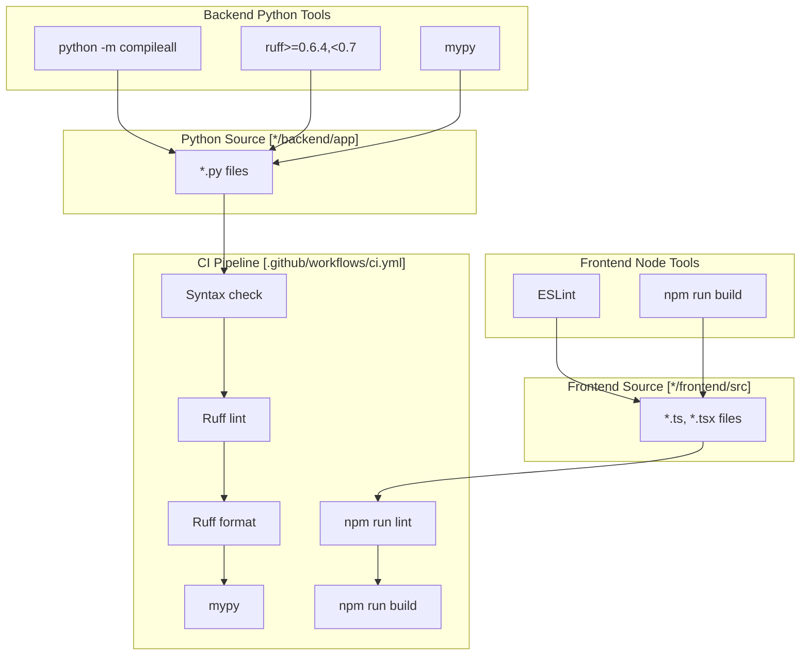
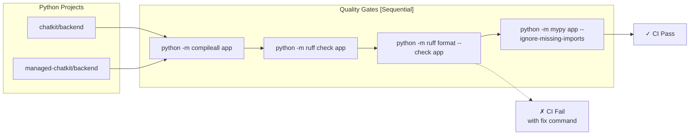
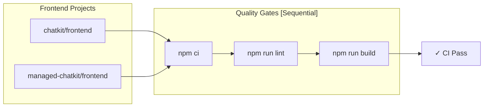
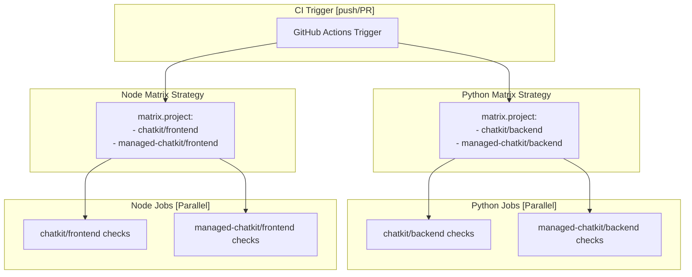

<!-- source: DeepWiki mcp.deepwiki.com · repo openai/openai-chatkit-starter-app · page 5.3 Development Tools · fetched 2026-10-26 -->

# Development Tools

<details>
<summary>Relevant source files</summary>

The following files were used as context for generating this wiki page:

- [.github/workflows/ci.yml](.github/workflows/ci.yml)
- [chatkit/backend/pyproject.toml](chatkit/backend/pyproject.toml)

</details>


## Purpose and Scope

This page documents the development tools used across both starter applications (`chatkit/` and `managed-chatkit/`) for code quality enforcement, type checking, and validation. Both projects follow identical development tooling patterns, with Python backends using `ruff` and `mypy`, and JavaScript frontends using `ESLint`.

These tools are configured as development dependencies and are invoked both locally during development and automatically in the CI/CD pipeline. For information about the CI/CD integration, see page 6. For production runtime dependencies, see pages 5.1 (Backend) and 5.2 (Frontend).

## Development Tools Overview

Both starter applications use language-specific development tools for code quality:

| Component | Tools | Purpose |
|-----------|-------|---------|
| **Backend (Python)** | `ruff`<br/>`mypy`<br/>`compileall` | Linting, formatting, type checking, syntax validation |
| **Frontend (Node.js)** | `ESLint`<br/>`Vite` | Code linting, build verification |

**Sources:** [chatkit/backend/pyproject.toml:13-16](), [.github/workflows/ci.yml:36-54](), [.github/workflows/ci.yml:81-87]()

## Development Tools Architecture

### Tool Invocation Flow



Development tools are defined in `pyproject.toml` for Python projects and invoked during CI validation. Frontend tools are installed via `npm ci` and invoked through npm scripts.

**Sources:** [chatkit/backend/pyproject.toml:13-16](), [.github/workflows/ci.yml:36-87]()

## Python Development Tools

### Ruff: Linting and Formatting

`ruff` is an extremely fast Python linter and formatter written in Rust. It is specified as a development dependency in [chatkit/backend/pyproject.toml:15]():

```
ruff>=0.6.4,<0.7
```

#### Ruff Capabilities

| Function | Command | Purpose |
|----------|---------|---------|
| **Linting** | `python -m ruff check app` | Identifies code quality issues, unused imports, and style violations |
| **Formatting** | `python -m ruff format app` | Auto-formats code to consistent style |
| **Format Check** | `python -m ruff format --check app` | Validates formatting without modifying files (CI mode) |

#### Ruff in CI Pipeline

The CI workflow executes ruff in two phases:

1. **Lint Check** ([.github/workflows/ci.yml:40-42]()):
   ```bash
   python -m ruff check app
   ```
   Validates code against linting rules.

2. **Format Check** ([.github/workflows/ci.yml:44-50]()):
   ```bash
   python -m ruff format --check app
   ```
   Ensures all code is formatted consistently. On failure, the CI provides actionable error message suggesting local fix command.

**Sources:** [chatkit/backend/pyproject.toml:15](), [.github/workflows/ci.yml:40-50]()

### mypy: Static Type Checking

`mypy` is a static type checker for Python that validates type annotations. It is installed in the CI environment ([.github/workflows/ci.yml:34]()) but not declared in `pyproject.toml` as a dev dependency, indicating it's a CI-only tool.

#### mypy Configuration

The CI runs mypy with the following command ([.github/workflows/ci.yml:52-54]()):

```bash
python -m mypy app --ignore-missing-imports
```

The `--ignore-missing-imports` flag allows type checking even when third-party libraries lack type stubs.

#### mypy Purpose

`mypy` validates that:
- Function parameters match their type annotations
- Return values match declared return types
- Variables are used consistently with their declared types
- Type annotations are correct throughout the codebase

This catches type-related bugs before runtime, improving code reliability.

**Sources:** [.github/workflows/ci.yml:34](), [.github/workflows/ci.yml:52-54]()

### Python Syntax Validation

Before running any quality tools, the CI performs basic Python syntax validation using the built-in `compileall` module ([.github/workflows/ci.yml:36-38]()):

```bash
python -m compileall app
```

This verifies that all `.py` files can be parsed successfully and contain valid Python syntax. This fast check fails quickly if there are obvious syntax errors.

**Sources:** [.github/workflows/ci.yml:36-38]()

## Node.js Development Tools

### ESLint: Frontend Code Linting

Both frontend applications (`chatkit/frontend` and `managed-chatkit/frontend`) use ESLint for JavaScript/TypeScript code quality enforcement. ESLint is invoked via npm scripts during CI validation.

#### ESLint in CI Pipeline

The CI workflow runs ESLint for both frontend projects ([.github/workflows/ci.yml:81-83]()):

```bash
npm run lint
```

This executes the `lint` script defined in each frontend's `package.json`, which typically runs ESLint against the source code to identify:
- Syntax errors
- Code style violations
- Common programming mistakes
- React-specific issues (hooks rules, etc.)

**Sources:** [.github/workflows/ci.yml:81-83]()

### Vite Build Verification

In addition to linting, the CI performs a production build test ([.github/workflows/ci.yml:85-87]()):

```bash
npm run build
```

This verifies that:
- All TypeScript code compiles successfully
- All imports resolve correctly
- The Vite bundler can generate production-ready artifacts
- No build-time errors exist

A successful build confirms the application can be deployed.

**Sources:** [.github/workflows/ci.yml:85-87]()

## CI/CD Quality Gates

### Python Quality Pipeline



The Python quality pipeline runs four sequential checks. If ruff format check fails, the CI output includes the command to run locally to fix formatting issues.

**Sources:** [.github/workflows/ci.yml:36-54]()

### Node.js Quality Pipeline



The frontend quality pipeline installs dependencies with `npm ci` (using lockfile), runs ESLint, and performs a production build verification.

**Sources:** [.github/workflows/ci.yml:77-87]()

## Local Development Usage

### Running Python Quality Tools Locally

Developers should run quality tools locally before committing code:

#### Install Development Dependencies

```bash
cd chatkit/backend  # or managed-chatkit/backend
python -m pip install ".[dev]"
python -m pip install mypy
```

This installs `ruff` and `mypy` ([.github/workflows/ci.yml:32-34]()).

#### Check Code Quality

```bash
# Syntax check
python -m compileall app

# Lint
python -m ruff check app

# Format check
python -m ruff format --check app

# Apply formatting (if needed)
python -m ruff format app

# Type check
python -m mypy app --ignore-missing-imports
```

Running these commands locally before pushing ensures CI will pass.

**Sources:** [.github/workflows/ci.yml:36-54]()

### Running Node.js Quality Tools Locally

For frontend development:

```bash
cd chatkit/frontend  # or managed-chatkit/frontend

# Install dependencies
npm ci

# Lint
npm run lint

# Build verification
npm run build
```

The `npm ci` command installs exact versions from `package-lock.json`, ensuring consistency with CI ([.github/workflows/ci.yml:79]()).

**Sources:** [.github/workflows/ci.yml:77-87]()

## Matrix Strategy for Multi-Project Validation

### Parallel Project Validation



The CI workflow uses GitHub Actions matrix strategy to validate all four projects in parallel ([.github/workflows/ci.yml:14-17]() and [.github/workflows/ci.yml:62-64]()). The `fail-fast: false` configuration ([.github/workflows/ci.yml:13](), [.github/workflows/ci.yml:60]()) ensures all projects are validated even if one fails, providing comprehensive feedback.

**Sources:** [.github/workflows/ci.yml:12-17](), [.github/workflows/ci.yml:59-64]()

## Version Constraints

Development dependencies use caret (`^`) version constraints, allowing automatic minor and patch updates:

- `typescript@^5`: Accepts versions 5.x.x
- `eslint@^9`: Accepts versions 9.x.x  
- `tailwindcss@^4`: Accepts versions 4.x.x

The exception is `eslint-config-next@15.5.4` ([package.json:28]()), which uses an exact version to match the Next.js core dependency version ([package.json:13]()), ensuring compatibility between Next.js and its ESLint configuration.

Type definition packages use caret constraints matching their corresponding runtime library versions.

**Sources:** [package.json:21-31]()

---

