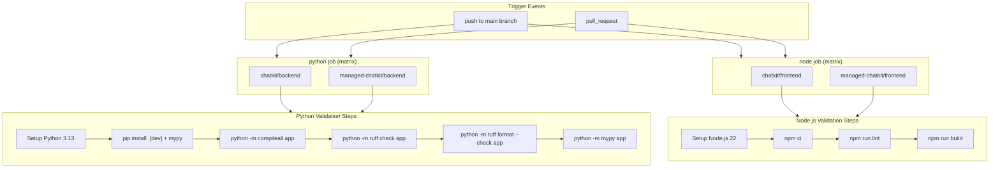
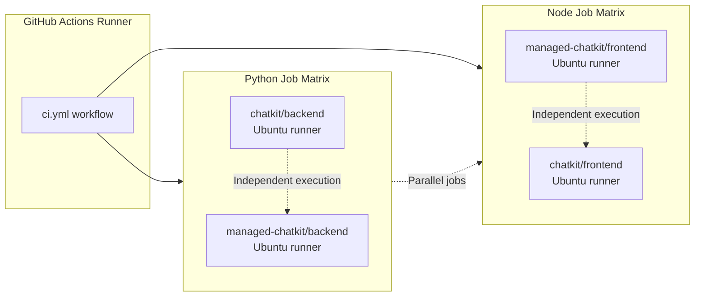
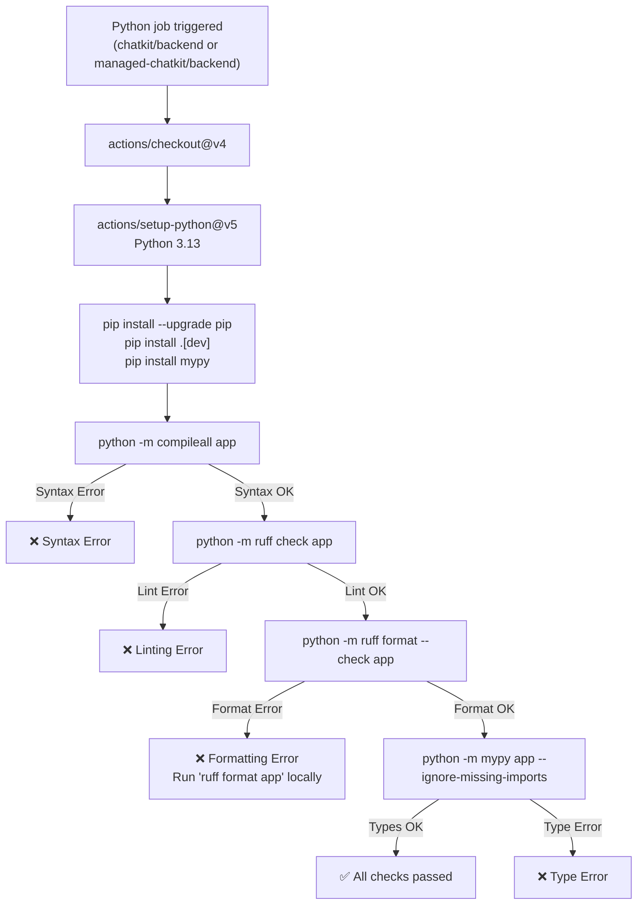
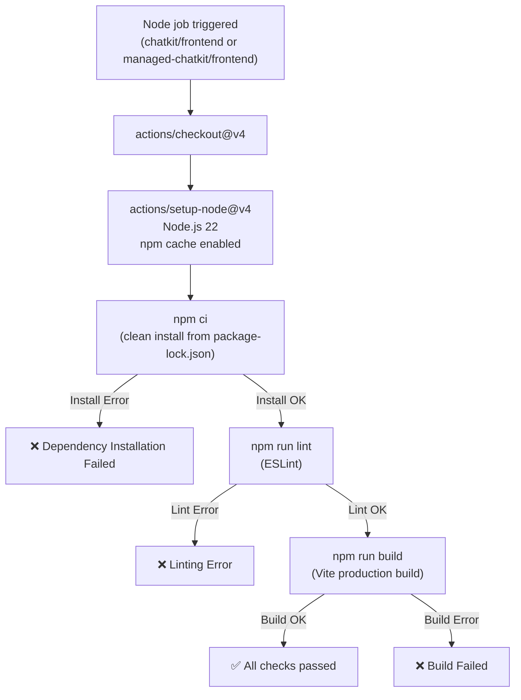

<!-- source: DeepWiki mcp.deepwiki.com · repo openai/openai-chatkit-starter-app · page 6 CI/CD Pipeline · fetched 2026-10-26 -->

# CI/CD Pipeline

<details>
<summary>Relevant source files</summary>

The following files were used as context for generating this wiki page:

- [.github/workflows/ci.yml](.github/workflows/ci.yml)

</details>


## Purpose and Scope

This document describes the automated CI/CD pipeline implemented using GitHub Actions that validates code quality across all four projects in the repository. The pipeline runs on every push to `main` and on all pull requests, executing parallel validation jobs for both Python backends and Node.js frontends.

For information about local development workflows and running these tools manually, see [Development Workflow](#7). For details on the specific dependencies being validated, see [Dependencies & Package Management](#5).

---

## Overview

The CI/CD pipeline is defined in [.github/workflows/ci.yml:1-88]() and implements a comprehensive validation strategy that ensures code quality standards are maintained across both integration patterns (self-hosted and managed ChatKit).

The pipeline consists of two independent job types that run in parallel:

| Job Type | Projects Validated | Primary Tools |
|----------|-------------------|---------------|
| `python` | `chatkit/backend`, `managed-chatkit/backend` | compileall, ruff, mypy |
| `node` | `chatkit/frontend`, `managed-chatkit/frontend` | ESLint, npm build |

**Key Design Decisions:**

- **Matrix Strategy**: Each job uses a matrix to validate multiple projects in parallel [.github/workflows/ci.yml:12-17]() and [.github/workflows/ci.yml:59-64]()
- **fail-fast: false**: Both jobs are configured with `fail-fast: false` [.github/workflows/ci.yml:13]() and [.github/workflows/ci.yml:60](), ensuring all projects are validated even if one fails
- **Consistent Tooling**: Both backend projects undergo identical validation steps; both frontend projects undergo identical validation steps

### CI/CD Pipeline Architecture



**Sources:** [.github/workflows/ci.yml:1-88]()

---

## Workflow Configuration

The CI workflow is triggered by two events defined in [.github/workflows/ci.yml:3-6]():

```yaml
on:
  push:
    branches: [ main ]
  pull_request:
```

This configuration ensures that:
- All commits pushed to the `main` branch are validated
- All pull requests are validated regardless of target branch

### Matrix Strategy

Both the `python` and `node` jobs utilize GitHub Actions matrix strategy to validate multiple projects in parallel:

**Python Job Matrix** [.github/workflows/ci.yml:12-17]():
```yaml
strategy:
  fail-fast: false
  matrix:
    project:
      - chatkit/backend
      - managed-chatkit/backend
```

**Node Job Matrix** [.github/workflows/ci.yml:59-64]():
```yaml
strategy:
  fail-fast: false
  matrix:
    project:
      - managed-chatkit/frontend
      - chatkit/frontend
```

The `fail-fast: false` configuration is critical: it ensures that all matrix combinations complete even if one fails, providing comprehensive feedback on all projects in a single CI run.

### Parallel Execution Model



All four projects are validated independently on separate `ubuntu-latest` runners [.github/workflows/ci.yml:11]() and [.github/workflows/ci.yml:58](), maximizing parallelization and minimizing total CI execution time.

**Sources:** [.github/workflows/ci.yml:3-17](), [.github/workflows/ci.yml:56-64]()

---

## Python Quality Checks

The Python validation pipeline implements a four-stage quality gate for both backend projects. Each project is validated in its own working directory using the `working-directory` configuration [.github/workflows/ci.yml:28]().

### Environment Setup

**Step 1: Checkout Repository** [.github/workflows/ci.yml:19-20]()
```yaml
- name: Checkout
  uses: actions/checkout@v4
```

**Step 2: Setup Python** [.github/workflows/ci.yml:22-25]()
```yaml
- name: Set up Python
  uses: actions/setup-python@v5
  with:
    python-version: "3.13"
```

Python 3.13 is used in CI, which is compatible with the project's minimum requirement of Python 3.11+.

**Step 3: Install Dependencies** [.github/workflows/ci.yml:27-34]()
```yaml
- name: Install dependencies (${{ matrix.project }})
  working-directory: ${{ matrix.project }}
  env:
    PIP_DISABLE_PIP_VERSION_CHECK: "1"
  run: |
    python -m pip install --upgrade pip
    python -m pip install ".[dev]"
    python -m pip install mypy
```

This step:
- Upgrades `pip` to the latest version
- Installs the project in editable mode with development dependencies using `.[dev]`
- Explicitly installs `mypy` for type checking

### Validation Stages

#### Stage 1: Syntax Check

**Command** [.github/workflows/ci.yml:36-38]():
```bash
python -m compileall app
```

The `compileall` module verifies that all Python files in the `app` directory compile without syntax errors. This is the fastest check and catches basic Python syntax violations before proceeding to more expensive analysis.

#### Stage 2: Ruff Lint

**Command** [.github/workflows/ci.yml:40-42]():
```bash
python -m ruff check app
```

Ruff performs linting analysis to identify code quality issues, potential bugs, and style violations. The tool checks against a comprehensive ruleset configured in each project's `pyproject.toml`.

#### Stage 3: Ruff Format Check

**Command** [.github/workflows/ci.yml:44-50]():
```bash
python -m ruff format --check app || {
  echo "::error ::Ruff format check failed. Run 'python -m ruff format app' locally to apply formatting.";
  exit 1;
}
```

The `--check` flag verifies code formatting without modifying files. If formatting issues are detected, the job fails with a helpful error message instructing developers how to fix the issues locally.

#### Stage 4: Type Checking with mypy

**Command** [.github/workflows/ci.yml:52-54]():
```bash
python -m mypy app --ignore-missing-imports
```

The final validation stage runs static type analysis using `mypy`. The `--ignore-missing-imports` flag allows the check to proceed even when type stubs for third-party libraries are unavailable.

### Python Validation Pipeline Flow



**Sources:** [.github/workflows/ci.yml:8-54]()

---

## Node.js Quality Checks

The Node.js validation pipeline implements a three-stage quality gate for both frontend projects, verifying dependency installation, linting compliance, and successful build execution.

### Environment Setup

**Step 1: Checkout Repository** [.github/workflows/ci.yml:67-68]()
```yaml
- name: Checkout repository
  uses: actions/checkout@v4
```

**Step 2: Setup Node.js** [.github/workflows/ci.yml:70-75]()
```yaml
- name: Setup Node.js
  uses: actions/setup-node@v4
  with:
    node-version: 22
    cache-dependency-path: ${{ matrix.project }}/package-lock.json
    cache: "npm"
```

This step:
- Installs Node.js version 22 to match the project requirements
- Configures npm caching using the project-specific `package-lock.json` path
- Caches the global npm cache directory to accelerate subsequent runs

### Validation Stages

#### Stage 1: Install Dependencies

**Command** [.github/workflows/ci.yml:77-79]():
```bash
npm ci
```

The `npm ci` (clean install) command:
- Installs dependencies from `package-lock.json` exactly as specified
- Removes `node_modules` if it exists to ensure a clean state
- Is faster and more reliable than `npm install` in CI environments

#### Stage 2: ESLint

**Command** [.github/workflows/ci.yml:81-83]():
```bash
npm run lint
```

This command executes the `lint` script defined in each frontend's `package.json`, which runs ESLint to enforce code style and identify potential issues in TypeScript/JavaScript files.

#### Stage 3: Build Verification

**Command** [.github/workflows/ci.yml:85-87]():
```bash
npm run build
```

The final stage executes the production build process using Vite. This ensures:
- All TypeScript files compile without errors
- All imports resolve correctly
- The application can be successfully bundled for deployment

### Node.js Validation Pipeline Flow



**Sources:** [.github/workflows/ci.yml:56-88]()

---

## Summary

The CI/CD pipeline provides comprehensive validation coverage through:

| Validation Type | Projects | Tools | Purpose |
|----------------|----------|-------|---------|
| Python Quality | `chatkit/backend`, `managed-chatkit/backend` | compileall, ruff, mypy | Syntax validation, linting, formatting, type checking |
| Node.js Quality | `chatkit/frontend`, `managed-chatkit/frontend` | ESLint, Vite | Code style enforcement, build verification |

The pipeline executes automatically on all pushes to `main` and on all pull requests, with a `fail-fast: false` configuration ensuring comprehensive feedback across all four projects. This design enables rapid iteration while maintaining code quality standards across both self-hosted and managed integration patterns.

**Sources:** [.github/workflows/ci.yml:1-88]()

---

