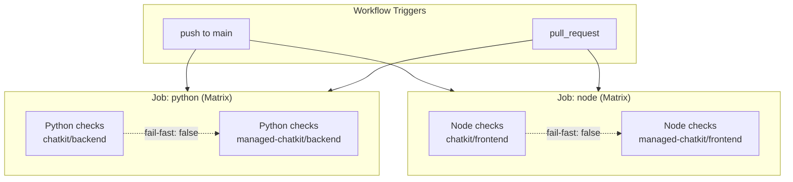
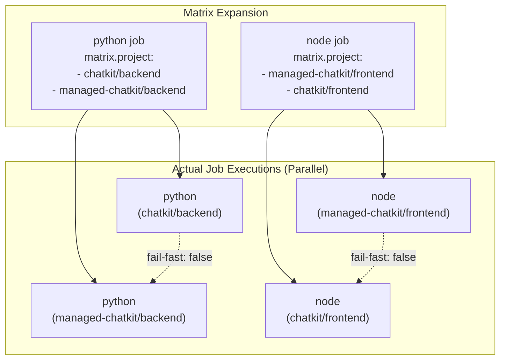
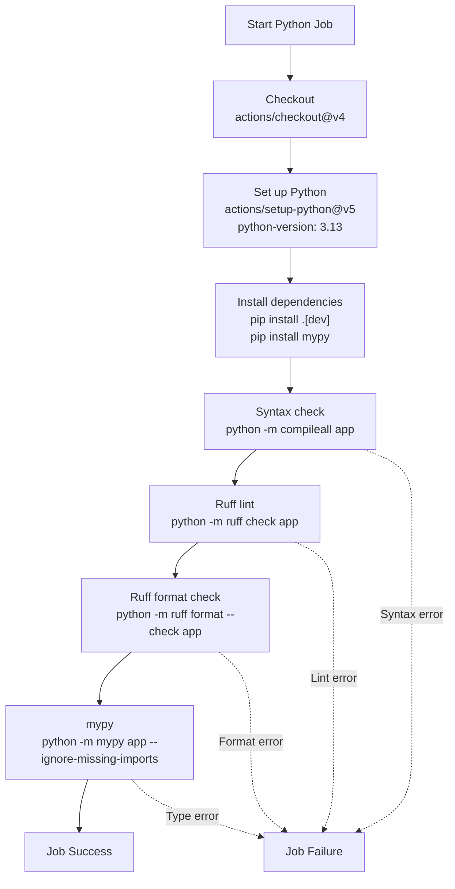
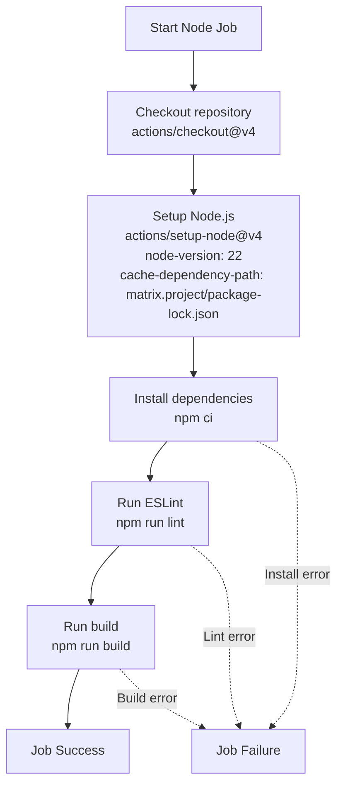
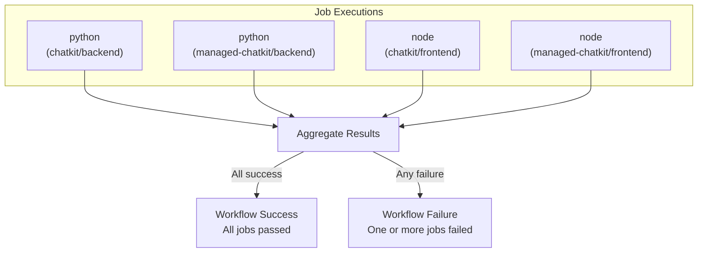
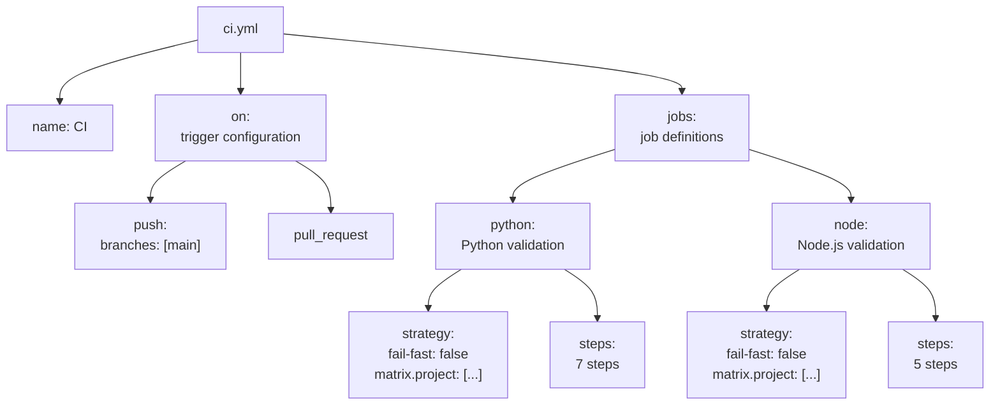

<!-- source: DeepWiki mcp.deepwiki.com · repo openai/openai-chatkit-starter-app · page 6.1 Workflow Configuration · fetched 2026-10-26 -->

# Workflow Configuration

<details>
<summary>Relevant source files</summary>

The following files were used as context for generating this wiki page:

- [.github/workflows/ci.yml](.github/workflows/ci.yml)

</details>


## Purpose and Scope

This document describes the GitHub Actions CI workflow configuration defined in [.github/workflows/ci.yml:1-88](). The workflow automates code quality checks and build validation for all four projects in the repository (two Python backends and two Node.js frontends) using a parallel execution strategy. This page focuses on the workflow structure, job matrix configuration, and parallel execution model.

## Workflow Overview

The CI workflow defines two independent jobs (`python` and `node`) that execute in parallel. Each job uses a matrix strategy to run multiple project validations concurrently, resulting in four total job executions per workflow run.

**Diagram: Workflow Structure and Parallel Execution**



**Sources:** [.github/workflows/ci.yml:1-88]()
</thinking>

## Workflow Triggers

The workflow is triggered by two event types, configured in [.github/workflows/ci.yml:3-7]():

| Trigger | Configuration | Purpose |
|---------|--------------|---------|
| `push` | `branches: [ main ]` | Validates all commits pushed directly to the main branch |
| `pull_request` | No branch filter | Validates all pull requests regardless of target branch |

The `push` trigger is branch-restricted to `main` to avoid redundant runs on feature branches (which are already validated via pull requests). The `pull_request` trigger has no branch filter, meaning it runs for PRs targeting any branch.

**Sources:** [.github/workflows/ci.yml:3-7]()

## Workflow Triggers

The workflow is triggered by two event types, configured in [.github/workflows/ci.yml:3-6]():

| Trigger | Configuration | Purpose |
|---------|--------------|---------|
| `push` | `branches: [ main ]` | Validates all commits pushed directly to the main branch |
| `pull_request` | No branch filter | Validates all pull requests regardless of target branch |

The `push` trigger is branch-restricted to `main` to avoid redundant runs on feature branches (which are already validated via pull requests). The `pull_request` trigger has no branch filter, meaning it runs for PRs targeting any branch.

**Sources:** [.github/workflows/ci.yml:3-6]()

## Job Structure and Matrix Strategy

The workflow defines two jobs: `python` and `node`. Each job uses a matrix strategy to execute across multiple projects, with `fail-fast: false` ensuring all matrix combinations run even if one fails.

### Python Job Configuration

The `python` job is defined at [.github/workflows/ci.yml:9-54]() with the following structure:

| Property | Value | Description |
|----------|-------|-------------|
| Job ID | `python` | Internal identifier for the job |
| `name` | `Python checks (${{ matrix.project }})` | Dynamic name including the current matrix project |
| `runs-on` | `ubuntu-latest` | Ubuntu Linux execution environment |
| `strategy.fail-fast` | `false` | Continue running other matrix jobs even if one fails |
| `strategy.matrix.project` | `["chatkit/backend", "managed-chatkit/backend"]` | Project paths to validate |

### Node Job Configuration

The `node` job is defined at [.github/workflows/ci.yml:56-88]() with the following structure:

| Property | Value | Description |
|----------|-------|-------------|
| Job ID | `node` | Internal identifier for the job |
| `name` | `Node checks (${{ matrix.project }})` | Dynamic name including the current matrix project |
| `runs-on` | `ubuntu-latest` | Ubuntu Linux execution environment |
| `strategy.fail-fast` | `false` | Continue running other matrix jobs even if one fails |
| `strategy.matrix.project` | `["managed-chatkit/frontend", "chatkit/frontend"]` | Project paths to validate |

**Sources:** [.github/workflows/ci.yml:9-88]()

## Matrix Execution Strategy

The `fail-fast: false` configuration at [.github/workflows/ci.yml:12]() and [.github/workflows/ci.yml:59]() is critical for comprehensive validation. This setting ensures that if one project fails validation, the other projects continue to run, providing complete feedback on all validation failures in a single workflow run.

**Diagram: Matrix Expansion and Parallel Execution**



Each matrix combination creates an independent job execution with its own runner, environment, and isolated filesystem. The jobs run in parallel subject to GitHub Actions runner availability.

**Sources:** [.github/workflows/ci.yml:9-88]()

## Python Job Steps

The `python` job executes six steps sequentially for each matrix project. All steps use `working-directory: ${{ matrix.project }}` to operate within the project-specific directory.

**Diagram: Python Job Step Flow**



### Step 1: Checkout

[.github/workflows/ci.yml:19-20]() - Uses `actions/checkout@v4` to clone the repository to the runner workspace.

### Step 2: Set up Python

[.github/workflows/ci.yml:22-25]() - Uses `actions/setup-python@v5` to install Python 3.13.

### Step 3: Install Dependencies

[.github/workflows/ci.yml:27-34]() - Installs project dependencies within the matrix project directory:

```bash
python -m pip install --upgrade pip
python -m pip install ".[dev]"
python -m pip install mypy
```

The `PIP_DISABLE_PIP_VERSION_CHECK: "1"` environment variable suppresses pip version check warnings to keep logs clean.

### Step 4: Syntax Check

[.github/workflows/ci.yml:36-38]() - Runs `python -m compileall app` to verify Python syntax without executing code.

### Step 5: Ruff Lint

[.github/workflows/ci.yml:40-42]() - Runs `python -m ruff check app` to validate code style and detect common errors.

### Step 6: Ruff Format Check

[.github/workflows/ci.yml:44-50]() - Runs `python -m ruff format --check app` to verify code formatting. On failure, outputs an error message instructing developers to run the formatter locally.

### Step 7: mypy Type Check

[.github/workflows/ci.yml:52-54]() - Runs `python -m mypy app --ignore-missing-imports` to perform static type checking.

**Sources:** [.github/workflows/ci.yml:18-54]()

## Node Job Steps

The `node` job executes five steps sequentially for each matrix project. All steps use `working-directory: ${{ matrix.project }}` to operate within the project-specific directory.

**Diagram: Node Job Step Flow**



### Step 1: Checkout Repository

[.github/workflows/ci.yml:67-68]() - Uses `actions/checkout@v4` to clone the repository to the runner workspace.

### Step 2: Setup Node.js

[.github/workflows/ci.yml:70-75]() - Uses `actions/setup-node@v4` with project-specific caching:

| Parameter | Value | Purpose |
|-----------|-------|---------|
| `node-version` | `22` | Installs Node.js version 22 |
| `cache-dependency-path` | `${{ matrix.project }}/package-lock.json` | Specifies the lock file path for cache key computation |
| `cache` | `"npm"` | Enables npm dependency caching |

The `cache-dependency-path` parameter is essential for matrix jobs because it ensures the cache key is computed from the correct project's `package-lock.json` file, not a monorepo root file.

### Step 3: Install Dependencies

[.github/workflows/ci.yml:77-79]() - Runs `npm ci` within the project directory to install exact dependency versions from `package-lock.json`.

### Step 4: Run ESLint

[.github/workflows/ci.yml:81-83]() - Executes `npm run lint` to validate code style and TypeScript correctness.

### Step 5: Run Build

[.github/workflows/ci.yml:85-87]() - Executes `npm run build` to compile TypeScript and bundle the application, verifying that the project builds successfully.

**Sources:** [.github/workflows/ci.yml:66-87]()

## Workflow Success Criteria

A workflow run succeeds only when all four matrix job executions complete successfully. The workflow fails if any job fails, but the `fail-fast: false` setting ensures all jobs run to completion regardless of failures in other jobs.

**Diagram: Workflow Status Aggregation**



This aggregation model provides comprehensive feedback while allowing all validations to complete, making it easier to fix multiple issues in a single iteration.

**Sources:** [.github/workflows/ci.yml:1-88]()

## Working Directory Configuration

Each step in the matrix jobs uses `working-directory: ${{ matrix.project }}` to operate within the project-specific directory. This configuration appears in:

- Python job: [.github/workflows/ci.yml:28,37,41,45,53]()
- Node job: [.github/workflows/ci.yml:78,82,86]()

The `${{ matrix.project }}` variable resolves to:
- `chatkit/backend`
- `managed-chatkit/backend`
- `chatkit/frontend`
- `managed-chatkit/frontend`

This approach allows the same step definitions to execute across different projects without code duplication.

**Sources:** [.github/workflows/ci.yml:28-86]()

## Runner Environment

Both jobs use `runs-on: ubuntu-latest` runners, which provide:

| Software | Purpose in Workflow |
|----------|---------------------|
| Git 2.x | Used by `actions/checkout@v4` to clone repository |
| Python runtime | Base Python installation, replaced by `actions/setup-python@v5` |
| Node.js runtime | Base Node.js installation, replaced by `actions/setup-node@v4` |
| Build tools (gcc, make) | Used by native npm dependencies during installation |
| pip | Python package manager for installing dependencies |
| npm | Node.js package manager for installing dependencies |

The runner provides approximately 14 GB of RAM and 2-core CPU, sufficient for building both Python and Node.js applications.

**Sources:** [.github/workflows/ci.yml:11,58]()

## Configuration File Structure

The complete workflow configuration follows GitHub Actions YAML syntax with matrix job definitions:

**Diagram: YAML Configuration Hierarchy**



The workflow file is located at [.github/workflows/ci.yml:1-88]() and follows the standard GitHub Actions directory structure where workflows must reside in `.github/workflows/` to be recognized by GitHub.

**Sources:** [.github/workflows/ci.yml:1-88]()

## Workflow Execution Time

The typical execution time for each step (approximate, based on cache availability):

| Step | Uncached Time | Cached Time |
|------|---------------|-------------|
| Checkout repository | 2-5 seconds | 2-5 seconds |
| Setup Node.js | 10-15 seconds | 3-5 seconds |
| Install dependencies | 30-60 seconds | 10-20 seconds |
| Run ESLint | 3-5 seconds | 3-5 seconds |
| Run build | 20-40 seconds | 20-40 seconds |
| **Total** | **~65-125 seconds** | **~38-75 seconds** |

The npm cache provides the most significant time savings by eliminating package downloads from the npm registry. The Node.js version cache provides minor improvements by avoiding the download and extraction of the Node.js binary.

**Sources:** [.github/workflows/ci.yml:17-30]()

---

