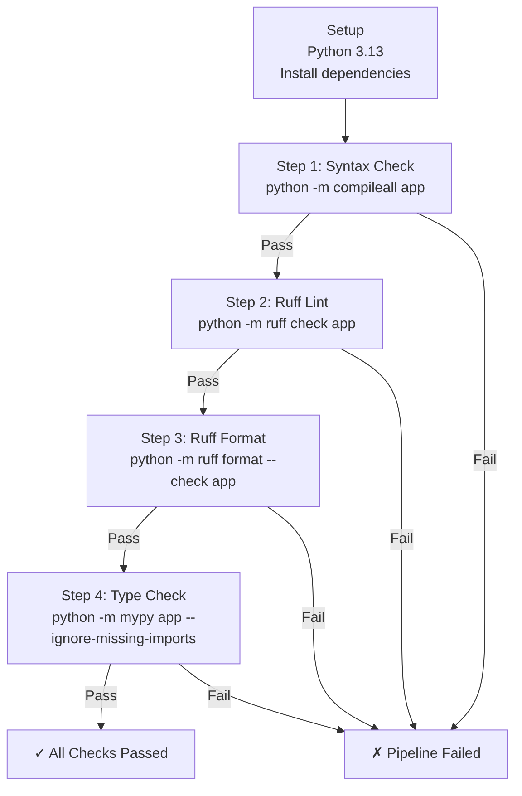
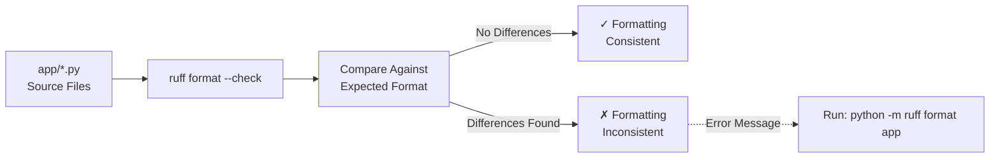
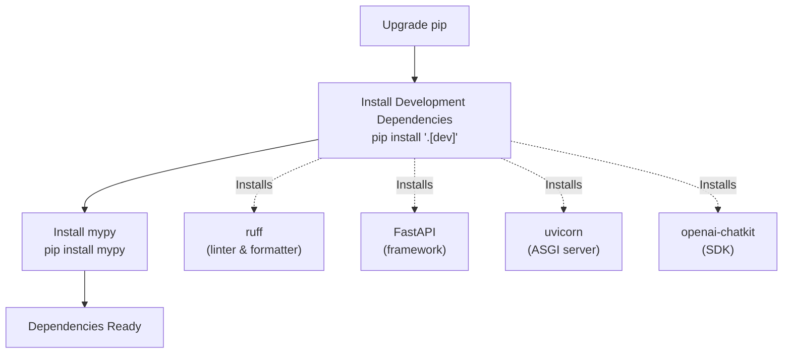
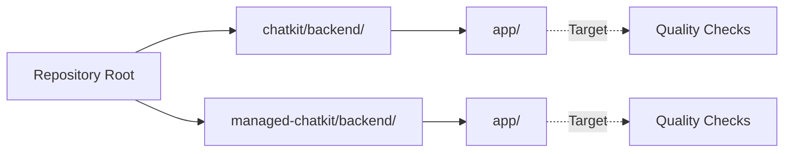

<!-- source: DeepWiki mcp.deepwiki.com · repo openai/openai-chatkit-starter-app · page 6.2 Python Quality Checks · fetched 2026-10-26 -->

# Python Quality Checks

<details>
<summary>Relevant source files</summary>

The following files were used as context for generating this wiki page:

- [.github/workflows/ci.yml](.github/workflows/ci.yml)

</details>


## Purpose and Scope

This document details the automated Python quality validation pipeline executed in the CI/CD workflow for both backend projects (`chatkit/backend` and `managed-chatkit/backend`). The pipeline runs four sequential checks to ensure code quality, style consistency, and type safety.

For information about the overall CI/CD workflow structure and job matrix configuration, see [Workflow Configuration](#6.1). For Node.js quality validation, see [Node.js Quality Checks](#6.3). For local development usage of these tools, see [Code Quality & Linting](#7.2).

**Sources:** [.github/workflows/ci.yml:9-54]()

---

## Pipeline Overview

The Python quality checks execute as a GitHub Actions job named `python` with a matrix strategy covering both backend projects. Each check must pass before proceeding to the next step, ensuring comprehensive validation.

### Sequential Validation Pipeline



**Sources:** [.github/workflows/ci.yml:36-54]()

---

## Project Matrix Configuration

The `python` job uses a matrix strategy to validate both backend projects in parallel while maintaining independent failure reporting:

| Configuration Key | Value |
|-------------------|-------|
| Job Name | `Python checks (${{ matrix.project }})` |
| Strategy | `fail-fast: false` |
| Matrix Projects | `chatkit/backend`, `managed-chatkit/backend` |
| Python Version | `3.13` |
| Runner | `ubuntu-latest` |

The `fail-fast: false` setting ensures that if one project fails validation, the other project continues executing its checks, providing comprehensive feedback across all projects.

**Sources:** [.github/workflows/ci.yml:9-25]()

---

## Step 1: Syntax Check

The first validation step uses Python's built-in `compileall` module to verify syntactic correctness of all Python source files in the `app` directory.

### Command Execution

```bash
python -m compileall app
```

### Validation Behavior

The `compileall` module:
- Recursively compiles all `.py` files in the `app` directory to bytecode
- Validates Python syntax without executing code
- Reports compilation errors with file path and line number
- Returns non-zero exit code if any file fails to compile

This check catches basic syntax errors such as:
- Indentation errors
- Invalid Python keywords
- Unclosed brackets, parentheses, or quotes
- Invalid token sequences

**Sources:** [.github/workflows/ci.yml:36-38]()

---

## Step 2: Ruff Lint

The second validation step runs Ruff's linting engine to enforce code quality rules and detect common programming errors.

### Command Execution

```bash
python -m ruff check app
```

### Linting Scope

Ruff performs static analysis on the `app` directory to identify:
- Unused imports and variables
- Undefined names
- Import order violations
- Code complexity issues
- Security vulnerabilities (e.g., hardcoded secrets)
- PEP 8 style violations
- Best practice violations

### Tool Characteristics

| Attribute | Details |
|-----------|---------|
| Implementation | Written in Rust for performance |
| Speed | 10-100x faster than traditional Python linters |
| Rule Sets | Compatible with Flake8, pycodestyle, isort, and others |
| Configuration | Defined in `pyproject.toml` or `ruff.toml` |

**Sources:** [.github/workflows/ci.yml:40-42]()

---

## Step 3: Ruff Format Check

The third validation step verifies code formatting consistency using Ruff's formatting engine in check-only mode.

### Command Execution

```bash
python -m ruff format --check app || {
  echo "::error ::Ruff format check failed. Run 'python -m ruff format app' locally to apply formatting.";
  exit 1;
}
```

### Check-Only Mode Behavior

The `--check` flag enables validation mode where Ruff:
- Analyzes code formatting without modifying files
- Compares current formatting against expected formatting
- Returns exit code 1 if formatting differences detected
- Outputs helpful error message directing developers to fix command

### Formatting Standards



The error output includes GitHub Actions annotation syntax (`::error ::`) to highlight formatting failures in the Actions UI.

**Sources:** [.github/workflows/ci.yml:44-50]()

---

## Step 4: Type Check with mypy

The final validation step uses mypy to perform static type checking, ensuring type safety and catching type-related errors before runtime.

### Command Execution

```bash
python -m mypy app --ignore-missing-imports
```

### Type Checking Configuration

| Flag | Purpose |
|------|---------|
| `--ignore-missing-imports` | Suppresses errors for third-party libraries without type stubs |
| Working Directory | `${{ matrix.project }}` (e.g., `chatkit/backend`) |
| Target Directory | `app` (relative to working directory) |

### Validation Coverage

mypy analyzes:
- Function parameter types
- Return value types
- Variable type annotations
- Type compatibility in assignments
- Generic type usage
- Optional type handling

The `--ignore-missing-imports` flag prevents failures when validating code that imports libraries lacking type stubs, focusing validation on the application code itself rather than third-party dependencies.

**Sources:** [.github/workflows/ci.yml:52-54]()

---

## Dependency Installation

Before executing quality checks, the workflow installs all necessary dependencies using pip.

### Installation Commands

```bash
python -m pip install --upgrade pip
python -m pip install ".[dev]"
python -m pip install mypy
```

### Installation Flow



The `.[dev]` syntax installs the package in editable mode along with development dependencies defined in the `[project.optional-dependencies]` section of `pyproject.toml`. mypy is installed separately as it may not be included in all project configurations.

**Sources:** [.github/workflows/ci.yml:27-34]()

---

## Execution Environment

### Environment Variables

| Variable | Value | Purpose |
|----------|-------|---------|
| `PIP_DISABLE_PIP_VERSION_CHECK` | `"1"` | Suppresses pip version warnings in CI output |

### Working Directory Context

Each quality check executes within the matrix project's working directory:



The `working-directory: ${{ matrix.project }}` directive ensures all commands execute in the correct project context, allowing relative path references like `app` to resolve properly.

**Sources:** [.github/workflows/ci.yml:28-54]()

---

## Quality Check Summary

The following table summarizes the purpose and validation scope of each quality check:

| Step | Tool | Primary Purpose | Secondary Purpose | Exit Code on Failure |
|------|------|-----------------|-------------------|---------------------|
| 1 | `compileall` | Syntax validation | Catch compilation errors | Non-zero |
| 2 | `ruff check` | Linting | Code quality & style enforcement | Non-zero |
| 3 | `ruff format --check` | Format validation | Ensure consistent formatting | 1 |
| 4 | `mypy` | Type checking | Static type safety validation | Non-zero |

Each check must pass (exit code 0) for the overall pipeline to succeed. The sequential execution ensures that basic syntax errors are caught before running more sophisticated analysis tools.

**Sources:** [.github/workflows/ci.yml:36-54]()

---

