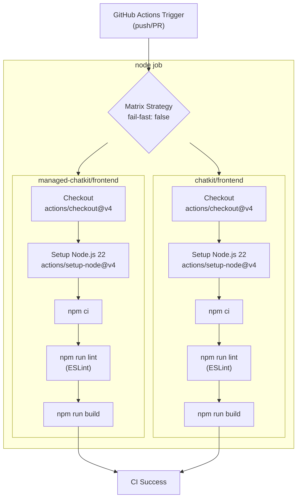
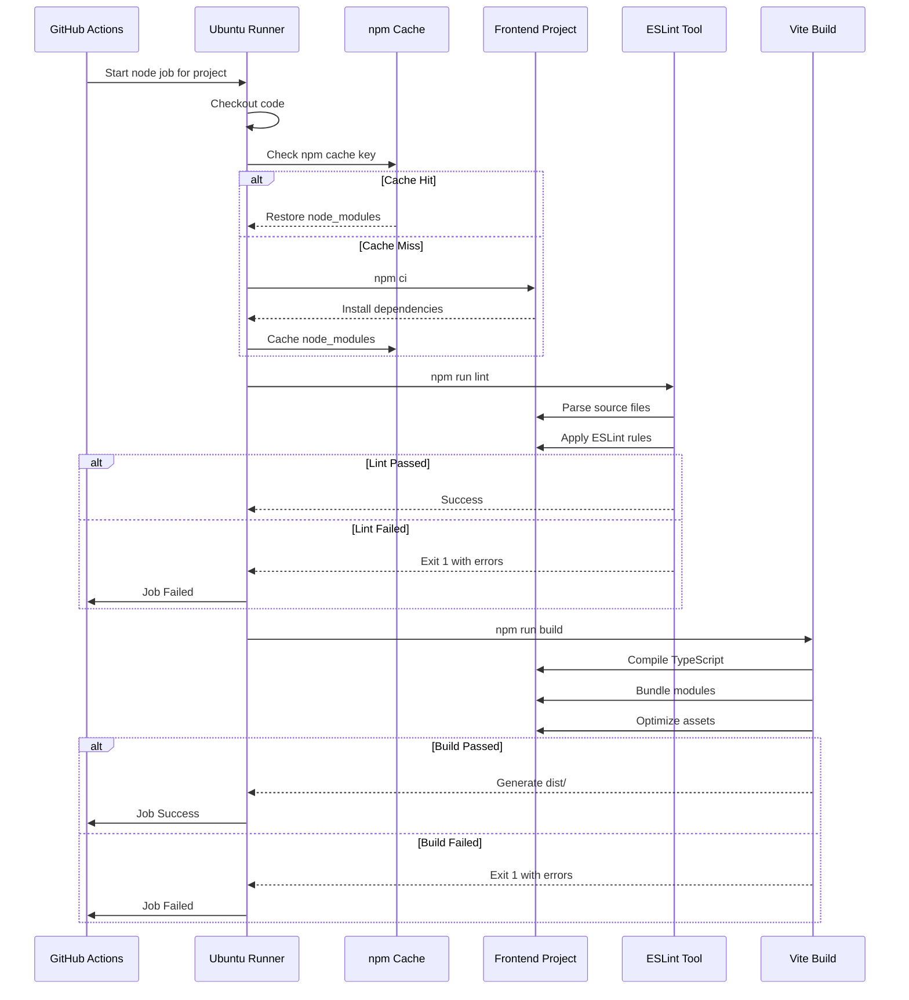
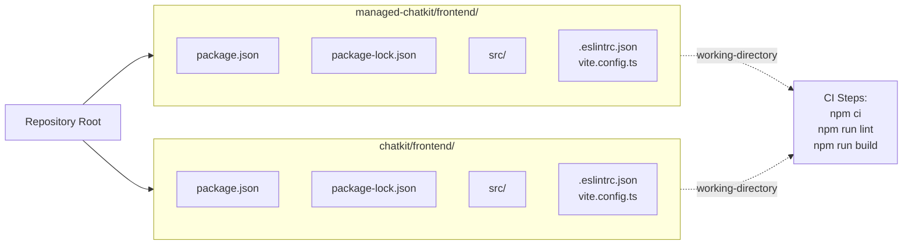

<!-- source: DeepWiki mcp.deepwiki.com · repo openai/openai-chatkit-starter-app · page 6.3 Node.js Quality Checks · fetched 2026-10-26 -->

# Node.js Quality Checks

<details>
<summary>Relevant source files</summary>

The following files were used as context for generating this wiki page:

- [.github/workflows/ci.yml](.github/workflows/ci.yml)

</details>


This document details the automated Node.js quality validation pipeline executed by GitHub Actions for both frontend projects in the repository. The pipeline ensures code quality and build integrity through linting and build verification.

For information about the overall CI/CD workflow structure and triggers, see [Workflow Configuration](#6.1). For Python validation steps, see [Python Quality Checks](#6.2).

---

## Overview

The Node.js quality checks job validates both frontend projects (`chatkit/frontend` and `managed-chatkit/frontend`) in parallel. Each project undergoes three validation stages: dependency installation, ESLint linting, and production build verification. The job runs on every push to the `main` branch and on all pull requests.

**Sources:** [.github/workflows/ci.yml:56-87]()

---

## Job Configuration

The `node` job executes quality checks for frontend projects using a matrix strategy that processes both projects in parallel.

### Job Matrix

| Property | Value |
|----------|-------|
| **Job Name** | `node` |
| **Display Name** | `Node checks (${{ matrix.project }})` |
| **Runner** | `ubuntu-latest` |
| **Fail-fast** | `false` (all projects run even if one fails) |
| **Matrix Projects** | `managed-chatkit/frontend`, `chatkit/frontend` |

The `fail-fast: false` configuration ensures comprehensive feedback by running checks on all projects regardless of individual failures.

**Sources:** [.github/workflows/ci.yml:56-65]()

---

## CI Node.js Validation Pipeline



**Diagram: Complete Node.js validation pipeline showing parallel execution for both frontend projects**

**Sources:** [.github/workflows/ci.yml:56-87]()

---

## Validation Steps

### Step 1: Repository Checkout

The first step checks out the repository code using GitHub's official checkout action.

```yaml
- name: Checkout repository
  uses: actions/checkout@v4
```

This step provides access to all project files required for subsequent validation steps.

**Sources:** [.github/workflows/ci.yml:67-68]()

---

### Step 2: Node.js Environment Setup

The pipeline sets up Node.js version 22 with npm caching enabled for faster subsequent runs.

```yaml
- name: Setup Node.js
  uses: actions/setup-node@v4
  with:
    node-version: 22
    cache-dependency-path: ${{ matrix.project }}/package-lock.json
    cache: "npm"
```

#### Configuration Details

| Parameter | Value | Purpose |
|-----------|-------|---------|
| `node-version` | `22` | Matches local development requirement |
| `cache-dependency-path` | `${{ matrix.project }}/package-lock.json` | Project-specific lockfile for cache key |
| `cache` | `"npm"` | Enables npm dependency caching |

The `cache-dependency-path` parameter uses the matrix variable to reference each project's specific `package-lock.json` file, ensuring accurate cache invalidation when dependencies change.

**Sources:** [.github/workflows/ci.yml:70-76]()

---

### Step 3: Dependency Installation

Dependencies are installed using `npm ci`, which provides reproducible builds from `package-lock.json`.

```yaml
- name: Install dependencies
  working-directory: ${{ matrix.project }}
  run: npm ci
```

#### npm ci vs npm install

The pipeline uses `npm ci` instead of `npm install` for several reasons:

| `npm ci` | `npm install` |
|----------|---------------|
| Installs exact versions from lockfile | May update dependencies |
| Fails if lockfile and package.json are out of sync | Attempts to reconcile differences |
| Removes `node_modules` before installation | Incrementally updates existing modules |
| Faster for CI environments | Optimized for development |

**Sources:** [.github/workflows/ci.yml:77-79]()

---

### Step 4: ESLint Code Quality

The pipeline executes ESLint to validate code quality, style consistency, and potential errors.

```yaml
- name: Run ESLint
  working-directory: ${{ matrix.project }}
  run: npm run lint
```

This step invokes the `lint` script defined in each project's `package.json`, which typically runs ESLint with project-specific configuration. ESLint validates:

- Code style consistency
- Potential runtime errors
- React-specific best practices
- TypeScript type usage patterns

If ESLint detects violations, the step fails and provides detailed error messages indicating the file, line number, and rule violation.

**Sources:** [.github/workflows/ci.yml:81-83]()

---

### Step 5: Production Build Verification

The final validation step verifies that the project can be built successfully for production deployment.

```yaml
- name: Run build
  working-directory: ${{ matrix.project }}
  run: npm run build
```

This step executes Vite's production build process, which:

1. Compiles TypeScript to JavaScript
2. Bundles all modules and dependencies
3. Optimizes assets (minification, tree-shaking)
4. Validates import/export resolution
5. Generates production-ready static assets

Build failures indicate issues such as:
- Type errors in TypeScript code
- Missing or incorrect imports
- Invalid JSX syntax
- Configuration errors in Vite or build tooling

**Sources:** [.github/workflows/ci.yml:85-87]()

---

## Validation Flow Sequence



**Diagram: Complete execution sequence for a single frontend project validation**

**Sources:** [.github/workflows/ci.yml:56-87]()

---

## Code Entity Mapping

The following table maps conceptual validation stages to specific code entities in the CI workflow:

| Concept | Code Entity | Location |
|---------|-------------|----------|
| Node validation job | `jobs.node` | [.github/workflows/ci.yml:56]() |
| Job display name | `Node checks (${{ matrix.project }})` | [.github/workflows/ci.yml:57]() |
| Project matrix | `matrix.project` | [.github/workflows/ci.yml:62-64]() |
| managed frontend path | `managed-chatkit/frontend` | [.github/workflows/ci.yml:63]() |
| chatkit frontend path | `chatkit/frontend` | [.github/workflows/ci.yml:64]() |
| Checkout step | `uses: actions/checkout@v4` | [.github/workflows/ci.yml:68]() |
| Node setup step | `uses: actions/setup-node@v4` | [.github/workflows/ci.yml:71]() |
| Node version | `node-version: 22` | [.github/workflows/ci.yml:73]() |
| Cache configuration | `cache: "npm"` | [.github/workflows/ci.yml:75]() |
| Dependency install | `npm ci` | [.github/workflows/ci.yml:79]() |
| Lint command | `npm run lint` | [.github/workflows/ci.yml:83]() |
| Build command | `npm run build` | [.github/workflows/ci.yml:87]() |

**Sources:** [.github/workflows/ci.yml:56-87]()

---

## Working Directory Context

All Node.js validation steps execute within the context of the specific frontend project directory specified by the matrix variable.



**Diagram: Working directory context for Node.js validation steps showing project-specific file access**

The `working-directory` parameter in each step ensures commands execute within the correct project context:

```yaml
working-directory: ${{ matrix.project }}
```

This parameter resolves to either `managed-chatkit/frontend` or `chatkit/frontend` depending on the matrix iteration.

**Sources:** [.github/workflows/ci.yml:78,82,86]()

---

## Failure Modes and Error Handling

The Node.js quality checks can fail at multiple stages, each providing specific diagnostic information:

### Failure Scenarios

| Stage | Failure Condition | Typical Causes |
|-------|-------------------|----------------|
| **Checkout** | Cannot access repository | Repository permissions, network issues |
| **Node Setup** | Cannot install Node.js | Invalid version specification, cache corruption |
| **npm ci** | Dependency installation fails | Missing packages, lockfile conflicts, network errors |
| **ESLint** | Linting rules violated | Code style violations, unused variables, type issues |
| **Build** | Build process fails | TypeScript errors, missing imports, configuration errors |

### Non-Blocking Failures

The `fail-fast: false` configuration ensures that failure in one project does not prevent validation of the other project. This provides comprehensive feedback on all frontend projects in a single CI run.

```yaml
strategy:
  fail-fast: false
  matrix:
    project:
      - managed-chatkit/frontend
      - chatkit/frontend
```

**Sources:** [.github/workflows/ci.yml:59-64]()

---

## Integration with Development Workflow

The Node.js quality checks enforce the same standards developers should follow locally before committing code. For local development practices, see [Code Quality & Linting](#7.2).

### Relationship to Local Development

| CI Step | Local Equivalent | Purpose Alignment |
|---------|-----------------|-------------------|
| `npm ci` | `npm install` | Dependency consistency |
| `npm run lint` | `npm run lint` | Code quality enforcement |
| `npm run build` | `npm run build` | Production readiness verification |

Developers should run `npm run lint` and `npm run build` locally before pushing to ensure CI passes.

**Sources:** [.github/workflows/ci.yml:77-87]()

---

