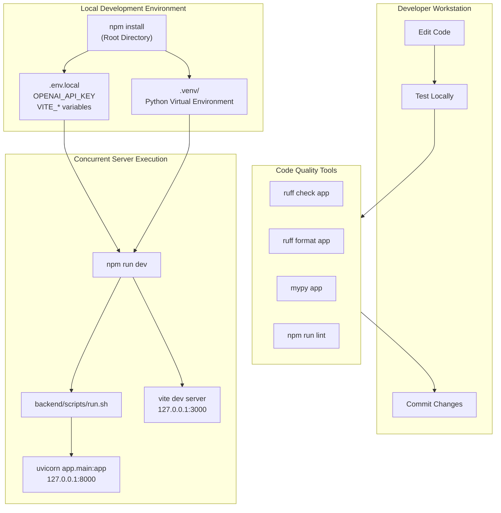

<!-- source: DeepWiki mcp.deepwiki.com · repo openai/openai-chatkit-starter-app · page 7 Development Workflow · fetched 2026-10-26 -->

# Development Workflow

<details>
<summary>Relevant source files</summary>

The following files were used as context for generating this wiki page:

- [.github/workflows/ci.yml](.github/workflows/ci.yml)
- [chatkit/.env.example](chatkit/.env.example)
- [chatkit/.gitignore](chatkit/.gitignore)
- [chatkit/README.md](chatkit/README.md)
- [chatkit/backend/.gitignore](chatkit/backend/.gitignore)
- [chatkit/backend/app/__init__.py](chatkit/backend/app/__init__.py)
- [chatkit/backend/scripts/run.sh](chatkit/backend/scripts/run.sh)

</details>


This document describes the standard development workflow for both the self-hosted and managed ChatKit starter applications. It covers local environment setup, concurrent server execution, code quality tools, and pre-commit validation procedures. For production deployment considerations, see [Deployment Considerations](#8). For detailed CI/CD pipeline documentation, see [CI/CD Pipeline](#6).

## Overview

Both `chatkit/` and `managed-chatkit/` applications follow identical development workflows. Each application consists of two components that run concurrently:

1. **FastAPI backend** - Runs on `http://127.0.0.1:8000`
2. **Vite frontend** - Runs on `http://127.0.0.1:3000` with `/chatkit` proxy

The root-level `package.json` orchestrates both processes using `npm run dev`, which executes backend and frontend start scripts in parallel.

**Sources:** [chatkit/README.md:1-33]()

---

## Local Development Setup

### Prerequisites

| Component | Required Version | Verification Command |
|-----------|-----------------|---------------------|
| Python | 3.11 or higher | `python --version` |
| Node.js | 22 | `node --version` |
| npm | Latest | `npm --version` |

**Sources:** [.github/workflows/ci.yml:24-25](), [.github/workflows/ci.yml:72-73]()

### Environment Variables

Create a `.env.local` file in the repository root with the following variables:

| Variable | Required | Default Value | Description |
|----------|----------|---------------|-------------|
| `OPENAI_API_KEY` | Yes | N/A | OpenAI API key for backend authentication |
| `VITE_CHATKIT_API_URL` | No | `/chatkit` | Frontend API endpoint URL |
| `VITE_CHATKIT_API_DOMAIN_KEY` | No | `domain_pk_localhost_dev` | Domain key for ChatKit authentication |

Example configuration:

```
OPENAI_API_KEY=sk-proj-...
VITE_CHATKIT_API_URL=http://127.0.0.1:8000/chatkit
VITE_CHATKIT_API_DOMAIN_KEY=domain_pk_local_dev
```

The backend startup script [chatkit/backend/scripts/run.sh:24-31]() automatically sources environment variables from `.env.local` if `OPENAI_API_KEY` is not already set in the shell environment.

**Sources:** [chatkit/.env.example:1-3](), [chatkit/README.md:18-26](), [chatkit/backend/scripts/run.sh:24-36]()

### Virtual Environment Setup

The Python backend requires a virtual environment for dependency isolation. The backend startup script [chatkit/backend/scripts/run.sh:12-15]() automatically creates a `.venv` directory if it does not exist:

```bash
if [ ! -d ".venv" ]; then
  echo "Creating virtual env in $PROJECT_ROOT/.venv ..."
  python -m venv .venv
fi
```

Manual virtual environment setup:

```bash
cd chatkit/backend  # or managed-chatkit/backend
python -m venv .venv
source .venv/bin/activate  # On Windows: .venv\Scripts\activate
pip install -e .
```

The `.venv/` directory is excluded from version control via [chatkit/backend/.gitignore:4]().

**Sources:** [chatkit/backend/scripts/run.sh:12-20](), [chatkit/backend/.gitignore:4]()

### Installing Dependencies

#### Unified Installation (Recommended)

From the `chatkit/` or `managed-chatkit/` directory:

```bash
npm install
```

This command installs both frontend dependencies and Python backend dependencies through the package scripts.

#### Backend Dependencies Only

From the `chatkit/backend/` or `managed-chatkit/backend/` directory:

```bash
pip install -e .
```

This installs the backend package in editable mode, including all dependencies from `pyproject.toml`.

#### Frontend Dependencies Only

From the `chatkit/frontend/` or `managed-chatkit/frontend/` directory:

```bash
npm ci
```

The `npm ci` command performs a clean install from `package-lock.json`, ensuring reproducible builds.

**Sources:** [chatkit/README.md:8-10](), [.github/workflows/ci.yml:27-34](), [.github/workflows/ci.yml:77-79]()

### Starting the Development Servers

#### Concurrent Server Execution

From the `chatkit/` or `managed-chatkit/` directory:

```bash
npm run dev
```

This command starts both the FastAPI backend and Vite frontend concurrently. The backend listens on `127.0.0.1:8000` and the frontend listens on `127.0.0.1:3000` with a proxy configured at `/chatkit` that forwards requests to the backend.

**Sources:** [chatkit/README.md:8-16]()

#### Backend Only

Execute the backend startup script:

```bash
cd chatkit/backend
./scripts/run.sh
```

This script [chatkit/backend/scripts/run.sh:1-40]() performs the following operations:

1. Creates virtual environment if missing
2. Activates virtual environment
3. Installs dependencies in editable mode
4. Sources `OPENAI_API_KEY` from `.env.local` if not set
5. Starts uvicorn server with `--reload` flag for hot reloading

Alternatively, start uvicorn directly from within the virtual environment:

```bash
uvicorn app.main:app --reload --host 127.0.0.1 --port 8000
```

**Sources:** [chatkit/backend/scripts/run.sh:1-40]()

#### Frontend Only

From the `chatkit/frontend/` or `managed-chatkit/frontend/` directory:

```bash
npm run dev
```

This starts the Vite development server with hot module replacement enabled.

**Sources:** [chatkit/README.md:8-16]()

### Development Workflow Diagram



**Sources:** [chatkit/README.md:8-16](), [chatkit/backend/scripts/run.sh:1-40](), [.github/workflows/ci.yml:36-54](), [.github/workflows/ci.yml:81-87]()

---

## Code Quality & Linting

All code changes must pass automated quality checks before merging. The CI pipeline [.github/workflows/ci.yml:1-88]() enforces these checks on every push and pull request.

### Python Quality Tools

The backend uses three primary quality tools, all executed in the [.github/workflows/ci.yml:36-54]() CI pipeline:

#### Ruff Linter

Ruff checks for common Python errors, code style violations, and potential bugs:

```bash
python -m ruff check app
```

The linter runs against the `app/` directory in both `chatkit/backend/` and `managed-chatkit/backend/`. Configuration is managed through `pyproject.toml` in each backend directory.

**CI Step:** [.github/workflows/ci.yml:40-42]()

#### Ruff Formatter

Ruff enforces consistent code formatting:

```bash
python -m ruff format --check app
```

The `--check` flag validates formatting without modifying files. To apply formatting locally:

```bash
python -m ruff format app
```

The CI pipeline [.github/workflows/ci.yml:44-50]() fails with an explicit error message if formatting violations are detected, instructing developers to run the format command locally.

**CI Step:** [.github/workflows/ci.yml:44-50]()

#### Mypy Type Checker

Mypy validates static type annotations:

```bash
python -m mypy app --ignore-missing-imports
```

The `--ignore-missing-imports` flag allows mypy to skip untyped third-party dependencies while still validating project code.

**CI Step:** [.github/workflows/ci.yml:52-54]()

### JavaScript Quality Tools

The frontend uses ESLint for code quality and style enforcement:

```bash
npm run lint
```

This command executes ESLint against the frontend source code. The CI pipeline [.github/workflows/ci.yml:81-83]() validates both `chatkit/frontend/` and `managed-chatkit/frontend/`.

**CI Step:** [.github/workflows/ci.yml:81-83]()

### Build Verification

The CI pipeline also verifies that both frontends build successfully:

```bash
npm run build
```

This ensures that production builds will succeed before code is merged.

**CI Step:** [.github/workflows/ci.yml:85-87]()

### Pre-Commit Workflow

Before committing code, developers should run all quality checks locally:

#### Python Backend

```bash
cd chatkit/backend  # or managed-chatkit/backend
source .venv/bin/activate

# Syntax check
python -m compileall app

# Lint
python -m ruff check app

# Format
python -m ruff format app

# Type check
python -m mypy app --ignore-missing-imports
```

#### JavaScript Frontend

```bash
cd chatkit/frontend  # or managed-chatkit/frontend

# Lint
npm run lint

# Build verification
npm run build
```

**Sources:** [.github/workflows/ci.yml:36-54](), [.github/workflows/ci.yml:81-87]()

### Quality Tools Installation

Quality tools are installed as development dependencies:

#### Python

```bash
pip install -e ".[dev]"  # Installs ruff
pip install mypy
```

The `[dev]` extra includes development dependencies defined in `pyproject.toml`.

**CI Installation:** [.github/workflows/ci.yml:27-34]()

#### JavaScript

```bash
npm ci
```

This installs all dependencies including ESLint, which is configured in `package.json` and `eslint.config.js`.

**CI Installation:** [.github/workflows/ci.yml:77-79]()

### Code Quality Workflow Diagram

```mermaid
graph LR
    subgraph Local_Checks["Local Quality Checks"]
        SYNTAX["python -m compileall app"]
        LINT["ruff check app"]
        FORMAT["ruff format app"]
        TYPE["mypy app"]
        JS_LINT["npm run lint"]
        BUILD["npm run build"]
    end
    
    subgraph Git_Actions["Version Control"]
        COMMIT["git commit"]
        PUSH["git push"]
        PR["Pull Request"]
    end
    
    subgraph CI_Pipeline[".github/workflows/ci.yml"]
        CI_TRIGGER["Workflow Trigger"]
        CI_PYTHON["Python Job Matrix<br/>chatkit/backend<br/>managed-chatkit/backend"]
        CI_NODE["Node Job Matrix<br/>chatkit/frontend<br/>managed-chatkit/frontend"]
        CI_SYNTAX["Syntax Check"]
        CI_RUFF_LINT["Ruff Lint"]
        CI_RUFF_FMT["Ruff Format Check"]
        CI_MYPY["mypy Type Check"]
        CI_ESLINT["ESLint"]
        CI_BUILD["Build Verification"]
        CI_SUCCESS["✓ All Checks Pass"]
    end
    
    SYNTAX --> LINT
    LINT --> FORMAT
    FORMAT --> TYPE
    TYPE --> COMMIT
    JS_LINT --> BUILD
    BUILD --> COMMIT
    COMMIT --> PUSH
    PUSH --> PR
    PR --> CI_TRIGGER
    CI_TRIGGER --> CI_PYTHON
    CI_TRIGGER --> CI_NODE
    CI_PYTHON --> CI_SYNTAX
    CI_SYNTAX --> CI_RUFF_LINT
    CI_RUFF_LINT --> CI_RUFF_FMT
    CI_RUFF_FMT --> CI_MYPY
    CI_NODE --> CI_ESLINT
    CI_ESLINT --> CI_BUILD
    CI_MYPY --> CI_SUCCESS
    CI_BUILD --> CI_SUCCESS
```



**Sources:** [.github/workflows/ci.yml:1-88]()

---

## Common Development Commands

| Task | Command | Working Directory |
|------|---------|------------------|
| Start both servers | `npm run dev` | `chatkit/` or `managed-chatkit/` |
| Install all dependencies | `npm install` | `chatkit/` or `managed-chatkit/` |
| Backend only (script) | `./scripts/run.sh` | `chatkit/backend/` or `managed-chatkit/backend/` |
| Backend only (direct) | `uvicorn app.main:app --reload` | `chatkit/backend/` or `managed-chatkit/backend/` (in venv) |
| Frontend only | `npm run dev` | `chatkit/frontend/` or `managed-chatkit/frontend/` |
| Lint Python | `ruff check app` | `chatkit/backend/` or `managed-chatkit/backend/` (in venv) |
| Format Python | `ruff format app` | `chatkit/backend/` or `managed-chatkit/backend/` (in venv) |
| Type check Python | `mypy app --ignore-missing-imports` | `chatkit/backend/` or `managed-chatkit/backend/` (in venv) |
| Lint JavaScript | `npm run lint` | `chatkit/frontend/` or `managed-chatkit/frontend/` |
| Build frontend | `npm run build` | `chatkit/frontend/` or `managed-chatkit/frontend/` |

**Sources:** [chatkit/README.md:8-10](), [chatkit/backend/scripts/run.sh:39](), [.github/workflows/ci.yml:36-87]()

---

## File Artifacts & Cache Directories

The development workflow generates several artifacts and cache directories that should not be committed to version control:

### Python Backend Artifacts

Excluded via [chatkit/backend/.gitignore:1-9]():

| Pattern | Description |
|---------|-------------|
| `__pycache__/` | Compiled Python bytecode cache |
| `*.py[cod]` | Compiled Python files (`.pyc`, `.pyo`, `.pyd`) |
| `*.egg-info/` | Package metadata from editable installs |
| `.venv/` | Python virtual environment |
| `.env` | Local environment variables (security risk) |
| `.ruff_cache/` | Ruff linter cache |
| `.pytest_cache/` | Pytest cache directory |
| `.coverage/` | Code coverage data |
| `*.log` | Log files |

### Root-Level Artifacts

Excluded via [chatkit/.gitignore:1-3]():

| Pattern | Description |
|---------|-------------|
| `node_modules/` | npm dependencies |
| `.env*` | All environment files (except `.env.example`) |

The pattern `.env*` matches `.env`, `.env.local`, `.env.production`, etc., while `!.env.example` explicitly allows the example file to be committed.

**Sources:** [chatkit/backend/.gitignore:1-9](), [chatkit/.gitignore:1-3]()

---

## CI/CD Integration

The GitHub Actions workflow [.github/workflows/ci.yml:1-88]() runs automatically on:

- Pushes to the `main` branch [.github/workflows/ci.yml:4-5]()
- All pull requests [.github/workflows/ci.yml:6]()

### Parallel Job Execution

The CI pipeline uses job matrices to validate all four projects in parallel:

**Python Projects** [.github/workflows/ci.yml:14-17]():
- `chatkit/backend`
- `managed-chatkit/backend`

**Node.js Projects** [.github/workflows/ci.yml:61-64]():
- `chatkit/frontend`
- `managed-chatkit/frontend`

The `fail-fast: false` configuration [.github/workflows/ci.yml:13]() ensures that all projects are validated even if one fails, providing comprehensive feedback to developers.

### CI Environment

| Component | Version | Configuration |
|-----------|---------|---------------|
| Operating System | Ubuntu Latest | `runs-on: ubuntu-latest` |
| Python | 3.13 | [.github/workflows/ci.yml:24-25]() |
| Node.js | 22 | [.github/workflows/ci.yml:72-73]() |
| Package Cache | Enabled | `cache: "npm"` for Node.js [.github/workflows/ci.yml:75]() |

### CI Dependency Installation

The CI pipeline uses `PIP_DISABLE_PIP_VERSION_CHECK: "1"` [.github/workflows/ci.yml:30]() to suppress pip version warnings during dependency installation.

For detailed CI/CD pipeline documentation, see [CI/CD Pipeline](#6).

**Sources:** [.github/workflows/ci.yml:1-88]()

---

## Troubleshooting Common Issues

### Backend Fails to Start

**Symptom:** `OPENAI_API_KEY` not found error

**Solution:** Ensure `.env.local` exists in the repository root with a valid `OPENAI_API_KEY`:

```bash
echo "OPENAI_API_KEY=sk-proj-..." > .env.local
```

Alternatively, export the variable in your shell:

```bash
export OPENAI_API_KEY=sk-proj-...
```

**Source:** [chatkit/backend/scripts/run.sh:33-36]()

### Ruff Format Check Fails in CI

**Symptom:** CI pipeline fails with "Ruff format check failed"

**Solution:** Run the formatter locally and commit the changes:

```bash
cd chatkit/backend  # or managed-chatkit/backend
python -m ruff format app
git add app
git commit -m "Apply ruff formatting"
```

**Source:** [.github/workflows/ci.yml:46-50]()

### Port Already in Use

**Symptom:** Backend or frontend fails to start due to port conflict

**Solution:** Kill the existing process using the port:

```bash
# Find process using port 8000 (backend)
lsof -ti:8000 | xargs kill -9

# Find process using port 3000 (frontend)
lsof -ti:3000 | xargs kill -9
```

Alternatively, modify the port configuration in the startup scripts or `npm run dev` command.

### Virtual Environment Not Activated

**Symptom:** `ModuleNotFoundError` when running backend commands

**Solution:** Activate the virtual environment before running Python commands:

```bash
cd chatkit/backend  # or managed-chatkit/backend
source .venv/bin/activate
```

The backend startup script [chatkit/backend/scripts/run.sh:17]() automatically activates the virtual environment.

**Sources:** [chatkit/backend/scripts/run.sh:17]()

---

