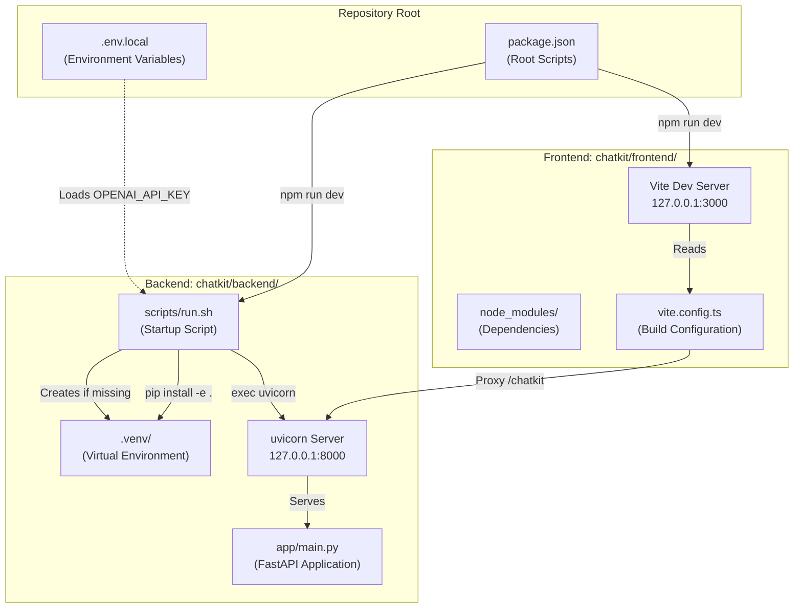
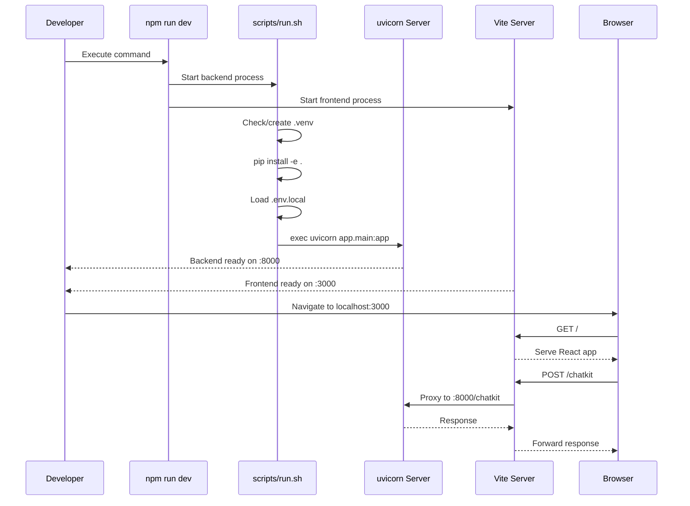
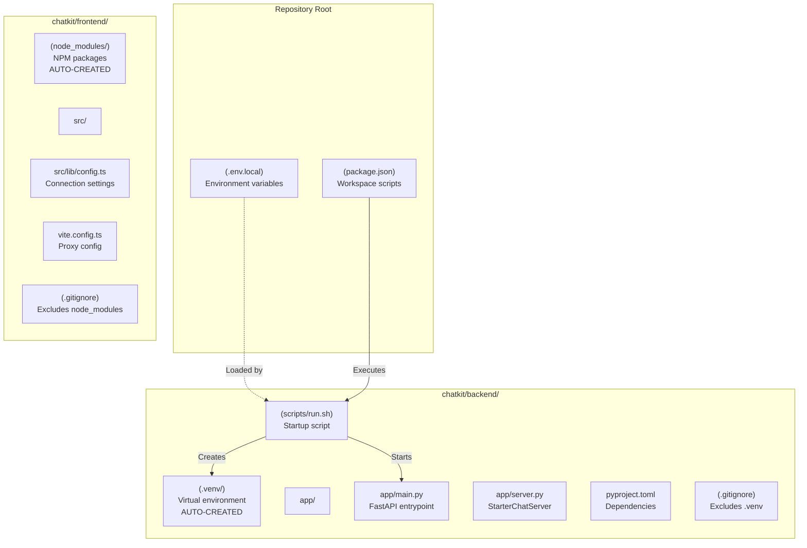

<!-- source: DeepWiki mcp.deepwiki.com · repo openai/openai-chatkit-starter-app · page 7.1 Local Development Setup · fetched 2026-10-26 -->

# Local Development Setup

<details>
<summary>Relevant source files</summary>

The following files were used as context for generating this wiki page:

- [chatkit/.env.example](chatkit/.env.example)
- [chatkit/.gitignore](chatkit/.gitignore)
- [chatkit/README.md](chatkit/README.md)
- [chatkit/backend/.gitignore](chatkit/backend/.gitignore)
- [chatkit/backend/app/__init__.py](chatkit/backend/app/__init__.py)
- [chatkit/backend/scripts/run.sh](chatkit/backend/scripts/run.sh)

</details>


This page provides step-by-step instructions for setting up a local development environment for either the `chatkit/` or `managed-chatkit/` starter applications. It covers virtual environment creation, dependency installation, environment variable configuration, and running development servers concurrently.

For information about code quality tools and linting workflows, see [Code Quality & Linting](#7.2). For environment variable details and configuration options, see [Environment Configuration](#2.2). For production deployment considerations, see [Deployment Considerations](#8).

---

## Prerequisites

Before beginning local development setup, ensure the following software is installed on your system:

| Software | Required Version | Purpose |
|----------|-----------------|---------|
| Python | 3.11 or higher | Backend runtime environment |
| Node.js | 22.x | Frontend build toolchain and package management |
| pip | Latest | Python package installer |
| npm | Bundled with Node.js | Node package manager |

For detailed installation instructions, see [Installation & Prerequisites](#2.1).

**Sources:** [chatkit/README.md:1-33]()

---

## Development Environment Architecture

The local development environment consists of two concurrent server processes and a file-based configuration system:



**Sources:** [chatkit/README.md:13-16](), [chatkit/backend/scripts/run.sh:1-40]()

---

## Python Virtual Environment Setup

The backend requires a Python virtual environment to isolate dependencies. The virtual environment is automatically created by the startup script if it does not already exist.

### Automatic Creation

When running `npm run dev`, the backend startup script [chatkit/backend/scripts/run.sh:12-15]() automatically creates a virtual environment at `chatkit/backend/.venv/`:

```bash
if [ ! -d ".venv" ]; then
  echo "Creating virtual env in $PROJECT_ROOT/.venv ..."
  python -m venv .venv
fi
```

### Manual Creation

To manually create a virtual environment for the backend:

```bash
cd chatkit/backend
python -m venv .venv
source .venv/bin/activate  # On Unix/macOS
# .venv\Scripts\activate   # On Windows
```

The virtual environment directory `.venv/` is excluded from version control via [chatkit/backend/.gitignore:4]().

**Sources:** [chatkit/backend/scripts/run.sh:12-17](), [chatkit/backend/.gitignore:4]()

---

## Dependency Installation

### Backend Dependencies

Backend dependencies are installed automatically by the startup script using pip in editable mode. The script [chatkit/backend/scripts/run.sh:19-20]() executes:

```bash
pip install -e . >/dev/null
```

This installs the package defined in the backend's `pyproject.toml` along with all dependencies specified in the `[project.dependencies]` section. Editable mode (`-e`) allows code changes to take effect without reinstallation.

For manual installation:

```bash
cd chatkit/backend
source .venv/bin/activate
pip install -e .
```

### Frontend Dependencies

Frontend dependencies must be installed manually before first run. From the repository root:

```bash
npm install
```

This installs all packages defined in the root `package.json` and workspace configurations. Node modules are stored in `node_modules/` directories, which are excluded from version control via [chatkit/.gitignore:1]().

**Sources:** [chatkit/README.md:8-10](), [chatkit/backend/scripts/run.sh:19-20](), [chatkit/.gitignore:1]()

---

## Environment Variable Configuration

Local development requires environment variables for API authentication and service configuration. These should be stored in `.env.local` at the repository root.

### Required Variables

| Variable | Required By | Purpose | Default Value |
|----------|-------------|---------|---------------|
| `OPENAI_API_KEY` | Backend | OpenAI API authentication | None (must be set) |
| `VITE_CHATKIT_API_URL` | Frontend | Backend endpoint URL | `/chatkit` |
| `VITE_CHATKIT_API_DOMAIN_KEY` | Frontend | Domain authentication key | `domain_pk_localhost_dev` |

### Configuration File Location

Create `.env.local` at the repository root (same level as `chatkit/` and `managed-chatkit/` directories):

```
.
├── .env.local          # Environment variables file
├── chatkit/
│   ├── backend/
│   └── frontend/
└── managed-chatkit/
```

### Example Configuration

An example configuration is provided in [chatkit/.env.example:1-3]():

```bash
OPENAI_API_KEY=sk-proj-...
VITE_CHATKIT_API_URL=http://127.0.0.1:8000/chatkit
VITE_CHATKIT_API_DOMAIN_KEY=domain_pk_local_dev
```

### Variable Loading Mechanism

The backend startup script automatically loads environment variables from `.env.local` if `OPENAI_API_KEY` is not already set in the shell environment [chatkit/backend/scripts/run.sh:22-31]():

```bash
ENV_FILE="$PROJECT_ROOT/../.env.local"
if [ -z "${OPENAI_API_KEY:-}" ] && [ -f "$ENV_FILE" ]; then
  echo "Sourcing OPENAI_API_KEY from $ENV_FILE"
  set -a
  . "$ENV_FILE"
  set +a
fi
```

If `OPENAI_API_KEY` is not found, the script exits with an error [chatkit/backend/scripts/run.sh:33-36]().

**Sources:** [chatkit/README.md:18-26](), [chatkit/.env.example:1-3](), [chatkit/backend/scripts/run.sh:22-36]()

---

## Running Development Servers

### Concurrent Server Startup

The primary method for local development is the `npm run dev` command, which starts both backend and frontend servers concurrently.

From the repository root:

```bash
npm run dev
```

This command executes the root `package.json` scripts that launch:

1. **Backend**: FastAPI application via uvicorn on `127.0.0.1:8000`
2. **Frontend**: Vite development server on `127.0.0.1:3000`

The frontend is configured with a proxy at `/chatkit` that forwards requests to the backend [chatkit/README.md:15-16]().



**Sources:** [chatkit/README.md:8-16](), [chatkit/backend/scripts/run.sh:38-39]()

---

## Manual Server Startup

For debugging or isolated testing, backend and frontend servers can be started independently.

### Backend Only

Execute the startup script directly:

```bash
cd chatkit/backend
./scripts/run.sh
```

The script [chatkit/backend/scripts/run.sh:1-40]() performs the following operations:

1. Changes to the backend project root directory
2. Creates virtual environment if missing
3. Activates the virtual environment
4. Installs dependencies in editable mode
5. Loads environment variables from `../../.env.local`
6. Validates `OPENAI_API_KEY` presence
7. Starts uvicorn with `--reload` flag on `127.0.0.1:8000`

The `--reload` flag enables automatic server restart when code changes are detected.

### Frontend Only

Start the Vite development server:

```bash
cd chatkit/frontend
npm run dev
```

Ensure the backend is running separately, as the frontend depends on the backend API endpoint.

**Sources:** [chatkit/backend/scripts/run.sh:1-40]()

---

## Development File Structure

Understanding the file organization helps locate configuration and code during development:



### Key Files for Local Development

| File Path | Purpose | Modified During Development |
|-----------|---------|----------------------------|
| `.env.local` | Environment variables | Rarely (only for API keys) |
| `chatkit/backend/.venv/` | Python virtual environment | Auto-managed |
| `chatkit/backend/scripts/run.sh` | Backend startup script | No |
| `chatkit/backend/app/main.py` | FastAPI application | Frequently |
| `chatkit/backend/app/server.py` | Chat server implementation | Frequently |
| `chatkit/frontend/src/` | React application source | Frequently |
| `chatkit/frontend/src/lib/config.ts` | Frontend configuration | Occasionally |
| `chatkit/frontend/vite.config.ts` | Build and proxy configuration | Rarely |

### Excluded Directories

The following directories are auto-generated and excluded from version control:

- `chatkit/backend/.venv/` - Python virtual environment [chatkit/backend/.gitignore:4]()
- `chatkit/backend/__pycache__/` - Python bytecode cache [chatkit/backend/.gitignore:1]()
- `chatkit/frontend/node_modules/` - NPM packages [chatkit/.gitignore:1]()
- `.env.local` and other `.env*` files (except `.env.example`) [chatkit/.gitignore:2-3]()

**Sources:** [chatkit/backend/.gitignore:1-10](), [chatkit/.gitignore:1-4](), [chatkit/backend/scripts/run.sh:7-10]()

---

## Development Server URLs

Once the development servers are running, the application can be accessed at the following URLs:

| Service | URL | Purpose |
|---------|-----|---------|
| Frontend | `http://127.0.0.1:3000` | React application UI |
| Backend API | `http://127.0.0.1:8000` | FastAPI endpoints |
| Backend Docs | `http://127.0.0.1:8000/docs` | Interactive API documentation |
| Proxied API | `http://127.0.0.1:3000/chatkit` | Frontend proxy to backend |

The frontend Vite server proxies requests to `/chatkit` through to the backend server, allowing the React application to communicate with the API without CORS issues during development [chatkit/README.md:15-16]().

**Sources:** [chatkit/README.md:15-16](), [chatkit/backend/scripts/run.sh:38]()

---

## Troubleshooting Common Setup Issues

### Missing OPENAI_API_KEY

If the backend fails to start with the error message:
```
Set OPENAI_API_KEY in your environment or in .env.local before running this script.
```

**Solution**: Create `.env.local` at the repository root and add your OpenAI API key [chatkit/backend/scripts/run.sh:33-36]().

### Virtual Environment Creation Fails

If Python virtual environment creation fails, ensure Python 3.11+ is installed and accessible via the `python` command.

**Solution**: Verify Python version with `python --version` and install Python 3.11+ if needed.

### Port Already in Use

If ports 8000 or 3000 are already in use, the servers will fail to start.

**Solution**: Stop existing processes using these ports, or modify the port configuration in [chatkit/backend/scripts/run.sh:39]() (backend) or frontend Vite configuration (frontend).

### npm install Fails

If frontend dependency installation fails, ensure Node.js 22.x is installed.

**Solution**: Verify Node.js version with `node --version` and install Node.js 22.x if needed.

**Sources:** [chatkit/backend/scripts/run.sh:33-39](), [chatkit/README.md:8-10]()

---

