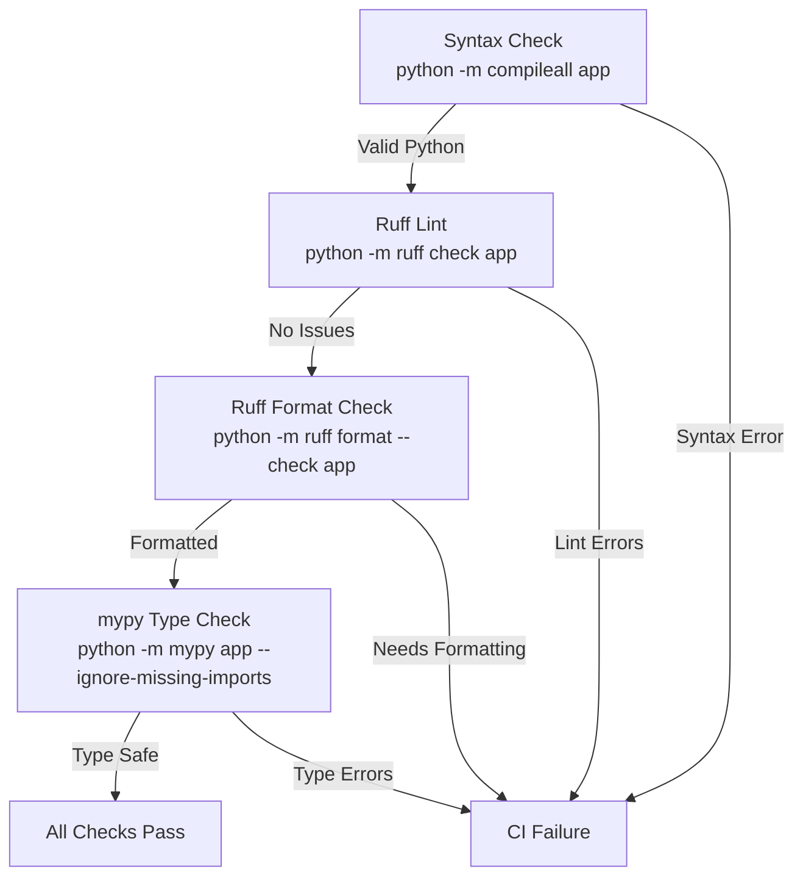
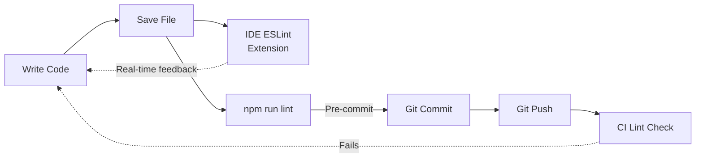

<!-- source: DeepWiki mcp.deepwiki.com · repo openai/openai-chatkit-starter-app · page 7.2 Code Quality & Linting · fetched 2026-10-26 -->

# Code Quality & Linting

<details>
<summary>Relevant source files</summary>

The following files were used as context for generating this wiki page:

- [.github/workflows/ci.yml](.github/workflows/ci.yml)
- [chatkit/backend/pyproject.toml](chatkit/backend/pyproject.toml)

</details>


This page documents the code quality tools and linting mechanisms used across both Python and Node.js projects in the ChatKit starter applications. The repository maintains consistent code quality through language-specific tooling: **Ruff** and **mypy** for Python backend validation, and **ESLint** for TypeScript/React frontend validation.

For information about how these tools integrate into the CI/CD pipeline, see page 6 (CI/CD Pipeline).

---

## Overview

Both `chatkit/backend` and `managed-chatkit/backend` Python projects use the same quality toolchain, as do both frontend projects. The quality tools enforce:

| Language | Linting | Formatting | Type Checking |
|----------|---------|------------|---------------|
| Python | Ruff | Ruff | mypy |
| TypeScript/React | ESLint | ESLint (autofix) | TypeScript compiler |

**Sources:** [.github/workflows/ci.yml:36-54](), [chatkit/backend/pyproject.toml:14-16]()

---

## Python Quality Tools

The Python backend projects use modern tooling for fast, comprehensive code quality checks. All Python quality tools are specified in `pyproject.toml` and installed via the `[dev]` optional dependency group.

### Dependency Configuration

[chatkit/backend/pyproject.toml:13-16]() defines the development dependencies:

```toml
[project.optional-dependencies]
dev = [
    "ruff>=0.6.4,<0.7",
]
```

Note that `mypy` is installed separately in CI [.github/workflows/ci.yml:34]() but should be installed locally for type checking.

**Sources:** [chatkit/backend/pyproject.toml:13-16](), [.github/workflows/ci.yml:34]()

### Ruff Linting

Ruff is an extremely fast Python linter written in Rust that replaces multiple tools (Flake8, isort, pydocstyle, etc.). The CI workflow runs ruff linting via [.github/workflows/ci.yml:40-42]():

```bash
python -m ruff check app
```

This command lints all Python files in the `app/` directory, checking for:
- Code style violations
- Unused imports and variables
- Potential bugs and anti-patterns
- Import ordering issues
- Documentation style

**Sources:** [.github/workflows/ci.yml:40-42](), [chatkit/backend/pyproject.toml:14-16]()

### Ruff Formatting

Ruff also provides an opinionated code formatter (similar to Black but faster). The CI workflow checks formatting via [.github/workflows/ci.yml:44-50]():

```bash
python -m ruff format --check app
```

The `--check` flag validates that code is formatted correctly without modifying files. If formatting issues are detected, the workflow outputs a helpful error message [.github/workflows/ci.yml:48]() instructing developers to run `python -m ruff format app` locally.

**Sources:** [.github/workflows/ci.yml:44-50]()

### mypy Type Checking

mypy performs static type checking on Python code annotated with type hints. The CI workflow runs type checking via [.github/workflows/ci.yml:52-54]():

```bash
python -m mypy app --ignore-missing-imports
```

The `--ignore-missing-imports` flag suppresses errors for third-party libraries without type stubs, focusing type checking on the application code.

**Sources:** [.github/workflows/ci.yml:52-54](), [.github/workflows/ci.yml:34]()

### Python Quality Check Flow



**Sources:** [.github/workflows/ci.yml:36-54]()

### Running Python Checks Locally

To run Python quality checks locally before committing:

1. **Install development dependencies:**
   ```bash
   cd chatkit/backend  # or managed-chatkit/backend
   pip install ".[dev]"
   pip install mypy
   ```

2. **Run syntax check:**
   ```bash
   python -m compileall app
   ```

3. **Run ruff linting:**
   ```bash
   python -m ruff check app
   ```

4. **Fix auto-fixable lint issues:**
   ```bash
   python -m ruff check app --fix
   ```

5. **Run ruff formatting:**
   ```bash
   python -m ruff format app
   ```

6. **Run type checking:**
   ```bash
   python -m mypy app --ignore-missing-imports
   ```

**Sources:** [.github/workflows/ci.yml:27-54](), [chatkit/backend/pyproject.toml:13-16]()

---

## Node.js Quality Tools

The frontend projects use ESLint for comprehensive linting and code quality enforcement.

### ESLint Configuration

Both frontend projects use ESLint with configurations appropriate to their frameworks. The CI workflow runs ESLint via [.github/workflows/ci.yml:81-83]():

```bash
npm run lint
```

This executes the `lint` script defined in each frontend's `package.json`.

**Sources:** [.github/workflows/ci.yml:81-83]()

### Running ESLint Locally

To run ESLint locally before committing:

1. **Install dependencies:**
   ```bash
   cd chatkit/frontend  # or managed-chatkit/frontend
   npm ci
   ```

2. **Run linting:**
   ```bash
   npm run lint
   ```

3. **Fix auto-fixable issues:**
   ```bash
   npm run lint -- --fix
   ```

**Sources:** [.github/workflows/ci.yml:77-83]()

---

## Quality Checks in CI/CD

The GitHub Actions workflow executes quality checks for all four projects (two backends, two frontends) in parallel. The workflow configuration uses a matrix strategy with `fail-fast: false` [.github/workflows/ci.yml:12-13](), ensuring all projects are validated even if one fails.

### Python Quality Pipeline

For each Python project (`chatkit/backend`, `managed-chatkit/backend`), the CI workflow [.github/workflows/ci.yml:9-54]() executes:

1. **Syntax Check** [.github/workflows/ci.yml:36-38]()
2. **Ruff Lint** [.github/workflows/ci.yml:40-42]()
3. **Ruff Format Check** [.github/workflows/ci.yml:44-50]()
4. **mypy Type Check** [.github/workflows/ci.yml:52-54]()

### Node.js Quality Pipeline

For each frontend project (`chatkit/frontend`, `managed-chatkit/frontend`), the CI workflow [.github/workflows/ci.yml:56-87]() executes:

1. **Install Dependencies** (`npm ci`) [.github/workflows/ci.yml:77-79]()
2. **ESLint Check** [.github/workflows/ci.yml:81-83]()
3. **Build Verification** [.github/workflows/ci.yml:85-87]()

For detailed information about the CI/CD pipeline configuration, see page 6 (CI/CD Pipeline).

**Sources:** [.github/workflows/ci.yml:9-87]()

---

## Development Workflow Integration



ESLint provides multiple checkpoints:

1. **Real-time feedback**: IDE extensions (VS Code, IntelliJ) show linting errors while typing
2. **Pre-commit**: Developers can run `npm run lint` before committing
3. **CI enforcement**: [.github/workflows/ci.yml:26-27]() runs linting automatically on push and pull requests

**Sources:** [.github/workflows/ci.yml:26-27](), [package.json:9]()

---

## Dependencies

The ESLint ecosystem requires several packages defined in [package.json:21-31]():

| Package | Version | Purpose |
|---------|---------|---------|
| `eslint` | `^9` | Core ESLint engine |
| `@eslint/eslintrc` | `^3` | Backward compatibility utilities including `FlatCompat` |
| `eslint-config-next` | `15.5.4` | Next.js ESLint configurations (`next/core-web-vitals`, `next/typescript`) |

These are installed as `devDependencies` because they're only needed during development and CI builds, not in production runtime.

**Sources:** [package.json:21-31]()

---

## Configuration Maintenance

The ESLint configuration uses `FlatCompat` [eslint.config.mjs:1-10]() to maintain compatibility with Next.js's traditional configuration format while using ESLint 9's flat config system. This approach:

- Allows seamless upgrades to Next.js versions that may update ESLint configurations
- Maintains compatibility with Next.js tooling expectations
- Provides a migration path to native flat config when Next.js fully adopts it

The configuration exports a default array [eslint.config.mjs:12-25]() that ESLint 9 processes directly without requiring a `.eslintrc.*` file.

**Sources:** [eslint.config.mjs:1-26]()

---

## Summary Table

| Aspect | Implementation | Location |
|--------|----------------|----------|
| Configuration Format | ESLint 9 flat config with `FlatCompat` | [eslint.config.mjs:1-26]() |
| Extended Configs | `next/core-web-vitals`, `next/typescript` | [eslint.config.mjs:13]() |
| Local Execution | `npm run lint` | [package.json:9]() |
| CI Execution | GitHub Actions workflow step | [.github/workflows/ci.yml:26-27]() |
| Ignored Paths | Build outputs and dependencies | [eslint.config.mjs:15-21]() |
| Engine Version | ESLint 9.x | [package.json:27]() |

**Sources:** [eslint.config.mjs:1-26](), [package.json:9](), [package.json:21-31](), [.github/workflows/ci.yml:26-27]()

---

