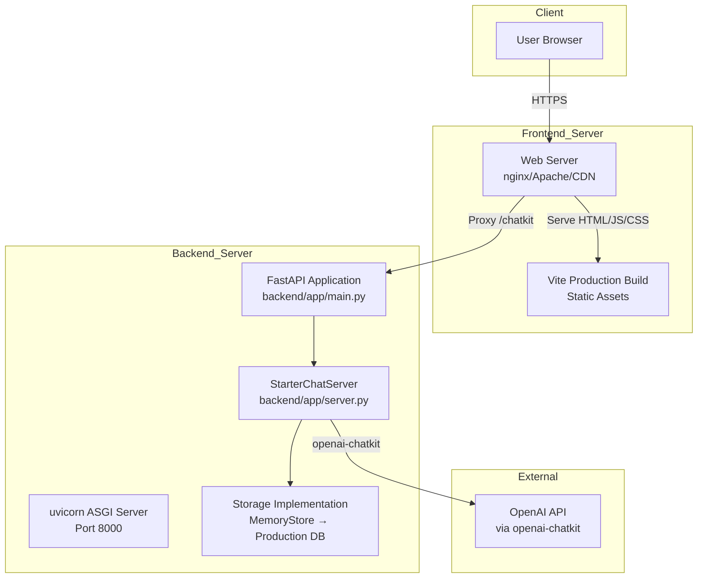
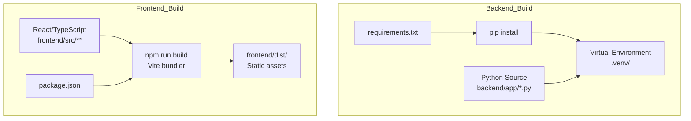
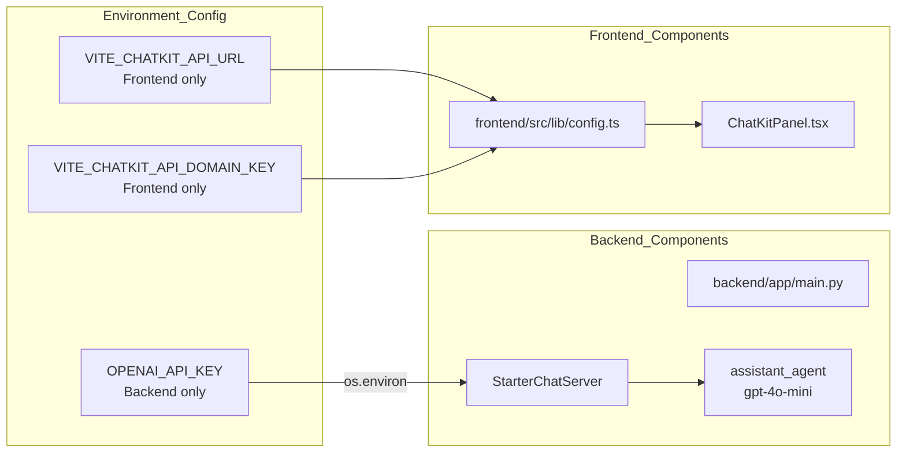
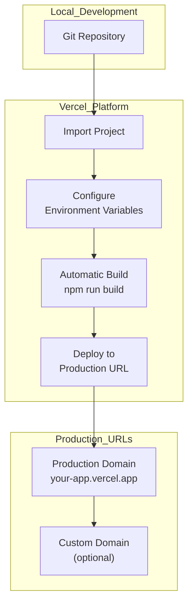
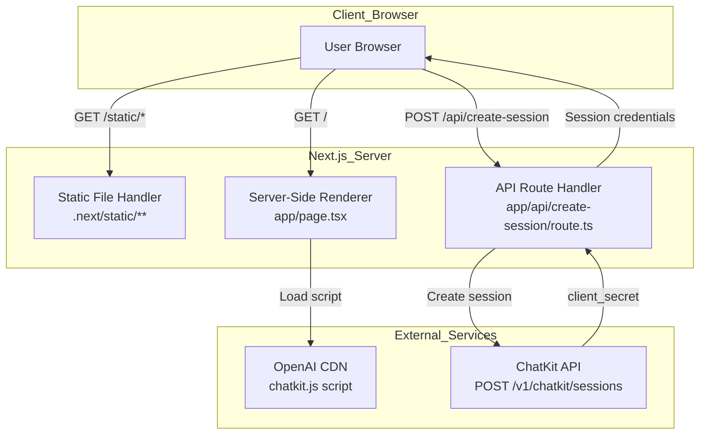
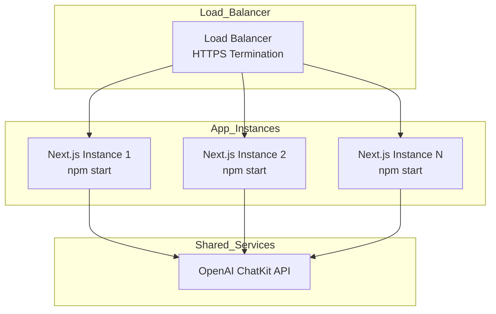
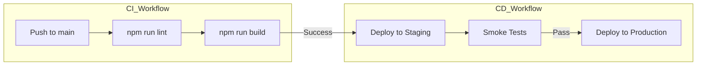

<!-- source: DeepWiki mcp.deepwiki.com · repo openai/openai-chatkit-starter-app · page 8 Deployment Considerations · fetched 2026-10-26 -->

# Deployment Considerations

<details>
<summary>Relevant source files</summary>

The following files were used as context for generating this wiki page:

- [chatkit/.env.example](chatkit/.env.example)
- [chatkit/.gitignore](chatkit/.gitignore)
- [chatkit/README.md](chatkit/README.md)
- [chatkit/backend/.gitignore](chatkit/backend/.gitignore)
- [chatkit/backend/app/__init__.py](chatkit/backend/app/__init__.py)
- [chatkit/backend/app/memory_store.py](chatkit/backend/app/memory_store.py)
- [chatkit/backend/app/server.py](chatkit/backend/app/server.py)

</details>


This document provides guidance for deploying the ChatKit starter applications to production environments. It covers production build processes, environment configuration, persistent storage migration, deployment platform options, and security considerations.

Both the `chatkit/` (self-hosted) and `managed-chatkit/` (managed) variants follow the same deployment patterns, with differences noted where applicable.

For local development setup, see [Getting Started](#2). For CI/CD pipeline information, see [CI/CD Pipeline](#6).

---

## Architecture Overview

The starter applications use a two-tier architecture with independent frontend and backend components:

**Deployment Architecture Diagram**



**Sources**: [chatkit/README.md:1-16](), [chatkit/backend/app/server.py:1-68]()

---

## Production Build Process

### Backend Build

The Python backend requires minimal build steps. The primary consideration is dependency installation:

```bash
# Navigate to backend directory
cd chatkit/backend

# Create virtual environment
python -m venv .venv
source .venv/bin/activate  # On Windows: .venv\Scripts\activate

# Install production dependencies
pip install -r requirements.txt
```

The backend does not require compilation or bundling. The FastAPI application in [chatkit/backend/app/main.py]() and supporting modules are ready to run directly.

**Backend Dependencies**:

| Package | Version Constraint | Purpose |
|---------|-------------------|---------|
| `fastapi` | `>=0.114.0,<0.117.0` | Web framework and API routing |
| `uvicorn` | `>=0.30.0,<0.31.0` | ASGI server for production |
| `openai` | `>=1.40.0` | OpenAI SDK for API access |
| `openai-chatkit` | `>=1.4.0,<2.0.0` | ChatKit server library |

**Sources**: [chatkit/backend/app/main.py](), backend requirements.txt

### Frontend Build

The Vite + React frontend requires a production build to generate optimized static assets:

```bash
# Navigate to frontend directory
cd chatkit/frontend

# Install dependencies
npm ci

# Build for production
npm run build
```

This produces a `dist/` directory containing:
- Minified JavaScript bundles with content hashing
- Optimized CSS files
- HTML entry point
- Static assets (fonts, images)

The `dist/` directory can be served by any static file server (nginx, Apache, CDN).

**Build Output Structure**:

```
frontend/dist/
├── index.html          # Entry point with injected script tags
├── assets/
│   ├── index-[hash].js    # Main JavaScript bundle
│   ├── index-[hash].css   # Compiled styles
│   └── vendor-[hash].js   # Third-party dependencies
└── vite.svg            # Static assets
```

**Sources**: [chatkit/README.md:8-10](), Vite build system

### Build Process Diagram



**Sources**: [chatkit/README.md:8-16](), [chatkit/backend/.gitignore:4]()

---

## Environment Configuration for Production

### Required Environment Variables

Both development and production environments require specific environment variables. Production deployments should configure these through platform-specific secret management systems.

| Variable | Required | Component | Purpose |
|----------|----------|-----------|---------|
| `OPENAI_API_KEY` | Yes | Backend | Authenticates with OpenAI API |
| `VITE_CHATKIT_API_URL` | No | Frontend | Backend API endpoint (default: `/chatkit`) |
| `VITE_CHATKIT_API_DOMAIN_KEY` | No | Frontend | Domain key for production (default: `domain_pk_localhost_dev`) |

**Sources**: [chatkit/.env.example:1-3](), [chatkit/README.md:18-26]()

### Environment Variable Configuration by Component

**Environment Variable Flow Diagram**



**Sources**: [chatkit/.env.example:1-3](), [chatkit/backend/app/server.py:17-28]()

### Production Domain Key

The `VITE_CHATKIT_API_DOMAIN_KEY` must be registered in the OpenAI dashboard for production deployments:

1. Navigate to OpenAI Dashboard → ChatKit Settings
2. Register your production domain (e.g., `example.com`)
3. Copy the generated domain key (format: `domain_pk_...`)
4. Set as `VITE_CHATKIT_API_DOMAIN_KEY` environment variable

The default value `domain_pk_localhost_dev` only works for `localhost` development environments.

**Sources**: [chatkit/README.md:24-26]()

### Security Best Practices

1. **Never commit `.env` files**: The [chatkit/.gitignore:2-3]() explicitly excludes `.env*` files (except `.env.example`)

2. **Server-side only**: `OPENAI_API_KEY` is only accessible in backend Python code, never exposed to the frontend

3. **Frontend variables**: Variables prefixed with `VITE_` are embedded in the frontend bundle during build and are publicly visible. Do not include sensitive data.

4. **Platform-specific secrets management**:
   - **Docker**: Use `--env-file` flag or secrets management
   - **Kubernetes**: Use Secrets resources for `OPENAI_API_KEY`
   - **Cloud platforms**: Use native secret stores (AWS Secrets Manager, GCP Secret Manager, Azure Key Vault)

**Sources**: [chatkit/.gitignore:2-3](), [chatkit/.env.example:1-3]()

---

## Deployment Platforms

The application can be deployed to various platforms. Below are platform-specific configurations and considerations.

### Deployment Options Comparison

| Platform | Setup Complexity | Auto-scaling | Cost | Best For |
|----------|-----------------|--------------|------|----------|
| Vercel | Low | Automatic | Free tier + usage | Fastest deployment, zero config |
| Netlify | Low | Automatic | Free tier + usage | Alternative to Vercel |
| Docker | Medium | Manual/K8s | Infrastructure cost | Custom infrastructure, self-hosted |
| AWS/GCP/Azure | High | Configurable | Variable | Enterprise deployments |

### Vercel Deployment

Vercel provides the simplest deployment path for Next.js applications:



**Deployment Steps**:

1. **Connect Repository**: Import your GitHub/GitLab repository into Vercel
2. **Configure Build**:
   - Build Command: `npm run build` (auto-detected from [package.json:7]())
   - Output Directory: `.next` (auto-detected)
   - Install Command: `npm install`
3. **Set Environment Variables**:
   - `OPENAI_API_KEY`: Your OpenAI API key
   - `NEXT_PUBLIC_CHATKIT_WORKFLOW_ID`: Your workflow ID from Agent Builder
   - `CHATKIT_API_BASE`: (Optional) Custom API endpoint
4. **Deploy**: Vercel automatically deploys on every push to main branch

**Sources**: [package.json:7](), [README.md](), Vercel Next.js deployment documentation

### Docker Deployment

For containerized deployments, create a `Dockerfile` in the project root:

```dockerfile
FROM node:20-alpine AS builder
WORKDIR /app
COPY package*.json ./
RUN npm ci
COPY . .
RUN npm run build

FROM node:20-alpine AS runner
WORKDIR /app
ENV NODE_ENV=production
COPY --from=builder /app/.next ./.next
COPY --from=builder /app/node_modules ./node_modules
COPY --from=builder /app/package.json ./package.json
COPY --from=builder /app/public ./public
EXPOSE 3000
CMD ["npm", "start"]
```

**Docker Build and Run Commands**:

```bash
# Build image
docker build -t chatkit-starter-app .

# Run container with environment variables
docker run -p 3000:3000 \
  -e OPENAI_API_KEY=sk-proj-... \
  -e NEXT_PUBLIC_CHATKIT_WORKFLOW_ID=wf_... \
  chatkit-starter-app
```

The Docker configuration uses multi-stage builds to minimize image size and separates the build environment from the runtime environment.

**Sources**: [package.json:7-8](), Docker best practices for Node.js applications

### Self-Hosted with PM2

For self-hosted deployments on Linux servers:

```bash
# Install PM2 globally
npm install -g pm2

# Build the application
npm run build

# Start with PM2
pm2 start npm --name "chatkit-app" -- start

# Configure PM2 to restart on system reboot
pm2 startup
pm2 save
```

Create `ecosystem.config.js` for PM2 configuration:

```javascript
module.exports = {
  apps: [{
    name: 'chatkit-app',
    script: 'npm',
    args: 'start',
    env: {
      NODE_ENV: 'production',
      PORT: 3000
    },
    env_file: '.env.local'
  }]
}
```

**Sources**: [package.json:8](), PM2 process management documentation

---

## Production Runtime

### Starting the Production Server

After building, start the production server using the command from [package.json:8]():

```bash
npm start
```

This command executes `next start`, which:
- Serves the optimized production build from `.next/`
- Listens on port 3000 by default (configurable via `PORT` environment variable)
- Enables server-side rendering for dynamic routes
- Serves static assets with caching headers

### Production Server Architecture



**Sources**: [package.json:8](), [app/api/create-session/route.ts](), [app/layout.tsx]()

### Port Configuration

The default port is 3000, but can be overridden:

```bash
# Using PORT environment variable
PORT=8080 npm start

# Or in .env.local
PORT=8080
```

**Sources**: [package.json:8](), Next.js server configuration

---

## Security Best Practices

### API Key Protection

The `OPENAI_API_KEY` is the most sensitive credential in the application. It must be protected:

1. **Never commit to version control**: The `.env.example` template does not contain real keys
2. **Server-side only**: API key is only accessible in [app/api/create-session/route.ts]()
3. **No client exposure**: The key never appears in client-side bundles or network responses
4. **Rotate regularly**: Implement a key rotation policy for production environments

**Sources**: [.env.example:1](), [app/api/create-session/route.ts]()

### HTTPS Enforcement

All production deployments should enforce HTTPS to protect:
- API keys in transit to ChatKit API
- Session credentials returned from `/api/create-session`
- User chat messages and responses

Most modern deployment platforms (Vercel, Netlify) provide automatic HTTPS. For self-hosted deployments, use a reverse proxy:

```nginx
# Nginx configuration example
server {
    listen 443 ssl http2;
    server_name your-domain.com;
    
    ssl_certificate /path/to/cert.pem;
    ssl_certificate_key /path/to/key.pem;
    
    location / {
        proxy_pass http://localhost:3000;
        proxy_http_version 1.1;
        proxy_set_header Upgrade $http_upgrade;
        proxy_set_header Connection 'upgrade';
        proxy_set_header Host $host;
        proxy_cache_bypass $http_upgrade;
    }
}
```

**Sources**: HTTPS best practices, reverse proxy configuration patterns

### Cookie Security

The application uses cookies for user session management in [app/api/create-session/route.ts](). In production, ensure cookies have secure attributes:

- `Secure`: Only transmitted over HTTPS
- `HttpOnly`: Not accessible via JavaScript
- `SameSite=Strict`: Prevents CSRF attacks

These attributes should be configured in the cookie creation logic.

**Sources**: [app/api/create-session/route.ts]()

### Content Security Policy

Implement Content Security Policy headers to restrict resource loading:

```javascript
// next.config.ts - add headers configuration
const config = {
  async headers() {
    return [
      {
        source: '/:path*',
        headers: [
          {
            key: 'Content-Security-Policy',
            value: "default-src 'self'; script-src 'self' https://cdn.openai.com; connect-src 'self' https://api.openai.com"
          }
        ]
      }
    ]
  }
}
```

**Sources**: Content Security Policy documentation

---

## Post-Deployment Verification

### Health Check Endpoints

Verify deployment health by testing these endpoints:

```bash
# 1. Test home page loads
curl -I https://your-domain.com/

# 2. Test session creation API
curl -X POST https://your-domain.com/api/create-session \
  -H "Content-Type: application/json" \
  -d '{"workflow":{"id":"wf_..."}}'

# Expected: {"client_secret": "...", "expires_after": ...}
```

**Sources**: [app/api/create-session/route.ts]()

### Functional Testing Checklist

After deployment, verify the following functionality:

| Test Case | Expected Behavior | Verification Method |
|-----------|------------------|---------------------|
| Page Load | Home page renders without errors | Open in browser |
| ChatKit Script | `chatkit.js` loads from CDN | Check browser network tab |
| Session Creation | API returns `client_secret` | Browser DevTools → Network → XHR |
| Chat Initialization | Chat panel displays with greeting | Visual inspection |
| Message Send/Receive | Messages flow bidirectionally | Send test message |
| Theme Toggle | Light/dark mode switches properly | Click theme button |
| Error Handling | Errors display in ErrorOverlay | Force error condition |

**Sources**: [app/layout.tsx](), [components/ChatKitPanel.tsx](), [components/ErrorOverlay.tsx]()

### Performance Verification

Check Core Web Vitals for production performance:

```bash
# Using Lighthouse CLI
npx lighthouse https://your-domain.com --view

# Key metrics to monitor:
# - First Contentful Paint (FCP) < 1.8s
# - Largest Contentful Paint (LCP) < 2.5s
# - Cumulative Layout Shift (CLS) < 0.1
# - Time to Interactive (TTI) < 3.8s
```

The production build from `npm run build` includes optimizations that should achieve good scores.

**Sources**: [package.json:7](), Web Vitals documentation

---

## Monitoring and Troubleshooting

### Log Collection

In production, collect logs from multiple sources:

1. **Next.js Server Logs**: Capture stdout/stderr from `npm start` process
2. **API Route Logs**: Monitor [app/api/create-session/route.ts]() error responses
3. **Client-Side Errors**: Implement error tracking (Sentry, LogRocket, etc.)
4. **ChatKit Errors**: Monitor errors from ChatKitPanel error state

```javascript
// Example: Add to app/layout.tsx
window.addEventListener('error', (event) => {
  // Send to monitoring service
  console.error('Client error:', event.error);
});
```

**Sources**: [app/api/create-session/route.ts](), [components/ChatKitPanel.tsx]()

### Common Deployment Issues

| Issue | Symptom | Solution |
|-------|---------|----------|
| Missing env vars | "Configuration error" or blank page | Verify all required variables in [.env.example]() are set |
| Build failures | Deployment fails during build | Check [package.json]() dependencies match lock file |
| API authentication errors | 401/403 from ChatKit API | Verify `OPENAI_API_KEY` is valid and has ChatKit access |
| CORS errors | Network errors in browser console | Ensure `CHATKIT_API_BASE` matches actual API endpoint |
| Session creation fails | "Failed to create session" error | Check OpenAI API status and workflow ID validity |

**Sources**: [.env.example](), [package.json](), [app/api/create-session/route.ts]()

### Debugging Production Issues

Enable detailed logging without redeploying:

```bash
# Set debug environment variable
DEBUG=* npm start

# Or for specific modules
DEBUG=next:* npm start
```

For API route debugging, add temporary logging in [app/api/create-session/route.ts]():

```typescript
console.log('Environment check:', {
  hasApiKey: !!process.env.OPENAI_API_KEY,
  workflowId: process.env.NEXT_PUBLIC_CHATKIT_WORKFLOW_ID,
  apiBase: process.env.CHATKIT_API_BASE
});
```

**Sources**: [app/api/create-session/route.ts](), Next.js debugging documentation

### Rollback Strategy

If a deployment introduces critical issues:

1. **Vercel/Netlify**: Use instant rollback feature in dashboard
2. **Docker**: Revert to previous image tag
3. **Git-based**: Deploy previous commit
4. **PM2**: `pm2 reload chatkit-app --update-env`

Always maintain the previous working build artifacts for quick rollback.

**Sources**: Deployment platform rollback documentation

---

## Scaling Considerations

### Horizontal Scaling

The application is stateless and can be horizontally scaled:



Each instance operates independently since session state is managed by ChatKit API, not the application server.

**Sources**: [app/api/create-session/route.ts](), stateless architecture pattern

### Performance Optimization

For high-traffic deployments:

1. **Enable CDN**: Cache static assets from `.next/static/` at edge locations
2. **API Route Caching**: Cache OpenAI API responses where appropriate
3. **Bundle Size Optimization**: Analyze bundle size with `npm run build` output
4. **Lazy Loading**: Defer non-critical JavaScript loading

**Sources**: [package.json:7](), Next.js performance optimization

### Resource Requirements

Minimum server specifications per instance:

- **CPU**: 1 vCPU (2+ recommended for concurrent users)
- **Memory**: 512MB minimum, 1GB recommended
- **Disk**: 500MB for application + dependencies
- **Network**: Reliable connection to OpenAI API endpoints

**Sources**: Next.js server requirements, Node.js performance guidelines

---

## Continuous Deployment

### Automated Deployment Pipeline

Integrate deployment with the CI workflow from [.github/workflows/ci.yml]():



**Sources**: [.github/workflows/ci.yml](), [package.json:7-9]()

### Environment Promotion Strategy

Maintain separate environments:

| Environment | Purpose | Deployment Trigger |
|-------------|---------|-------------------|
| Development | Local testing | Manual: `npm run dev` |
| Staging | Pre-production validation | Auto: Merge to `develop` branch |
| Production | Live users | Manual: Merge to `main` after approval |

Each environment should have its own `OPENAI_API_KEY` and `NEXT_PUBLIC_CHATKIT_WORKFLOW_ID` to isolate workflows.

**Sources**: [.env.example](), [package.json:6-8]()

---

## Summary

Deploying the ChatKit Starter App to production requires:

1. **Build**: Execute `npm run build` to create optimized production assets
2. **Environment**: Configure `OPENAI_API_KEY` and `NEXT_PUBLIC_CHATKIT_WORKFLOW_ID`
3. **Platform**: Choose deployment platform (Vercel, Docker, self-hosted)
4. **Security**: Enforce HTTPS, protect API keys, configure secure cookies
5. **Verification**: Test endpoints, functionality, and performance
6. **Monitoring**: Collect logs and track errors for troubleshooting

The application's stateless architecture and Next.js foundation enable straightforward deployment to various platforms with minimal configuration.

**Sources**: [package.json:7-8](), [.env.example](), [README.md:45-50]()

---

