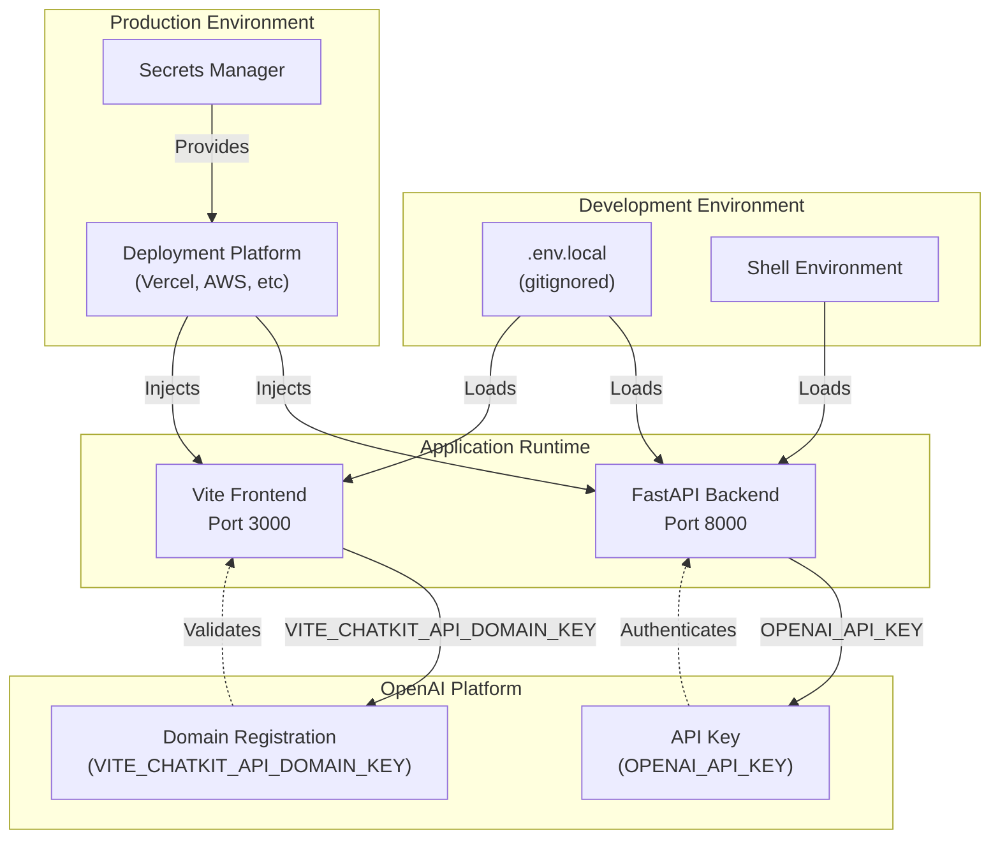
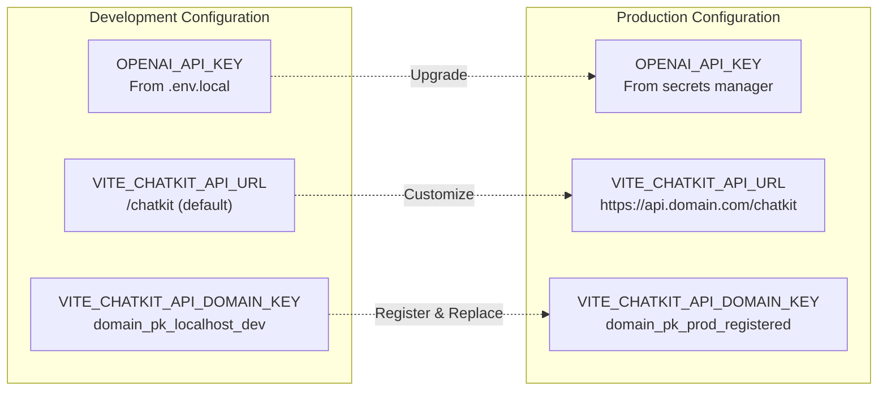
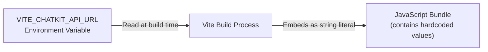
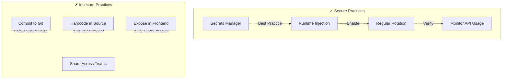

<!-- source: DeepWiki mcp.deepwiki.com · repo openai/openai-chatkit-starter-app · page 8.1 Production Environment Variables · fetched 2026-10-26 -->

# Production Environment Variables

<details>
<summary>Relevant source files</summary>

The following files were used as context for generating this wiki page:

- [chatkit/.env.example](chatkit/.env.example)
- [chatkit/.gitignore](chatkit/.gitignore)
- [chatkit/README.md](chatkit/README.md)
- [chatkit/backend/.gitignore](chatkit/backend/.gitignore)
- [chatkit/backend/app/__init__.py](chatkit/backend/app/__init__.py)

</details>


This document specifies the environment variables required for deploying either ChatKit starter application (`chatkit/` or `managed-chatkit/`) to production environments. It covers configuration differences between development and production, domain key registration, and security best practices.

For local development environment setup, see [Local Development Setup](#7.1). For deployment architecture decisions, see [Deployment Considerations](#8).

---

## Purpose and Scope

Environment variables control runtime configuration for both the backend (FastAPI) and frontend (Vite/React) components. Production deployments require specific values that differ from development defaults, particularly for API authentication and domain-specific security.

This document covers:
- Required and optional environment variables
- Development vs production value differences
- Domain key registration process
- Security and access control considerations
- Platform-specific deployment patterns

---

## Environment Variable Overview

The starter applications use three primary environment variables, divided between backend and frontend configurations:

| Variable | Component | Required | Default (Dev) | Production Notes |
|----------|-----------|----------|---------------|------------------|
| `OPENAI_API_KEY` | Backend | Yes | None | API key from OpenAI platform |
| `VITE_CHATKIT_API_URL` | Frontend | No | `/chatkit` | Full URL for cross-origin deployments |
| `VITE_CHATKIT_API_DOMAIN_KEY` | Frontend | No | `domain_pk_localhost_dev` | Registered domain key from OpenAI dashboard |

**Sources:** [chatkit/README.md:18-26](), [chatkit/.env.example:1-3]()

---

## Configuration Architecture



**Sources:** [chatkit/README.md:24-26](), [chatkit/.gitignore:1-3]()

---

## Backend Environment Variables

### OPENAI_API_KEY (Required)

The OpenAI API key authenticates backend requests to the OpenAI API through the `openai-chatkit` library.

**Format:** `sk-proj-...` (project-scoped key)

**Development:**
```bash
# In .env.local or shell
OPENAI_API_KEY=sk-proj-abcdef123456...
```

**Production Considerations:**
- **Never commit** to version control (enforced by [chatkit/backend/.gitignore:5]() and [chatkit/.gitignore:2]())
- Use platform-specific secrets management (AWS Secrets Manager, Vercel Environment Variables, etc.)
- Rotate keys regularly following security best practices
- Use project-scoped keys to limit blast radius
- Monitor usage through OpenAI dashboard for anomalies

**Runtime Access:**
The backend loads this variable at startup. The FastAPI application does not directly access it; instead, the `openai-chatkit` library's `Agent` class uses it to authenticate API requests.

**Sources:** [chatkit/README.md:20](), [chatkit/.env.example:1](), [chatkit/backend/.gitignore:5]()

---

## Frontend Environment Variables

Frontend environment variables must be prefixed with `VITE_` to be embedded in the client bundle during the Vite build process.

### VITE_CHATKIT_API_URL (Optional)

Specifies the backend API endpoint URL. The frontend proxies ChatKit requests to this URL.

**Default:** `/chatkit` (relative path, proxied by Vite dev server)

**Development:**
```bash
# Default behavior (no explicit config needed)
VITE_CHATKIT_API_URL=/chatkit
```

**Production:**
```bash
# Separate backend deployment
VITE_CHATKIT_API_URL=https://api.example.com/chatkit

# Same-origin deployment with path prefix
VITE_CHATKIT_API_URL=/api/chatkit
```

**When to Override:**
- Backend and frontend deployed to separate domains
- Backend behind API gateway with custom path
- Multiple environments (staging, production) with different backend URLs

**Sources:** [chatkit/README.md:21](), [chatkit/.env.example:2]()

---

### VITE_CHATKIT_API_DOMAIN_KEY (Optional)

Domain-specific security key registered through the OpenAI dashboard. This key validates that the frontend is authorized to use ChatKit from the deployment domain.

**Default:** `domain_pk_localhost_dev` (development-only key)

**Development:**
```bash
# Default for local development
VITE_CHATKIT_API_DOMAIN_KEY=domain_pk_localhost_dev
```

**Production:**
```bash
# Production domain key
VITE_CHATKIT_API_DOMAIN_KEY=domain_pk_prod_abc123xyz
```

**Registration Process:**
1. Deploy frontend to production domain (e.g., `https://chat.example.com`)
2. Access OpenAI dashboard
3. Navigate to ChatKit domain registration section
4. Register domain: `chat.example.com`
5. Receive domain key: `domain_pk_prod_...`
6. Set `VITE_CHATKIT_API_DOMAIN_KEY` environment variable
7. Rebuild and redeploy frontend with new key

**Security Notes:**
- Domain keys prevent unauthorized domains from using your ChatKit integration
- Each production domain requires a separate registered key
- Development key (`domain_pk_localhost_dev`) only works on `localhost`
- Keys are public (embedded in client bundle) but domain-validated

**Sources:** [chatkit/README.md:22](), [chatkit/README.md:25-26](), [chatkit/.env.example:3]()

---

## Development vs Production Configuration Matrix



| Aspect | Development | Production |
|--------|-------------|------------|
| **Source** | `.env.local` file (gitignored) | Platform secrets manager |
| **API Key** | Personal development key | Organization production key |
| **Backend URL** | `/chatkit` (proxied) | Full URL or path with domain |
| **Domain Key** | `domain_pk_localhost_dev` | Registered domain key |
| **Security** | Local-only, minimal risk | Secrets rotation, monitoring |
| **Build Process** | Live reload with `npm run dev` | Static build with `npm run build` |

**Sources:** [chatkit/README.md:18-26](), [chatkit/.env.example:1-3]()

---

## Environment Variable Loading Patterns

### Backend (FastAPI)

The FastAPI backend loads environment variables using Python's standard `os.environ` or libraries like `python-dotenv`:

**Loading Priority:**
1. Shell environment variables (highest priority)
2. `.env.local` file at repository root
3. Platform-injected environment variables (production)

**Example Access Pattern:**
```python
# Typical pattern (not shown in starter code)
import os

api_key = os.environ.get("OPENAI_API_KEY")
```

**Deployment Notes:**
- In production, avoid file-based `.env` loading
- Use platform-native environment variable injection
- Backend runs as long-lived process; changes require restart

**Sources:** [chatkit/README.md:24](), [chatkit/backend/.gitignore:5]()

---

### Frontend (Vite)

Vite bundles environment variables into the client JavaScript at build time. Variables must have the `VITE_` prefix.

**Build-Time Embedding:**


**Access Pattern:**
```typescript
// In frontend/src/lib/config.ts (typical pattern)
const apiUrl = import.meta.env.VITE_CHATKIT_API_URL || '/chatkit';
const domainKey = import.meta.env.VITE_CHATKIT_API_DOMAIN_KEY || 'domain_pk_localhost_dev';
```

**Critical Differences from Backend:**
- **Build-time only:** Changing variables requires rebuild
- **Public values:** All `VITE_` variables are visible in client bundle
- **No secrets:** Never put sensitive keys in `VITE_` variables

**Deployment Workflow:**
1. Set production environment variables on platform
2. Trigger build: `npm run build`
3. Vite reads `VITE_*` variables and embeds in bundle
4. Deploy static assets to CDN/hosting
5. Changes require full rebuild and redeploy

**Sources:** [chatkit/README.md:21-22](), [chatkit/.env.example:2-3]()

---

## Platform-Specific Configuration Examples

### Vercel

```bash
# Environment variables set in Vercel dashboard
OPENAI_API_KEY=sk-proj-xxx              # Backend (secure)
VITE_CHATKIT_API_URL=/api/chatkit       # Frontend (build-time)
VITE_CHATKIT_API_DOMAIN_KEY=domain_pk_prod_xxx  # Frontend (build-time)
```

**Vercel-Specific Notes:**
- Set backend variables as "Server" type for security
- Frontend variables automatically available at build
- Separate environment scopes (production, preview, development)

### AWS (ECS + S3/CloudFront)

**Backend (ECS Task Definition):**
```json
{
  "environment": [
    {
      "name": "OPENAI_API_KEY",
      "valueFrom": "arn:aws:secretsmanager:..."
    }
  ]
}
```

**Frontend (Build via CodeBuild):**
```yaml
# buildspec.yml
env:
  variables:
    VITE_CHATKIT_API_URL: "https://api.example.com/chatkit"
  secrets-manager:
    VITE_CHATKIT_API_DOMAIN_KEY: "prod/frontend:DOMAIN_KEY"
```

### Docker / Docker Compose

**docker-compose.yml:**
```yaml
services:
  backend:
    environment:
      - OPENAI_API_KEY=${OPENAI_API_KEY}
    env_file:
      - .env.production
  
  frontend:
    build:
      args:
        - VITE_CHATKIT_API_URL=${VITE_CHATKIT_API_URL}
        - VITE_CHATKIT_API_DOMAIN_KEY=${VITE_CHATKIT_API_DOMAIN_KEY}
```

**Sources:** [chatkit/README.md:24-26]()

---

## Security Best Practices

### API Key Management



**Critical Security Rules:**

1. **Never commit API keys** - Enforced by `.gitignore` patterns
2. **Backend only** - `OPENAI_API_KEY` must never reach frontend
3. **Use secrets managers** - AWS Secrets Manager, HashiCorp Vault, etc.
4. **Rotate regularly** - Implement key rotation schedule
5. **Monitor usage** - Set up alerts for unusual API consumption
6. **Least privilege** - Use project-scoped keys when possible

**Sources:** [chatkit/backend/.gitignore:5](), [chatkit/.gitignore:2]()

---

### Domain Key Security

**Domain keys are public but validated:**
- Embedded in client JavaScript bundle (visible to users)
- OpenAI validates origin domain matches registered domain
- Prevents unauthorized domains from using your integration
- Not a secret; protects against cross-origin abuse

**Registration Requirements:**
- Each production domain requires separate key
- Subdomains need separate registration
- Development key only works on `localhost`

**Sources:** [chatkit/README.md:25-26]()

---

## Validation and Troubleshooting

### Missing OPENAI_API_KEY

**Symptom:** Backend fails to start or API requests fail

**Error Pattern:**
```
Error: OpenAI API key not found
```

**Resolution:**
1. Verify key is set: `echo $OPENAI_API_KEY`
2. Check `.env.local` exists and contains key
3. Restart backend after setting variable
4. Verify key format starts with `sk-proj-` or `sk-`

---

### Incorrect VITE_CHATKIT_API_URL

**Symptom:** Frontend cannot connect to backend

**Error Pattern:**
```
Failed to fetch: ERR_CONNECTION_REFUSED
CORS policy error
```

**Resolution:**
1. Verify backend is running on expected URL
2. Check CORS configuration in backend allows origin
3. Rebuild frontend after changing variable
4. Verify proxy configuration in `vite.config.ts` (development only)

---

### Invalid VITE_CHATKIT_API_DOMAIN_KEY

**Symptom:** ChatKit initialization fails in browser

**Error Pattern:**
```
Domain key validation failed
Unauthorized domain
```

**Resolution:**
1. Verify domain key registered in OpenAI dashboard
2. Confirm deployment domain matches registered domain
3. Check for typos in domain key value
4. Rebuild and redeploy frontend
5. Use `domain_pk_localhost_dev` for local development only

**Sources:** [chatkit/README.md:25-26]()

---

## Environment Variable Checklist

Use this checklist when deploying to production:

- [ ] `OPENAI_API_KEY` set in secrets manager (backend)
- [ ] API key tested and validated with OpenAI
- [ ] Key monitoring and rotation schedule configured
- [ ] Production domain deployed and accessible
- [ ] Domain registered in OpenAI dashboard
- [ ] `VITE_CHATKIT_API_DOMAIN_KEY` obtained from registration
- [ ] `VITE_CHATKIT_API_URL` set to production backend URL
- [ ] Frontend rebuilt with production environment variables
- [ ] CORS configuration allows production frontend domain
- [ ] Test end-to-end chat flow in production
- [ ] `.env.local` and `.env` files not committed (verify `.gitignore`)
- [ ] Documentation updated with deployment-specific values

**Sources:** [chatkit/README.md:18-26](), [chatkit/.gitignore:2]()

---

## Related Documentation

- **[Environment Configuration](#2.2)** - Development environment setup and `.env.local` configuration
- **[Local Development Setup](#7.1)** - Complete local development workflow
- **[Deployment Considerations](#8)** - Overall deployment architecture decisions
- **[Persistent Storage Migration](#8.2)** - Database configuration for production deployments

---

