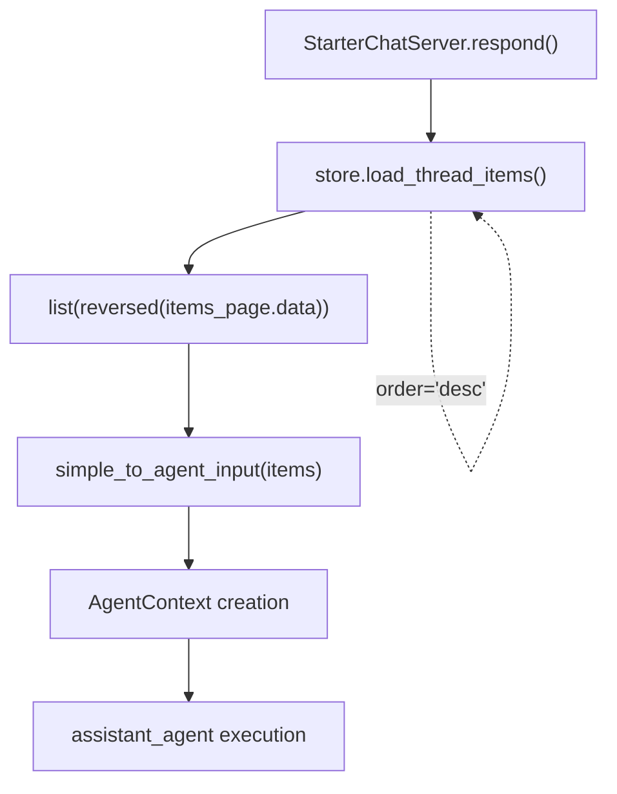
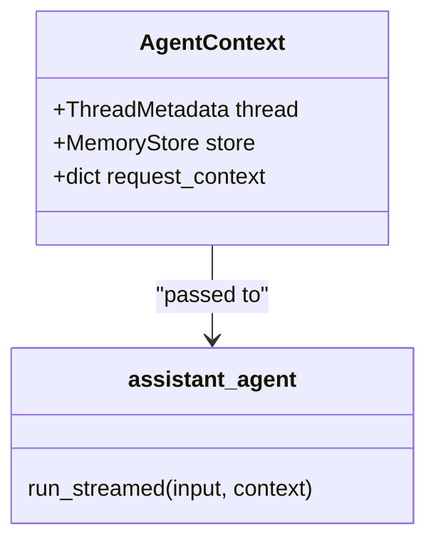
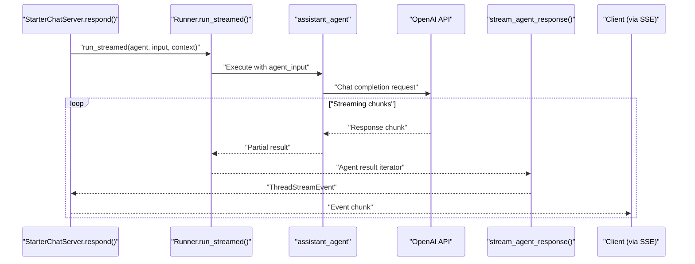
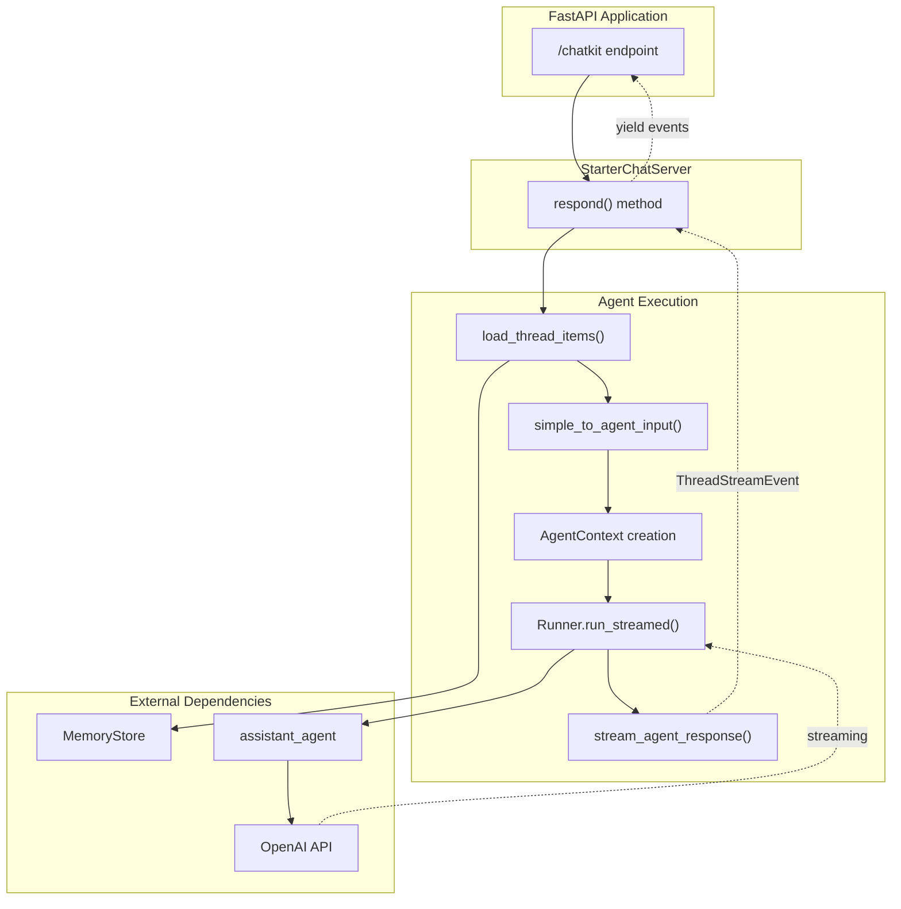
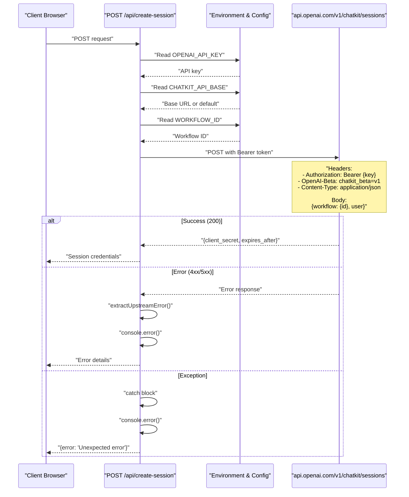

<!-- source: DeepWiki mcp.deepwiki.com · repo openai/openai-chatkit-starter-app · extra page AI Agent Integration · fetched 2026-10-26 -->

# AI Agent Integration

<details>
<summary>Relevant source files</summary>

The following files were used as context for generating this wiki page:

- [chatkit/backend/app/memory_store.py](chatkit/backend/app/memory_store.py)
- [chatkit/backend/app/server.py](chatkit/backend/app/server.py)

</details>


## Purpose and Scope

This document explains how the self-hosted ChatKit backend integrates an AI agent to generate conversational responses. It covers the `assistant_agent` configuration, context preparation from conversation history, and streaming response generation using the OpenAI Agents SDK. This agent is invoked by the `StarterChatServer.respond` method (see page 3.2.2) and uses conversation history from `MemoryStore` (see page 3.2.3).

## Agent Configuration

The AI agent is configured as a module-level constant in [chatkit/backend/app/server.py:20-28](), defining its behavior and capabilities.

### Agent Definition

```python
assistant_agent = Agent[AgentContext[dict[str, Any]]](
    model=MODEL,
    name="Starter Assistant",
    instructions=(
        "You are a concise, helpful assistant. "
        "Keep replies short and focus on directly answering "
        "the user's request."
    ),
)
```

### Configuration Parameters

| Parameter | Value | Purpose |
|-----------|-------|---------|
| `model` | `"gpt-4.1-mini"` | The OpenAI model used for response generation (defined at [chatkit/backend/app/server.py:17]()) |
| `name` | `"Starter Assistant"` | Identifier for the agent in logs and debugging |
| `instructions` | System prompt | Defines the agent's behavior and response style |

The `MODEL` constant is set to `"gpt-4.1-mini"` at [chatkit/backend/app/server.py:17](), providing a balance between capability and cost for the starter application.

### Type Parameterization

The agent is parameterized with `AgentContext[dict[str, Any]]`, indicating it operates within a ChatKit agent context that carries a generic dictionary for request-specific data. The `AgentContext` type comes from the `chatkit.agents` module and provides access to the thread, store, and request context during agent execution.

**Sources:** [chatkit/backend/app/server.py:20-28](), [chatkit/backend/app/server.py:17]()

## Context Preparation

Before invoking the agent, the `respond` method prepares conversation context from stored history. This process involves loading recent messages, reversing their order, and converting them to agent-compatible format.

### Context Preparation Flow

**Diagram: Context Preparation Pipeline**



### Loading Recent Items

The method loads up to 30 recent conversation items at [chatkit/backend/app/server.py:44-50]():

```python
items_page = await self.store.load_thread_items(
    thread.id,
    after=None,
    limit=MAX_RECENT_ITEMS,
    order="desc",
    context=context,
)
```

| Parameter | Value | Purpose |
|-----------|-------|---------|
| `thread.id` | Current thread identifier | Scopes the query to the active conversation |
| `after` | `None` | No pagination cursor (fetch from start) |
| `limit` | `30` | Maximum items to load (defined by `MAX_RECENT_ITEMS` at [chatkit/backend/app/server.py:16]()) |
| `order` | `"desc"` | Newest items first (reversed later for chronological order) |

### Chronological Ordering

Items are loaded in descending order (newest first) for efficient pagination, then reversed at [chatkit/backend/app/server.py:51]() to provide chronological order to the agent:

```python
items = list(reversed(items_page.data))
```

This ensures the agent processes messages in the order they were sent, which is critical for maintaining conversation coherence.

### Agent Input Conversion

The `simple_to_agent_input` function at [chatkit/backend/app/server.py:52]() converts ChatKit `ThreadItem` objects into the format expected by the Agents SDK:

```python
agent_input = await simple_to_agent_input(items)
```

This function, imported from `chatkit.agents`, transforms thread items (which may include user messages, assistant messages, and system events) into agent-compatible message structures.

### AgentContext Creation

An `AgentContext` is instantiated at [chatkit/backend/app/server.py:54-58]() to provide the agent with access to necessary resources:

**Diagram: AgentContext Structure**



```python
agent_context = AgentContext(
    thread=thread,
    store=self.store,
    request_context=context,
)
```

| Field | Type | Purpose |
|-------|------|---------|
| `thread` | `ThreadMetadata` | Current thread metadata for context |
| `store` | `MemoryStore` | Store instance for persisting agent-generated items |
| `request_context` | `dict[str, Any]` | Request-specific data passed through the system |

**Sources:** [chatkit/backend/app/server.py:44-58](), [chatkit/backend/app/server.py:16]()

## Streaming Response Generation

The agent generates responses using a streaming execution model, allowing real-time updates to be sent to the client as the AI generates its reply.

### Streaming Execution

**Diagram: Streaming Response Flow**



The streaming process is initiated at [chatkit/backend/app/server.py:60-64]():

```python
result = Runner.run_streamed(
    assistant_agent,
    agent_input,
    context=agent_context,
)
```

### Runner.run_streamed

The `Runner.run_streamed` method (from the `agents` library imported at [chatkit/backend/app/server.py:7]()) executes the agent with streaming enabled. This returns an iterator that yields partial results as the agent processes the input and receives responses from the OpenAI API.

| Parameter | Type | Purpose |
|-----------|------|---------|
| First argument | `Agent[AgentContext[dict]]` | The `assistant_agent` instance to execute |
| `agent_input` | Converted message format | Prepared conversation history and current message |
| `context` | `AgentContext` | Runtime context with thread, store, and request data |

### Event Streaming

The raw agent result stream is converted to `ThreadStreamEvent` objects at [chatkit/backend/app/server.py:66-67]():

```python
async for event in stream_agent_response(agent_context, result):
    yield event
```

The `stream_agent_response` function (imported from `chatkit.agents` at [chatkit/backend/app/server.py:8]()) transforms agent execution events into ChatKit-compatible `ThreadStreamEvent` objects. These events are yielded from the `respond` method, allowing the FastAPI endpoint to stream them to the client using Server-Sent Events (SSE).

### Event Types

The streamed events may include:

| Event Type | Purpose |
|------------|---------|
| Message delta events | Partial text content as it's generated |
| Function call events | Tool invocations if the agent uses functions |
| Completion events | Signal the end of response generation |
| Error events | Communicate failures during generation |

**Sources:** [chatkit/backend/app/server.py:60-67](), [chatkit/backend/app/server.py:7-8]()

## Integration with ChatKit Server

The agent integration operates within the broader ChatKit server architecture, connecting conversation management with AI response generation.

**Diagram: Agent Integration Architecture**



### Call Chain

The agent is invoked through this call chain:

1. **FastAPI Endpoint** (`/chatkit`) receives a request
2. **ChatKitServer** processes the payload (see page 3.2.1)
3. **StarterChatServer.respond** orchestrates the response (see page 3.2.2)
4. **Context Preparation** loads and converts history
5. **Runner.run_streamed** executes the `assistant_agent`
6. **stream_agent_response** converts results to `ThreadStreamEvent`
7. **FastAPI** streams events back to the client

### Data Dependencies

| Component | Purpose | Source |
|-----------|---------|--------|
| `thread` | Current conversation metadata | Passed from `ChatKitServer` |
| `self.store` | Access to conversation history | Initialized in `StarterChatServer.__init__` at [chatkit/backend/app/server.py:34-36]() |
| `context` | Request-specific data | Passed through from endpoint |

The `respond` method at [chatkit/backend/app/server.py:38-67]() serves as the orchestration point, coordinating between the store, agent, and streaming infrastructure to generate AI responses.

**Sources:** [chatkit/backend/app/server.py:31-67](), [chatkit/backend/app/server.py:1-13]()

## Customization Points

The agent integration provides several customization opportunities for developers adapting the starter application.

### Model Selection

The model can be changed by modifying the `MODEL` constant at [chatkit/backend/app/server.py:17]():

```python
MODEL = "gpt-4.1-mini"  # Change to "gpt-4o", "gpt-3.5-turbo", etc.
```

Different models offer tradeoffs between cost, speed, and capability.

### Agent Instructions

The agent's behavior is controlled by the `instructions` parameter at [chatkit/backend/app/server.py:23-27](). Modify this to change the agent's personality, response style, or task focus:

```python
instructions=(
    "You are a concise, helpful assistant. "
    "Keep replies short and focus on directly answering "
    "the user's request."
)
```

### Context Window Size

The number of recent messages provided to the agent is controlled by `MAX_RECENT_ITEMS` at [chatkit/backend/app/server.py:16]():

```python
MAX_RECENT_ITEMS = 30  # Adjust based on context requirements
```

Increasing this value provides more conversation history but increases token usage and latency. Decreasing it reduces costs but may limit the agent's ability to maintain context over longer conversations.

### Agent Capabilities

The `assistant_agent` can be extended with additional capabilities by:

1. **Adding tools/functions**: Configure the agent with function calling capabilities
2. **Implementing multi-agent systems**: Replace the single agent with orchestrated multi-agent workflows
3. **Custom processing**: Modify `simple_to_agent_input` to include additional context or preprocessing

**Sources:** [chatkit/backend/app/server.py:16-28]()

## API Request Flow Summary



**Sources:** [app/api/create-session/route.ts:15-120](), [lib/config.ts:1-6](), [.env.example:1-2]()

---

