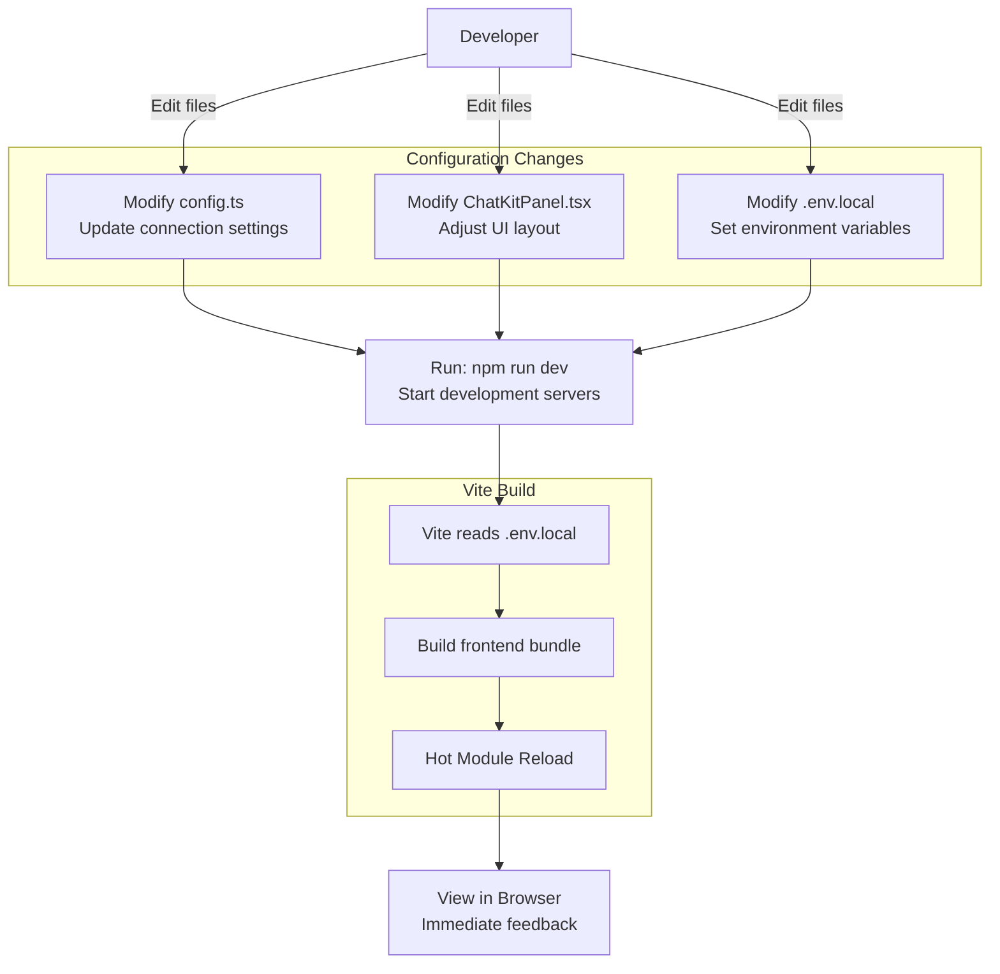
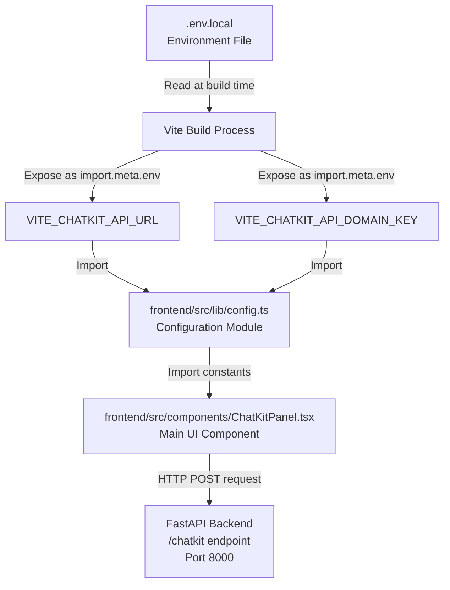
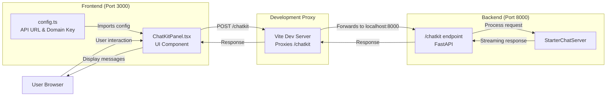

<!-- source: DeepWiki mcp.deepwiki.com · repo openai/openai-chatkit-starter-app · extra page Configuration & Customization · fetched 2026-10-26 -->

## Customization Workflow

The typical workflow for customizing the frontend configuration:



**Description:** Developers modify configuration files and environment variables, then run `npm run dev` to start the development servers. Vite's hot module reload provides immediate feedback for most changes without requiring a full page reload.

**Sources:** [chatkit/README.md:8-10](), [chatkit/README.md:28-32]()

## Integration with Backend Configuration

The frontend configuration must align with backend settings to establish proper communication:

**Configuration Alignment:**

| Frontend Setting | Backend Requirement | Integration Point |
|------------------|---------------------|-------------------|
| `VITE_CHATKIT_API_URL` | FastAPI `/chatkit` endpoint | HTTP connection path |
| `VITE_CHATKIT_API_DOMAIN_KEY` | Domain validation logic | Authentication |
| Port 3000 (dev) | Port 8000 (backend) | Development proxy |

The backend FastAPI application must expose the `/chatkit` endpoint (documented in section 3.2.1) at the URL specified in `VITE_CHATKIT_API_URL` for the frontend to function correctly. During development, this is handled automatically by the Vite proxy configuration.

**Sources:** [chatkit/README.md:15-16](), [chatkit/README.md:21-22]()

## Common Customization Tasks

### Changing the API Endpoint

To connect to a different backend URL:

1. Update `VITE_CHATKIT_API_URL` in `.env.local`
2. Restart the development server: `npm run dev`
3. Verify the connection in browser developer tools

### Updating the Domain Key

To use a different ChatKit domain:

1. Register a domain key in the OpenAI dashboard
2. Update `VITE_CHATKIT_API_DOMAIN_KEY` in `.env.local`
3. Restart the development server to rebuild with the new key

### Modifying the UI Layout

To adjust the chat interface layout:

1. Open `frontend/src/components/ChatKitPanel.tsx`
2. Modify component structure, styling, or behavior
3. Save the file to trigger hot module reload
4. Review changes immediately in the browser

**Sources:** [chatkit/README.md:28-32]()

## Best Practices

### Configuration Management

- **Environment Files:** Use `.env.local` for local secrets; never commit this file to version control
- **Default Values:** Provide sensible defaults in `config.ts` for optional settings
- **Type Safety:** Leverage TypeScript types to catch configuration errors at compile time
- **Documentation:** Comment configuration options to explain their purpose and valid values

### Customization Strategy

- **Incremental Changes:** Start with small modifications to understand their impact
- **Version Control:** Commit configuration changes separately from feature development
- **Testing:** Verify functionality with both development and production configurations
- **Documentation:** Document custom modifications for team members and future reference

**Sources:** [chatkit/README.md:28-32](), [chatkit/.gitignore:2-3]()

## Relationship to Other Components

The frontend configuration documented on this page coordinates with several other system components:

- **Backend Configuration (3.2.1):** The backend FastAPI application must expose the endpoint specified in `VITE_CHATKIT_API_URL`
- **Environment Variables (2.2):** Environment setup provides the values read by the configuration module
- **Request Flow (3.4):** Configuration determines the endpoint used in the complete request flow from user to backend

The frontend serves as the user-facing interface that relies on properly configured backend services and environment variables to function correctly.

**Sources:** [chatkit/README.md:15-16](), [chatkit/README.md:28-32]()
# Configuration & Customization

<details>
<summary>Relevant source files</summary>

The following files were used as context for generating this wiki page:

- [chatkit/.env.example](chatkit/.env.example)
- [chatkit/.gitignore](chatkit/.gitignore)
- [chatkit/README.md](chatkit/README.md)
- [chatkit/backend/.gitignore](chatkit/backend/.gitignore)
- [chatkit/backend/app/__init__.py](chatkit/backend/app/__init__.py)

</details>


This document details the frontend configuration and customization points for the self-hosted ChatKit starter application. The frontend is built with Vite + React and provides two primary customization areas: connection settings in `frontend/src/lib/config.ts` and layout adjustments in `frontend/src/components/ChatKitPanel.tsx`.

## Purpose and Scope

The self-hosted ChatKit frontend configuration system serves to:
- Connect the frontend to the FastAPI backend via configurable endpoints
- Define authentication credentials through domain keys
- Provide customizable UI layout and components
- Separate configuration from implementation for easy modification

The configuration system reads environment variables prefixed with `VITE_` at build time and makes them available to the frontend application.

## Configuration Files

### frontend/src/lib/config.ts

This file exports configuration constants used throughout the frontend application. It primarily handles connection settings to the backend API:

**Key Configuration Values:**

| Setting | Environment Variable | Default | Purpose |
|---------|---------------------|---------|---------|
| API URL | `VITE_CHATKIT_API_URL` | `/chatkit` | Backend endpoint path for chat requests |
| Domain Key | `VITE_CHATKIT_API_DOMAIN_KEY` | `domain_pk_localhost_dev` | ChatKit authentication domain key |

The `VITE_` prefix is a Vite convention that makes environment variables available in the browser bundle at build time. Vite automatically exposes variables starting with `VITE_` to client-side code through `import.meta.env`.

**Sources:** [chatkit/README.md:21-22](), [chatkit/.env.example:2-3]()

### frontend/src/components/ChatKitPanel.tsx

This file contains the main UI layout component that integrates with the ChatKit UI library. The component:
- Renders the chat interface
- Connects to the backend using configuration from `config.ts`
- Handles user interactions and message display
- Manages the visual layout and styling

Modifications to this file enable customization of the UI layout, component arrangement, and visual presentation.

**Sources:** [chatkit/README.md:31]()

## Configuration Flow



**Description:** Environment variables are read at build time by Vite and exposed through `import.meta.env`. The configuration module imports these values and exports them as constants. The `ChatKitPanel` component imports these constants to establish the backend connection.

**Sources:** [chatkit/README.md:15-16](), [chatkit/README.md:21-22](), [chatkit/README.md:30-31]()

## Environment Variable Configuration

### Development Setup

For local development, create a `.env.local` file in the `chatkit/` directory with the following variables:

```
OPENAI_API_KEY=sk-proj-...
VITE_CHATKIT_API_URL=/chatkit
VITE_CHATKIT_API_DOMAIN_KEY=domain_pk_localhost_dev
```

**Variable Details:**

| Variable | Required | Purpose |
|----------|----------|---------|
| `OPENAI_API_KEY` | Yes (backend) | OpenAI API authentication key for backend |
| `VITE_CHATKIT_API_URL` | No | Backend endpoint URL (defaults to `/chatkit`) |
| `VITE_CHATKIT_API_DOMAIN_KEY` | No | ChatKit domain key (defaults to `domain_pk_localhost_dev`) |

The `VITE_CHATKIT_API_URL` uses a relative path `/chatkit` which is automatically proxied to the FastAPI backend during development. The Vite development server forwards requests to port 8000 where the backend runs.

**Sources:** [chatkit/.env.example:1-3](), [chatkit/README.md:20-22](), [chatkit/README.md:15-16]()

### Production Setup

For production deployments, update the environment variables:

1. **Register a Domain Key:** Obtain a production domain key from the OpenAI dashboard
2. **Set Full Backend URL:** Configure `VITE_CHATKIT_API_URL` with the complete backend URL
3. **Update Domain Key:** Set `VITE_CHATKIT_API_DOMAIN_KEY` to the production key

Example production configuration:

```
VITE_CHATKIT_API_URL=https://api.yourapp.com/chatkit
VITE_CHATKIT_API_DOMAIN_KEY=domain_pk_prod_abc123xyz
```

**Sources:** [chatkit/README.md:25-26]()

## Connection Architecture



**Description:** During development, the frontend on port 3000 makes requests to `/chatkit`. The Vite dev server proxies these requests to the FastAPI backend on port 8000. In production, the frontend connects directly to the deployed backend URL specified in `VITE_CHATKIT_API_URL`.

**Sources:** [chatkit/README.md:15-16](), [chatkit/README.md:30-32]()

## Modifying Configuration

### Changing UI Text

To modify the chat interface text, edit the static constants in [lib/config.ts:7-17]():

- **Greeting Message:** Modify `GREETING` string
- **Input Placeholder:** Modify `PLACEHOLDER_INPUT` string
- **Starter Prompts:** Add, remove, or modify objects in the `STARTER_PROMPTS` array

Example modification to add a new starter prompt:

```typescript
export const STARTER_PROMPTS: StartScreenPrompt[] = [
  {
    label: "What can you do?",
    prompt: "What can you do?",
    icon: "circle-question",
  },
  {
    label: "Tell me about OpenAI",
    prompt: "Tell me about OpenAI and its products",
    icon: "lightbulb",
  },
];
```

### Changing the Session Endpoint

To modify the session creation endpoint, update the `CREATE_SESSION_ENDPOINT` constant in [lib/config.ts:5](). Note that the corresponding API route handler must also be moved or updated in the `app/api/` directory structure.

### Changing the Workflow ID

The `WORKFLOW_ID` should not be directly modified in `lib/config.ts`. Instead, update the `NEXT_PUBLIC_CHATKIT_WORKFLOW_ID` environment variable in `.env.local`. See [Environment Variables](#8.1) for details.

## Type Definitions

The `StartScreenPrompt` type is imported from the `@openai/chatkit` package:

```typescript
import { StartScreenPrompt } from "@openai/chatkit";
```

**Source:** [lib/config.ts:1]()

This type defines the structure of prompt objects with the following properties:
- `label: string` - Display text
- `prompt: string` - Message sent when clicked
- `icon: string` - Icon identifier from ChatKit's icon set

## Configuration Access Pattern

The configuration follows a centralized import pattern where:

1. **Single Source:** All configuration constants are defined in one file (`lib/config.ts`)
2. **Named Exports:** Each constant is exported individually for selective imports
3. **Direct Imports:** Components import only the constants they need
4. **No Re-exports:** Configuration is not re-exported through intermediate modules

This pattern ensures:
- Easy tracking of configuration usage across the codebase
- Type safety for all configuration values
- Simple modification without side effects

**Sources:** [lib/config.ts:1-18](), [components/ChatKitPanel.tsx:6-11]()

---

