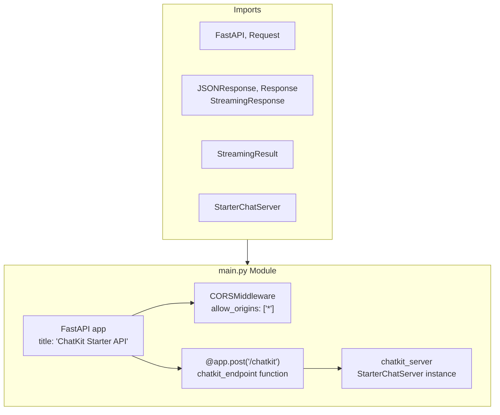
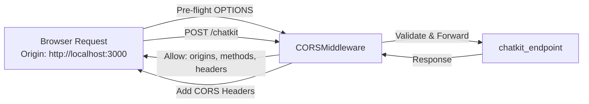
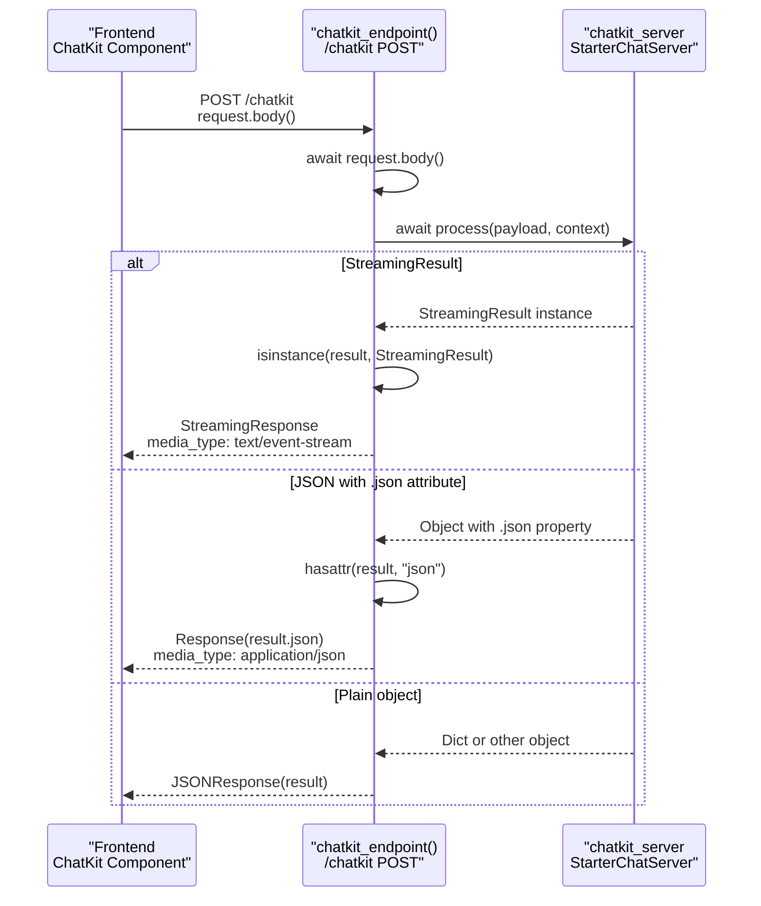
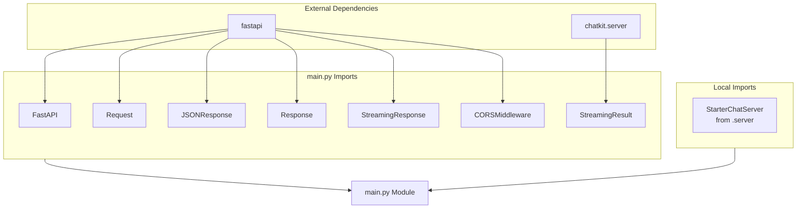

<!-- source: DeepWiki mcp.deepwiki.com · repo openai/openai-chatkit-starter-app · extra page FastAPI Entrypoint · fetched 2026-10-26 -->

# FastAPI Entrypoint

<details>
<summary>Relevant source files</summary>

The following files were used as context for generating this wiki page:

- [chatkit/backend/app/main.py](chatkit/backend/app/main.py)

</details>


This document describes the FastAPI application entry point for the self-hosted ChatKit backend, located at [chatkit/backend/app/main.py](). This module initializes the FastAPI web server, configures CORS middleware, and exposes the `/chatkit` HTTP endpoint that accepts requests from the ChatKit web component.

**Scope**: This page focuses exclusively on the HTTP layer and FastAPI configuration. For details on how requests are processed after reaching the endpoint, see [StarterChatServer](#3.2.2). For the overall backend architecture, see [Backend Implementation](#3.2).

## Purpose and Responsibilities

The FastAPI entrypoint serves as the HTTP interface layer with the following responsibilities:

| Responsibility | Implementation |
|---------------|----------------|
| **Web Server Initialization** | Creates and configures the FastAPI application instance |
| **CORS Configuration** | Enables cross-origin requests from the frontend |
| **Request Routing** | Maps the `/chatkit` POST endpoint to the server implementation |
| **Payload Proxying** | Forwards raw request bodies to `StarterChatServer` |
| **Response Handling** | Adapts `StreamingResult` or JSON responses to appropriate HTTP formats |

Sources: [chatkit/backend/app/main.py:1-36]()

## Application Structure



**Diagram: FastAPI Application Initialization Structure**

The module creates a single global `FastAPI` instance and a single `StarterChatServer` instance that persists across requests. The CORS middleware is configured to allow all origins, credentials, methods, and headers, which is appropriate for local development but should be restricted in production deployments.

Sources: [chatkit/backend/app/main.py:6-22]()

## FastAPI Application Initialization

The FastAPI application is initialized at module load time with a descriptive title:

```python
app = FastAPI(title="ChatKit Starter API")
```

This creates the ASGI application that will be served by Uvicorn (see [Getting Started](#2.3) for server startup details).

Sources: [chatkit/backend/app/main.py:12]()

## CORS Middleware Configuration

The application configures permissive CORS settings to enable the frontend (running on port 3000) to communicate with the backend (running on port 8000):



**Diagram: CORS Request Flow**

The middleware configuration at [chatkit/backend/app/main.py:14-20]() uses wildcard permissions:

| Parameter | Value | Purpose |
|-----------|-------|---------|
| `allow_origins` | `["*"]` | Accept requests from any origin |
| `allow_credentials` | `True` | Allow cookies and authentication headers |
| `allow_methods` | `["*"]` | Accept all HTTP methods |
| `allow_headers` | `["*"]` | Accept all request headers |

**Note**: This permissive configuration is suitable for local development but should be restricted to specific origins in production environments.

Sources: [chatkit/backend/app/main.py:14-20]()

## Server Instance Management

The `StarterChatServer` is instantiated once at module level:

```python
chatkit_server = StarterChatServer()
```

This singleton pattern ensures that the in-memory `MemoryStore` (see [MemoryStore](#3.2.3)) persists across requests, maintaining conversation history for the lifetime of the backend process. The server instance is shared across all concurrent requests handled by the FastAPI application.

Sources: [chatkit/backend/app/main.py:22]()

## The `/chatkit` Endpoint

The primary HTTP endpoint handles POST requests from the ChatKit web component:



**Diagram: /chatkit Endpoint Request Handling Flow**

### Endpoint Implementation

The `chatkit_endpoint` function at [chatkit/backend/app/main.py:25-35]() follows this processing pattern:

1. **Extract Payload**: Reads the raw request body using `await request.body()`
2. **Process Request**: Invokes `chatkit_server.process(payload, context)` with the payload and a context dictionary containing the FastAPI `Request` object
3. **Determine Response Type**: Inspects the result to determine the appropriate HTTP response format
4. **Return Response**: Wraps the result in the appropriate FastAPI response class

### Response Type Handling

The endpoint supports three response types through conditional logic:

| Condition | Response Type | Media Type | Use Case |
|-----------|--------------|------------|----------|
| `isinstance(result, StreamingResult)` | `StreamingResponse` | `text/event-stream` | Streaming AI responses with Server-Sent Events |
| `hasattr(result, "json")` | `Response` | `application/json` | Pre-serialized JSON responses |
| Default | `JSONResponse` | `application/json` | Dict or JSON-serializable objects |

This flexible response handling allows the `StarterChatServer` to return different response types based on the request (streaming for chat completion, non-streaming for other operations).

Sources: [chatkit/backend/app/main.py:25-35]()

## Request Context

The endpoint passes a context dictionary to the server's `process` method:

```python
{"request": request}
```

This context provides the `StarterChatServer` access to the raw FastAPI `Request` object, enabling access to headers, query parameters, or other request metadata if needed. Currently, the server implementation does not utilize this context, but it provides an extension point for authentication, rate limiting, or request-specific configuration.

Sources: [chatkit/backend/app/main.py:29]()

## Type Checking and Imports

The module uses specific imports from the `fastapi` package and the `chatkit` library:



**Diagram: Import Dependencies**

The type hint `Response` in the function signature at [chatkit/backend/app/main.py:26]() is the base class for FastAPI response types, allowing the function to return any of the specific response subclasses (`StreamingResponse`, `Response`, or `JSONResponse`).

Sources: [chatkit/backend/app/main.py:1-10]()

## Integration with ASGI Server

This FastAPI application is served by Uvicorn, an ASGI web server. The development server is started with the command:

```bash
uvicorn app.main:app --reload --host 127.0.0.1 --port 8000
```

The `app` variable at [chatkit/backend/app/main.py:12]() is the ASGI application that Uvicorn loads and serves. For details on starting the server, see [Running the Application](#2.3).

Sources: [chatkit/backend/app/main.py:12]()

## Error Handling

The endpoint does not implement explicit error handling; exceptions raised by `StarterChatServer.process()` will be caught by FastAPI's default exception handlers and returned as HTTP 500 responses. For production deployments, consider adding custom exception handlers to provide more specific error responses to clients.

Sources: [chatkit/backend/app/main.py:25-35]()

---

