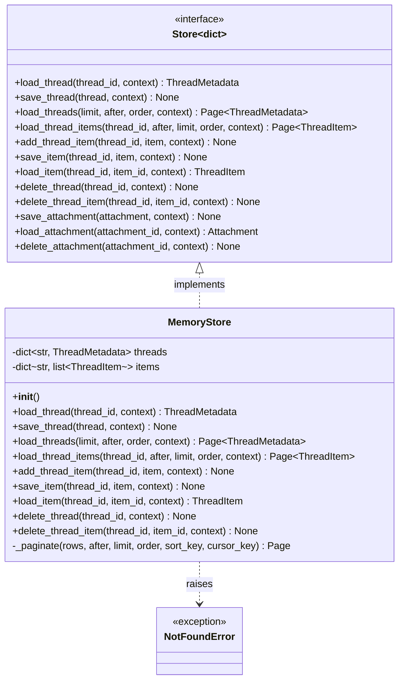
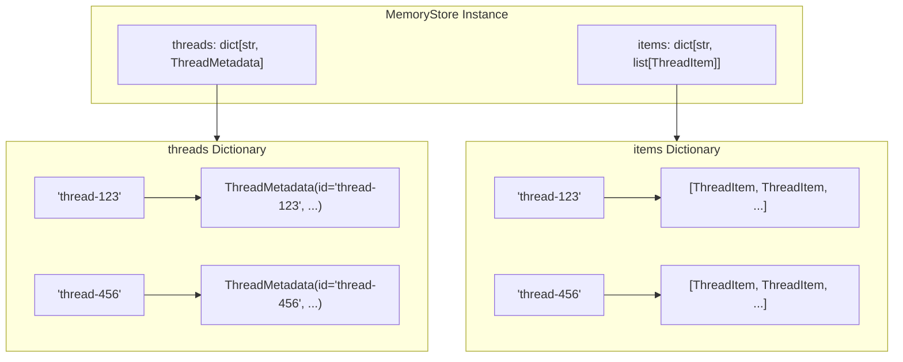
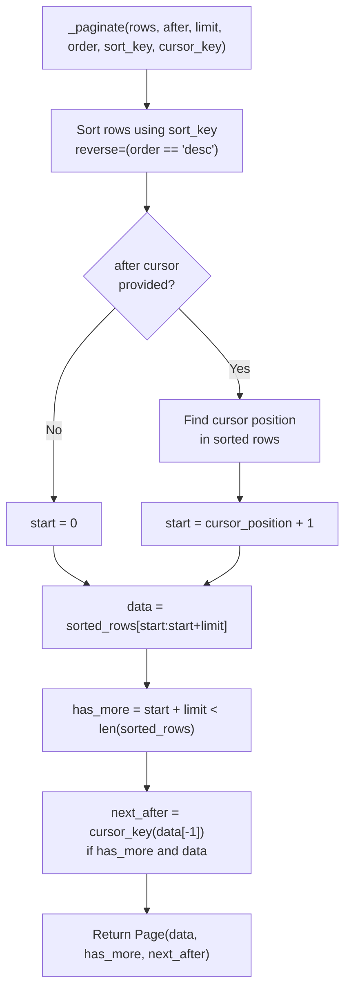
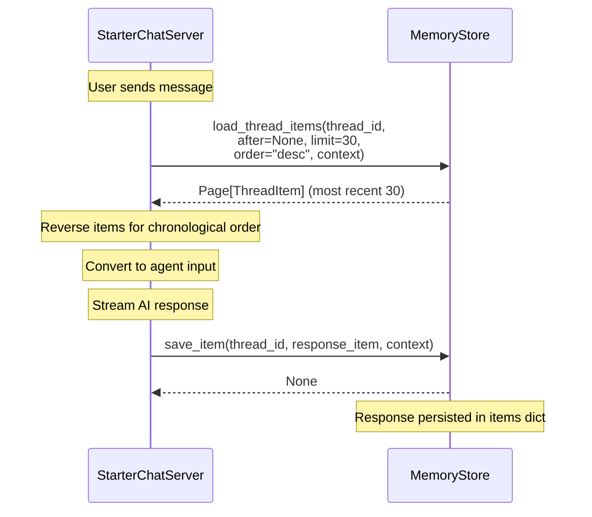

<!-- source: DeepWiki mcp.deepwiki.com · repo openai/openai-chatkit-starter-app · extra page MemoryStore · fetched 2026-10-26 -->

# MemoryStore

<details>
<summary>Relevant source files</summary>

The following files were used as context for generating this wiki page:

- [chatkit/backend/app/memory_store.py](chatkit/backend/app/memory_store.py)
- [chatkit/backend/app/server.py](chatkit/backend/app/server.py)

</details>


## Purpose and Scope

The `MemoryStore` class provides a simple in-memory implementation of the ChatKit `Store` interface for development and demonstration purposes. It stores conversation threads and thread items in Python dictionaries, allowing the self-hosted ChatKit application to maintain conversation state without requiring database infrastructure. 

**Important**: This implementation is intended for development only. For production deployments, see [Persistent Storage Migration](#8.2) for guidance on replacing this with a database-backed store.

For information about how the `StarterChatServer` uses this store to orchestrate chat responses, see [StarterChatServer](#3.2.2).

**Sources:** [chatkit/backend/app/memory_store.py:1-4]()

## Class Overview and Interface Compliance

The `MemoryStore` class implements the `Store[dict]` interface from the `chatkit.store` module. It provides async methods for managing thread metadata and thread items, along with pagination support for listing operations.



**Sources:** [chatkit/backend/app/memory_store.py:10-14]()

## Data Structures

The `MemoryStore` maintains two primary in-memory data structures:

| Data Structure | Type | Purpose | Initialization |
|---|---|---|---|
| `threads` | `dict[str, ThreadMetadata]` | Stores thread metadata keyed by thread ID | Empty dict |
| `items` | `dict[str, list[ThreadItem]]` | Stores lists of thread items, keyed by thread ID | `defaultdict(list)` |

The use of `defaultdict(list)` for `items` ensures that accessing a non-existent thread ID automatically creates an empty list, simplifying item append operations.



**Sources:** [chatkit/backend/app/memory_store.py:15-17]()

## Thread Operations

The `MemoryStore` provides basic CRUD operations for thread metadata:

### load_thread

Retrieves thread metadata by thread ID. Raises `NotFoundError` if the thread does not exist.

```python
async def load_thread(self, thread_id: str, context: dict) -> ThreadMetadata
```

**Implementation:** Direct dictionary lookup with error handling at [chatkit/backend/app/memory_store.py:19-22]()

### save_thread

Stores or updates thread metadata. Uses the thread's `id` field as the dictionary key.

```python
async def save_thread(self, thread: ThreadMetadata, context: dict) -> None
```

**Implementation:** Simple dictionary assignment at [chatkit/backend/app/memory_store.py:24-25]()

### load_threads

Returns a paginated list of all threads, sorted by `created_at` timestamp. Supports ascending (`"asc"`) or descending (`"desc"`) order.

```python
async def load_threads(
    self, limit: int, after: str | None, order: str, context: dict
) -> Page[ThreadMetadata]
```

**Implementation:** Delegates to `_paginate` helper at [chatkit/backend/app/memory_store.py:27-38]()

### delete_thread

Removes a thread and all its associated items from both dictionaries. Uses `pop` with a default to avoid errors if the thread doesn't exist.

```python
async def delete_thread(self, thread_id: str, context: dict) -> None
```

**Implementation:** [chatkit/backend/app/memory_store.py:74-76]()

**Sources:** [chatkit/backend/app/memory_store.py:19-38](), [chatkit/backend/app/memory_store.py:74-76]()

## Thread Item Operations

Thread items represent individual messages and AI responses within a conversation thread:

### load_thread_items

Returns a paginated list of items for a specific thread, sorted by `created_at` timestamp. This is the primary method used by `StarterChatServer` to load conversation history.

```python
async def load_thread_items(
    self, thread_id: str, after: str | None, limit: int, order: str, context: dict
) -> Page[ThreadItem]
```

**Usage in StarterChatServer:** The server loads the most recent 30 items in descending order, then reverses the list to present conversation history chronologically at [chatkit/backend/app/server.py:44-51]()

**Implementation:** [chatkit/backend/app/memory_store.py:40-51]()

### add_thread_item

Appends a new item to the thread's item list. The `defaultdict` ensures the list exists even for new threads.

```python
async def add_thread_item(self, thread_id: str, item: ThreadItem, context: dict) -> None
```

**Implementation:** [chatkit/backend/app/memory_store.py:53-56]()

### save_item

Updates an existing item or appends it if not found. Performs a linear search through the thread's items to locate matching item by ID.

```python
async def save_item(self, thread_id: str, item: ThreadItem, context: dict) -> None
```

**Implementation:** [chatkit/backend/app/memory_store.py:58-64]()

### load_item

Retrieves a specific item by ID from a thread. Raises `NotFoundError` if the item is not found.

```python
async def load_item(self, thread_id: str, item_id: str, context: dict) -> ThreadItem
```

**Implementation:** [chatkit/backend/app/memory_store.py:66-72]()

### delete_thread_item

Removes a specific item from a thread by creating a new list that excludes the target item.

```python
async def delete_thread_item(self, thread_id: str, item_id: str, context: dict) -> None
```

**Implementation:** [chatkit/backend/app/memory_store.py:78-83]()

**Sources:** [chatkit/backend/app/memory_store.py:40-83](), [chatkit/backend/app/server.py:44-51]()

## Pagination Logic

The `_paginate` helper method implements cursor-based pagination for both threads and thread items. This pattern allows clients to efficiently page through large result sets.

### Pagination Algorithm



### Pagination Parameters

| Parameter | Type | Purpose |
|---|---|---|
| `rows` | `list` | Complete list of items to paginate |
| `after` | `str \| None` | Cursor value from previous page (item ID) |
| `limit` | `int` | Maximum number of items to return |
| `order` | `str` | Sort order: `"asc"` or `"desc"` |
| `sort_key` | `callable` | Function to extract sort value from item |
| `cursor_key` | `callable` | Function to extract cursor value (typically ID) |

### Return Value

The method returns a `Page` object containing:

- `data`: List of items for the current page
- `has_more`: Boolean indicating if more items exist beyond this page
- `after`: Cursor value to use for fetching the next page (ID of last item in `data`)

**Sources:** [chatkit/backend/app/memory_store.py:85-104]()

## Attachment Operations

The `MemoryStore` does not implement attachment storage operations. All three attachment methods raise `NotImplementedError`:

- `save_attachment` [chatkit/backend/app/memory_store.py:108-109]()
- `load_attachment` [chatkit/backend/app/memory_store.py:111-112]()
- `delete_attachment` [chatkit/backend/app/memory_store.py:114-115]()

Applications requiring attachment support must implement these methods or use a different store implementation.

**Sources:** [chatkit/backend/app/memory_store.py:106-115]()

## Integration with StarterChatServer

The `StarterChatServer` instantiates a single `MemoryStore` instance and uses it to manage conversation state across all chat sessions.



### Key Usage Patterns

**Initialization:** The store is created in the server's `__init__` method and passed to the parent `ChatKitServer` class at [chatkit/backend/app/server.py:34-36]()

**Loading Context:** The `respond` method loads up to `MAX_RECENT_ITEMS` (30) items in descending order to provide conversation context to the AI agent at [chatkit/backend/app/server.py:44-51]()

**Order Reversal:** Items are loaded newest-first (`order="desc"`) then reversed to present them chronologically to the agent. This approach optimizes for loading recent history efficiently.

**Persistence:** The ChatKit framework automatically persists AI responses by calling `save_item` on the store.

**Sources:** [chatkit/backend/app/server.py:16](), [chatkit/backend/app/server.py:34-36](), [chatkit/backend/app/server.py:44-51]()

## Limitations and Production Considerations

The `MemoryStore` has several critical limitations that make it unsuitable for production use:

| Limitation | Impact | Production Solution |
|---|---|---|
| **No Persistence** | All data lost on server restart | Replace with database-backed store |
| **No Concurrency Control** | Race conditions in multi-threaded environments | Use database transactions or locks |
| **Linear Search** | `O(n)` lookup performance for items | Index items by ID in database |
| **Memory Bound** | All data must fit in RAM | Use persistent storage with pagination |
| **No Attachments** | Cannot store file uploads | Implement attachment storage (e.g., S3 + DB metadata) |
| **Single Instance** | No horizontal scaling possible | Use shared database across server instances |

For production deployment guidance, see [Persistent Storage Migration](#8.2).

**Sources:** [chatkit/backend/app/memory_store.py:1-4]()

---

