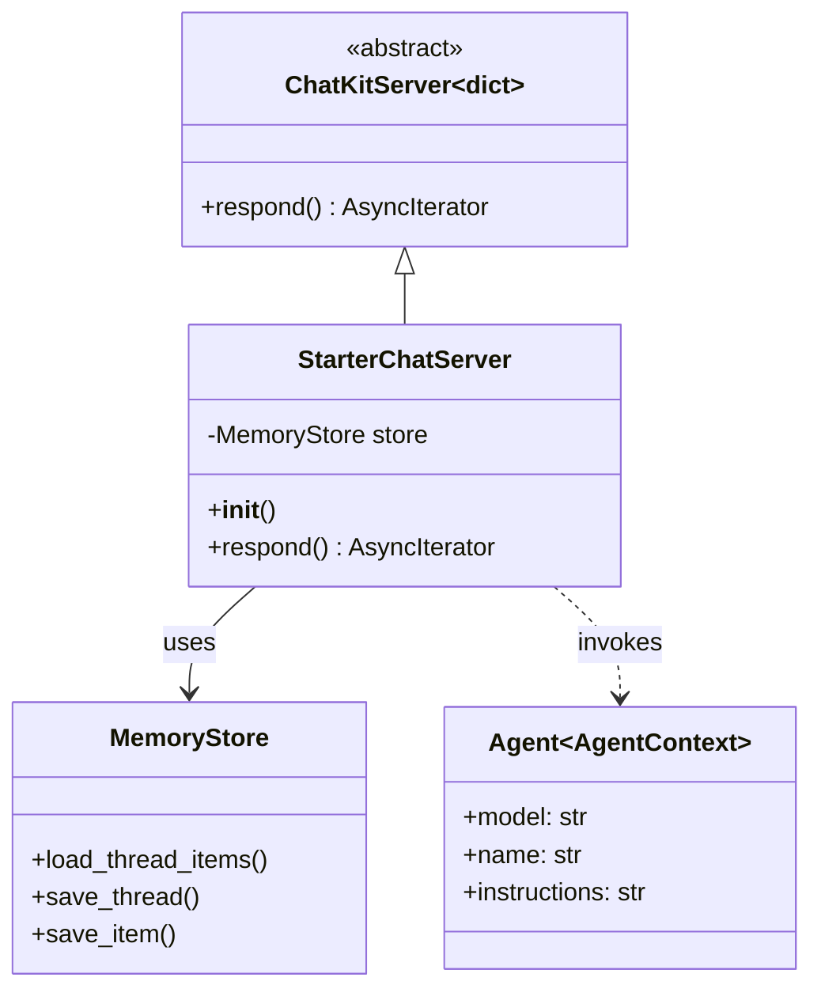
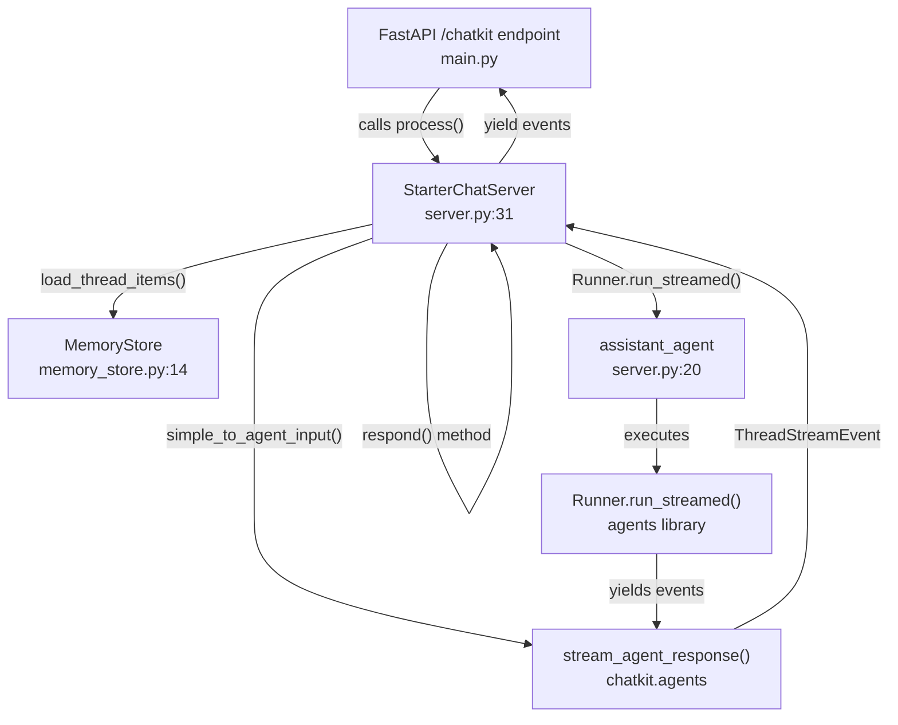
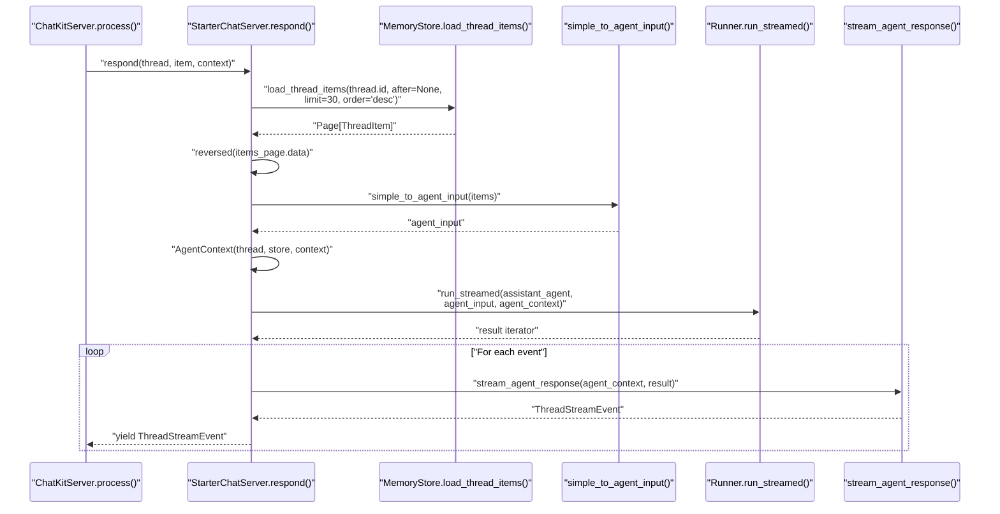
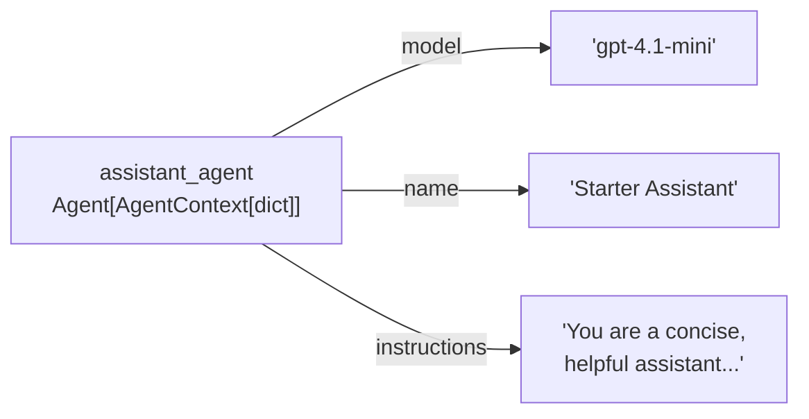

<!-- source: DeepWiki mcp.deepwiki.com · repo openai/openai-chatkit-starter-app · extra page StarterChatServer · fetched 2026-10-26 -->

# StarterChatServer

<details>
<summary>Relevant source files</summary>

The following files were used as context for generating this wiki page:

- [chatkit/backend/app/memory_store.py](chatkit/backend/app/memory_store.py)
- [chatkit/backend/app/server.py](chatkit/backend/app/server.py)

</details>


This document describes the `StarterChatServer` class, which is the core orchestration component of the self-hosted ChatKit backend. This class implements the ChatKit server interface and coordinates conversation handling, history retrieval, agent invocation, and response streaming.

For information about the underlying storage implementation, see [MemoryStore](#3.2.3). For details about the FastAPI entrypoint that uses this server, see [FastAPI Entrypoint](#3.2.1). For agent configuration details, see [AI Agent Integration](#3.2.4).

**Sources:** [chatkit/backend/app/server.py:1-68]()

## Purpose and Scope

The `StarterChatServer` class serves as the main business logic coordinator for chat interactions in the self-hosted ChatKit application. It inherits from `ChatKitServer` provided by the `openai-chatkit` library and implements the `respond` method to handle incoming user messages. The server's responsibilities include:

- Loading recent conversation history from storage
- Converting ChatKit data structures to agent-compatible format
- Invoking the AI assistant agent with proper context
- Streaming response events back to the client
- Managing the lifecycle of chat interactions

**Sources:** [chatkit/backend/app/server.py:31-68]()

## Class Structure

The `StarterChatServer` class extends `ChatKitServer[dict[str, Any]]` and maintains a single instance variable:



**Sources:** [chatkit/backend/app/server.py:31-36]()

### Initialization

The constructor instantiates a `MemoryStore` and passes it to the parent `ChatKitServer` constructor:

| Line | Code Element | Description |
|------|--------------|-------------|
| 34-36 | `__init__` | Initializes `self.store` with new `MemoryStore()` instance and calls parent constructor |

**Sources:** [chatkit/backend/app/server.py:34-36]()

### Type Parameters

The class uses `dict[str, Any]` as its context type parameter. This generic context is passed through the request pipeline and made available to storage operations and agent execution.

**Sources:** [chatkit/backend/app/server.py:31]()

## Component Relationships

The following diagram shows how `StarterChatServer` interacts with other system components using actual code symbols:



**Sources:** [chatkit/backend/app/server.py:1-68]()

## The respond Method

The `respond` method is the core orchestration function that processes incoming user messages and generates AI responses. This method is called by the ChatKit framework when a user sends a message.

### Method Signature

```python
async def respond(
    self,
    thread: ThreadMetadata,
    item: UserMessageItem | None,
    context: dict[str, Any],
) -> AsyncIterator[ThreadStreamEvent]:
```

| Parameter | Type | Purpose |
|-----------|------|---------|
| `thread` | `ThreadMetadata` | Metadata about the current conversation thread |
| `item` | `UserMessageItem \| None` | The user's message (if creating new message) |
| `context` | `dict[str, Any]` | Request context passed through the pipeline |
| Returns | `AsyncIterator[ThreadStreamEvent]` | Stream of events representing the AI response |

**Sources:** [chatkit/backend/app/server.py:38-43]()

### Execution Flow

The following sequence diagram traces the complete execution path through the `respond` method with actual method calls:



**Sources:** [chatkit/backend/app/server.py:38-67]()

### Step-by-Step Breakdown

#### Step 1: Load Recent History

```
items_page = await self.store.load_thread_items(
    thread.id,
    after=None,
    limit=MAX_RECENT_ITEMS,
    order="desc",
    context=context,
)
```

The method retrieves the most recent conversation items from the store. The `MAX_RECENT_ITEMS` constant (set to `30`) limits the history window to prevent context overflow. The `order="desc"` parameter loads items in reverse chronological order (newest first).

**Sources:** [chatkit/backend/app/server.py:44-50](), [chatkit/backend/app/server.py:16]()

#### Step 2: Reverse to Chronological Order

```
items = list(reversed(items_page.data))
```

Since the items are loaded in descending order but agents expect chronological order (oldest first), the list is reversed before processing.

**Sources:** [chatkit/backend/app/server.py:51]()

#### Step 3: Convert to Agent Input Format

```
agent_input = await simple_to_agent_input(items)
```

The `simple_to_agent_input` utility function from the `chatkit.agents` module converts ChatKit `ThreadItem` objects into the format expected by the agent library. This typically transforms thread items into a list of messages with roles and content.

**Sources:** [chatkit/backend/app/server.py:52](), [chatkit/backend/app/server.py:8]()

#### Step 4: Prepare Agent Context

```
agent_context = AgentContext(
    thread=thread,
    store=self.store,
    request_context=context,
)
```

An `AgentContext` object is created to provide the agent with access to thread metadata, the storage layer, and the original request context. This allows the agent to perform additional operations if needed.

**Sources:** [chatkit/backend/app/server.py:54-58](), [chatkit/backend/app/server.py:8]()

#### Step 5: Execute Agent with Streaming

```
result = Runner.run_streamed(
    assistant_agent,
    agent_input,
    context=agent_context,
)
```

The `Runner.run_streamed` method from the `agents` library executes the `assistant_agent` with the prepared input and context. This returns an asynchronous iterator that yields partial results as the AI generates its response.

**Sources:** [chatkit/backend/app/server.py:60-64]()

#### Step 6: Stream Response Events

```
async for event in stream_agent_response(agent_context, result):
    yield event
```

The `stream_agent_response` utility function converts agent execution events into `ThreadStreamEvent` objects that conform to the ChatKit protocol. These events are yielded back to the caller, which ultimately streams them to the client via Server-Sent Events (SSE).

**Sources:** [chatkit/backend/app/server.py:66-67](), [chatkit/backend/app/server.py:8]()

## Configuration Constants

Two module-level constants control the assistant's behavior:

| Constant | Value | Purpose | Location |
|----------|-------|---------|----------|
| `MAX_RECENT_ITEMS` | `30` | Maximum number of conversation items to load for context | [chatkit/backend/app/server.py:16]() |
| `MODEL` | `"gpt-4.1-mini"` | OpenAI model identifier used by the assistant | [chatkit/backend/app/server.py:17]() |

**Sources:** [chatkit/backend/app/server.py:16-17]()

## Assistant Agent Configuration

The module defines a pre-configured `assistant_agent` instance that the server uses for all conversations:



The agent is configured with:
- **Model**: `gpt-4.1-mini` for efficient, cost-effective responses
- **Name**: `"Starter Assistant"` for identification
- **Instructions**: System prompt emphasizing concise, direct responses

**Sources:** [chatkit/backend/app/server.py:20-28]()

## Integration with ChatKit Framework

The `StarterChatServer` integrates with the ChatKit framework through inheritance and protocol compliance:

### Base Class Integration

By inheriting from `ChatKitServer[dict[str, Any]]`, the class gains:
- The `process` method that handles incoming HTTP requests
- Automatic thread creation and management
- Message validation and error handling
- Streaming response coordination

The server only needs to implement the `respond` method to define custom behavior.

**Sources:** [chatkit/backend/app/server.py:31](), [chatkit/backend/app/server.py:9]()

### Store Protocol

The server passes its `MemoryStore` instance to the parent `ChatKitServer` constructor, enabling the framework to:
- Create and retrieve thread metadata
- Store user messages before calling `respond`
- Save assistant responses after streaming completes
- Support pagination and thread listing operations

**Sources:** [chatkit/backend/app/server.py:35-36]()

### Event Streaming Protocol

The `respond` method's return type (`AsyncIterator[ThreadStreamEvent]`) allows the ChatKit framework to:
- Stream partial responses to clients in real-time
- Update message status as it evolves
- Handle errors and completion events
- Maintain consistency between server state and client UI

**Sources:** [chatkit/backend/app/server.py:43]()

## Import Dependencies

The `StarterChatServer` implementation relies on several key imports:

| Import | Source | Purpose |
|--------|--------|---------|
| `Runner` | `agents` | Executes agent logic with streaming support |
| `Agent` | `agents` | Agent class for defining AI assistants |
| `AgentContext` | `chatkit.agents` | Context wrapper for agent execution |
| `simple_to_agent_input` | `chatkit.agents` | Converts thread items to agent format |
| `stream_agent_response` | `chatkit.agents` | Converts agent events to ChatKit events |
| `ChatKitServer` | `chatkit.server` | Base class providing server functionality |
| `ThreadMetadata`, `ThreadStreamEvent`, `UserMessageItem` | `chatkit.types` | ChatKit data types |
| `MemoryStore` | `.memory_store` | Local storage implementation |

**Sources:** [chatkit/backend/app/server.py:1-13]()

---

