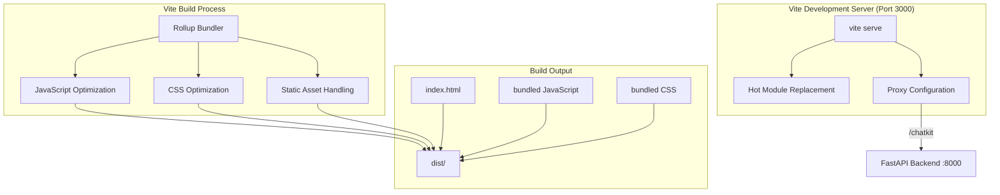
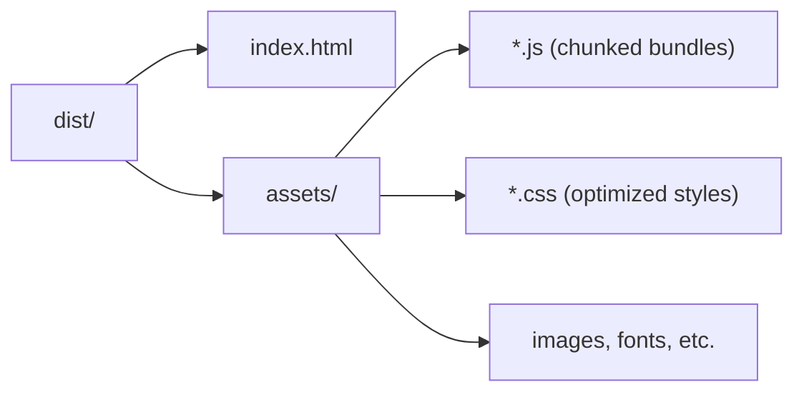
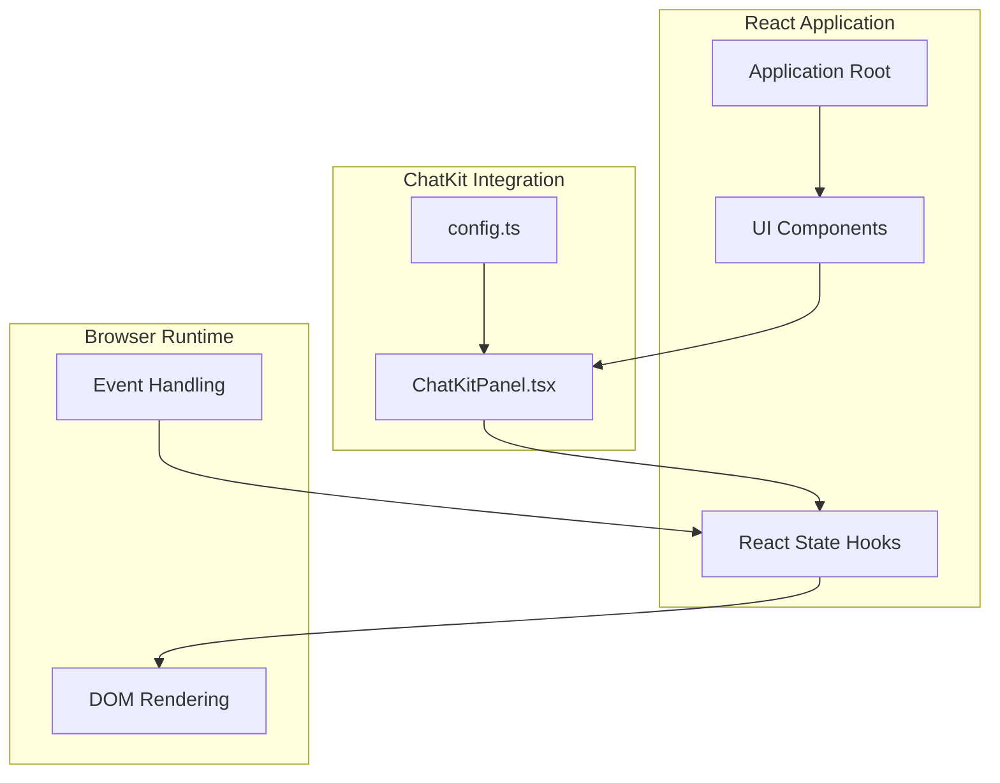
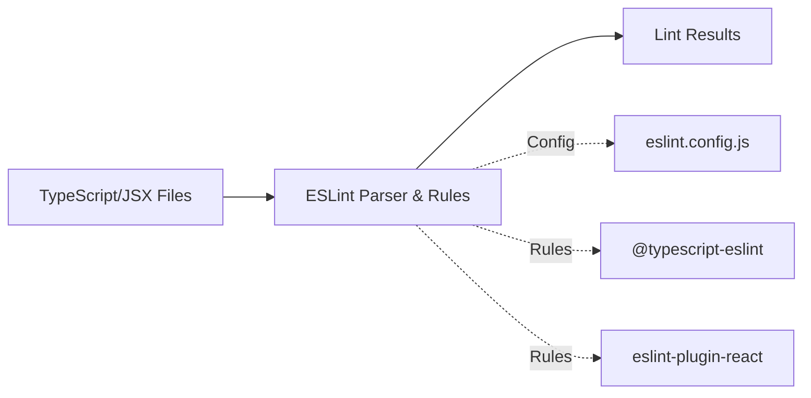
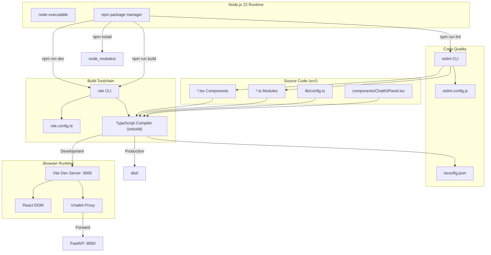
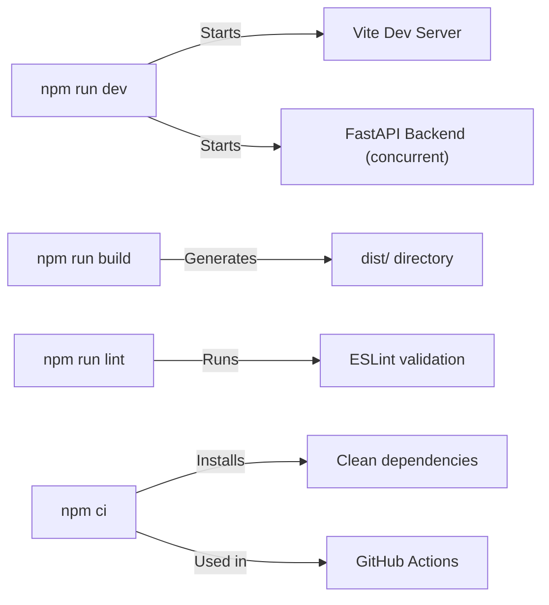

<!-- source: DeepWiki mcp.deepwiki.com · repo openai/openai-chatkit-starter-app · extra page Technology Stack · fetched 2026-10-26 -->

# Technology Stack

Relevant source files

The following files were used as context for generating this wiki page:

- [chatkit/.env.example](chatkit/.env.example)
- [chatkit/.gitignore](chatkit/.gitignore)
- [chatkit/README.md](chatkit/README.md)
- [chatkit/backend/.gitignore](chatkit/backend/.gitignore)
- [chatkit/backend/app/__init__.py](chatkit/backend/app/__init__.py)
- [chatkit/frontend/.gitignore](chatkit/frontend/.gitignore)

## Purpose and Scope

This page documents the frontend technology stack for the self-hosted ChatKit starter application located in the `chatkit/frontend/` directory. It covers the core build tool (Vite), UI framework (React), type system (TypeScript), and supporting development tooling.

For backend technology stack information, see [Backend Dependencies](#5.1). For configuration and customization of the frontend, see [Configuration & Customization](#3.3.2).

---

## Core Technology Stack

The frontend uses a modern JavaScript toolchain optimized for developer experience and production performance:

| Technology | Version | Purpose |
|------------|---------|---------|
| Node.js | 22 | JavaScript runtime environment |
| Vite | Latest | Build tool and development server |
| React | Latest | UI framework |
| TypeScript | Latest | Type-safe JavaScript superset |
| ESLint | Latest | Code quality and style enforcement |

**Sources:** [chatkit/README.md:3-4]()

---

## Vite Build System

### Overview

Vite serves as the build tool and development server for the frontend. It provides:

- **Fast Hot Module Replacement (HMR)** for instant feedback during development
- **Optimized production builds** with code splitting and tree shaking
- **Native ESM support** for modern browser compatibility
- **Development proxy** for routing API requests to the backend

**Diagram: Vite Development and Build Architecture**

**Sources:** [chatkit/README.md:13-16]()

### Development Server Configuration

The development server runs on `127.0.0.1:3000` and includes a proxy configuration for API routing:

- **Base URL:** `http://127.0.0.1:3000`
- **Proxy Path:** `/chatkit` forwards requests to the FastAPI backend
- **Target Backend:** `http://127.0.0.1:8000/chatkit`

This proxy eliminates CORS issues during local development by making the frontend and backend appear to be served from the same origin.

**Sources:** [chatkit/README.md:15-16]()

### Build Output

Production builds are written to the `dist/` directory, which contains:

**Diagram: Build Output Structure**

The `dist/` directory is excluded from version control and should be deployed to a static hosting service or CDN.

**Sources:** [chatkit/frontend/.gitignore:2]()

---

## React Framework

React provides the component-based UI architecture. The application uses:

- **Functional components** with React Hooks for state management
- **React's concurrent rendering** for responsive UI updates
- **Component composition** for modular, reusable UI elements

### Key React Integration Points

**Diagram: React Application Structure**

The primary integration point is `frontend/src/components/ChatKitPanel.tsx`, which renders the chat interface and manages conversation state.

**Sources:** [chatkit/README.md:31]()

---

## TypeScript Integration

TypeScript provides static type checking for improved code quality and developer experience:

- **Type-safe API contracts** between frontend and backend
- **Enhanced IDE support** with autocomplete and inline documentation
- **Compile-time error detection** before runtime issues occur

The TypeScript configuration is managed through `tsconfig.json` and integrated directly with Vite's build process—no separate compilation step required.

**Sources:** Inferred from standard Vite+React+TypeScript project structure

---

## Development Tooling

### ESLint

ESLint enforces code quality standards and style consistency across the frontend codebase:

**Diagram: ESLint Validation Pipeline**

ESLint runs automatically in CI/CD and can be executed locally before committing code. For detailed CI/CD integration, see [Node.js Quality Checks](#6.3).

**Sources:** Inferred from CI/CD workflow documentation

### Build Artifacts

The following directories are generated during development and build processes:

| Directory | Purpose | Version Control |
|-----------|---------|-----------------|
| `node_modules/` | Installed npm dependencies | Excluded (`.gitignore`) |
| `dist/` | Production build output | Excluded (`.gitignore`) |
| `.DS_Store` | macOS metadata | Excluded (`.gitignore`) |
| `.next/` | Build cache (if present) | Excluded (`.gitignore`) |
| `*.tsbuildinfo` | TypeScript incremental build info | Excluded (`.gitignore`) |

**Sources:** [chatkit/frontend/.gitignore:1-7]()

---

## Technology Stack Diagram

The following diagram maps the frontend technology stack to specific code entities and runtime processes:

**Diagram: Complete Frontend Technology Stack and Code Entity Mapping**

**Sources:** [chatkit/README.md:3-16](), [chatkit/frontend/.gitignore:1-7]()

---

## Environment Configuration

The frontend reads configuration from environment variables prefixed with `VITE_`:

| Variable | Default | Purpose |
|----------|---------|---------|
| `VITE_CHATKIT_API_URL` | `/chatkit` | Backend API endpoint URL |
| `VITE_CHATKIT_API_DOMAIN_KEY` | `domain_pk_localhost_dev` | ChatKit domain authentication key |

These variables are defined in `.env.local` at the repository root and are embedded into the built JavaScript bundles at build time by Vite.

**Sources:** [chatkit/README.md:21-22](), [chatkit/.env.example:2-3]()

---

## Development Workflow Integration

The frontend integrates with the overall development workflow through npm scripts:

**Diagram: NPM Script Integration**

The `npm run dev` command starts both the frontend and backend servers concurrently, providing a complete development environment with a single command.

**Sources:** [chatkit/README.md:8-16]()

---

## Summary

The frontend technology stack prioritizes developer experience and modern web standards:

- **Vite** provides instant feedback through HMR and fast build times
- **React** enables component-based UI development with declarative syntax
- **TypeScript** catches errors at compile time and improves code maintainability
- **ESLint** enforces consistent code style and quality standards

This stack requires Node.js 22 and integrates seamlessly with the FastAPI backend through Vite's proxy configuration during development.

**Sources:** [chatkit/README.md:1-33](), [chatkit/frontend/.gitignore:1-7](), [chatkit/.env.example:1-3]()

---

