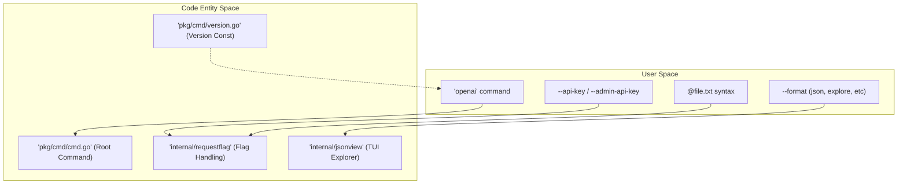
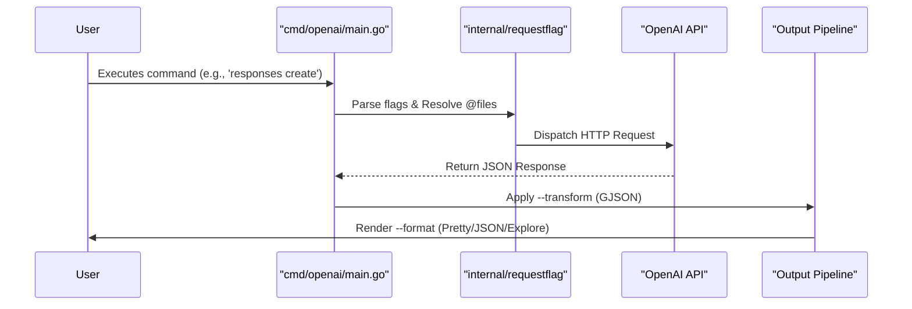

<!-- source: DeepWiki mcp.deepwiki.com · repo openai/openai-cli · page 1 Overview · fetched 2026-10-26 -->

# Overview

Relevant source files

The following files were used as context for generating this wiki page:

- [.release-please-manifest.json](.release-please-manifest.json)
- [.stats.yml](.stats.yml)
- [CHANGELOG.md](CHANGELOG.md)
- [LICENSE](LICENSE)
- [README.md](README.md)
- [pkg/cmd/version.go](pkg/cmd/version.go)

The `openai-cli` project is the official command-line interface for the [OpenAI REST API](https://platform.openai.com/docs). It provides a resource-based command structure [README.md:48-52]() that allows users to interact with OpenAI's inference, administration, and management endpoints directly from the terminal.

The CLI is built in Go and is largely generated from an OpenAPI specification [pkg/cmd/version.go:1](), ensuring high fidelity with the underlying API surface. It supports advanced features such as interactive JSON exploration, GJSON-based data transformation, and sophisticated file-handling via specific URI schemes [README.md:98-140]().

### Project Generation and Metadata
The codebase is maintained through an automated pipeline. The `.stats.yml` file tracks the state of the API generation, including the source OpenAPI spec URL and the number of configured endpoints (currently 220) [.stats.yml:1-4](). Versioning is managed via `release-please`, which synchronizes the version string across `pkg/cmd/version.go`, `.release-please-manifest.json`, and the `CHANGELOG.md` [pkg/cmd/version.go:5](), [.release-please-manifest.json:2](), [CHANGELOG.md:3]().

### High-Level Architecture
The CLI follows a hierarchical command structure where global flags manage authentication and output formatting, while subcommands map to specific API resources.

#### System Mapping: User Space to Code Entities
The following diagram illustrates how user-facing CLI concepts map to internal code entities and configuration files.

**CLI Entity Mapping**

Sources: [pkg/cmd/cmd.go](), [internal/requestflag](), [internal/jsonview](), [pkg/cmd/version.go:5]()

### Core Workflows
The CLI's operation can be divided into three primary phases: initialization, request construction, and output processing.

**Request Lifecycle**

Sources: [README.md:48-62](), [README.md:98-101](), [README.md:105-110]()

### Navigation and Child Pages

To dive deeper into specific areas of the `openai-cli`, refer to the following child pages:

#### [Getting Started](#1.1)
Covers the prerequisites and initial setup.
*   **Installation**: Using Homebrew (`brew install openai/tools/openai`) or Go (`go install`) [README.md:9-23]().
*   **Authentication**: Setting up `OPENAI_API_KEY` and `OPENAI_ADMIN_KEY` [README.md:79-84]().
*   **Basic Usage**: Executing your first `responses create` or `admin` commands [README.md:59-72]().

#### [SDK Generation and Versioning](#1.2)
Details the automated maintenance of the CLI.
*   **Stainless Generation**: How the CLI is kept in sync with the [OpenAPI spec](https://storage.googleapis.com/stainless-sdk-openapi-specs/openai/openai-371f497afe4d6070f6e252e5febbe8f453c7058a8dff0c26a01b4d88442a4ac2.yml) [.stats.yml:2]().
*   **Release Management**: The role of `release-please` in managing the [CHANGELOG.md]() and semantic versioning [pkg/cmd/version.go:5]().
*   **Stats Tracking**: Understanding the metadata in `.stats.yml` [.stats.yml:1-4]().

### Developer Resources
For contributors, the `scripts/` directory contains essential utilities:
*   `scripts/run`: Run the tool locally during development [README.md:43]().
*   `scripts/link`: Link the CLI against a local or specific version of the `openai-go` SDK [README.md:145-162]().

Sources: [.stats.yml:1-4](), [README.md:9-162](), [pkg/cmd/version.go:5](), [CHANGELOG.md:1-60]()

---

