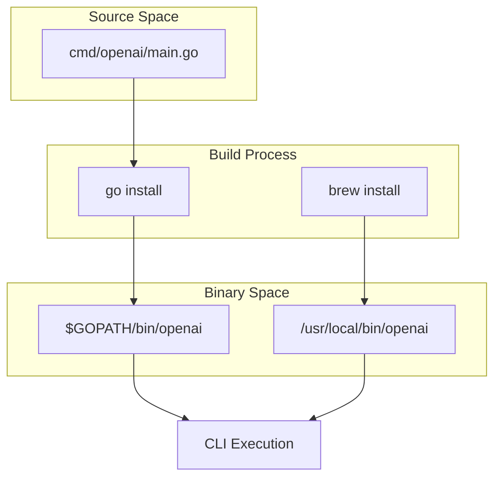
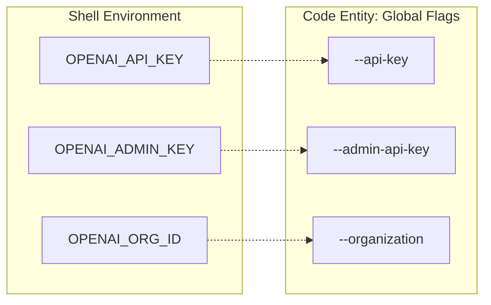

<!-- source: DeepWiki mcp.deepwiki.com · repo openai/openai-cli · page 1.1 Getting Started · fetched 2026-10-26 -->

# Getting Started

<details>
<summary>Relevant source files</summary>

The following files were used as context for generating this wiki page:

- [.release-please-manifest.json](.release-please-manifest.json)
- [CHANGELOG.md](CHANGELOG.md)
- [LICENSE](LICENSE)
- [README.md](README.md)
- [pkg/cmd/version.go](pkg/cmd/version.go)

</details>


This page provides the technical foundations for installing, authenticating, and executing the first commands with the OpenAI CLI. It covers the transition from local installation to the execution of API requests against OpenAI's REST endpoints.

## Installation Methods

The OpenAI CLI can be installed via package managers or built from source using the Go toolchain.

### Homebrew (macOS/Linux)
The recommended method for most users is via the official Homebrew tap:
```sh
brew install openai/tools/openai
```
[README.md:9-13]()

### Go Installation
To install the CLI using Go, version 1.25 or later is required. This compiles the binary and places it in the `GOPATH` bin directory.
```sh
go install 'github.com/openai/openai-cli/cmd/openai@latest'
```
[README.md:15-21]()

**Path Configuration:**
The binary is typically located at `$HOME/go/bin`. To ensure the `openai` command is available, add this to your shell profile:
```sh
export PATH="$PATH:$(go env GOPATH)/bin"
```
[README.md:23-33]()

### Installation Data Flow
The following diagram illustrates how different installation paths result in the `openai` binary entry point.

**Installation to Entry Point**

Sources: [README.md:11-33](), [pkg/cmd/version.go:5-5]()

---

## Authentication and Environment

The CLI uses a tiered authentication system depending on the resource being accessed (Standard API vs. Admin Organization API).

### Environment Variables
The CLI checks for specific environment variables to populate global flags automatically.

| Environment Variable | Description | Default |
| :--- | :--- | :--- |
| `OPENAI_API_KEY` | Primary API key for standard endpoints | `null` |
| `OPENAI_ADMIN_KEY` | Key for admin-level organization management | `null` |
| `OPENAI_ORG_ID` | Specific Organization ID to target | `null` |
| `OPENAI_PROJECT_ID` | Specific Project ID to target | `null` |
| `OPENAI_WEBHOOK_SECRET`| Secret for validating webhook signatures | `null` |

[README.md:79-86]()

### Configuration Mapping
The CLI maps these environment variables to internal flag states. This allows for persistent configuration without passing flags on every command.

**Environment to Flag Mapping**

Sources: [README.md:87-93]()

---

## Basic Usage Patterns

The CLI follows a resource-based command structure: `openai [resource] <command> [flags...]` [README.md:48-52]().

### Standard API Commands
Standard inference commands (e.g., Chat Completions) require `OPENAI_API_KEY`.
```sh
export OPENAI_API_KEY="sk-..."
openai responses create --input "Say this is a test" --model gpt-5.5
```
[README.md:54-62]()

### Admin API Commands
Administrative tasks (e.g., usage metrics) require `OPENAI_ADMIN_KEY`.
```sh
export OPENAI_ADMIN_KEY="sk-admin-..."
openai admin:organization:usage completions --start-time 1735689600 --end-time 1735776000
```
[README.md:64-73]()

### Passing File Data
The CLI supports a special `@` prefix syntax for passing file contents as arguments.

1.  **Direct File Path**: `--arg @image.png` loads the file.
2.  **Explicit Encoding**:
    *   `@file://path/to/file.txt`: Forces plain text string encoding.
    *   `@data://path/to/binary.dat`: Forces base64 encoding.
3.  **Escaping**: Use `\@` to pass a literal string starting with an at-sign.

[README.md:103-141]()

---

## Global Flags Reference

These flags are available across all commands and modify the behavior of the request or the output display.

| Flag | Purpose |
| :--- | :--- |
| `--debug` | Enables HTTP request/response logging (redacts sensitive headers) [README.md:95-95]() |
| `--base-url` | Overrides the default API endpoint (useful for proxies or local mocks) [README.md:97-97]() |
| `--format` | Sets output format: `auto`, `explore`, `json`, `jsonl`, `pretty`, `raw`, `yaml` [README.md:98-98]() |
| `--transform` | Filters output using GJSON syntax [README.md:100-100]() |
| `--version` | Displays the current version (e.g., `1.1.2`) [pkg/cmd/version.go:5-5]() |

Sources: [README.md:87-102](), [pkg/cmd/version.go:1-6]()

---

