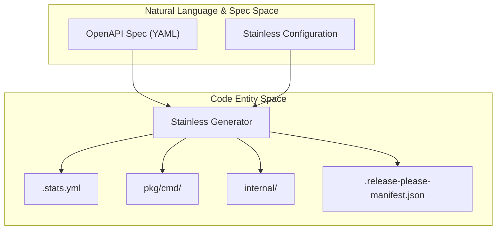
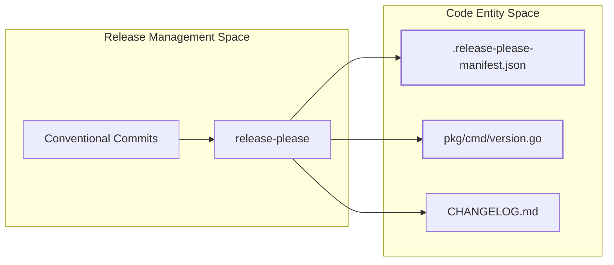

<!-- source: DeepWiki mcp.deepwiki.com · repo openai/openai-cli · page 1.2 SDK Generation and Versioning · fetched 2026-10-26 -->

# SDK Generation and Versioning

Relevant source files

The following files were used as context for generating this wiki page:

- [.release-please-manifest.json](.release-please-manifest.json)
- [.stats.yml](.stats.yml)
- [CHANGELOG.md](CHANGELOG.md)
- [pkg/cmd/version.go](pkg/cmd/version.go)

This page describes the automated lifecycle of the `openai-cli`. The project is not authored manually; instead, it is generated from the OpenAI OpenAPI specification using Stainless. Versioning and changelog generation are handled via `release-please` to maintain semantic versioning (SemVer) integrity.

## Stainless Generation Flow

The `openai-cli` is a generated artifact. Stainless consumes the OpenAI OpenAPI specification and applies a configuration layer to produce the Go source code that forms the CLI. This ensures that the CLI remains in sync with the latest API features, such as Realtime API or Admin Organization endpoints, without requiring manual implementation of every request/response structure.

### The Generation Pipeline

The following diagram illustrates how the OpenAPI specification is transformed into the executable CLI.

**Stainless Generation Data Flow**

### Tracking State with `.stats.yml`

The `.stats.yml` file acts as a manifest for the current generation state. It tracks the source of truth for the API definition and the configuration used during the build process.

*   **`configured_endpoints`**: The total count of API endpoints currently exposed through the CLI `[ .stats.yml:1-1 ]()`.
*   **`openapi_spec_url`**: The specific URL to the versioned OpenAPI YAML file hosted by Stainless `[ .stats.yml:2-2 ]()`.
*   **`openapi_spec_hash`**: A MD5/SHA hash of the spec file to detect upstream changes `[ .stats.yml:3-3 ]()`.
*   **`config_hash`**: A hash of the internal Stainless configuration used to generate the CLI logic `[ .stats.yml:4-4 ]()`.

**Sources:**
- `[.stats.yml:1-5]()`

## Versioning and Release Management

The project utilizes `release-please` to automate versioning. This tool parses Conventional Commit messages to determine the next semantic version and automatically updates the relevant files.

### Semantic Versioning Files

Three primary files track the current version of the CLI:
1.  **`.release-please-manifest.json`**: The source of truth for the current version string used by the release automation `[ .release-please-manifest.json:1-3 ]()`.
2.  **`pkg/cmd/version.go`**: Contains the `Version` constant. This value is injected into the CLI's binary and is what users see when running `openai --version` `[ pkg/cmd/version.go:5-5 ]()`.
3.  **`CHANGELOG.md`**: A generated history of changes, categorized by "Features", "Bug Fixes", and "Documentation" `[ CHANGELOG.md:1-59 ]()`.

### Release-Please Integration

When Stainless triggers a generation update, it often includes commits with specific prefixes (e.g., `feat(api):`, `fix(api):`). `release-please` interprets these to update the `Version` constant in `pkg/cmd/version.go` `[ pkg/cmd/version.go:5-5 ]()`.

**Versioning Entity Map**

### Changelog Structure

The `CHANGELOG.md` provides a historical record of the CLI's evolution. It maps specific Git commit hashes to high-level features or fixes. For example:
*   **Features**: New API capabilities like `realtime` or `admin org` updates `[ CHANGELOG.md:17-17 ]()`, `[ CHANGELOG.md:40-41 ]()`.
*   **Bug Fixes**: Corrections to regressions, such as enum handling in `imagegen` `[ CHANGELOG.md:22-22 ]()`.
*   **Chores**: Internal maintenance, such as redacting sensitive headers in debug logs `[ CHANGELOG.md:27-27 ]()`.

**Sources:**
- `[.release-please-manifest.json:1-3]()`
- `[pkg/cmd/version.go:1-6]()`
- `[CHANGELOG.md:1-59]()`

---

