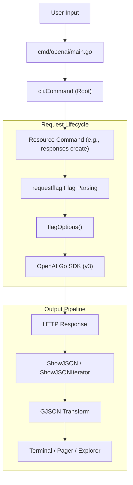
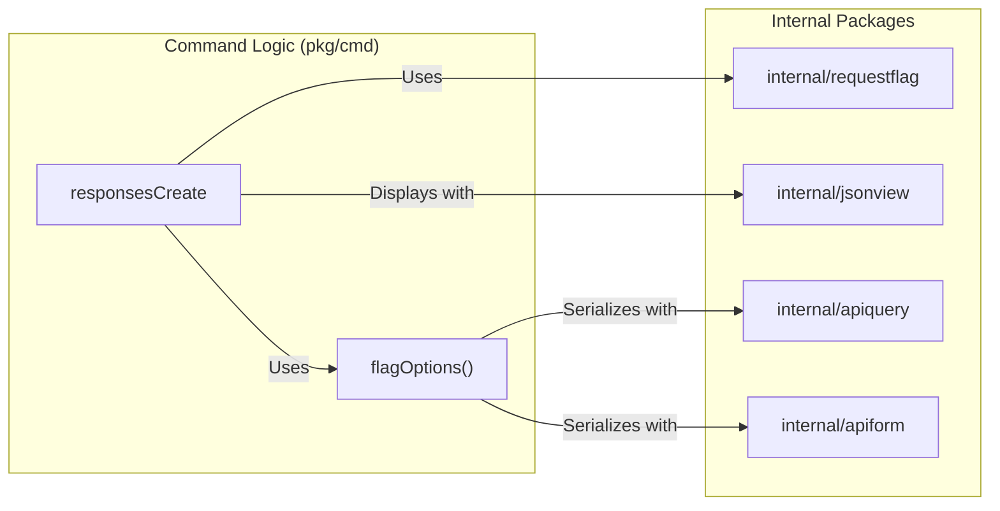

<!-- source: DeepWiki mcp.deepwiki.com · repo openai/openai-cli · page 2 CLI Architecture · fetched 2026-10-26 -->

# CLI Architecture

Relevant source files

The following files were used as context for generating this wiki page:

- [LICENSE](LICENSE)
- [README.md](README.md)
- [go.mod](go.mod)
- [go.sum](go.sum)
- [pkg/cmd/chatcompletion.go](pkg/cmd/chatcompletion.go)
- [pkg/cmd/response.go](pkg/cmd/response.go)

The OpenAI CLI is a resource-oriented command-line interface built on top of the `urfave/cli/v3` framework [go.mod:18](). It is designed to map the OpenAI REST API into a hierarchical command tree where each API resource (e.g., `responses`, `chat completions`) is represented as a command group.

The architecture emphasizes a declarative approach to request construction using a custom flag system that handles type safety, file embedding, and API-specific encoding requirements.

## System Overview

The following diagram illustrates the flow of a command from execution to the final output, bridging user input to the internal code entities.

### CLI Execution Flow

**Sources:** [cmd/openai/main.go:1-10](), [pkg/cmd/response.go:18-22](), [README.md:48-52]()

## Core Components

### 1. Command Tree and Root Command
The CLI's entry point is in `cmd/openai/main.go`, which initializes the root command defined in the `pkg/cmd` package. The command structure follows a `openai [resource] <command> [flags...]` pattern [README.md:48-52](). Global flags such as `--api-key`, `--format`, and `--debug` are attached at the root to influence the behavior of all subcommands [README.md:87-102]().

For details, see [Command Tree and Root Command](#2.1).

### 2. Request Construction Pipeline
Commands use a specialized `requestflag.Flag[T]` type [pkg/cmd/response.go:23-29]() to define parameters. This system maps CLI flags directly to API request components via metadata like `BodyPath`, `QueryPath`, or `PathParam` [pkg/cmd/response.go:27](). It also handles complex logic like the `@` prefix for file embedding and base64 encoding for binary data [README.md:103-109]().

For details, see [Request Construction Pipeline](#2.2).

### 3. Output Formatting and Display
The CLI supports multiple output formats including `json`, `yaml`, `pretty`, and an interactive `explore` mode [README.md:98](). The output pipeline utilizes `ShowJSON` and `ShowJSONIterator` to handle both standard and streaming responses. Users can also apply [GJSON](https://github.com/tidwall/gjson) transformations using the `--transform` flag [README.md:100]().

For details, see [Output Formatting and Display](#2.3).

### 4. Debug Middleware and Logging
When the `--debug` flag is enabled [README.md:95](), the CLI activates a `RequestLogger` middleware. This component logs full HTTP request and response details to `stderr`, while automatically redacting sensitive information like API keys and Authorization headers to ensure security during troubleshooting.

For details, see [Debug Middleware and Logging](#2.4).

## Package Relationships

The CLI relies on several internal packages to manage the complexity of the OpenAI API:

| Package | Responsibility |
| :--- | :--- |
| `internal/requestflag` | Generic flag system for type-safe API request mapping. |
| `internal/jsonview` | TUI components for the interactive `explore` output format. |
| `internal/apiform` | Handles `multipart/form-data` encoding for file uploads. |
| `internal/apiquery` | Manages complex query string serialization (e.g., bracket notation). |

### Internal Entity Mapping

**Sources:** [pkg/cmd/response.go:9-10](), [go.mod:5-18](), [README.md:131-140]()

**Sources:**
- [README.md:48-102]() (Global flags and command structure)
- [pkg/cmd/response.go:18-93]() (Command definition and flag mapping)
- [go.mod:1-20]() (Core dependencies)

---

