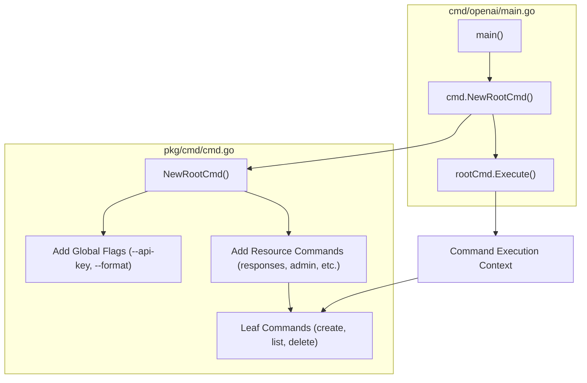

<!-- source: DeepWiki mcp.deepwiki.com · repo openai/openai-cli · page 2.1 Command Tree and Root Command · fetched 2026-10-26 -->

# Command Tree and Root Command

<details>
<summary>Relevant source files</summary>

The following files were used as context for generating this wiki page:

- [LICENSE](LICENSE)
- [README.md](README.md)
- [pkg/cmd/cmdutil_test.go](pkg/cmd/cmdutil_test.go)

</details>


This section details the construction of the OpenAI CLI command hierarchy, the configuration of global flags, the main entry point, and the error handling mechanisms that govern the tool's execution.

The CLI is built on a resource-based command structure, where the root command serves as the entry point for all sub-resources (e.g., `responses`, `images`, `admin`).

### Main Entrypoint

The application starts in `cmd/openai/main.go`. This file is responsible for initializing the root command and executing it within the operating system environment.

- **`main()`**: The entrypoint calls `cmd.NewRootCmd().Execute()` [cmd/openai/main.go:10-10]().
- **Execution Flow**: If `Execute()` returns an error, the application prints the error to `stderr` and exits with status code `1` [cmd/openai/main.go:12-14]().

**Sources:**
- [cmd/openai/main.go:1-15]()

### Root Command Assembly

The root command is defined and assembled in `pkg/cmd/cmd.go`. It uses the `cli.Command` structure to define the base behavior and metadata for the entire tool.

#### The `NewRootCmd` Function
This function instantiates the root `openai` command and attaches all resource-specific subcommands.

1.  **Metadata**: Sets the `Use` string to `"openai"` and provides short/long descriptions [pkg/cmd/cmd.go:27-30]().
2.  **Subcommand Registration**: It attaches various API resource groups using `AddCommand`. These include:
    *   **Inference**: `responses`, `chat:completions` [pkg/cmd/cmd.go:34-35]().
    *   **Media**: `images`, `audio`, `videos` [pkg/cmd/cmd.go:36-38]().
    *   **Admin**: `admin:organization:projects`, `admin:organization:users`, etc [pkg/cmd/cmd.go:50-65]().
    *   **Infrastructure**: `files`, `models`, `batches`, `vector-stores` [pkg/cmd/cmd.go:40-49]().

#### Global Flags
Global flags are defined on the root command, making them available to every subcommand in the tree. These flags handle authentication, environment configuration, and output formatting.

| Flag | Environment Variable | Description |
| :--- | :--- | :--- |
| `--api-key` | `OPENAI_API_KEY` | API key for standard endpoints [pkg/cmd/cmd.go:88-88]() |
| `--admin-api-key`| `OPENAI_ADMIN_KEY` | Key for admin/organization endpoints [pkg/cmd/cmd.go:89-89]() |
| `--organization` | `OPENAI_ORG_ID` | Specific Organization ID [pkg/cmd/cmd.go:90-90]() |
| `--project` | `OPENAI_PROJECT_ID` | Specific Project ID [pkg/cmd/cmd.go:91-91]() |
| `--base-url` | - | Custom API backend URL [pkg/cmd/cmd.go:96-96]() |
| `--format` | - | Output format (json, pretty, explore, etc.) [pkg/cmd/cmd.go:97-97]() |
| `--debug` | - | Enables HTTP request/response logging [pkg/cmd/cmd.go:94-94]() |
| `--transform` | - | GJSON path to filter output data [pkg/cmd/cmd.go:101-101]() |

**Sources:**
- [pkg/cmd/cmd.go:25-85]()
- [pkg/cmd/cmd.go:87-105]()
- [README.md:87-102]()

### Data Flow: Root to Subcommand

The following diagram illustrates how the `main` package triggers the command tree assembly and how flags propagate down to the leaf commands.

**Command Initialization and Execution**

**Sources:**
- [cmd/openai/main.go:10-10]()
- [pkg/cmd/cmd.go:34-75]()

### Error Handling

Error handling in the CLI is centralized to ensure consistent output formatting, especially when using the `--format-error` flag.

1.  **Validation**: Commands perform early validation, such as checking for a missing scheme in `--base-url` using `ValidateBaseURL` [pkg/cmd/cmdutil_test.go:137-144]().
2.  **API Errors**: When an API request fails, the error is captured and passed to the output pipeline.
3.  **Formatting**: The CLI supports `--format-error` and `--transform-error` to allow users to parse error responses with the same flexibility as successful responses [README.md:99-101]().
4.  **Exit Codes**: Any error returned to `rootCmd.Execute()` results in a non-zero exit code [cmd/openai/main.go:12-14]().

### Technical Mapping: Code Entities

The following diagram bridges the natural language concepts of "Global Flags" and "Resource Commands" to their specific implementations in the Go source.

**Code Entity Map**
```mermaid
classDiagram
    class "main.go" {
        +main()
    }
    class "pkg/cmd/cmd.go" {
        +NewRootCmd()
        +rootCmd cli.Command
    }
    class "GlobalFlags" {
        --api-key
        --format
        --debug
        --base-url
    }
    class "ResourceGroups" {
        responsesCmd
        adminCmd
        imagesCmd
    }

    "main.go" ..> "pkg/cmd/cmd.go" : calls
    "pkg/cmd/cmd.go" *-- "GlobalFlags" : PersistentFlags()
    "pkg/cmd/cmd.go" *-- "ResourceGroups" : AddCommand()
```

**Sources:**
- [cmd/openai/main.go:10-10]()
- [pkg/cmd/cmd.go:26-32]()
- [pkg/cmd/cmd.go:87-105]()

### Configuration Precedence

The CLI evaluates configuration in the following order of precedence (highest to lowest):
1.  **Command Line Flags**: e.g., `--api-key "sk-..."` [pkg/cmd/cmd.go:88-88]().
2.  **Environment Variables**: e.g., `OPENAI_API_KEY` [README.md:79-85]().
3.  **Defaults**: Default values specified in the `cli.Command` definition or internal SDK defaults.

**Sources:**
- [README.md:79-93]()
- [pkg/cmd/cmd.go:87-105]()

---

