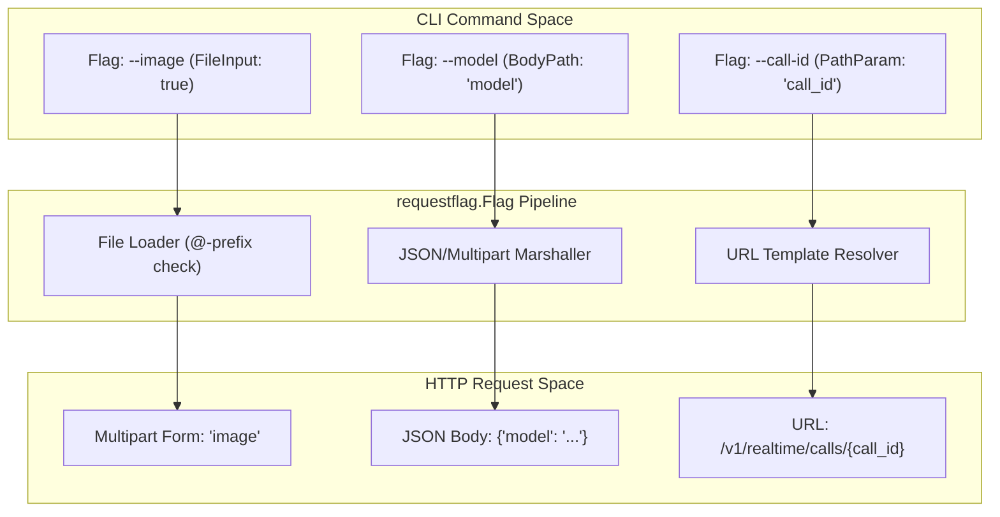
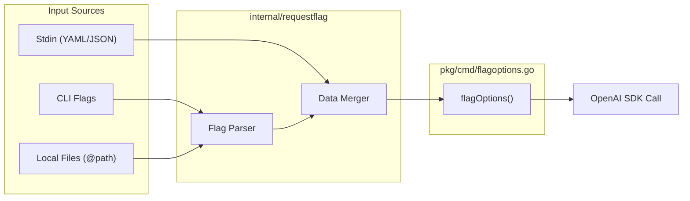

<!-- source: DeepWiki mcp.deepwiki.com · repo openai/openai-cli · page 2.2 Request Construction Pipeline · fetched 2026-10-26 -->

# Request Construction Pipeline

Relevant source files

The following files were used as context for generating this wiki page:

- [pkg/cmd/call.go](pkg/cmd/call.go)
- [pkg/cmd/chatcompletion.go](pkg/cmd/chatcompletion.go)
- [pkg/cmd/image.go](pkg/cmd/image.go)
- [pkg/cmd/image_test.go](pkg/cmd/image_test.go)
- [pkg/cmd/response.go](pkg/cmd/response.go)

The Request Construction Pipeline is the mechanism by which the OpenAI CLI translates command-line flags and piped input into structured HTTP requests compatible with the OpenAI API. This process is driven by the `internal/requestflag` package and a set of metadata-rich flag definitions generated from the OpenAPI specification.

## The Flag Type System

The core of the pipeline is the `requestflag.Flag[T]` generic type. Unlike standard CLI flags, these objects contain metadata that describes exactly where the value should reside in the final HTTP request.

### Metadata Fields
Each flag defines its destination using specific path fields:
*   **`BodyPath`**: Maps the flag value to a key in the JSON or multipart body [pkg/cmd/image.go:26-26]().
*   **`QueryPath`**: Maps the flag value to a URL query parameter.
*   **`PathParam`**: Maps the flag value to a placeholder in the URL (e.g., `{call_id}`) [pkg/cmd/call.go:24-24]().
*   **`HeaderPath`**: Maps the flag value to an HTTP header.
*   **`FileInput`**: A boolean indicating if the flag supports the `@` prefix for file embedding [pkg/cmd/image.go:27-27]().
*   **`Const`**: Indicates the flag has a fixed value that cannot be changed by the user, often used for API versioning or type discriminators [pkg/cmd/call.go:30-30]().

### Request Mapping Diagram
The following diagram illustrates how different `requestflag.Flag` configurations route data from the terminal to the HTTP request.

**Flag to HTTP Mapping**

Sources: [pkg/cmd/image.go:22-33](), [pkg/cmd/call.go:21-32]()

## Input Methods: Flags, Pipes, and Files

The pipeline supports three primary ways to provide data for a request.

### 1. Command Line Flags
The most direct method. For complex types like maps or arrays, the CLI expects JSON strings (e.g., `--metadata '{"key": "value"}'`) [pkg/cmd/response.go:64-68]().

### 2. File Embedding (@-prefix)
If a flag is marked with `FileInput: true`, the CLI checks if the value starts with `@`. If it does, the CLI reads the content of the file path following the `@` and uses that data as the flag value [pkg/cmd/image.go:22-28](). This is used extensively for image uploads and transcriptions.

### 3. Stdin Piping
Commands support piping YAML or JSON data directly into the request. This is handled by the `Action` function of each command, which uses `requestflag` utilities to merge piped data with values provided via flags. Flags typically override values provided in the pipe [pkg/cmd/image_test.go:28-46]().

**Data Flow: Piped Input vs Flags**

Sources: [pkg/cmd/image_test.go:75-103](), [pkg/cmd/chatcompletion.go:22-33]()

## Nested Objects and Inner Flags

For complex API objects (like `reasoning` or `prompt` configurations), the CLI uses `requestflag.WithInnerFlags` to flatten nested structures into dot-notated flags [pkg/cmd/call.go:16-18]().

*   **`InnerFlag`**: Defines a flag that maps to a field within a parent object.
*   **`InnerField`**: Specifies the key inside the parent map where the value should be placed [pkg/cmd/call.go:107-112]().

Example: The flag `--prompt.id` maps to the `id` field inside the `prompt` object in the request body [pkg/cmd/call.go:115-119]().

## Encoding and Transmission

Once the data is collected, it is passed to the `flagOptions()` function. This function (typically located in `pkg/cmd/flagoptions.go`) transforms the internal flag representations into a slice of `option.RequestOption` types used by the underlying Go SDK.

### Encoding Types
The pipeline automatically determines the encoding based on the request requirements:
*   **JSON Encoding**: The default for most "create" or "update" operations [pkg/cmd/response.go:18-22]().
*   **Multipart Encoding**: Triggered when a request includes file data (e.g., `images edit`). This uses `internal/apiform` to construct the multi-part body [pkg/cmd/image.go:62-73]().
*   **Query Encoding**: Used for GET requests (e.g., listing resources), utilizing `internal/apiquery` to handle bracket notation for arrays and nested objects.

Sources: [pkg/cmd/image.go:9-12](), [pkg/cmd/call.go:103-138](), [pkg/cmd/response.go:9-13]()

---

