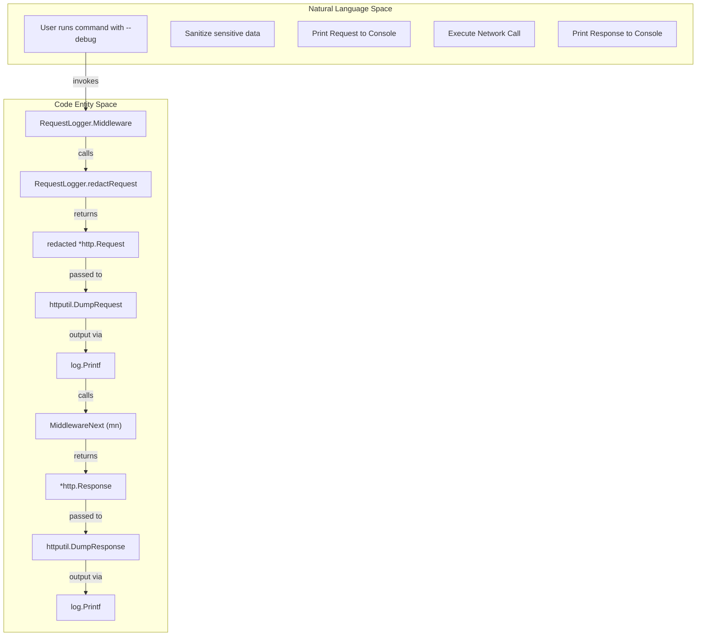

<!-- source: DeepWiki mcp.deepwiki.com · repo openai/openai-cli · page 2.4 Debug Middleware and Logging · fetched 2026-10-26 -->

# Debug Middleware and Logging

<details>
<summary>Relevant source files</summary>

The following files were used as context for generating this wiki page:

- [internal/debugmiddleware/debug_middleware.go](internal/debugmiddleware/debug_middleware.go)

</details>


The `openai-cli` provides a robust debugging mechanism via the `--debug` global flag. This flag activates a middleware-based logging system that captures and displays HTTP request and response metadata. To protect user security, the system includes an automated redaction layer that filters sensitive credentials before they reach the terminal output.

## Overview of RequestLogger Middleware

The core of the debugging system is the `RequestLogger` struct located in `internal/debugmiddleware`. This component is designed as a standard middleware that intercepts the HTTP request lifecycle.

### Data Flow and Execution
When the CLI is executed with the `--debug` flag, the `RequestLogger` is injected into the client's middleware chain. The flow follows these steps:

1.  **Request Interception**: The `Middleware` function receives the outgoing `*http.Request` [[internal/debugmiddleware/debug_middleware.go:43-44]]().
2.  **Redaction**: The request is passed to `redactRequest` to ensure credentials are not logged [[internal/debugmiddleware/debug_middleware.go:45]]().
3.  **Request Logging**: The redacted request metadata is dumped using `httputil.DumpRequest` and printed via `log.Printf` [[internal/debugmiddleware/debug_middleware.go:49-51]]().
4.  **Downstream Execution**: The middleware calls `mn(req)` to pass the request to the next handler in the chain (usually the actual HTTP transport) [[internal/debugmiddleware/debug_middleware.go:53]]().
5.  **Response Logging**: Once the response is received, its metadata is dumped using `httputil.DumpResponse` and logged before being returned to the caller [[internal/debugmiddleware/debug_middleware.go:58-60]]().

### Entity Mapping: Debug Lifecycle
The following diagram maps the logical flow of a debugged request to the specific code entities responsible for each stage.

**Figure 1: Request/Response Logging Flow**

**Sources:** [internal/debugmiddleware/debug_middleware.go:43-64]()

## Sensitive Header Redaction

To prevent API keys and session tokens from appearing in shell history or log files, the `RequestLogger` performs deep inspection of HTTP headers.

### Redaction Logic
The `redactRequest` function clones the request headers and replaces sensitive values with the string `<REDACTED>` [[internal/debugmiddleware/debug_middleware.go:18]](). 

*   **Standard Sensitive Headers**: Headers such as `api-key`, `x-api-key`, `cookie`, and `set-cookie` are completely replaced [[internal/debugmiddleware/debug_middleware.go:22-27]]().
*   **Authorization Header**: This header receives special treatment. If it contains a scheme (e.g., `Bearer`), the scheme is preserved to assist in debugging (e.g., `Bearer <REDACTED>`), while the token itself is hidden [[internal/debugmiddleware/debug_middleware.go:75-88]]().
*   **Optimization**: If no sensitive headers are found, the function returns the original request pointer to avoid unnecessary memory allocation from `req.Clone()` [[internal/debugmiddleware/debug_middleware.go:103-105]]().

### Redaction Targets
| Header Key | Redaction Strategy |
| :--- | :--- |
| `Authorization` | Partial (Preserves prefix like `Bearer`) |
| `api-key` | Full replacement |
| `x-api-key` | Full replacement |
| `cookie` | Full replacement |
| `set-cookie` | Full replacement |

**Sources:** [internal/debugmiddleware/debug_middleware.go:22-27](), [internal/debugmiddleware/debug_middleware.go:70-110]()

## Implementation Details

The middleware is implemented using a functional pattern defined by the `Middleware` and `MiddlewareNext` types.

### Type Definitions
The package defines internal types to remain decoupled from specific generated SDK structures during testing:
```go
type Middleware     = func(*http.Request, MiddlewareNext) (*http.Response, error)
type MiddlewareNext = func(*http.Request) (*http.Response, error)
```
[[internal/debugmiddleware/debug_middleware.go:13-16]]()

### Component Interaction
The `RequestLogger` struct uses an interface for its logger field, allowing the standard `log` package to be swapped out during unit testing.

**Figure 2: Component Relationship**
```mermaid
classDiagram
    class RequestLogger {
        -logger: interface
        -sensitiveHeaders: []string
        +NewRequestLogger() RequestLogger
        +Middleware() Middleware
        -redactRequest(req) *http.Request
    }

    class MiddlewareContext {
        <<Interface>>
        +Printf(format, args)
    }

    RequestLogger --> MiddlewareContext : uses
    RequestLogger ..> "http.Request" : inspects
    RequestLogger ..> "http.Response" : logs
```
**Sources:** [internal/debugmiddleware/debug_middleware.go:30-41]()

## Middleware Chain Integration

The `RequestLogger` is typically the first or last middleware in the chain depending on whether the user wants to see the request exactly as sent over the wire or as it exists before other transformations. In the `openai-cli`, the logging occurs just before the request is handed off to the `MiddlewareNext` function, ensuring that any modifications made by previous middlewares (such as header injection) are visible in the debug output [[internal/debugmiddleware/debug_middleware.go:53]]().

**Sources:** [internal/debugmiddleware/debug_middleware.go:43-64]()

---

