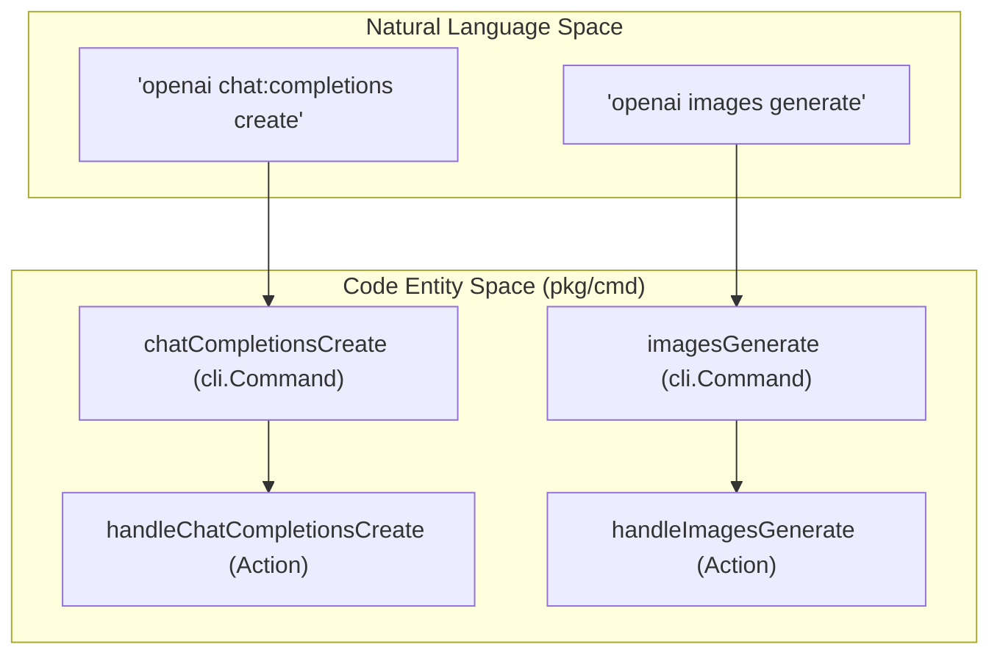
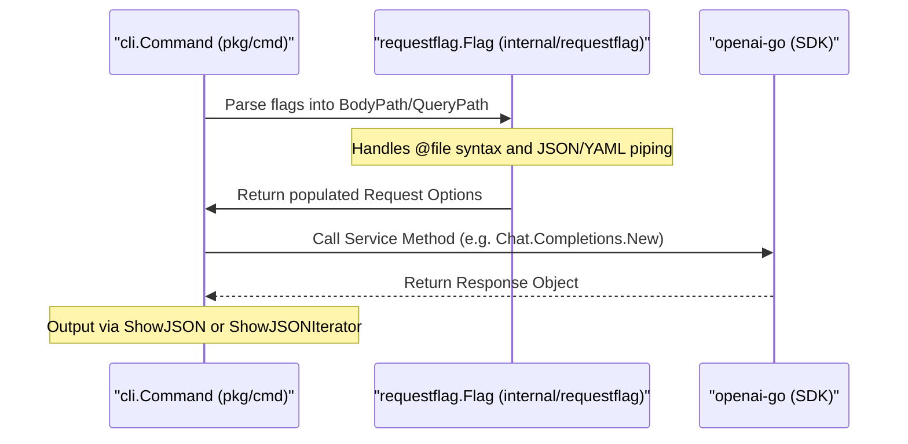

<!-- source: DeepWiki mcp.deepwiki.com · repo openai/openai-cli · page 3 API Command Reference · fetched 2026-10-26 -->

# API Command Reference

Relevant source files

The following files were used as context for generating this wiki page:

- [pkg/cmd/call.go](pkg/cmd/call.go)
- [pkg/cmd/chatcompletion.go](pkg/cmd/chatcompletion.go)
- [pkg/cmd/image.go](pkg/cmd/image.go)
- [pkg/cmd/image_test.go](pkg/cmd/image_test.go)
- [pkg/cmd/response.go](pkg/cmd/response.go)

The `openai-cli` provides a comprehensive command-line interface to the OpenAI API, organized into resource groups that mirror the API's structure. Each command group is generated to support standard CRUD operations as well as specialized actions like streaming, file uploads, and background execution.

This page serves as a high-level map of the available command domains. For detailed flag documentation and usage examples for specific resources, refer to the child pages linked in each section.

### Command Structure Overview

The CLI maps natural language commands to specific Go entities within the `pkg/cmd` package. Most commands utilize the `requestflag.Flag` system to translate CLI arguments into structured API requests.

**CLI Command Mapping**

Sources: [pkg/cmd/chatcompletion.go:17-115](), [pkg/cmd/image.go:171-304]()

---

### Inference Commands

The core of the CLI's functionality resides in the inference groups. These commands facilitate text generation, multi-modal interactions, and complex reasoning tasks.

*   **Responses API**: A high-level interface for creating model responses with support for background execution, conversation state, and prompt caching [pkg/cmd/response.go:18-103]().
*   **Chat Completions**: The traditional endpoint for generating completions from a list of messages, supporting function calling, logprobs, and reasoning models [pkg/cmd/chatcompletion.go:17-115]().

For details, see [Inference Commands (Responses and Chat Completions)](#3.1).

---

### Image Generation Commands

The `images` command group handles the creation and manipulation of visual content. It supports multiple models including `dall-e-3` and the `gpt-image` series.

*   **Generate**: Create new images from text prompts [pkg/cmd/image.go:171-304]().
*   **Edit**: Modify existing images using masks or instructions [pkg/cmd/image.go:62-169]().
*   **Variations**: Create new versions of an existing image (exclusive to `dall-e-2`) [pkg/cmd/image.go:17-60]().

The CLI supports advanced features like `partial-images` for streaming generation and `input-fidelity` controls [pkg/cmd/image.go:87-90](), [pkg/cmd/image.go:121-125]().

For details, see [Image Generation Commands](#3.2).

---

### Realtime API Commands

The `realtime` group manages low-latency, multi-modal sessions typically used for voice or SIP/WebRTC applications.

*   **Calls**: Manage active call lifecycles with `accept`, `hangup`, `reject`, and `refer` [pkg/cmd/call.go:16-153]().
*   **Client Secrets**: Generate ephemeral keys for secure client-side WebRTC initialization.

These commands often utilize `requestflag.WithInnerFlags` to handle complex nested configurations for audio and reasoning parameters [pkg/cmd/call.go:103-138]().

For details, see [Realtime API Commands](#3.3).

---

### Admin Organization Commands

Administrative tasks require elevated permissions (via `OPENAI_ADMIN_KEY`). These commands allow for programmatic management of an OpenAI organization's infrastructure.

*   **Identity & Access**: Manage `users`, `groups`, `roles`, and `service-accounts`.
*   **Resource Management**: Control `projects`, `api-keys`, and `certificates`.
*   **Observability**: Access `audit-logs`, `usage` metrics, and `rate-limits`.

For details, see [Admin Organization Commands](#3.4).

---

### Other API Resource Commands

The CLI covers the remaining breadth of the OpenAI platform, including utility and specialized resource groups.

| Command Group | Purpose |
| :--- | :--- |
| `audio` | Transcriptions, translations, and text-to-speech. |
| `files` | Uploading and managing files for fine-tuning or assistants. |
| `models` | Listing and retrieving metadata for available models. |
| `fine-tuning` | Managing training jobs and checkpoints. |
| `vector-stores` | Creating and querying embeddings for retrieval. |
| `batches` | Handling asynchronous batch processing jobs. |

For details, see [Other API Resource Commands](#3.5).

---

### Request Lifecycle Diagram

The following diagram illustrates how a command moves from the CLI definition into the underlying SDK.

**Command Execution Flow**

Sources: [pkg/cmd/chatcompletion.go:17-33](), [pkg/cmd/image.go:22-28](), [pkg/cmd/call.go:21-25]()

---

