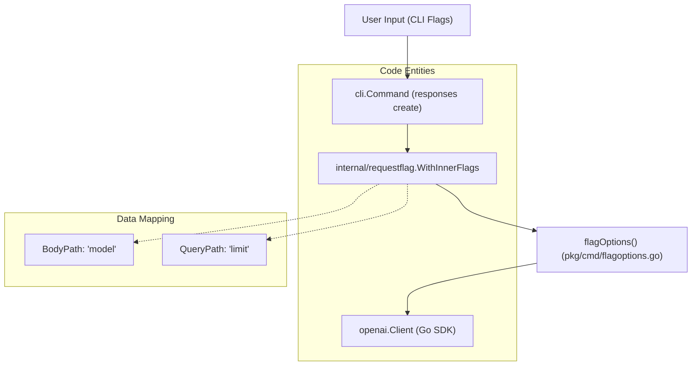
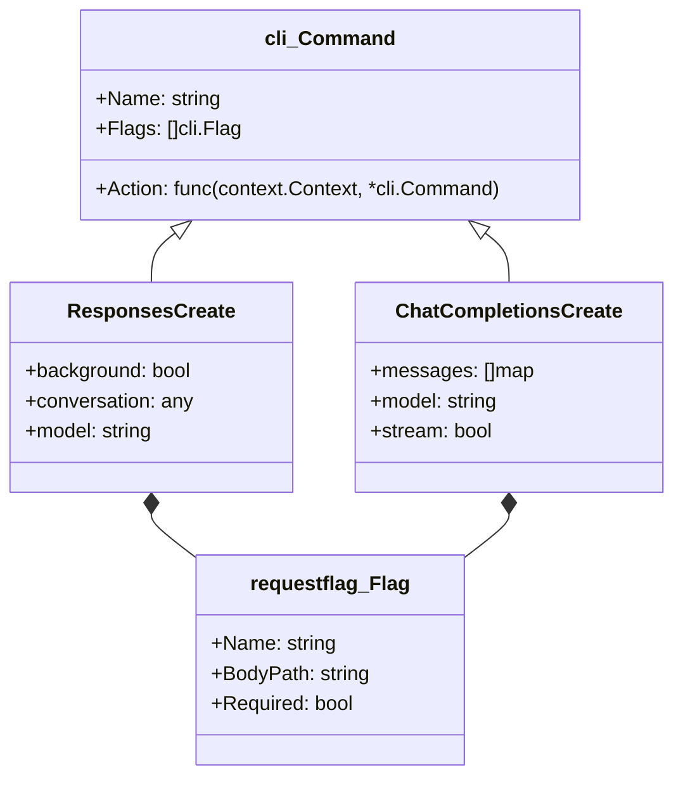

<!-- source: DeepWiki mcp.deepwiki.com · repo openai/openai-cli · page 3.1 Inference Commands (Responses and Chat Completions) · fetched 2026-10-26 -->

# Inference Commands (Responses and Chat Completions)

<details>
<summary>Relevant source files</summary>

The following files were used as context for generating this wiki page:

- [pkg/cmd/chatcompletion.go](pkg/cmd/chatcompletion.go)
- [pkg/cmd/response.go](pkg/cmd/response.go)

</details>


This page details the CLI implementation for OpenAI's inference APIs, specifically the `responses` and `chat:completions` command groups. These commands represent the primary interface for generating text, audio, and structured data from OpenAI models.

## Overview of Inference Command Groups

The CLI exposes two primary command groups for model interaction:
1.  **`responses`**: The modern interface supporting conversation state, background execution, and advanced tool integration [pkg/cmd/response.go:18-20]().
2.  **`chat:completions`**: The standard interface for stateless or manually managed chat interactions [pkg/cmd/chatcompletion.go:17-19]().

### Command Structure and Logic Flow

The following diagram illustrates how a CLI command (e.g., `openai responses create`) flows from the user's terminal through the internal flag system to the Go SDK.

**Inference Request Data Flow**

Sources: [pkg/cmd/response.go:18-21](), [pkg/cmd/chatcompletion.go:17-20]()

---

## Responses Command Group

The `responses` group implements the newer Responses API, which is designed to handle complex, multi-turn interactions and background tasks.

### Core Operations
| Command | SDK Method | Description |
| :--- | :--- | :--- |
| `create` | `responses.New(...)` | Generates a new model response [pkg/cmd/response.go:18]() |
| `retrieve` | `responses.Get(...)` | Fetches a specific response by ID |
| `cancel` | `responses.Cancel(...)` | Aborts a running response |
| `delete` | `responses.Delete(...)` | Removes a response record |

### Key Features and Implementation

#### 1. Conversation State and Multi-turn
The CLI manages conversation state via two primary flags:
*   `--conversation`: Links the response to a persistent conversation object. Input and output items are automatically appended [pkg/cmd/response.go:35-38]().
*   `--previous-response-id`: Creates a multi-turn conversation by referencing a specific prior response ID [pkg/cmd/response.go:79-83]().

#### 2. Background Execution
The `--background` flag (default: `false`) allows the model to process the response asynchronously. This is useful for long-running reasoning tasks or tool calls [pkg/cmd/response.go:23-28]().

#### 3. Prompt Caching
Caching is controlled through:
*   `--prompt-cache-key`: Optimizes hit rates for similar requests [pkg/cmd/response.go:89-93]().
*   `--prompt-cache-retention`: Sets the retention policy (e.g., `24h`) [pkg/cmd/response.go:94-98]().

Sources: [pkg/cmd/response.go:23-98]()

---

## Chat Completions Command Group

The `chat:completions` group is the standard interface for text generation. It is built around the `messages` array, where each entry is a map representing a role (system, user, assistant) and content.

### Message Handling
The `--message` flag is defined as a slice of maps (`[]map[string]any`), allowing users to pass complex JSON structures or YAML files via the `@` prefix [pkg/cmd/chatcompletion.go:22-27]().

### Reasoning Models (o-series)
For models like `o1` or `o3`, specific flags manage the reasoning effort and token limits:
*   `--max-completion-tokens`: The modern replacement for `max-tokens`, accounting for both visible and reasoning tokens [pkg/cmd/chatcompletion.go:66-70]().
*   `--reasoning-effort`: (Inherited from SDK) Controls the amount of compute dedicated to reasoning.

**Inference Code Entity Relationship**

Sources: [pkg/cmd/response.go:18-72](), [pkg/cmd/chatcompletion.go:17-33]()

---

## Streaming vs. Synchronous Modes

Both command groups support streaming. The CLI detects the `--stream` flag and switches the output pipeline from `ShowJSON` to `ShowJSONIterator`.

*   **Synchronous**: The CLI waits for the full JSON response and prints it once.
*   **Streaming**: The CLI uses `openai.NewChatCompletionStream` (or equivalent) and processes `Server-Sent Events (SSE)`. Each chunk is passed through the output pipeline in real-time.

### Implementation Details
The CLI uses `requestflag.Flag` to map CLI arguments to the underlying API request body.
*   **BodyPath**: Specifies the JSON key in the request body (e.g., `BodyPath: "model"`) [pkg/cmd/response.go:71]().
*   **InnerFlags**: Used for complex objects like `--reasoning` or `--context-management` to allow dot-notation or JSON input [pkg/cmd/response.go:18, 100]().

### Structured Outputs
Structured outputs are enabled by passing a JSON schema to the `response-format` flag:
```bash
openai chat:completions create \
  --model gpt-4o \
  --message '{"role": "user", "content": "Extract data"}' \
  --response-format '{"type": "json_schema", "json_schema": {...}}'
```

Sources: [pkg/cmd/response.go:18-103](), [pkg/cmd/chatcompletion.go:17-116]()

---

