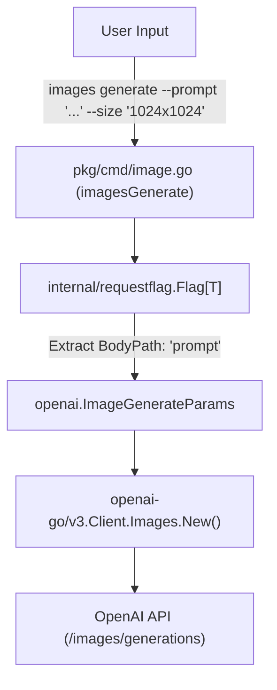
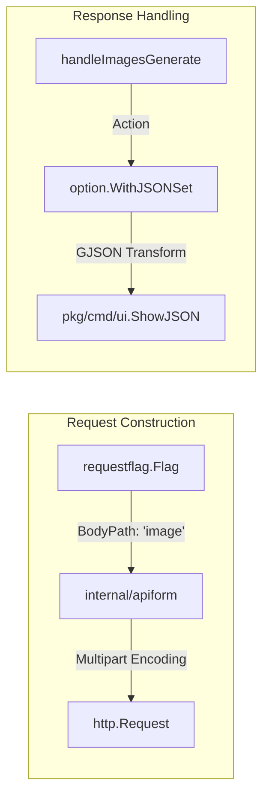

<!-- source: DeepWiki mcp.deepwiki.com · repo openai/openai-cli · page 3.2 Image Generation Commands · fetched 2026-10-26 -->

# Image Generation Commands

Relevant source files

The following files were used as context for generating this wiki page:

- [pkg/cmd/image.go](pkg/cmd/image.go)
- [pkg/cmd/image_test.go](pkg/cmd/image_test.go)

The `images` command group provides access to OpenAI's image generation, editing, and variation capabilities. This implementation supports legacy models like `dall-e-2` as well as modern `gpt-image` models, featuring advanced controls for fidelity, transparency, and streaming partial results.

## Command Overview

The CLI exposes three primary subcommands within the `images` group, defined in [pkg/cmd/image.go]().

| Command | Purpose | Supported Models |
| :--- | :--- | :--- |
| `generate` | Creates an image from a text prompt. | `dall-e-2`, `dall-e-3`, `gpt-image-*` |
| `edit` | Edits or extends an existing image using a mask or prompt. | `dall-e-2`, `gpt-image-*` |
| `create-variation` | Generates a variation of a provided image. | `dall-e-2` |

### Logic Flow: Command to API
The following diagram illustrates how a CLI command like `images generate` transitions from a user flag into a structured request via the `internal/requestflag` system and the underlying SDK.

**Image Generation Request Flow**

Sources: [pkg/cmd/image.go:17-60](), [pkg/cmd/image.go:62-140](), [pkg/cmd/image.go:150-160]()

## Key Features and Implementation

### File Uploads via Multipart
Commands that require source images (`edit`, `create-variation`) utilize the `FileInput: true` attribute on flags. This signals the CLI to treat the flag value as a file path, read the binary content, and prepare a multipart/form-data request.

*   **Edit Image**: The `--image` flag in `images edit` accepts up to 16 images for GPT models or 1 for DALL-E 2 [pkg/cmd/image.go:67-73]().
*   **Masking**: The `--mask` flag allows providing an additional PNG with transparency to define edit areas [pkg/cmd/image.go:91-96]().
*   **Variations**: The `create-variation` command requires a square PNG under 4MB [pkg/cmd/image.go:22-28]().

### Advanced Generation Flags
Modern `gpt-image` models support granular control over the output through specific flags:

*   **`--input-fidelity`**: Controls how much effort the model exerts to match input image styles (e.g., `high`, `low`). Supported on `gpt-image-1` and `gpt-image-1.5` [pkg/cmd/image.go:87-90]().
*   **`--background`**: Sets transparency (`transparent`, `opaque`, `auto`). Transparency requires `output-format` to be `png` or `webp` [pkg/cmd/image.go:80-85]().
*   **`--partial-images`**: Configures streaming behavior. By setting a value between 1 and 3, the API returns partial images during the generation process [pkg/cmd/image.go:120-125]().

### Data Flow: Multipart and Response Formats
The CLI handles different response formats (`url` vs `b64_json`) and encoding types based on the model and flags provided.

**Code Entity Association**

Sources: [pkg/cmd/image.go:26-27](), [pkg/cmd/image.go:133-136](), [pkg/cmd/image.go:161-163]()

## Technical Implementation Details

### Action Handlers
Each command maps to a specific handler function that executes the SDK call. For example, `images generate` uses `handleImagesGenerate` [pkg/cmd/image.go:161](). These handlers:
1. Initialize the request parameters using `flagOptions()` to map CLI flags to SDK structs.
2. Call the corresponding method on `client.Images`.
3. Pass the result to the output pipeline (e.g., `ShowJSON`) for formatting.

### Model-Specific Constraints
The CLI enforces constraints through usage strings and default values:
*   **DALL-E 2**: Only model supporting `create-variation` [pkg/cmd/image.go:19]().
*   **GPT Image Models**: Support `output-compression` and `output-format` (`jpeg`, `webp`), which are ignored by DALL-E [pkg/cmd/image.go:109-119]().

## Testing Patterns
Image commands are tested using the `mocktest` package to verify flag-to-JSON mapping and stdin piping.

*   **Flag Testing**: `TestImagesGenerate` verifies that flags like `--moderation` and `--style` are correctly passed to the API [pkg/cmd/image_test.go:106-129]().
*   **Piping Data**: Tests demonstrate piping YAML/JSON directly into the command, which bypasses individual flag parsing in favor of a structured input [pkg/cmd/image_test.go:131-155]().

Sources: [pkg/cmd/image_test.go:12-47](), [pkg/cmd/image_test.go:106-156]()

---

