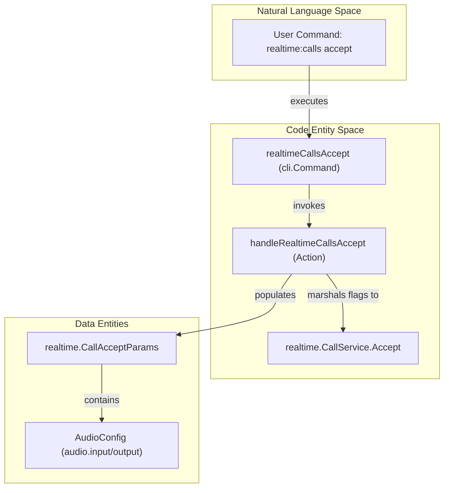
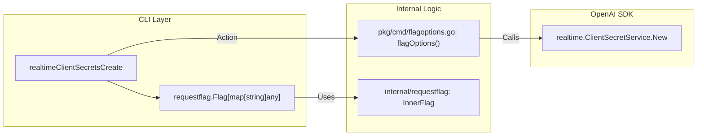

<!-- source: DeepWiki mcp.deepwiki.com · repo openai/openai-cli · page 3.3 Realtime API Commands · fetched 2026-10-26 -->

# Realtime API Commands

<details>
<summary>Relevant source files</summary>

The following files were used as context for generating this wiki page:

- [pkg/cmd/call.go](pkg/cmd/call.go)
- [pkg/cmd/call_test.go](pkg/cmd/call_test.go)
- [pkg/cmd/clientsecret_test.go](pkg/cmd/clientsecret_test.go)

</details>


The Realtime API allows for low-latency, multi-modal interactions (audio and text) and supports integration with telephony systems via SIP and WebRTC. The CLI provides two primary command groups for interacting with these capabilities: `realtime:calls` for managing active telephony/WebRTC sessions and `realtime:client-secrets` for generating ephemeral tokens for client-side authentication.

## Realtime Calls (`realtime:calls`)

The `realtime:calls` command group manages the lifecycle of a Realtime session initiated via SIP or WebRTC. It supports accepting incoming calls, hanging up, referring (transferring), and rejecting calls.

### Session Lifecycle Management

When a call is initiated, it is identified by a `call_id`. The CLI interacts with this ID to transition the session state.

| Command | Action | Key Parameters |
| :--- | :--- | :--- |
| `accept` | Accepts an incoming SIP call and configures the session. | `--call-id`, `--audio`, `--model`, `--instructions` |
| `hangup` | Ends an active Realtime API call. | `--call-id` |
| `refer` | Transfers the call to a new target URI. | `--call-id`, `--target-uri` |
| `reject` | Rejects an incoming call with a specific status code. | `--call-id`, `--status-code` |

### Session Configuration and Audio
The `accept` command is the most complex, as it defines the model behavior and audio parameters for the duration of the call [pkg/cmd/call.go:16-100]().

*   **Audio Configuration**: Controlled via the `--audio` flag or inner flags like `--audio.input` and `--audio.output` [pkg/cmd/call.go:104-113](). It includes settings for `noise_reduction`, `transcription` (e.g., using `whisper-1`), and `turn_detection` [pkg/cmd/call_test.go:21-21]().
*   **Turn Detection**: Uses `server_vad` (Voice Activity Detection) to determine when the user has finished speaking. Configuration includes `silence_duration_ms` and `threshold` [pkg/cmd/call_test.go:84-91]().
*   **Reasoning Effort**: For reasoning-capable models like `gpt-realtime-2`, the `--reasoning.effort` flag constrains the amount of computation spent on internal reasoning before responding [pkg/cmd/call.go:131-137]().

### Data Flow: SIP Call Acceptance
The following diagram illustrates how the CLI translates a command into a call to the Realtime SDK.

**CLI to SDK Mapping: Realtime Call Accept**

Sources: [pkg/cmd/call.go:16-101](), [pkg/cmd/call.go:104-113](), [pkg/cmd/call_test.go:12-35]()

## Realtime Client Secrets (`realtime:client-secrets`)

The `realtime:client-secrets:create` command is used to generate ephemeral client secrets. These secrets allow client-side applications (like web browsers or mobile apps) to connect directly to the OpenAI Realtime API without exposing the developer's permanent API key.

### Ephemeral Session Configuration
When creating a client secret, you provide the full session configuration that the client will be locked into. This prevents the client from changing critical parameters like the model or system instructions.

*   **Expiration**: The `--expires-after` flag (with inner flags `--expires-after.anchor` and `--expires-after.seconds`) defines how long the secret remains valid [pkg/cmd/clientsecret_test.go:34-35]().
*   **Session Constraints**: The `--session` flag accepts a JSON/YAML object defining `modalities`, `tools`, and `instructions` [pkg/cmd/clientsecret_test.go:20-20]().

**Implementation Details: Client Secret Creation**

Sources: [pkg/cmd/clientsecret_test.go:12-40](), [internal/requestflag/requestflag.go:1-20]() (implied by usage in test)

## Implementation Details

### Flag Handling
The Realtime commands make extensive use of `requestflag.WithInnerFlags` to provide a flattened CLI experience for deeply nested API structures [pkg/cmd/call.go:16-16]().

*   **Path Parameters**: The `call-id` is mapped to the URL path using `PathParam: "call_id"` [pkg/cmd/call.go:24-24]().
*   **Body Parameters**: Most configuration flags map to the JSON request body via `BodyPath` [pkg/cmd/call.go:31-31]().
*   **Complex Types**: Flags like `--tool` and `--audio` accept JSON strings or can be populated via piped input [pkg/cmd/call_test.go:21-21](), [pkg/cmd/call_test.go:70-120]().

### Examples

**Accepting a call with VAD configuration:**
```bash
openai realtime:calls accept \
  --call-id "call_123" \
  --audio.input '{ "turn_detection": { "type": "server_vad", "threshold": 0.5 } }' \
  --model "gpt-4o-realtime-preview"
```
Sources: [pkg/cmd/call.go:16-37](), [pkg/cmd/call_test.go:49-50]()

**Creating a client secret with a 10-minute expiry:**
```bash
openai realtime:client-secrets create \
  --expires-after.anchor "created_at" \
  --expires-after.seconds 600 \
  --session '{ "model": "gpt-4o-realtime-preview", "modalities": ["text", "audio"] }'
```
Sources: [pkg/cmd/clientsecret_test.go:33-36]()

**Sources:**
- [pkg/cmd/call.go:1-155]()
- [pkg/cmd/call_test.go:1-192]()
- [pkg/cmd/clientsecret_test.go:1-105]()

---

