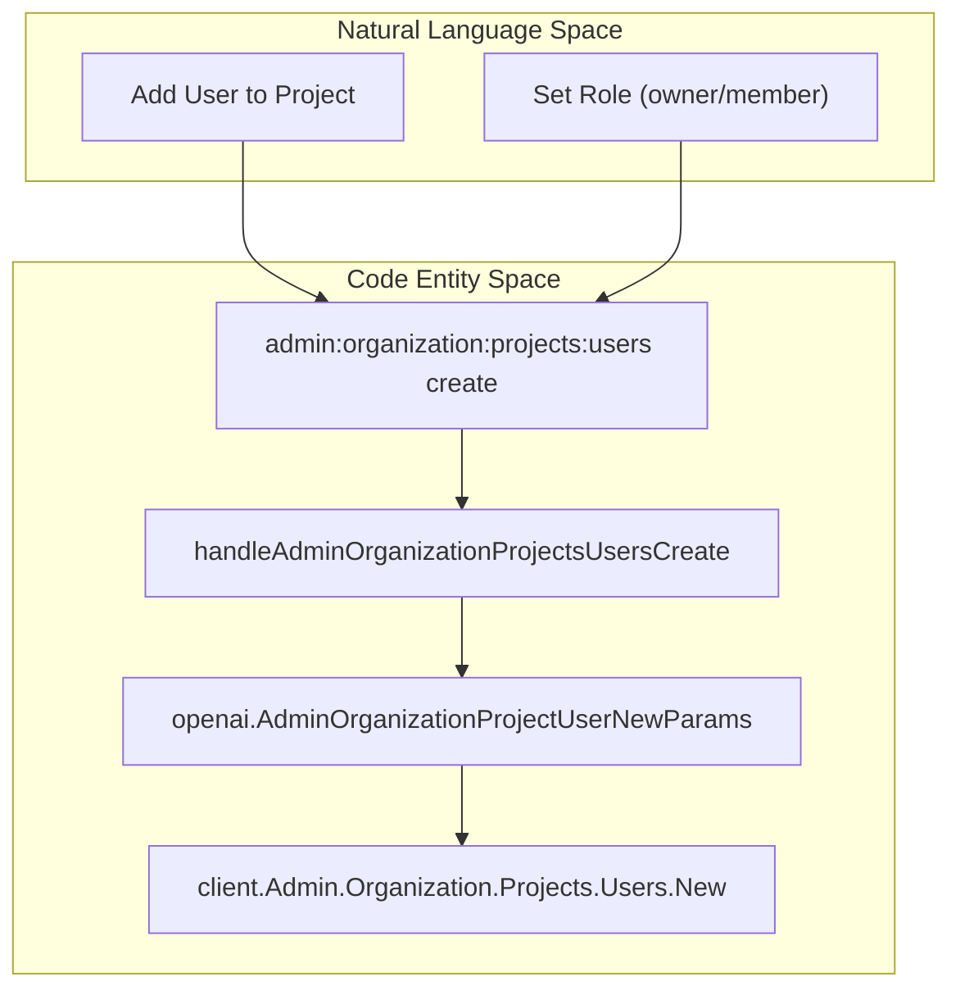
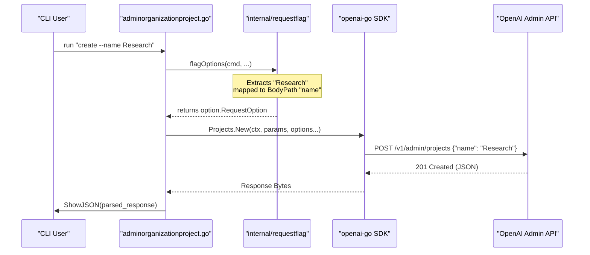

<!-- source: DeepWiki mcp.deepwiki.com · repo openai/openai-cli · page 3.4 Admin Organization Commands · fetched 2026-10-26 -->

# Admin Organization Commands

<details>
<summary>Relevant source files</summary>

The following files were used as context for generating this wiki page:

- [pkg/cmd/adminorganizationproject.go](pkg/cmd/adminorganizationproject.go)
- [pkg/cmd/adminorganizationproject_test.go](pkg/cmd/adminorganizationproject_test.go)
- [pkg/cmd/adminorganizationprojectuser.go](pkg/cmd/adminorganizationprojectuser.go)
- [pkg/cmd/adminorganizationprojectuser_test.go](pkg/cmd/adminorganizationprojectuser_test.go)
- [pkg/cmd/adminorganizationuser.go](pkg/cmd/adminorganizationuser.go)
- [pkg/cmd/adminorganizationuser_test.go](pkg/cmd/adminorganizationuser_test.go)

</details>


The `admin:organization` command group provides a suite of administrative tools for managing OpenAI organizations. These commands allow administrators to manage projects, users, service accounts, roles, and monitor usage metrics.

All commands in this group require an administrative API key, which can be provided via the `OPENAI_ADMIN_KEY` environment variable or the `--admin-api-key` flag [pkg/cmd/adminorganizationproject_test.go:16-16]().

## Project Management

The `admin:organization:projects` subgroup handles the lifecycle of projects within an organization. Projects can be created, retrieved, updated, and archived, but notably, they cannot be deleted [pkg/cmd/adminorganizationproject.go:19-19]().

### Project Data Flow

When a project command is executed, the CLI follows a standard pipeline:
1.  **Client Initialization**: Creates an `openai.Client` using options derived from global and command-specific flags [pkg/cmd/adminorganizationproject.go:135-135]().
2.  **Flag Parsing**: The `flagOptions` function processes `requestflag.Flag` types, mapping them to the appropriate `PathParam`, `QueryPath`, or `BodyPath` [pkg/cmd/adminorganizationproject.go:142-148]().
3.  **SDK Execution**: The command calls the corresponding method on `client.Admin.Organization.Projects` [pkg/cmd/adminorganizationproject.go:157-157]().
4.  **Output Rendering**: The response is captured as raw bytes, parsed via `gjson`, and passed to `ShowJSON` for formatting based on the `--format` flag [pkg/cmd/adminorganizationproject.go:162-172]().

### Command-to-SDK Mapping

| CLI Command | SDK Method | Purpose |
| :--- | :--- | :--- |
| `create` | `Projects.New` | Creates a new project with optional geography and external keys [pkg/cmd/adminorganizationproject.go:157-157](). |
| `retrieve` | `Projects.Get` | Fetches details for a specific `project-id` [pkg/cmd/adminorganizationproject.go:199-199](). |
| `update` | `Projects.Update` | Modifies project name or configuration [pkg/cmd/adminorganizationproject.go:237-237](). |
| `list` | `Projects.List` | Lists projects, with support for `include-archived` [pkg/cmd/adminorganizationproject.go:88-117](). |
| `archive` | `Projects.Archive` | Disables a project permanently [pkg/cmd/adminorganizationproject.go:119-132](). |

**Sources:** [pkg/cmd/adminorganizationproject.go:17-132](), [pkg/cmd/adminorganizationproject.go:134-240]()

## User and Membership Management

User management is split into two levels: Organization-wide membership and Project-specific membership.

### Organization Users
Commands under `admin:organization:users` manage the presence of users within the entire organization.

*   **List**: Supports filtering by email and pagination using the `after` cursor [pkg/cmd/adminorganizationuser.go:71-95]().
*   **Update**: Allows changing organization roles (e.g., `owner` or `reader`) and setting metadata like `developer-persona` [pkg/cmd/adminorganizationuser.go:32-65]().

### Project Users
Commands under `admin:organization:projects:users` manage which organization members have access to specific projects. Users must already be members of the organization before they can be added to a project [pkg/cmd/adminorganizationprojectuser.go:19-20]().

**Project User Interaction Diagram**



**Sources:** [pkg/cmd/adminorganizationuser.go:17-110](), [pkg/cmd/adminorganizationprojectuser.go:17-141]()

## Implementation Detail: Request Construction

The admin commands utilize the `internal/requestflag` system to declaratively define how CLI inputs map to API requests.

| Code Entity | Implementation Detail |
| :--- | :--- |
| `requestflag.Flag[T]` | Generic container for flag values and metadata [pkg/cmd/adminorganizationproject.go:22-27](). |
| `PathParam` | Used for identifiers in the URL (e.g., `project_id`) [pkg/cmd/adminorganizationproject.go:51-51](). |
| `BodyPath` | Used for JSON payload fields (e.g., `name`) [pkg/cmd/adminorganizationproject.go:26-26](). |
| `QueryPath` | Used for URL query parameters (e.g., `limit`, `after`) [pkg/cmd/adminorganizationproject.go:96-97](). |

### Data Flow: CLI to API

The following diagram illustrates how a command like `admin:organization:projects create --name "Research"` is processed.



**Sources:** [pkg/cmd/adminorganizationproject.go:21-38](), [pkg/cmd/adminorganizationproject.go:142-157](), [internal/requestflag/requestflag.go:1-50]()

## Testing Patterns

Admin commands are tested using the `mocktest` package, which simulates API responses and validates that flags are correctly translated into SDK parameters.

1.  **Flag Tests**: Validate that individual flags correctly populate the request [pkg/cmd/adminorganizationproject_test.go:11-22]().
2.  **Piping Tests**: Ensure that data can be piped via `stdin` in YAML or JSON format, which is then parsed into the request body [pkg/cmd/adminorganizationproject_test.go:24-36]().

```go
// Example of a piping test for project creation
t.Run("piping data", func(t *testing.T) {
    pipeData := []byte("name: name\nexternal_key_id: ext_id\n")
    mocktest.TestRunMockTestWithPipeAndFlags(
        t, pipeData,
        "--admin-api-key", "sk-admin...",
        "admin:organization:projects", "create",
    )
})
```

**Sources:** [pkg/cmd/adminorganizationproject_test.go:11-37](), [pkg/cmd/adminorganizationuser_test.go:11-80]()

---

