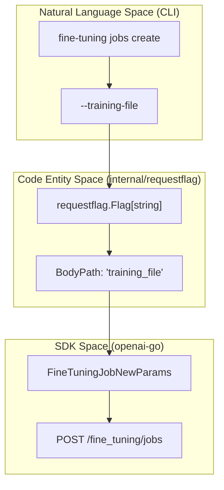
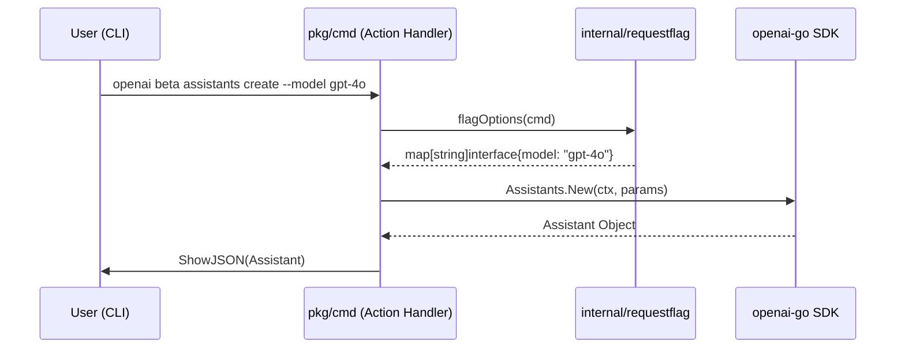

<!-- source: DeepWiki mcp.deepwiki.com · repo openai/openai-cli · page 3.5 Other API Resource Commands · fetched 2026-10-26 -->

# Other API Resource Commands

Relevant source files

The following files were used as context for generating this wiki page:

- [pkg/cmd/chatcompletion.go](pkg/cmd/chatcompletion.go)
- [pkg/cmd/image.go](pkg/cmd/image.go)
- [pkg/cmd/image_test.go](pkg/cmd/image_test.go)
- [pkg/cmd/response.go](pkg/cmd/response.go)

This page covers the secondary API resource command groups provided by the OpenAI CLI. While inference and organization management are primary drivers, the CLI provides comprehensive coverage for audio processing, embeddings, file management, model lifecycle, and beta features like Assistants and Vector Stores.

## Audio Commands

The `audio` command group handles speech-to-text (transcriptions and translations) and text-to-speech (speech generation) tasks. These commands often involve multipart form data for file uploads or binary streams for output.

### Implementation and Data Flow
Audio commands utilize the `internal/apiform` package to encode local files into multipart requests [pkg/cmd/image.go:27](). For speech generation, the CLI handles binary response streams directly to the terminal or redirected files.

| Command | Function | Key Flags |
| :--- | :--- | :--- |
| `audio speech` | Generates audio from text | `--model`, `--voice`, `--input` |
| `audio transcriptions` | Transcribes audio into input language | `--file`, `--model`, `--language` |
| `audio translations` | Translates audio into English | `--file`, `--model` |

**Sources:** [pkg/cmd/image.go:17-57](), [pkg/cmd/image.go:62-136]()

## File and Model Management

The CLI provides lifecycle management for OpenAI-hosted files and custom models.

### Files
The `files` command group manages documents used for fine-tuning or assistants.
- **Uploads:** Files are uploaded using multipart encoding. The CLI supports a `@` prefix to specify local paths [pkg/cmd/image.go:27]().
- **Retrieval:** Supports listing all files or retrieving specific file content/metadata.

### Models
The `models` group allows users to list available models and delete fine-tuned models.
- `models list`: Returns a JSON list of all accessible models.
- `models delete`: Deletes a custom fine-tuned model.

**Sources:** [pkg/cmd/image.go:22-28](), [pkg/cmd/image.go:91-96]()

## Fine-Tuning and Training

Fine-tuning involves creating jobs that reference uploaded files to train custom versions of models.

### Command Structure
1. **Jobs**: `fine-tuning jobs create` initiates the training process.
2. **Checkpoints**: `fine-tuning jobs checkpoints list` allows monitoring of training progress at specific steps.

### Data Association Diagram: Fine-Tuning Lifecycle
This diagram bridges the CLI command space to the internal request flags and the underlying SDK entities.

"Fine-Tuning Lifecycle"

**Sources:** [pkg/cmd/image.go:17-40](), [pkg/cmd/chatcompletion.go:22-33]()

## Vector Stores and Batches

### Vector Stores (Beta)
Used primarily with the Assistants API for file search.
- `vector-stores create`: Initializes a store.
- `vector-stores files`: Manages individual files within a specific store.
- `vector-stores file-batches`: Handles bulk operations for adding files to stores.

### Batches
The `batches` command group allows for asynchronous processing of large volumes of requests (e.g., chat completions) at a lower cost.
- `batches create`: Requires an `input_file_id` (pointing to a `.jsonl` file).
- `batches cancel`: Stops a processing batch.

**Sources:** [pkg/cmd/response.go:18-48](), [pkg/cmd/chatcompletion.go:17-33]()

## Beta: Assistants, Threads, and Messages

The `beta` prefix contains commands for the stateful Assistants API.

| Resource | Description |
| :--- | :--- |
| `beta assistants` | Create and manage persistent AI entities with tools. |
| `beta threads` | Manage conversation sessions. |
| `beta messages` | Add user messages or retrieve assistant responses within a thread. |
| `beta runs` | Execute an assistant on a thread. |

### Logic Flow: Assistant Execution
The execution flow moves from flag parsing to the `Action` handler, which invokes the SDK.

"Assistant Request Flow"

**Sources:** [pkg/cmd/response.go:58-106](), [pkg/cmd/chatcompletion.go:17-33]()

## Embeddings and Other Resources

### Embeddings
The `embeddings create` command converts text into numerical vectors.
- **Flags**: `--input` (string or array), `--model`, and `--dimensions`.
- **Implementation**: Uses `requestflag.Flag[any]` to handle both single strings and arrays of strings for the input field [pkg/cmd/response.go:44-48]().

### Uploads and Containers
Used for multi-part large file uploads (primarily for high-volume data ingestion).
- `uploads create`: Initiates a multipart upload session.
- `uploads parts`: Manages individual chunks of the upload.

**Sources:** [pkg/cmd/response.go:44-48](), [pkg/cmd/chatcompletion.go:22-27]()

---

