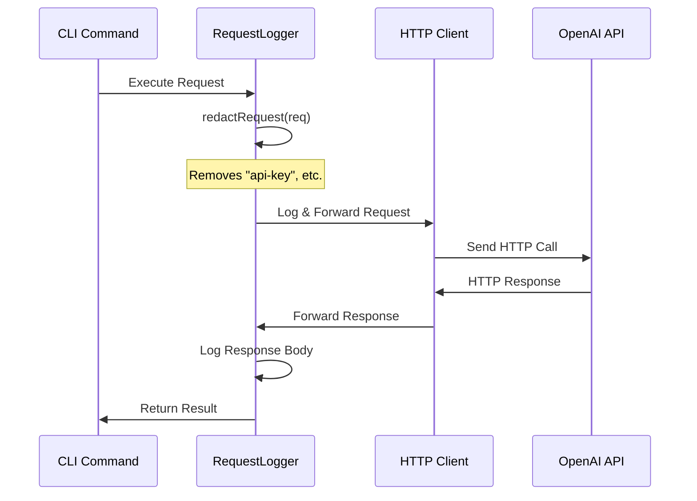

<!-- source: DeepWiki mcp.deepwiki.com · repo openai/openai-cli · page 4 Internal Packages · fetched 2026-10-26 -->

# Internal Packages

<details>
<summary>Relevant source files</summary>

The following files were used as context for generating this wiki page:

- [internal/autocomplete/autocomplete_test.go](internal/autocomplete/autocomplete_test.go)
- [internal/autocomplete/shellscripts/bash_autocomplete.bash](internal/autocomplete/shellscripts/bash_autocomplete.bash)
- [internal/debugmiddleware/debug_middleware.go](internal/debugmiddleware/debug_middleware.go)
- [internal/jsonview/explorer.go](internal/jsonview/explorer.go)

</details>


The `internal/` directory contains the core logic and utilities that power the CLI's specialized behaviors, such as interactive JSON exploration, complex flag parsing for API requests, and shell autocompletion. These packages are kept internal to prevent them from being imported by external projects, ensuring that the CLI's implementation details can evolve independently of a public API.

### Package Architecture Overview

The following diagram illustrates how the internal packages interact to process a command from input to output.

**Internal Package Request/Response Flow**
```mermaid
graph TD
    subgraph "Input Space"
        A["Shell (Bash/Zsh)"] -- "Tab Completion" --> B["internal/autocomplete"]
        C["CLI Flags/Stdin"] -- "Parsing" --> D["internal/requestflag"]
    end

    subgraph "Processing Space"
        D -- "Encoding" --> E["internal/apiform"]
        D -- "Encoding" --> F["internal/apiquery"]
        D -- "Binary Handling" --> G["internal/binaryparam"]
        H["HTTP Client"] -- "Logging" --> I["internal/debugmiddleware"]
    end

    subgraph "Output Space"
        J["JSON Response"] -- "Interactive TUI" --> K["internal/jsonview"]
    end

    B -.-> "GetCompletions()"
    D -.-> "Flag[T]"
    I -.-> "RequestLogger"
    K -.-> "TableView/TextView"
```
Sources: [internal/autocomplete/autocomplete.go:1-20](), [internal/requestflag/requestflag.go:1-30](), [internal/jsonview/explorer.go:1-22](), [internal/debugmiddleware/debug_middleware.go:29-33]()

---

### Shell Autocomplete (`internal/autocomplete`)
The `internal/autocomplete` package provides dynamic tab-completion for the CLI. It supports Bash and Zsh by generating completion scripts and handling the `__complete` hidden command. It is capable of completing subcommands, flags, and even remote file protocols like `@file://` and `@data://`.

*   **Key Entity:** `GetCompletions` [internal/autocomplete/autocomplete_test.go:12-23]() processes the current command-line arguments and returns valid completion candidates.
*   **Protocol Handling:** It handles the logic for collapsing colon-commands and completing file paths when the `@` prefix is detected [internal/autocomplete/shellscripts/bash_autocomplete.bash:19-44]().

For details, see [Shell Autocomplete (internal/autocomplete)](#4.1).

### JSON Explorer (`internal/jsonview`)
When the CLI is run with `--format explore`, the `internal/jsonview` package takes over to provide an interactive Terminal User Interface (TUI) built with the Bubbletea framework.

*   **Key Entity:** `TableView` [internal/jsonview/explorer.go:112-123]() renders JSON arrays as interactive tables with navigable rows.
*   **Key Entity:** `TextView` [internal/jsonview/explorer.go:262-267]() renders individual JSON values or objects with syntax highlighting and viewport scrolling.
*   **Streaming Support:** It supports `AnyIterator` to lazily load more data into the view as the user scrolls [internal/jsonview/explorer.go:148-160]().

For details, see [JSON Explorer (internal/jsonview)](#4.2).

### Request Flag System (`internal/requestflag`)
This package is the backbone of the CLI's request construction. It defines how CLI flags map to OpenAPI parameters, including paths, headers, query strings, and request bodies.

*   **Key Entity:** `Flag[T]` is a generic type used to encapsulate flag values and their metadata.
*   **Metadata Mapping:** It uses types like `BodyPath`, `QueryPath`, and `PathParam` to determine where a flag's value should be placed in the final HTTP request.
*   **Input Flexibility:** Supports reading flag values from files using the `@` syntax and piping YAML/JSON directly into the command via stdin.

For details, see [Request Flag System (internal/requestflag)](#4.3).

### API Encoding Utilities
These small, focused packages handle the serialization of Go types into the specific formats required by the OpenAI API.

*   **`internal/apiform`**: Handles `multipart/form-data` encoding, specifically for file uploads.
*   **`internal/apiquery`**: Serializes nested objects into URL query parameters using bracket notation (e.g., `filter[name]=value`).
*   **`internal/binaryparam`**: Manages parameters that are sent as raw binary data (`application/octet-stream`).

For details, see [API Encoding Utilities (internal/apiform, internal/apiquery, internal/binaryparam)](#4.4).

### Debug Middleware (`internal/debugmiddleware`)
The `internal/debugmiddleware` package provides the `RequestLogger` which intercepts the HTTP request lifecycle when the `--debug` flag is active.

*   **Redaction:** It automatically redacts sensitive headers like `api-key`, `Authorization`, and `Cookie` before printing logs to the terminal [internal/debugmiddleware/debug_middleware.go:22-27]().
*   **Implementation:** It implements a `Middleware` pattern that wraps the standard `http.Request` and `http.Response` [internal/debugmiddleware/debug_middleware.go:43-64]().

**Debug Logging Logic**

Sources: [internal/debugmiddleware/debug_middleware.go:43-64](), [internal/debugmiddleware/debug_middleware.go:70-110]()

---

