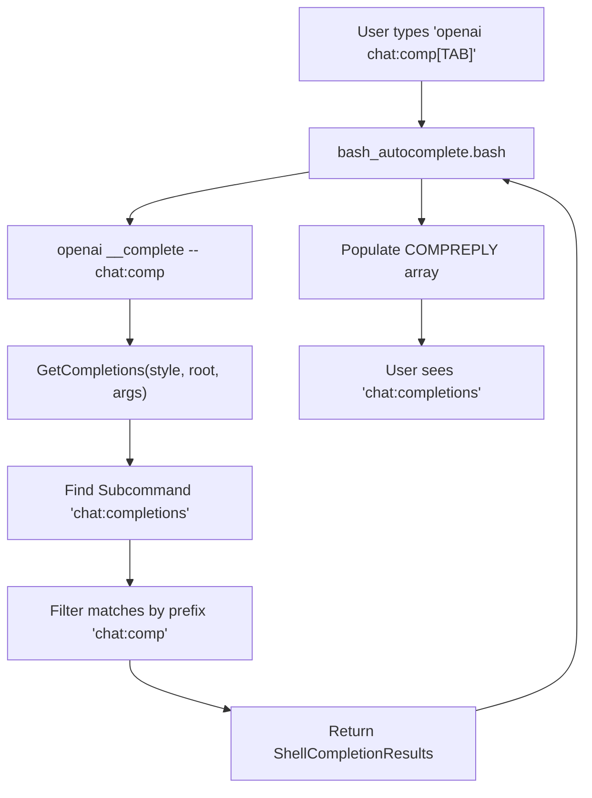
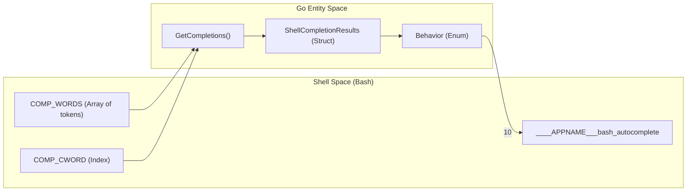

<!-- source: DeepWiki mcp.deepwiki.com · repo openai/openai-cli · page 4.1 Shell Autocomplete (internal/autocomplete) · fetched 2026-10-26 -->

# Shell Autocomplete (internal/autocomplete)

Relevant source files

The following files were used as context for generating this wiki page:

- [internal/autocomplete/autocomplete_test.go](internal/autocomplete/autocomplete_test.go)
- [internal/autocomplete/shellscripts/bash_autocomplete.bash](internal/autocomplete/shellscripts/bash_autocomplete.bash)

The `internal/autocomplete` package provides the logic for shell tab completion within the OpenAI CLI. It bridges the gap between the CLI's command tree (defined via `urfave/cli/v3`) and the requirements of various shell completion engines (Bash and Zsh).

## Overview

The completion system allows users to tab-complete subcommands, flags, and special file protocols like `@file://` and `@data://`. The implementation consists of two parts:
1.  **Go Logic**: A backend that traverses the command tree to find matching completions based on current arguments.
2.  **Shell Scripts**: Integration scripts (e.g., `bash_autocomplete.bash`) that hook into the shell's completion mechanism and call the CLI with a hidden `__complete` command.

### Key Types and Constants

| Entity | Description |
| :--- | :--- |
| `GetCompletions()` | The primary entry point for calculating completion candidates [internal/autocomplete/autocomplete.go:42-43](). |
| `CompletionStyle` | Enum for the target shell (`bash`, `zsh`) [internal/autocomplete/autocomplete.go:13-16](). |
| `ShellCompletionBehavior` | Enum determining how the shell should behave after receiving results (Default, File completion, or None) [internal/autocomplete/autocomplete.go:21-25](). |
| `ShellCompletion` | Struct representing a single completion candidate with a `Name` and `Usage` [internal/autocomplete/autocomplete.go:27-30](). |

Sources: [internal/autocomplete/autocomplete.go:13-30](), [internal/autocomplete/autocomplete.go:42-43]()

---

## Data Flow: From Shell to Code

The following diagram illustrates how a tab-press in a Bash terminal flows through the integration script into the Go logic.

### Bash Completion Flow

Sources: [internal/autocomplete/shellscripts/bash_autocomplete.bash:3-9](), [internal/autocomplete/autocomplete.go:42-50]()

---

## Implementation Details

### GetCompletions Logic
The `GetCompletions` function determines what to suggest based on the state of the command line [internal/autocomplete/autocomplete.go:42-100]().

1.  **Command Traversal**: It walks the `cli.Command` tree to find the deepest subcommand specified in the arguments [internal/autocomplete/autocomplete_test.go:67-89]().
2.  **Flag Handling**: If the user is typing a flag (starts with `-`), it iterates through the current command's `Flags` and returns matching names and aliases [internal/autocomplete/autocomplete_test.go:91-114]().
3.  **File Behavior**: If a flag is detected that `TakesFile: true`, the system returns `ShellCompletionBehaviorFile`, signaling the shell to switch to standard file system completion [internal/autocomplete/autocomplete_test.go:139-158]().

### Special Protocols (@file:// and @data://)
The CLI supports embedding file content via `@` prefixes. The `bash_autocomplete.bash` script contains specific logic to handle these:
*   **Colon-command Collapsing**: Bash often splits tokens at colons. The script joins tokens like `@file`, `:`, and `//path` back together to ensure the protocol is recognized [internal/autocomplete/shellscripts/bash_autocomplete.bash:14-22]().
*   **Protocol Stripping**: When completing paths after `@file://`, the script strips the prefix to perform a `compgen -f` on the actual path, then prepends the prefix back to the results [internal/autocomplete/shellscripts/bash_autocomplete.bash:28-47]().

### Code Entity Mapping
This diagram maps the conceptual completion steps to the specific Go functions and shell script variables.

Sources: [internal/autocomplete/shellscripts/bash_autocomplete.bash:3-10](), [internal/autocomplete/autocomplete.go:32-40]()

---

## Integration Scripts

### bash_autocomplete.bash
The script registers the completion function using `complete -o filenames -F` [internal/autocomplete/shellscripts/bash_autocomplete.bash:59]().

Key logic branches in the script:
*   **Exit Code 10**: Triggers standard Bash file completion [internal/autocomplete/shellscripts/bash_autocomplete.bash:50]().
*   **Exit Code 11**: No completions available [internal/autocomplete/shellscripts/bash_autocomplete.bash:51]().
*   **Exit Code 0**: Uses the newline-separated strings returned by the CLI's `__complete` command [internal/autocomplete/shellscripts/bash_autocomplete.bash:52]().

### Testing the Integration
The system includes "probe" tests that execute a real Bash subshell to verify that the completion script correctly handles edge cases like filename quoting and the `@` protocol without executing arbitrary code (preventing command injection during completion) [internal/autocomplete/autocomplete_test.go:160-230]().

Sources: [internal/autocomplete/shellscripts/bash_autocomplete.bash:49-54](), [internal/autocomplete/autocomplete_test.go:160-230]()

---

