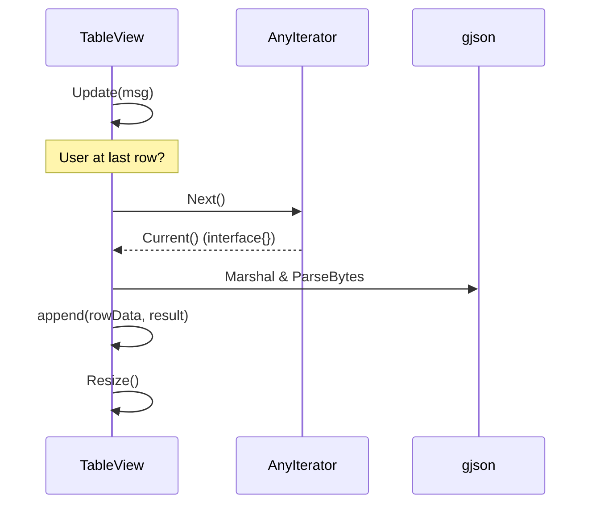

<!-- source: DeepWiki mcp.deepwiki.com · repo openai/openai-cli · page 4.2 JSON Explorer (internal/jsonview) · fetched 2026-10-26 -->

# JSON Explorer (internal/jsonview)

<details>
<summary>Relevant source files</summary>

The following files were used as context for generating this wiki page:

- [internal/jsonview/explorer.go](internal/jsonview/explorer.go)
- [internal/jsonview/explorer_test.go](internal/jsonview/explorer_test.go)
- [internal/jsonview/staticdisplay.go](internal/jsonview/staticdisplay.go)
- [internal/jsonview/terminal.go](internal/jsonview/terminal.go)

</details>


The `internal/jsonview` package provides an interactive Terminal User Interface (TUI) for exploring complex JSON structures. It is primarily used by the CLI's `explore` output format to allow users to navigate through API responses, expand nested objects/arrays, and handle streaming data dynamically.

## Overview and Implementation

The JSON explorer is built using the **Bubble Tea** framework, utilizing a stack-based navigation model. It supports two primary viewing modes: a tabular view for collections and a viewport-based text view for individual values or large strings.

### Key Components

| Component | Description |
| :--- | :--- |
| `JSONViewer` | The main Bubble Tea model that manages the navigation stack and global state [internal/jsonview/explorer.go:277-285](). |
| `TableView` | Renders JSON arrays or objects as interactive tables with automatic column resizing [internal/jsonview/explorer.go:112-123](). |
| `TextView` | Renders large strings or individual JSON primitives using a scrollable viewport [internal/jsonview/explorer.go:262-267](). |
| `AnyIterator` | An interface allowing the explorer to consume data from streaming iterators lazily [internal/jsonview/explorer.go:1456-1460](). |

### Navigation Model Data Flow

The `JSONViewer` maintains a `stack` of `JSONView` objects. Navigating "forward" (e.g., pressing `Right` or `Enter`) pushes a new view onto the stack, while "back" (e.g., `Left` or `Backspace`) pops the current view.

**Logic for View Transitions:**
1. **Selection:** When a user selects a row in a `TableView`, the explorer retrieves the underlying `gjson.Result` [internal/jsonview/explorer.go:394-406]().
2. **Type Detection:** If the selected data is a container (Object/Array), a new `TableView` is pushed [internal/jsonview/explorer.go:424-432]().
3. **Leaf Nodes:** If the data is a primitive (String/Number), a `TextView` is pushed to allow full inspection [internal/jsonview/explorer.go:434-442]().

**JSON Explorer Navigation Flow**
```mermaid
graph TD
    "InitExplorer" --> "JSONViewer.Init"
    "JSONViewer.Init" --> "Stack: [TableView(Root)]"
    "TableView(Root)" -- "Key: Right/Enter" --> "navigateForward()"
    "navigateForward()" -- "Is Container?" --> "Push TableView"
    "navigateForward()" -- "Is Primitive?" --> "Push TextView"
    "Push TableView" --> "Stack: [Root, SubTable]"
    "Push TextView" --> "Stack: [Root, DetailView]"
    "Stack: [Root, SubTable]" -- "Key: Left/Back" --> "Pop Stack"
    "Pop Stack" --> "Stack: [Root]"
```
Sources: [internal/jsonview/explorer.go:277-285](), [internal/jsonview/explorer.go:394-442](), [internal/jsonview/explorer.go:444-454]()

---

## TableView and Dynamic Resizing

The `TableView` component dynamically calculates column widths based on both header titles and the content of the visible rows.

### Column Calculation
The `updateColumnWidths` function calculates the required width for each column and attempts to fit them within the terminal's available width. If the total width exceeds the terminal width, it applies a "fair share" algorithm to shrink columns proportionally [internal/jsonview/explorer.go:209-260]().

### Streaming Iterator Support
The explorer can handle paginated or streaming data through the `AnyIterator`. When a user scrolls to the last row of a `TableView` that is backed by an iterator, the `Update` method triggers `loadMoreData` [internal/jsonview/explorer.go:134-143]().

**Streaming Data Loading**

Sources: [internal/jsonview/explorer.go:129-146](), [internal/jsonview/explorer.go:148-200]()

---

## Static Display Rendering

For non-interactive output (the standard CLI output when not using `explore`), the package provides `RenderJSON`. This function produces a tree-like, color-coded representation of JSON data.

### Formatting Logic
- **Indentation:** Uses a fixed `tabWidth` of 2 [internal/jsonview/staticdisplay.go:15]().
- **Styling:** Applies specific `lipgloss` styles for different JSON types (e.g., `stringValueStyle` in green, `numberValueStyle` in orange) [internal/jsonview/staticdisplay.go:18-29]().
- **Single-line Optimization:** Small primitives are rendered inline with their keys, while objects and arrays trigger newlines and increased indentation [internal/jsonview/staticdisplay.go:67-70]().

Sources: [internal/jsonview/staticdisplay.go:31-65](), [internal/jsonview/staticdisplay.go:126-135]()

---

## Terminal Security and Styling

A critical feature of the explorer is the sanitization of terminal control sequences. This prevents malicious or malformed API responses from executing ANSI escape codes (like terminal title changes or clipboard access) in the user's terminal.

### Sanitization
The `sanitizeTerminalString` function iterates through every rune in a string and replaces control characters (C0, DEL, C1 ranges) with their escaped unicode representation (e.g., `\u001b` instead of a raw ESC byte) [internal/jsonview/terminal.go:8-22]().

### Style Definitions
The explorer uses `lipgloss` to define its visual theme:
- **Arrays:** Rounded border with color "1" [internal/jsonview/explorer.go:42, 98]().
- **Objects:** Rounded border with color "4" [internal/jsonview/explorer.go:44, 100]().
- **Strings:** Rounded border with color "5" [internal/jsonview/explorer.go:43, 99]().

Sources: [internal/jsonview/terminal.go:24-44](), [internal/jsonview/explorer.go:96-102]()

## Key Mapping

The explorer defines a custom `keyMap` to handle TUI interactions:

| Key | Action | Function |
| :--- | :--- | :--- |
| `↑/k`, `↓/j` | Move selection | `keys.Up`, `keys.Down` [internal/jsonview/explorer.go:66-73]() |
| `→/l`, `Enter` | Expand / Navigate Forward | `keys.Enter` [internal/jsonview/explorer.go:78-81]() |
| `←/h`, `Backspace` | Go Back | `keys.Back` [internal/jsonview/explorer.go:74-77]() |
| `p` | Print current value to stdout and exit | `keys.PrintValue` [internal/jsonview/explorer.go:82-85]() |
| `r` | Toggle raw JSON view | `keys.Raw` [internal/jsonview/explorer.go:86-89]() |
| `q`, `Esc` | Quit explorer | `keys.Quit` [internal/jsonview/explorer.go:90-93]() |

Sources: [internal/jsonview/explorer.go:47-94]()

---

