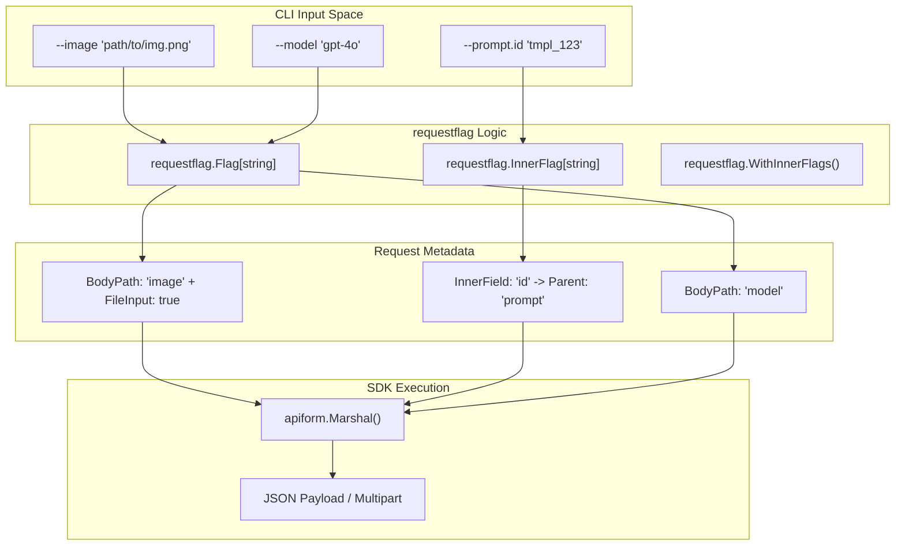
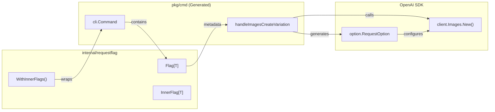

<!-- source: DeepWiki mcp.deepwiki.com · repo openai/openai-cli · page 4.3 Request Flag System (internal/requestflag) · fetched 2026-10-26 -->

# Request Flag System (internal/requestflag)

Relevant source files

The following files were used as context for generating this wiki page:

- [pkg/cmd/call.go](pkg/cmd/call.go)
- [pkg/cmd/chatcompletion.go](pkg/cmd/chatcompletion.go)
- [pkg/cmd/image.go](pkg/cmd/image.go)
- [pkg/cmd/image_test.go](pkg/cmd/image_test.go)
- [pkg/cmd/response.go](pkg/cmd/response.go)

The `internal/requestflag` package provides a type-safe, metadata-driven system for mapping CLI flags to API request parameters. It extends the standard `urfave/cli/v3` flag system to support complex OpenAI API requirements, such as nested JSON bodies, multipart file uploads, and piping data from `stdin`.

## Core Components

### The Generic Flag[T] Type
The primary entity is `requestflag.Flag[T]`, a generic struct that implements the `cli.Flag` interface [pkg/cmd/image.go:22-28](). It stores metadata about where a flag's value should reside in the final HTTP request.

| Metadata Field | Description |
| :--- | :--- |
| `BodyPath` | The JSON path (or form field name) in the request body [pkg/cmd/image.go:26](). |
| `QueryPath` | The key used in the URL query string [pkg/cmd/image.go:9](). |
| `PathParam` | The placeholder name in the URL path (e.g., `call_id`) [pkg/cmd/call.go:24](). |
| `HeaderPath` | The HTTP header name for the value. |
| `FileInput` | Boolean indicating if the value should be treated as a file path for upload [pkg/cmd/image.go:27](). |
| `Const` | If true, the flag value is fixed and cannot be changed by the user [pkg/cmd/call.go:30](). |

### Inner Flags and Nested Objects
For complex API objects (like `prompt` or `reasoning` configurations), the CLI uses `InnerFlag` to expose nested fields as top-level flags using dot-notation (e.g., `--prompt.id`).

*   **`WithInnerFlags`**: A wrapper function used during command definition to register these nested relationships [pkg/cmd/call.go:16]().
*   **`InnerFlag[T]`**: Defines a flag that maps to a specific field inside a parent `map[string]any` or struct [pkg/cmd/call.go:105-112]().

### File Handling (`FileInput`)
When `FileInput` is set to `true`, the system interprets the flag value as a local file path. It automatically handles reading the file and preparing it for multipart/form-data encoding [pkg/cmd/image.go:27](). In tests, `mocktest.TestFile` is used to simulate these uploads [pkg/cmd/image_test.go:19]().

## Data Flow: Flag to Request

The following diagram illustrates how the `requestflag` system translates CLI inputs into the structured data required by the OpenAI Go SDK.

**Flag Translation Pipeline**

**Sources:** [pkg/cmd/image.go:22-28](), [pkg/cmd/call.go:103-138](), [pkg/cmd/chatcompletion.go:28-33]()

## Advanced Features

### Stdin Piping (YAML/JSON)
The system supports piping entire request bodies via `stdin`. If data is piped, the `requestflag` system parses it as YAML or JSON and merges it with any explicitly provided command-line flags. This is extensively used in testing to validate complex payloads [pkg/cmd/image_test.go:28-46]().

### Pointer Utilities
Because many API fields are optional, the package provides a `Ptr[T]` helper to easily initialize flags with default values for pointer types (e.g., `*int64`, `*string`) [pkg/cmd/image.go:37]().

### Data Aliases
The system supports mapping CLI-friendly names to API-specific keys via internal aliasing, ensuring that the user experience remains consistent even when the underlying OpenAPI spec uses different naming conventions.

## Implementation Details

### flagOptions()
Located in `pkg/cmd/flagoptions.go` (referenced by generated code), this function aggregates the values from all `requestflag.Flag` instances into a slice of `option.RequestOption`. These options are then passed to the SDK client methods.

**Code Entity Map**

**Sources:** [pkg/cmd/image.go:17-60](), [pkg/cmd/call.go:16-101](), [pkg/cmd/image.go:58]()

### Summary of Metadata Usage
| File Path | Entity | Usage |
| :--- | :--- | :--- |
| [pkg/cmd/image.go:26]() | `BodyPath` | Maps `--image` to the `image` field in the JSON/Form body. |
| [pkg/cmd/call.go:24]() | `PathParam` | Maps `--call-id` to the `{call_id}` variable in the URL path. |
| [pkg/cmd/call.go:30]() | `Const` | Ensures the `type` flag is always `realtime`. |
| [pkg/cmd/call.go:118]() | `InnerField` | Maps `--prompt.id` to the `id` key within the `prompt` map. |

**Sources:** [pkg/cmd/image.go:1-13402](), [pkg/cmd/image_test.go:1-157](), [pkg/cmd/response.go:1-24204](), [pkg/cmd/chatcompletion.go:1-25522](), [pkg/cmd/call.go:1-4696]()

---

