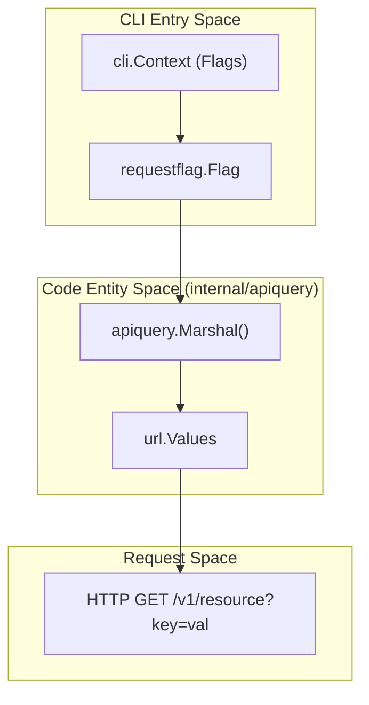
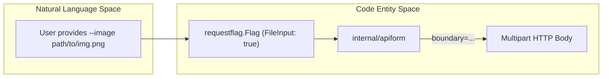

<!-- source: DeepWiki mcp.deepwiki.com · repo openai/openai-cli · page 4.4 API Encoding Utilities (internal/apiform, internal/apiquery, internal/binaryparam) · fetched 2026-10-26 -->

# API Encoding Utilities (internal/apiform, internal/apiquery, internal/binaryparam)

Relevant source files

The following files were used as context for generating this wiki page:

- [pkg/cmd/call.go](pkg/cmd/call.go)
- [pkg/cmd/image.go](pkg/cmd/image.go)
- [pkg/cmd/image_test.go](pkg/cmd/image_test.go)

The `openai-cli` utilizes a set of internal utilities to transform CLI flag inputs into structured formats required by the OpenAI API. These utilities handle the serialization of complex data structures into URL query strings, multipart form-data for file uploads, and binary streams for specialized endpoints.

## Overview of Encoding Utilities

The encoding process is driven by metadata attached to flags in the command definitions, specifically `BodyPath`, `QueryPath`, and `PathParam` [internal/requestflag:21-25]().

| Package | Primary Purpose | Key Encoding Format |
| :--- | :--- | :--- |
| `internal/apiform` | Multipart form-data generation | `multipart/form-data` |
| `internal/apiquery` | Query string serialization | URL-encoded with bracket notation |
| `internal/binaryparam` | Octet-stream handling | `application/octet-stream` |

## Query String Serialization (internal/apiquery)

The `apiquery` package is responsible for converting structured Go data into URL query parameters. It is frequently used in `GET` requests or list operations where filtering and pagination are required.

### Bracket Notation Support
The utility supports deep-nesting through bracket notation (e.g., `filter[name]=value`). This is essential for the CLI's `requestflag` system, which often deals with nested maps and slices [pkg/cmd/call.go:103-113]().

### Data Flow: Flag to Query String
The following diagram illustrates how a command like `realtime:calls accept` processes flags into a query-compatible structure.

**Query Parameter Encoding Flow**

Sources: [pkg/cmd/call.go:9-10](), [internal/requestflag:21-25]()

## Form and Multipart Encoding (internal/apiform)

The `apiform` utility handles `POST` requests that require `multipart/form-data`. This is primarily used for endpoints involving file uploads, such as image variations or edits.

### File Input Handling
When a flag is marked with `FileInput: true`, the CLI treats the string value as a file path (or `@` prefixed data) [pkg/cmd/image.go:22-28](). `apiform` ensures these files are correctly attached as multi-part sections with appropriate headers.

### Implementation in Image Commands
In `images create-variation`, the `--image` flag is mapped to the `image` field in the multipart body [pkg/cmd/image.go:26]().

**Multipart Request Construction**

Sources: [pkg/cmd/image.go:21-28](), [pkg/cmd/image.go:71-73]()

## Binary Parameter Handling (internal/binaryparam)

`internal/binaryparam` is used for endpoints that expect a raw binary stream rather than a structured JSON or Form body. This is common in "upload" style endpoints where the entire request body is the file content.

### Request Body Integration
The CLI request pipeline identifies when a request should be sent as `application/octet-stream` based on the SDK method requirements. The `binaryparam` utility assists in wrapping these parameters so they are compatible with the `option.WithRequestBody` pattern used in the underlying `openai-go` SDK [pkg/cmd/image.go:11-12]().

## Integration with Request Pipeline

These utilities are not called directly by the end-user but are invoked during the `Action` phase of a `cli.Command` [pkg/cmd/image.go:58]().

### Flag Metadata Mapping
The encoding utilities rely on the following fields defined in `internal/requestflag`:

1.  **`BodyPath`**: Directs the utility to place the value in the JSON or Multipart body [pkg/cmd/image.go:32]().
2.  **`QueryPath`**: Directs the utility to use `apiquery` to append the value to the URL [internal/requestflag:21-25]().
3.  **`PathParam`**: Used to perform string replacement in the URL template before encoding begins [pkg/cmd/call.go:24]().

### Complex Types and Inner Flags
For nested objects (e.g., `audio.input`, `prompt.variables`), the `requestflag.WithInnerFlags` wrapper ensures that the hierarchy is preserved so that `apiquery` or `apiform` can reconstruct the intended nested structure [pkg/cmd/call.go:103-138]().

| Feature | Utility | Example Flag |
| :--- | :--- | :--- |
| File Upload | `apiform` | `--image` [pkg/cmd/image.go:23]() |
| Nested Map | `apiquery` | `--audio.input` [pkg/cmd/call.go:106]() |
| Path Variable | String Replacement | `--call-id` [pkg/cmd/call.go:22]() |

Sources: [pkg/cmd/image.go:21-57](), [pkg/cmd/call.go:16-100](), [pkg/cmd/call.go:103-138]()

---

