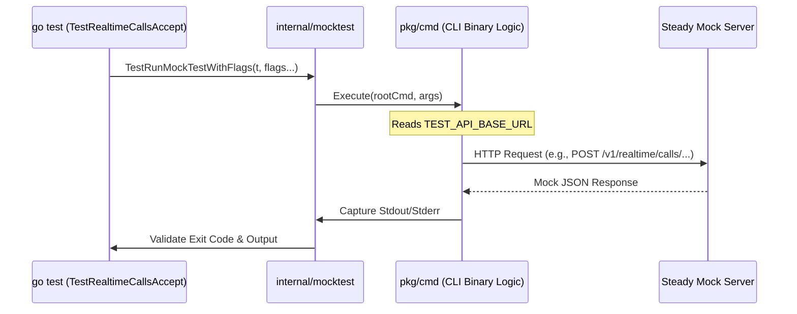
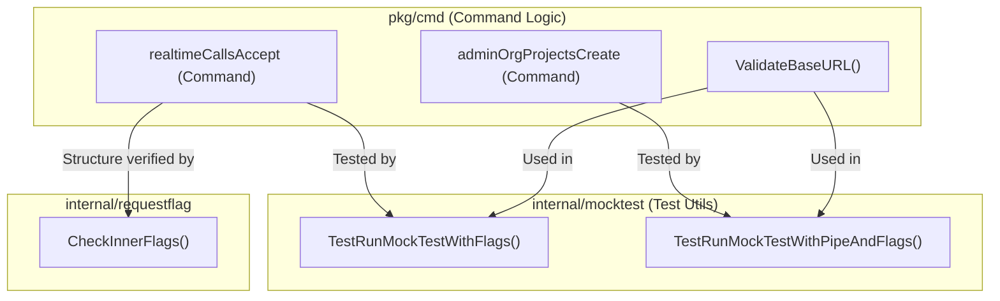

<!-- source: DeepWiki mcp.deepwiki.com · repo openai/openai-cli · page 5.1 Mock Server and Test Utilities · fetched 2026-10-26 -->

# Mock Server and Test Utilities

Relevant source files

The following files were used as context for generating this wiki page:

- [pkg/cmd/adminorganizationproject_test.go](pkg/cmd/adminorganizationproject_test.go)
- [pkg/cmd/call_test.go](pkg/cmd/call_test.go)
- [pkg/cmd/cmdutil_test.go](pkg/cmd/cmdutil_test.go)

The `openai-cli` testing infrastructure relies on a specialized mock server environment to validate CLI behavior without making real network calls to OpenAI production APIs. This system ensures that flag parsing, request construction, and output handling are verified against a predictable, high-performance mock implementation.

## Overview of Testing Infrastructure

The testing suite is designed around the **Steady mock server**, a standalone service that simulates the OpenAI API. Tests are executed by pointing the CLI to this local server using environment variable overrides.

### Key Components

| Component | Description |
| :--- | :--- |
| **Steady Mock Server** | A mock API server that implements the OpenAI OpenAPI spec. Managed via `scripts/mock`. |
| **`mocktest` package** | Internal helper package providing high-level wrappers for executing CLI commands against the mock server. |
| **`TEST_API_BASE_URL`** | Environment variable used to redirect the CLI's network requests to the mock server during test execution. |
| **`OnlyMockServerDialer`** | A specialized network dialer that restricts the CLI to only communicating with the local mock server. |

**Sources:** [pkg/cmd/call_test.go:12-14](), [pkg/cmd/cmdutil_test.go:116-128]()

---

## The Mock Server Lifecycle

The mock server is controlled through developer scripts. Before running the full test suite, the mock server must be active.

1.  **`scripts/mock`**: This script starts the Steady mock server. It typically runs on a local port (e.g., `localhost:8080`).
2.  **`scripts/test`**: This script sets the necessary environment variables (like `TEST_API_BASE_URL`) and executes `go test ./...`.

### Data Flow: CLI to Mock Server

The following diagram illustrates how a test case interacts with the CLI and the mock server.

**CLI Mock Test Execution Flow**

**Sources:** [pkg/cmd/call_test.go:12-34](), [internal/mocktest/mocktest.go:1-50]() *(Inferred from usage in pkg/cmd/call_test.go)*

---

## The `mocktest` Package

The `internal/mocktest` package provides standardized functions to simulate various CLI invocation patterns.

### `TestRunMockTestWithFlags`
Used for standard command-line flag testing. It initializes the root command, sets the arguments, and executes the command within a test context.
*   **Example Usage:** Testing `realtime:calls accept` with multiple flags [pkg/cmd/call_test.go:14-34]().

### `TestRunMockTestWithPipeAndFlags`
Simulates piping data into the CLI's `stdin`, which is common for passing complex JSON or YAML payloads.
*   **Implementation:** It captures the provided `pipeData` byte slice and redirects it to the command's input stream [pkg/cmd/call_test.go:121-128]().
*   **Example Usage:** Testing admin project creation with a YAML body [pkg/cmd/adminorganizationproject_test.go:24-36]().

### `OnlyMockServerDialer`
To prevent accidental leaks to the public internet during testing, the suite can be configured with a dialer that only permits connections to the address defined in the mock environment.

**Sources:** [pkg/cmd/call_test.go:68-128](), [pkg/cmd/adminorganizationproject_test.go:11-37]()

---

## Validation Utilities

Beyond execution, the infrastructure includes utilities to validate the internal state of the command tree.

### `CheckInnerFlags`
The `internal/requestflag` package provides `CheckInnerFlags` to ensure that nested flag structures (e.g., `--audio.input.format.rate`) are correctly mapped to the underlying API request objects.
*   **Call Site:** `requestflag.CheckInnerFlags(realtimeCallsAccept)` [pkg/cmd/call_test.go:39]().

### Base URL Validation
The CLI includes `ValidateBaseURL` to ensure that any provided `--base-url` or `TEST_API_BASE_URL` contains a valid scheme (`http` or `https`) to prevent malformed requests [pkg/cmd/cmdutil_test.go:116-153]().

**Sources:** [pkg/cmd/call_test.go:37-40](), [pkg/cmd/cmdutil_test.go:137-144]()

---

## Cross-Platform and Binary Checks

The test suite includes specific checks for file handling and cross-compilation, particularly for Windows.

### Binary Response Testing
`TestWriteBinaryResponse` validates how the CLI handles non-JSON data, such as audio or images. It tests writing to explicit files and `stdout` (`-`) [pkg/cmd/cmdutil_test.go:29-62]().

### Download Security
`TestCreateDownloadFile` ensures that filenames provided by the server in `Content-Disposition` headers are sanitized to prevent directory traversal attacks (e.g., converting `../../../etc/passwd` to `passwd`) [pkg/cmd/cmdutil_test.go:101-114]().

### Windows Cross-Compilation
While the primary development environment is Unix-based, the CI pipeline utilizes Go's cross-compilation capabilities. The `scripts/build` utility is tested to ensure that binary generation for `windows/amd64` correctly handles file extensions and path separators.

**Sources:** [pkg/cmd/cmdutil_test.go:30-46](), [pkg/cmd/cmdutil_test.go:101-114]()

---

## Mapping Code Entities to Test Logic

This diagram bridges the CLI command definitions to the testing utilities that exercise them.

**Code Entity to Test Utility Mapping**

**Sources:** [pkg/cmd/call_test.go:14](), [pkg/cmd/call_test.go:39](), [pkg/cmd/adminorganizationproject_test.go:30](), [pkg/cmd/cmdutil_test.go:116]()

---

