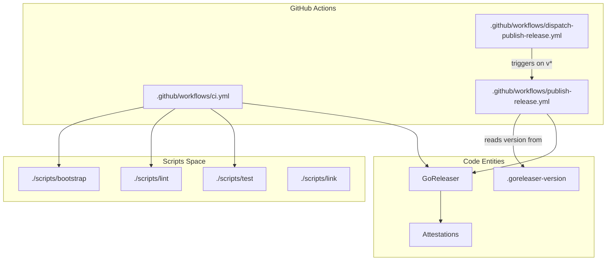
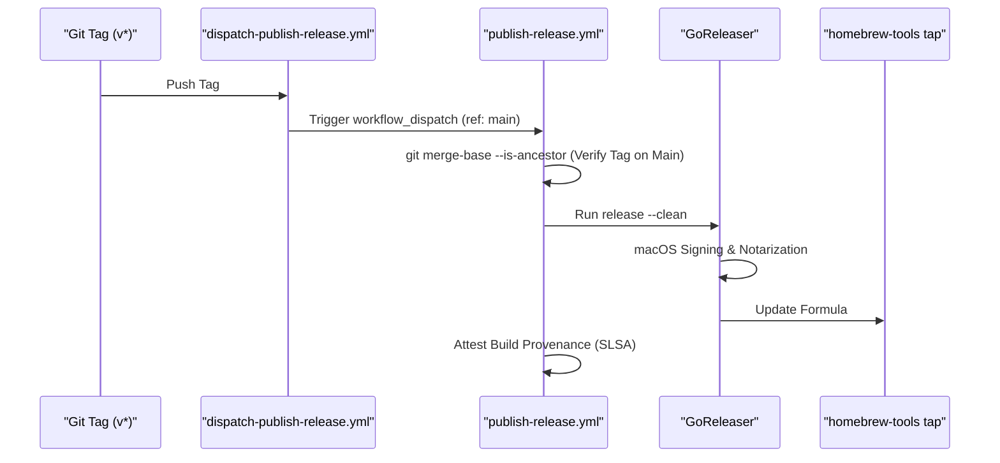

<!-- source: DeepWiki mcp.deepwiki.com · repo openai/openai-cli · page 6 CI/CD and Release Pipeline · fetched 2026-10-26 -->

# CI/CD and Release Pipeline

Relevant source files

The following files were used as context for generating this wiki page:

- [.github/workflows/ci.yml](.github/workflows/ci.yml)
- [.github/workflows/dispatch-publish-release.yml](.github/workflows/dispatch-publish-release.yml)
- [.github/workflows/publish-release.yml](.github/workflows/publish-release.yml)
- [.goreleaser-version](.goreleaser-version)

The `openai-cli` utilizes automated workflows to ensure code quality, facilitate cross-platform builds, and manage secure releases. These pipelines are primarily driven by GitHub Actions, utilizing `GoReleaser` for artifact orchestration and `SLSA` for build provenance.

The automation is divided into two primary tracks:
1.  **Continuous Integration (CI):** Validates every push and pull request through linting, testing, and snapshot builds.
2.  **Release Pipeline:** Triggered by version tags to perform formal cross-compilation, code signing (macOS), and distribution to package managers like Homebrew.

## Pipeline Overview

The following diagram illustrates the relationship between the GitHub Action workflows and the underlying scripts and tools used to build the CLI.

### Workflow and Tooling Relationship

**Sources:** [ .github/workflows/ci.yml:1-127 ](), [ .github/workflows/publish-release.yml:1-109 ](), [ .github/workflows/dispatch-publish-release.yml:1-26 ]()

---

## Continuous Integration

The CI workflow ([.github/workflows/ci.yml]()) is responsible for maintaining the integrity of the `main` branch and validating contributions. It runs on every push and pull request, excluding specific internal branches used for codegen previews.

*   **Linting:** Executes `./scripts/lint` to ensure code style consistency.
*   **Testing:** Runs the full test suite via `./scripts/test`, which includes unit tests and mock server integration tests.
*   **Snapshot Builds:** Uses `GoReleaser` to perform a `--snapshot` build to verify that the project compiles across all target architectures without publishing.
*   **Stainless Integration:** In internal staging environments, it uses `./scripts/link` to test the CLI against specific versions of the underlying `openai-go` SDK.

For details, see [Continuous Integration](#6.1).

**Sources:** [ .github/workflows/ci.yml:21-46 ](), [ .github/workflows/ci.yml:47-83 ](), [ .github/workflows/ci.yml:103-127 ]()

---

## Release Pipeline

The release process is a multi-stage workflow designed for security and platform compatibility. It is initiated by pushing a git tag (e.g., `v1.2.3`), which triggers a dispatch mechanism to ensure the release is built from the `main` branch.

### Release Execution Flow

**Sources:** [ .github/workflows/dispatch-publish-release.yml:8-25 ](), [ .github/workflows/publish-release.yml:55-57 ](), [ .github/workflows/publish-release.yml:82-95 ](), [ .github/workflows/publish-release.yml:96-108 ]()

Key features of the release pipeline include:
*   **Merge-Base Verification:** Ensures that the tag being released is an ancestor of the `main` branch to prevent releasing unmerged code.
*   **macOS Notarization:** Uses Apple-specific secrets (`MACOS_NOTARY_KEY`, etc.) to sign and notarize binaries for macOS users.
*   **Provenance:** Generates SLSA build provenance attestations to allow users to verify the artifact's origin.

For details, see [Release Pipeline](#6.2).

**Sources:** [ .github/workflows/publish-release.yml:31-57 ](), [ .github/workflows/publish-release.yml:90-95 ]()

---

## Developer Scripts

The `scripts/` directory contains the source of truth for all lifecycle tasks. By wrapping complex logic in shell scripts, the project ensures that the same commands used in CI can be executed locally by developers.

| Script | Purpose |
| :--- | :--- |
| `bootstrap` | Installs necessary Go dependencies and tools. |
| `lint` | Runs `golangci-lint` and other static analysis tools. |
| `test` | Executes `go test` with appropriate flags for the environment. |
| `link` / `unlink` | Replaces the remote SDK dependency with a local or specific version for development. |
| `mock` | Starts the `Steady` mock server for local integration testing. |

For details, see [Developer Scripts](#6.3).

**Sources:** [ .github/workflows/ci.yml:42-45 ](), [ .github/workflows/ci.yml:67-70 ](), [ .github/workflows/ci.yml:120-126 ]()

---

