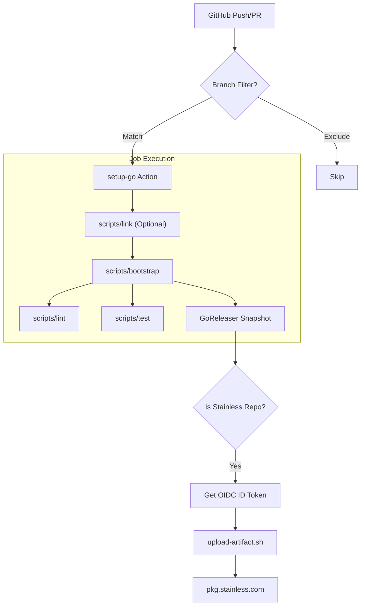
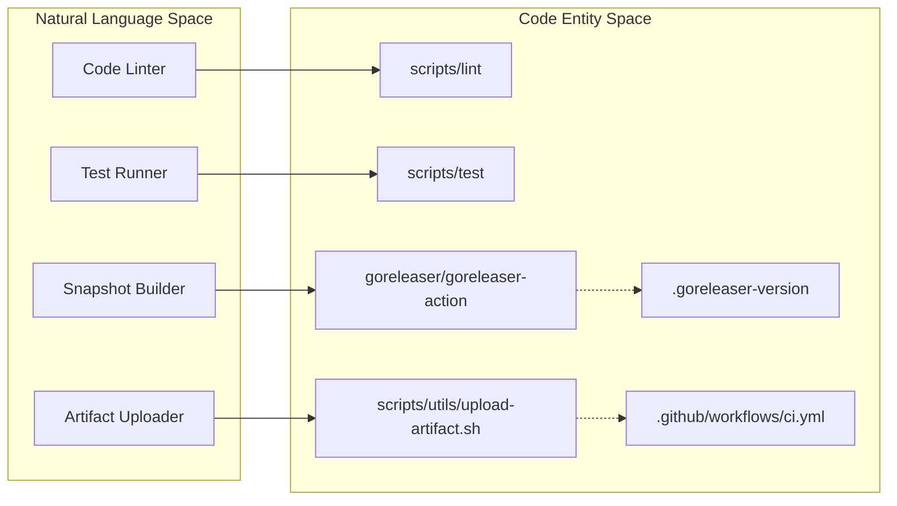

<!-- source: DeepWiki mcp.deepwiki.com · repo openai/openai-cli · page 6.1 Continuous Integration · fetched 2026-10-26 -->

# Continuous Integration

Relevant source files

The following files were used as context for generating this wiki page:

- [.github/workflows/ci.yml](.github/workflows/ci.yml)
- [.goreleaser-version](.goreleaser-version)

The Continuous Integration (CI) pipeline for the OpenAI CLI is designed to ensure code quality, build integrity, and automated artifact distribution. The workflow is triggered on pushes and pull requests, executing a suite of linting, testing, and snapshot build processes. It integrates closely with the Stainless SDK ecosystem, allowing for dynamic linking of private Go modules during the build process.

## CI Workflow Overview

The CI process is defined in [.github/workflows/ci.yml:1-127](). It consists of three primary jobs: `lint`, `build`, and `test`. These jobs run in parallel to provide rapid feedback on contributions.

### Branch and Event Triggers
The workflow implements specific inclusion and exclusion rules to optimize resource usage and avoid redundant builds on generated branches:
*   **Included Branches:** All branches (`**`) and specifically `codegen/stl/**` [.github/workflows/ci.yml:4-5,11]().
*   **Excluded Branches:** Branches prefixed with `integrated/`, `stl-preview-head/`, `stl-preview-base/`, `codegen/` (except `codegen/stl/`), and the literal `generated` branch [.github/workflows/ci.yml:6-10,13-15]().
*   **Conditionals:** Jobs are skipped if the commit message is "codegen metadata" to prevent loops during automated updates [.github/workflows/ci.yml:25,54]().

### Environment Configuration
The pipeline configures the Go environment to handle private dependencies. The `GOPRIVATE` environment variable is set to include both the official OpenAI Go SDK and the Stainless-hosted SDK variants:
*   `github.com/openai/openai-go/v3`
*   `github.com/stainless-sdks/openai-go/v3`
[.github/workflows/ci.yml:18]()

## Job Details

### 1. Linting (`lint`)
The `lint` job ensures code style and static analysis requirements are met.
*   **Setup:** Uses a custom composite action `./.github/actions/setup-go` which requires a `STAINLESS_API_KEY` secret [.github/workflows/ci.yml:32-34]().
*   **SDK Linking:** If running within the `stainless-sdks` repository, it attempts to link the SDK staging branch using `./scripts/link` [.github/workflows/ci.yml:37-39]().
*   **Execution:** Runs `./scripts/bootstrap` to install dependencies followed by `./scripts/lint` [.github/workflows/ci.yml:42-45]().

### 2. Testing (`test`)
The `test` job executes the CLI's test suite, including mock server integration tests.
*   **Execution:** Similar setup to the lint job, concluding with the execution of `./scripts/test` [.github/workflows/ci.yml:123-126]().

### 3. Build and Artifact Upload (`build`)
The `build` job performs a GoReleaser snapshot build and uploads the resulting artifacts.
*   **GoReleaser Snapshot:** It reads the required version from [.goreleaser-version:1]() and executes `goreleaser` with the `--snapshot` and `--skip=publish` flags [.github/workflows/ci.yml:72-80]().
*   **OIDC Authentication:** For repositories under `stainless-sdks`, it requests a GitHub OIDC token to authenticate with the Stainless artifact server [.github/workflows/ci.yml:84-91]().
*   **Artifact Upload:** If not on a preview branch, it executes `./scripts/utils/upload-artifact.sh` to push the build tarball to `https://pkg.stainless.com/s` [.github/workflows/ci.yml:93-101]().

## CI Implementation Logic

The following diagram illustrates the flow of a single CI run, showing how scripts and external tools are orchestrated.

### CI Execution Flow

**Sources:** [.github/workflows/ci.yml:1-127](), [.goreleaser-version:1]()

## Code Entity Mapping

The CI process relies on specific script entities and configuration files to manage the build lifecycle.

### CI Component Interaction
| Component | Code Entity / File | Role |
| :--- | :--- | :--- |
| **Workflow Definition** | `.github/workflows/ci.yml` | Orchestrates the lint, build, and test jobs [.github/workflows/ci.yml:20-127](). |
| **Dependency Setup** | `scripts/bootstrap` | Prepares the environment and installs Go dependencies [.github/workflows/ci.yml:42](). |
| **SDK Linker** | `scripts/link` | Replaces the standard SDK with a local or specific branch version [.github/workflows/ci.yml:39](). |
| **Build Tool** | `goreleaser` | Compiles binaries and packages them for snapshot testing [.github/workflows/ci.yml:77-80](). |
| **Version Pin** | `.goreleaser-version` | Ensures consistent GoReleaser versions across CI runs [.goreleaser-version:1](). |
| **Artifact Uploader** | `scripts/utils/upload-artifact.sh` | Handles the transmission of binaries to the Stainless package repository [.github/workflows/ci.yml:101](). |

### System to Code Mapping

**Sources:** [.github/workflows/ci.yml:1-127](), [.goreleaser-version:1]()

## Stainless SDK Integration

A critical feature of the CI pipeline is the ability to test the CLI against unreleased versions of the `openai-go` SDK. 

1.  **GOPRIVATE:** The environment is configured to allow fetching private modules from the Stainless GitHub organization [.github/workflows/ci.yml:18]().
2.  **Dynamic Linking:** The `scripts/link` utility is invoked with the current branch name: `github.com/stainless-sdks/openai-go/v3@${{ github.ref_name }}` [.github/workflows/ci.yml:39](). This ensures that if a feature requires changes in both the SDK and the CLI, the CLI CI can validate them together before the SDK is officially published.

**Sources:** [.github/workflows/ci.yml:18,36-40]()

---

