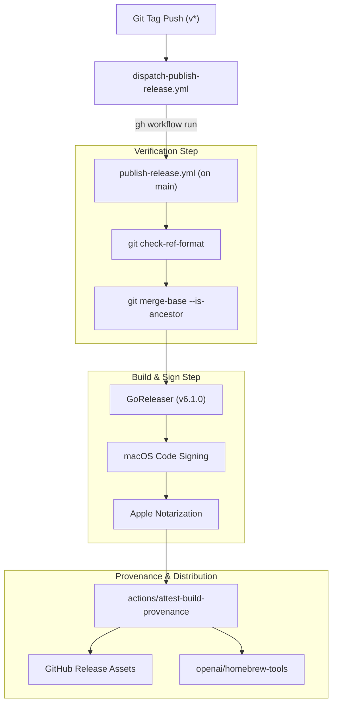
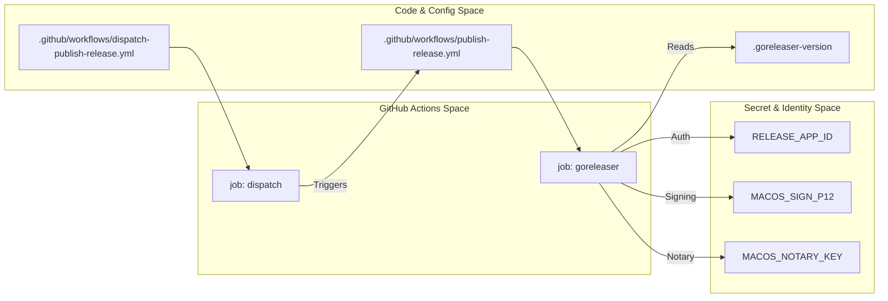

<!-- source: DeepWiki mcp.deepwiki.com · repo openai/openai-cli · page 6.2 Release Pipeline · fetched 2026-10-26 -->

# Release Pipeline

Relevant source files

The following files were used as context for generating this wiki page:

- [.github/workflows/dispatch-publish-release.yml](.github/workflows/dispatch-publish-release.yml)
- [.github/workflows/publish-release.yml](.github/workflows/publish-release.yml)

The release pipeline for the `openai-cli` is an automated process designed to ensure that every official binary is cryptographically signed, notarized for macOS, verified against the `main` branch, and accompanied by SLSA build provenance. The pipeline is split into a trigger mechanism and a heavy-lifting execution workflow.

## Pipeline Architecture

The release process follows a two-stage workflow dispatch pattern. This ensures that while releases are triggered by tags, the actual build logic always runs from the latest trusted code on the `main` branch.

### Release Dispatch Logic
The `Dispatch Publish Release` workflow acts as a gatekeeper. It listens for new git tags matching the `v*` pattern.

1.  **Trigger**: A push of a tag (e.g., `v1.2.3`) triggers the workflow [`.github/workflows/dispatch-publish-release.yml`:8-10]().
2.  **Dispatch**: It executes `gh workflow run publish-release.yml` targeting the `main` branch, passing the tag name as an input parameter [`.github/workflows/dispatch-publish-release.yml`:22-25]().

### The Publish Release Workflow
The core logic resides in `publish-release.yml`. It performs environment validation, cross-compilation, and artifact distribution.

#### 1. Tag Gating and Merge-Base Verification
Before building, the pipeline performs strict security checks to ensure the tag is legitimate and exists on the `main` branch history:
*   **Format Check**: Validates that the tag starts with `v` [`.github/workflows/publish-release.yml`:36-39]().
*   **Remote Verification**: Uses `git ls-remote` to confirm the tag exists on the remote repository [`.github/workflows/publish-release.yml`:43-45]().
*   **Lineage Verification**: Uses `git merge-base --is-ancestor` to verify that the commit pointed to by the tag is an ancestor of `origin/main` [`.github/workflows/publish-release.yml`:55](). This prevents releasing code from unmerged feature branches.

#### 2. Cross-Compilation with GoReleaser
The pipeline uses **GoReleaser** to handle the build matrix. The version of GoReleaser is pinned in a local file `.goreleaser-version` to ensure build reproducibility [`.github/workflows/publish-release.yml`:79-81]().

| Environment Variable | Purpose |
| :--- | :--- |
| `GITHUB_TOKEN` | Used for creating the GitHub Release and uploading assets [`.github/workflows/publish-release.yml`:88](). |
| `HOMEBREW_TAP_GITHUB_TOKEN` | Scoped token for updating the `openai/homebrew-tools` repository [`.github/workflows/publish-release.yml`:89](). |
| `GORELEASER_CURRENT_TAG` | Passes the validated tag to the build engine [`.github/workflows/publish-release.yml`:90](). |

#### 3. macOS Signing and Notarization
To support macOS users without "unidentified developer" warnings, the pipeline integrates Apple's signing and notarization tools via GoReleaser. It utilizes the following secrets:
*   `MACOS_SIGN_P12` and `MACOS_SIGN_PASSWORD`: The installer certificate for code signing [`.github/workflows/publish-release.yml`:91-92]().
*   `MACOS_NOTARY_KEY`, `ID`, and `ISSUER_ID`: Credentials for the Apple Notary Service [`.github/workflows/publish-release.yml`:93-95]().

#### 4. SLSA Build Provenance and Attestation
The pipeline generates **SLSA (Supply-chain Levels for Software Artifacts)** Level 3 attestations.
*   **Attestation Generation**: Uses `actions/attest-build-provenance` to sign all files in the `dist/` directory [`.github/workflows/publish-release.yml`:96-99]().
*   **Verification**: Immediately verifies the generated attestations using `gh attestation verify` to ensure the artifacts were produced by the specific workflow and repository [`.github/workflows/publish-release.yml`:100-108]().

#### 5. Homebrew Integration
The pipeline automatically updates the Homebrew formula in the `openai/homebrew-tools` repository. It uses a dedicated GitHub App token with `pull-requests: write` and `contents: write` permissions to the tap repository [`.github/workflows/publish-release.yml`:69-78]().

Sources: [`.github/workflows/publish-release.yml`:1-109](), [`.github/workflows/dispatch-publish-release.yml`:1-26]()

## Data Flow Diagram

The following diagram illustrates the flow from a git tag event to the final distribution of authenticated artifacts.

**Release Pipeline Data Flow**

Sources: [`.github/workflows/publish-release.yml`:25-108](), [`.github/workflows/dispatch-publish-release.yml`:8-25]()

## Release Execution Entity Map

This diagram maps the high-level release stages to the specific GitHub Actions jobs and secrets used in the implementation.

**Pipeline Entity Mapping**

Sources: [`.github/workflows/publish-release.yml`:17-20](), [`.github/workflows/publish-release.yml`:66-67](), [`.github/workflows/publish-release.yml`:79-81](), [`.github/workflows/publish-release.yml`:91-93](), [`.github/workflows/dispatch-publish-release.yml`:13-17]()

## Permission Model

The release pipeline operates with a strict permission set to minimize the blast radius of the automated tokens.

| Job / Step | Permissions Required | Purpose |
| :--- | :--- | :--- |
| `dispatch` | `actions: write`, `contents: read` | To trigger the second workflow [`.github/workflows/dispatch-publish-release.yml`:3-5](). |
| `goreleaser` | `contents: read`, `id-token: write`, `attestations: write` | To read code and generate SLSA attestations [`.github/workflows/publish-release.yml`:21-24](). |
| `app-token` | `contents: write` | For the CLI repository to create the release [`.github/workflows/publish-release.yml`:68](). |
| `tap-token` | `contents: write`, `pull-requests: write` | For the `homebrew-tools` repository [`.github/workflows/publish-release.yml`:77-78](). |

Sources: [`.github/workflows/publish-release.yml`:21-24](), [`.github/workflows/publish-release.yml`:63-78](), [`.github/workflows/dispatch-publish-release.yml`:3-5]()

---

