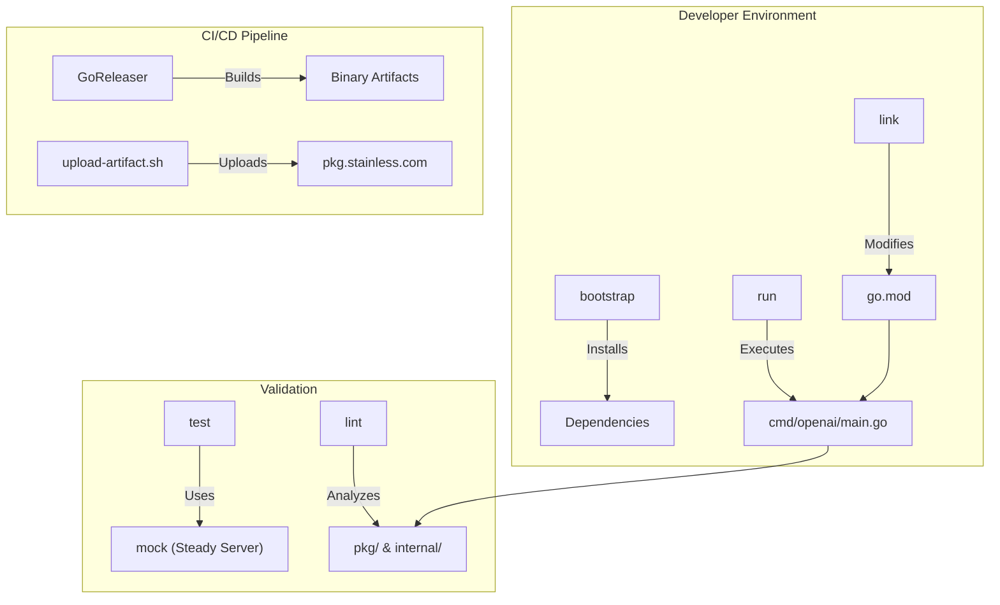
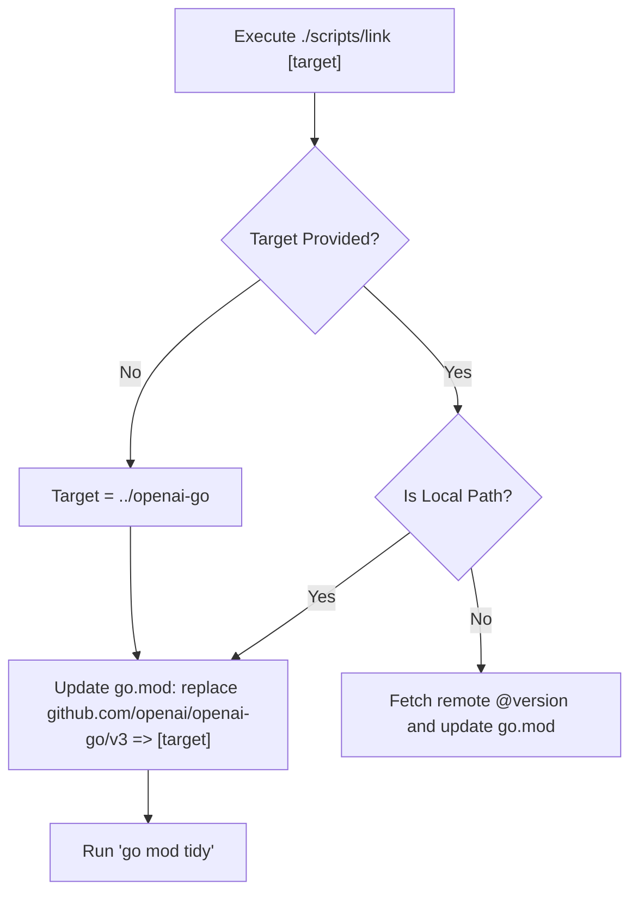

<!-- source: DeepWiki mcp.deepwiki.com · repo openai/openai-cli · page 6.3 Developer Scripts · fetched 2026-10-26 -->

# Developer Scripts

Relevant source files

The following files were used as context for generating this wiki page:

- [.github/workflows/ci.yml](.github/workflows/ci.yml)
- [.goreleaser-version](.goreleaser-version)
- [LICENSE](LICENSE)
- [README.md](README.md)

The `scripts/` directory contains a suite of utility scripts designed to streamline local development, automate testing, and manage dependencies. These scripts provide a consistent interface for both developers and Continuous Integration (CI) environments to interact with the codebase.

## Development Lifecycle Scripts

These scripts handle the setup and execution of the CLI during development.

### bootstrap
The `bootstrap` script is responsible for setting up the local development environment and ensuring all necessary dependencies are installed [README.md:42-43](). It is a prerequisite for running lints and tests in CI environments [.github/workflows/ci.yml:42-43]().

### run
The `run` script allows developers to execute the CLI locally without manually building or installing the binary. It passes all arguments directly to the Go entry point [README.md:37-44]().

### link and unlink
The `link` script is a critical tool for development when the CLI needs to be tested against a specific version of the `openai-go` SDK. It modifies the `go.mod` file to point to a different SDK source [README.md:143-146]().

*   **Remote Linking**: Links to a specific branch, tag, or commit hash from a repository [README.md:148-153]().
*   **Local Linking**: Links to a local directory containing the SDK source. By default, it looks for `../openai-go` [README.md:155-161]().

The CI pipeline uses `link` to test the CLI against staging branches of the SDK [.github/workflows/ci.yml:36-40]().

### build
The `build` script (often invoked via `go install` or GoReleaser in CI) compiles the source code into an executable binary. In CI, GoReleaser uses the version specified in `.goreleaser-version` to create snapshot builds [.github/workflows/ci.yml:72-80]().

## Validation and Quality Scripts

### lint
The `lint` script executes static analysis tools to ensure code quality and adherence to style guidelines. It is executed as a mandatory step in the CI pipeline [.github/workflows/ci.yml:44-45]().

### test
The `test` script runs the project's test suite. This includes unit tests and integration tests that interact with the mock server [.github/workflows/ci.yml:125-126]().

### format
The `format` script ensures consistent code formatting across the repository, typically wrapping standard Go formatting tools.

## Mocking and Artifacts

### mock
The `mock` script starts the **Steady** mock server. This server provides a local API endpoint that mimics the OpenAI REST API, allowing the CLI to be tested without making real network requests or incurring costs.

### upload-artifact.sh
Located in `scripts/utils/upload-artifact.sh`, this script handles the transmission of build artifacts to `pkg.stainless.com` during the CI process [.github/workflows/ci.yml:93-101]().

## Script Interaction Diagram

The following diagram illustrates how developer scripts interact with the codebase and external dependencies.

**Script Dependency and Data Flow**

**Sources:** [README.md:37-44](), [README.md:143-161](), [.github/workflows/ci.yml:36-45](), [.github/workflows/ci.yml:72-101]()

## Logic Flow: SDK Linking

The `link` script manages the relationship between the CLI and the underlying Go SDK. This is essential for testing unreleased SDK features.

**SDK Link Resolution Logic**

**Sources:** [README.md:143-161](), [.github/workflows/ci.yml:36-40]()

## Summary of Scripts

| Script | Purpose | Key Files/Entities |
| :--- | :--- | :--- |
| `bootstrap` | Environment setup | `go.mod`, CI runners |
| `run` | Local execution | `cmd/openai/main.go` |
| `link` | SDK replacement | `go.mod`, `openai-go` SDK |
| `lint` | Static analysis | `pkg/`, `internal/` |
| `test` | Test execution | `mocktest` package, Steady server |
| `mock` | Mock API server | Steady server binaries |
| `build` | Binary compilation | `.goreleaser-version` |
| `format` | Code style | All `.go` files |

**Sources:** [README.md:37-44](), [README.md:143-161](), [.github/workflows/ci.yml:21-127]()

---

