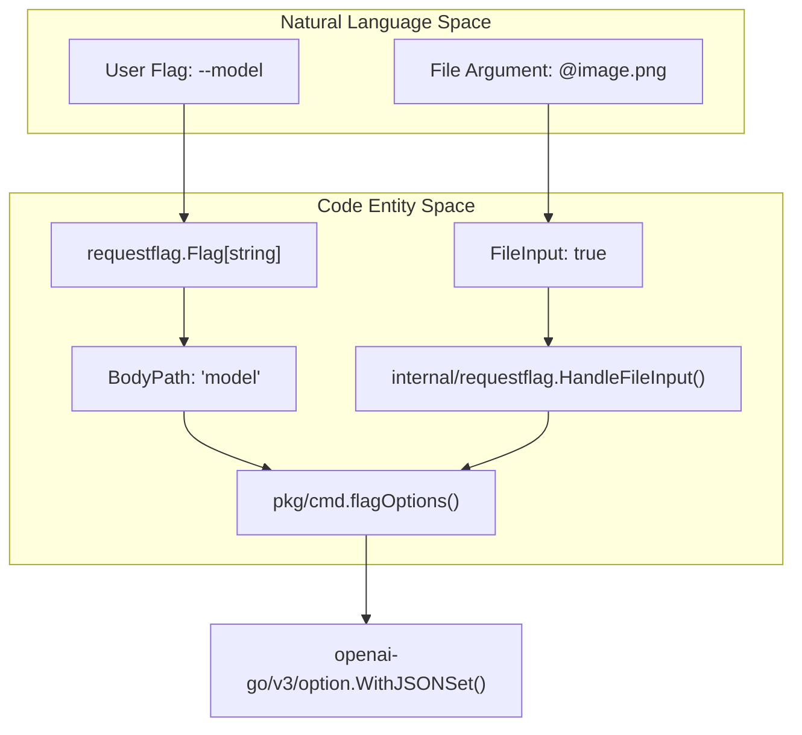
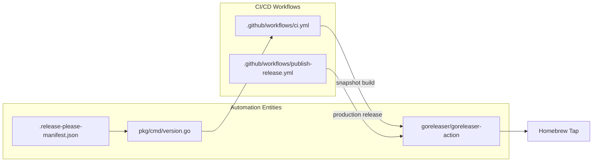

<!-- source: DeepWiki mcp.deepwiki.com · repo openai/openai-cli · page 7 Glossary · fetched 2026-10-26 -->

# Glossary

Relevant source files

The following files were used as context for generating this wiki page:

- [.github/workflows/ci.yml](.github/workflows/ci.yml)
- [.github/workflows/dispatch-publish-release.yml](.github/workflows/dispatch-publish-release.yml)
- [.github/workflows/publish-release.yml](.github/workflows/publish-release.yml)
- [.goreleaser-version](.goreleaser-version)
- [.release-please-manifest.json](.release-please-manifest.json)
- [.stats.yml](.stats.yml)
- [CHANGELOG.md](CHANGELOG.md)
- [LICENSE](LICENSE)
- [README.md](README.md)
- [internal/autocomplete/autocomplete_test.go](internal/autocomplete/autocomplete_test.go)
- [internal/autocomplete/shellscripts/bash_autocomplete.bash](internal/autocomplete/shellscripts/bash_autocomplete.bash)
- [internal/debugmiddleware/debug_middleware.go](internal/debugmiddleware/debug_middleware.go)
- [internal/jsonview/explorer.go](internal/jsonview/explorer.go)
- [pkg/cmd/call.go](pkg/cmd/call.go)
- [pkg/cmd/chatcompletion.go](pkg/cmd/chatcompletion.go)
- [pkg/cmd/image.go](pkg/cmd/image.go)
- [pkg/cmd/image_test.go](pkg/cmd/image_test.go)
- [pkg/cmd/response.go](pkg/cmd/response.go)
- [pkg/cmd/version.go](pkg/cmd/version.go)

This page defines codebase-specific terms, jargon, and domain concepts used within the OpenAI CLI. It serves as a technical reference for onboarding engineers to understand how high-level concepts map to specific code entities.

## Core Concepts

### Request Construction Pipeline
The process of transforming CLI flags and piped input into valid HTTP requests for the OpenAI API. This pipeline is primarily driven by the `internal/requestflag` package and the `flagOptions()` helper.

| Term | Definition | Code Pointer |
| :--- | :--- | :--- |
| **Request Flag** | A generic wrapper around CLI flags that includes metadata for API mapping (e.g., `BodyPath`, `QueryPath`). | [internal/requestflag/request_flag.go:1-50]() |
| **BodyPath** | A metadata string indicating where a flag's value should be placed in the JSON request body. | [pkg/cmd/image.go:26-26]() |
| **FileInput** | A boolean attribute on a flag indicating it can accept the `@` file-prefix syntax. | [pkg/cmd/image.go:27-27]() |
| **Data Aliases** | Mapping of simplified CLI names to complex API field paths. | [internal/requestflag/request_flag.go:1-100]() |

**Natural Language to Code Entity Mapping: Request Pipeline**

Sources: [pkg/cmd/image.go:22-33](), [internal/requestflag/request_flag.go:1-50]()

---

### Output Pipeline
The system responsible for rendering API responses into various user-requested formats.

*   **GJSON Transform**: A mechanism using the `gjson` library to filter or reshape JSON output before display via the `--transform` flag. [README.md:100-101]()
*   **Explore Format**: An interactive TUI (Terminal User Interface) mode for navigating large JSON responses, implemented using the `bubbletea` framework. [internal/jsonview/explorer.go:1-50]()
*   **Pretty Print**: Default human-readable output formatting. [README.md:98-98]()

---

## Technical Jargon

### @-Prefix Syntax
A CLI-specific convention for passing file contents as arguments.
*   `@file://`: Explicitly sends file contents as a string literal. [README.md:135-135]()
*   `@data://`: Explicitly sends file contents as base64-encoded data. [README.md:135-135]()

### Admin Organization Commands
Commands requiring the `OPENAI_ADMIN_KEY` environment variable, used for managing organizational resources like projects, users, and usage metrics.
*   **Root Namespace**: `admin:organization`
*   **Implementation**: Scoped command groups in `pkg/cmd/`. [README.md:69-72]()

### Stainless
The automated SDK generation platform used to produce the underlying Go SDK (`openai-go`) and the CLI's command structures from an OpenAPI specification.
*   **Stats Tracking**: The `.stats.yml` file tracks the OpenAPI spec hash and the number of configured endpoints. [.stats.yml:1-4]()

---

## Build & Release Terms

### GoReleaser
The tool used to automate the cross-compilation, signing, and notarization of binaries for different platforms (macOS, Linux, Windows).
*   **Configuration**: Managed via `.goreleaser.yml` (implied) and versioned via `.goreleaser-version`. [.goreleaser-version:1-1]()
*   **Workflow**: Triggered by `publish-release.yml`. [.github/workflows/publish-release.yml:82-86]()

### Release-Please
A GitHub Action that automates semantic versioning and changelog generation based on conventional commits.
*   **Manifest**: `.release-please-manifest.json` tracks the current version. [.release-please-manifest.json:1-3]()
*   **Version Pointer**: The `Version` constant in `pkg/cmd/version.go` is updated by this tool. [pkg/cmd/version.go:5-5]()

**Code Entity Space: Release Lifecycle**

Sources: [pkg/cmd/version.go:1-6](), [.release-please-manifest.json:1-3](), [.github/workflows/publish-release.yml:82-90]()

---

## Internal Abbreviations

| Abbreviation | Meaning | Context |
| :--- | :--- | :--- |
| **OIDC** | OpenID Connect | Used for secure artifact upload to `pkg.stainless.com` during CI. [.github/workflows/ci.yml:84-91]() |
| **JSONL** | JSON Lines | An output format where each line is a valid JSON object, used for streaming. [README.md:98-98]() |
| **SLSA** | Supply-chain Levels for Software Artifacts | Attestation generated during the release process to ensure build integrity. [.github/workflows/publish-release.yml:96-100]() |
| **Steady** | Mock Server | The internal mock server used to simulate OpenAI API responses during testing. [pkg/cmd/image_test.go:12-26]() |

Sources: [.github/workflows/ci.yml:84-101](), [README.md:98-99](), [pkg/cmd/image_test.go:12-26]()