# Page: Overview

# Overview

<details>
<summary>Relevant source files</summary>

The following files were used as context for generating this wiki page:

- [.release-please-manifest.json](.release-please-manifest.json)
- [.stats.yml](.stats.yml)
- [CHANGELOG.md](CHANGELOG.md)
- [LICENSE](LICENSE)
- [README.md](README.md)
- [pkg/cmd/version.go](pkg/cmd/version.go)

</details>


The `openai-cli` project is the official command-line interface for the [OpenAI REST API](https://platform.openai.com/docs). It provides a resource-based command structure [README.md:48-52]() that allows users to interact with OpenAI's inference, administration, and management endpoints directly from the terminal.

The CLI is built in Go and is largely generated from an OpenAPI specification [pkg/cmd/version.go:1](), ensuring high fidelity with the underlying API surface. It supports advanced features such as interactive JSON exploration, GJSON-based data transformation, and sophisticated file-handling via specific URI schemes [README.md:98-140]().

### Project Generation and Metadata
The codebase is maintained through an automated pipeline. The `.stats.yml` file tracks the state of the API generation, including the source OpenAPI spec URL and the number of configured endpoints (currently 220) [.stats.yml:1-4](). Versioning is managed via `release-please`, which synchronizes the version string across `pkg/cmd/version.go`, `.release-please-manifest.json`, and the `CHANGELOG.md` [pkg/cmd/version.go:5](), [.release-please-manifest.json:2](), [CHANGELOG.md:3]().

### High-Level Architecture
The CLI follows a hierarchical command structure where global flags manage authentication and output formatting, while subcommands map to specific API resources.

#### System Mapping: User Space to Code Entities
The following diagram illustrates how user-facing CLI concepts map to internal code entities and configuration files.

**CLI Entity Mapping**
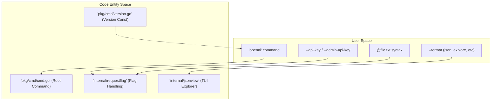
Sources: [pkg/cmd/cmd.go](), [internal/requestflag](), [internal/jsonview](), [pkg/cmd/version.go:5]()

### Core Workflows
The CLI's operation can be divided into three primary phases: initialization, request construction, and output processing.

**Request Lifecycle**
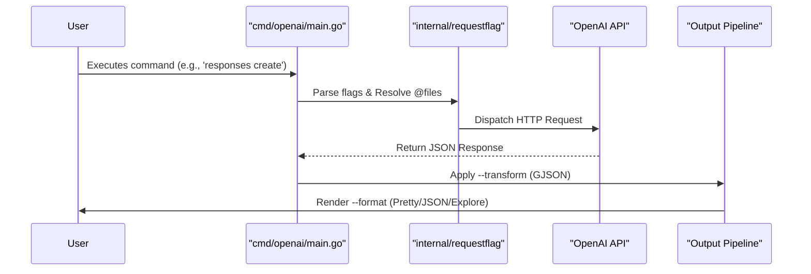
Sources: [README.md:48-62](), [README.md:98-101](), [README.md:105-110]()

### Navigation and Child Pages

To dive deeper into specific areas of the `openai-cli`, refer to the following child pages:

#### [Getting Started](#1.1)
Covers the prerequisites and initial setup.
*   **Installation**: Using Homebrew (`brew install openai/tools/openai`) or Go (`go install`) [README.md:9-23]().
*   **Authentication**: Setting up `OPENAI_API_KEY` and `OPENAI_ADMIN_KEY` [README.md:79-84]().
*   **Basic Usage**: Executing your first `responses create` or `admin` commands [README.md:59-72]().

#### [SDK Generation and Versioning](#1.2)
Details the automated maintenance of the CLI.
*   **Stainless Generation**: How the CLI is kept in sync with the [OpenAPI spec](https://storage.googleapis.com/stainless-sdk-openapi-specs/openai/openai-371f497afe4d6070f6e252e5febbe8f453c7058a8dff0c26a01b4d88442a4ac2.yml) [.stats.yml:2]().
*   **Release Management**: The role of `release-please` in managing the [CHANGELOG.md]() and semantic versioning [pkg/cmd/version.go:5]().
*   **Stats Tracking**: Understanding the metadata in `.stats.yml` [.stats.yml:1-4]().

### Developer Resources
For contributors, the `scripts/` directory contains essential utilities:
*   `scripts/run`: Run the tool locally during development [README.md:43]().
*   `scripts/link`: Link the CLI against a local or specific version of the `openai-go` SDK [README.md:145-162]().

Sources: [.stats.yml:1-4](), [README.md:9-162](), [pkg/cmd/version.go:5](), [CHANGELOG.md:1-60]()

---

# Page: Getting Started

# Getting Started

<details>
<summary>Relevant source files</summary>

The following files were used as context for generating this wiki page:

- [.release-please-manifest.json](.release-please-manifest.json)
- [CHANGELOG.md](CHANGELOG.md)
- [LICENSE](LICENSE)
- [README.md](README.md)
- [pkg/cmd/version.go](pkg/cmd/version.go)

</details>


This page provides the technical foundations for installing, authenticating, and executing the first commands with the OpenAI CLI. It covers the transition from local installation to the execution of API requests against OpenAI's REST endpoints.

## Installation Methods

The OpenAI CLI can be installed via package managers or built from source using the Go toolchain.

### Homebrew (macOS/Linux)
The recommended method for most users is via the official Homebrew tap:
```sh
brew install openai/tools/openai
```
[README.md:9-13]()

### Go Installation
To install the CLI using Go, version 1.25 or later is required. This compiles the binary and places it in the `GOPATH` bin directory.
```sh
go install 'github.com/openai/openai-cli/cmd/openai@latest'
```
[README.md:15-21]()

**Path Configuration:**
The binary is typically located at `$HOME/go/bin`. To ensure the `openai` command is available, add this to your shell profile:
```sh
export PATH="$PATH:$(go env GOPATH)/bin"
```
[README.md:23-33]()

### Installation Data Flow
The following diagram illustrates how different installation paths result in the `openai` binary entry point.

**Installation to Entry Point**
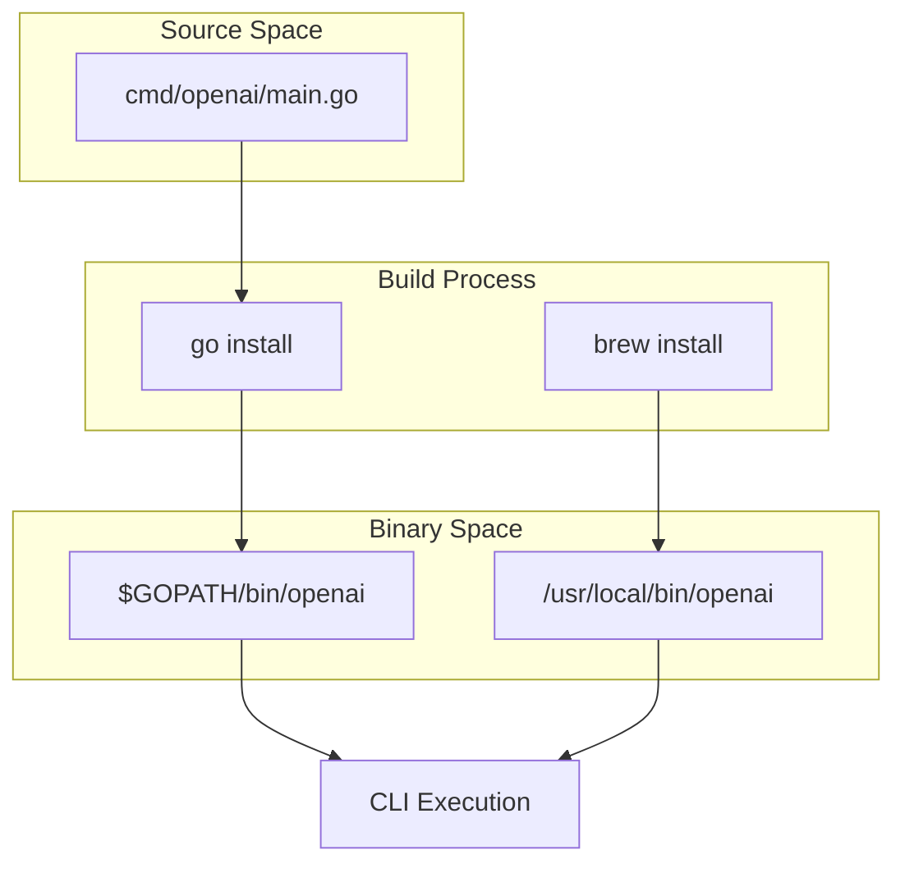
Sources: [README.md:11-33](), [pkg/cmd/version.go:5-5]()

---

## Authentication and Environment

The CLI uses a tiered authentication system depending on the resource being accessed (Standard API vs. Admin Organization API).

### Environment Variables
The CLI checks for specific environment variables to populate global flags automatically.

| Environment Variable | Description | Default |
| :--- | :--- | :--- |
| `OPENAI_API_KEY` | Primary API key for standard endpoints | `null` |
| `OPENAI_ADMIN_KEY` | Key for admin-level organization management | `null` |
| `OPENAI_ORG_ID` | Specific Organization ID to target | `null` |
| `OPENAI_PROJECT_ID` | Specific Project ID to target | `null` |
| `OPENAI_WEBHOOK_SECRET`| Secret for validating webhook signatures | `null` |

[README.md:79-86]()

### Configuration Mapping
The CLI maps these environment variables to internal flag states. This allows for persistent configuration without passing flags on every command.

**Environment to Flag Mapping**
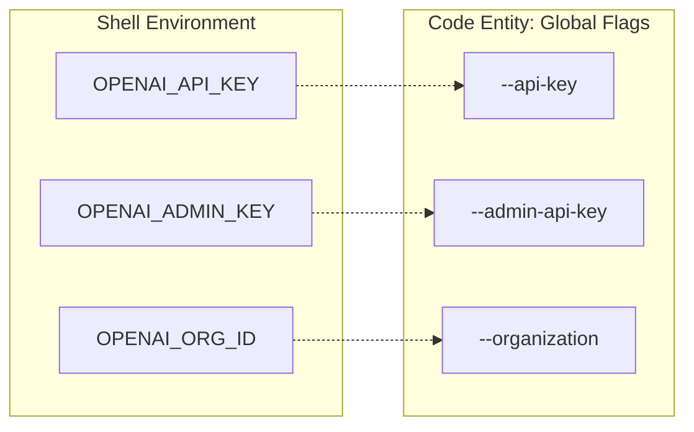
Sources: [README.md:87-93]()

---

## Basic Usage Patterns

The CLI follows a resource-based command structure: `openai [resource] <command> [flags...]` [README.md:48-52]().

### Standard API Commands
Standard inference commands (e.g., Chat Completions) require `OPENAI_API_KEY`.
```sh
export OPENAI_API_KEY="sk-..."
openai responses create --input "Say this is a test" --model gpt-5.5
```
[README.md:54-62]()

### Admin API Commands
Administrative tasks (e.g., usage metrics) require `OPENAI_ADMIN_KEY`.
```sh
export OPENAI_ADMIN_KEY="sk-admin-..."
openai admin:organization:usage completions --start-time 1735689600 --end-time 1735776000
```
[README.md:64-73]()

### Passing File Data
The CLI supports a special `@` prefix syntax for passing file contents as arguments.

1.  **Direct File Path**: `--arg @image.png` loads the file.
2.  **Explicit Encoding**:
    *   `@file://path/to/file.txt`: Forces plain text string encoding.
    *   `@data://path/to/binary.dat`: Forces base64 encoding.
3.  **Escaping**: Use `\@` to pass a literal string starting with an at-sign.

[README.md:103-141]()

---

## Global Flags Reference

These flags are available across all commands and modify the behavior of the request or the output display.

| Flag | Purpose |
| :--- | :--- |
| `--debug` | Enables HTTP request/response logging (redacts sensitive headers) [README.md:95-95]() |
| `--base-url` | Overrides the default API endpoint (useful for proxies or local mocks) [README.md:97-97]() |
| `--format` | Sets output format: `auto`, `explore`, `json`, `jsonl`, `pretty`, `raw`, `yaml` [README.md:98-98]() |
| `--transform` | Filters output using GJSON syntax [README.md:100-100]() |
| `--version` | Displays the current version (e.g., `1.1.2`) [pkg/cmd/version.go:5-5]() |

Sources: [README.md:87-102](), [pkg/cmd/version.go:1-6]()

---

# Page: SDK Generation and Versioning

# SDK Generation and Versioning

<details>
<summary>Relevant source files</summary>

The following files were used as context for generating this wiki page:

- [.release-please-manifest.json](.release-please-manifest.json)
- [.stats.yml](.stats.yml)
- [CHANGELOG.md](CHANGELOG.md)
- [pkg/cmd/version.go](pkg/cmd/version.go)

</details>


This page describes the automated lifecycle of the `openai-cli`. The project is not authored manually; instead, it is generated from the OpenAI OpenAPI specification using Stainless. Versioning and changelog generation are handled via `release-please` to maintain semantic versioning (SemVer) integrity.

## Stainless Generation Flow

The `openai-cli` is a generated artifact. Stainless consumes the OpenAI OpenAPI specification and applies a configuration layer to produce the Go source code that forms the CLI. This ensures that the CLI remains in sync with the latest API features, such as Realtime API or Admin Organization endpoints, without requiring manual implementation of every request/response structure.

### The Generation Pipeline

The following diagram illustrates how the OpenAPI specification is transformed into the executable CLI.

**Stainless Generation Data Flow**
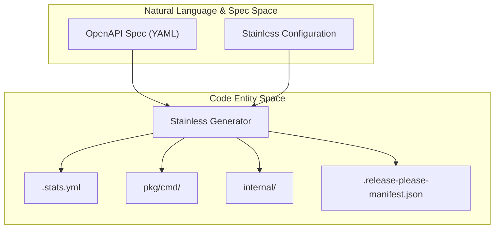

### Tracking State with `.stats.yml`

The `.stats.yml` file acts as a manifest for the current generation state. It tracks the source of truth for the API definition and the configuration used during the build process.

*   **`configured_endpoints`**: The total count of API endpoints currently exposed through the CLI `[ .stats.yml:1-1 ]()`.
*   **`openapi_spec_url`**: The specific URL to the versioned OpenAPI YAML file hosted by Stainless `[ .stats.yml:2-2 ]()`.
*   **`openapi_spec_hash`**: A MD5/SHA hash of the spec file to detect upstream changes `[ .stats.yml:3-3 ]()`.
*   **`config_hash`**: A hash of the internal Stainless configuration used to generate the CLI logic `[ .stats.yml:4-4 ]()`.

**Sources:**
- `[.stats.yml:1-5]()`

## Versioning and Release Management

The project utilizes `release-please` to automate versioning. This tool parses Conventional Commit messages to determine the next semantic version and automatically updates the relevant files.

### Semantic Versioning Files

Three primary files track the current version of the CLI:
1.  **`.release-please-manifest.json`**: The source of truth for the current version string used by the release automation `[ .release-please-manifest.json:1-3 ]()`.
2.  **`pkg/cmd/version.go`**: Contains the `Version` constant. This value is injected into the CLI's binary and is what users see when running `openai --version` `[ pkg/cmd/version.go:5-5 ]()`.
3.  **`CHANGELOG.md`**: A generated history of changes, categorized by "Features", "Bug Fixes", and "Documentation" `[ CHANGELOG.md:1-59 ]()`.

### Release-Please Integration

When Stainless triggers a generation update, it often includes commits with specific prefixes (e.g., `feat(api):`, `fix(api):`). `release-please` interprets these to update the `Version` constant in `pkg/cmd/version.go` `[ pkg/cmd/version.go:5-5 ]()`.

**Versioning Entity Map**
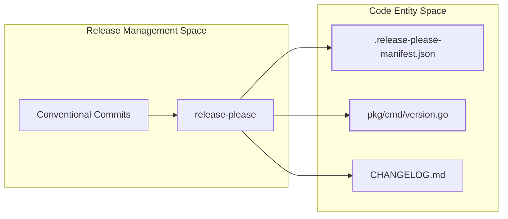

### Changelog Structure

The `CHANGELOG.md` provides a historical record of the CLI's evolution. It maps specific Git commit hashes to high-level features or fixes. For example:
*   **Features**: New API capabilities like `realtime` or `admin org` updates `[ CHANGELOG.md:17-17 ]()`, `[ CHANGELOG.md:40-41 ]()`.
*   **Bug Fixes**: Corrections to regressions, such as enum handling in `imagegen` `[ CHANGELOG.md:22-22 ]()`.
*   **Chores**: Internal maintenance, such as redacting sensitive headers in debug logs `[ CHANGELOG.md:27-27 ]()`.

**Sources:**
- `[.release-please-manifest.json:1-3]()`
- `[pkg/cmd/version.go:1-6]()`
- `[CHANGELOG.md:1-59]()`

---

# Page: CLI Architecture

# CLI Architecture

<details>
<summary>Relevant source files</summary>

The following files were used as context for generating this wiki page:

- [LICENSE](LICENSE)
- [README.md](README.md)
- [go.mod](go.mod)
- [go.sum](go.sum)
- [pkg/cmd/chatcompletion.go](pkg/cmd/chatcompletion.go)
- [pkg/cmd/response.go](pkg/cmd/response.go)

</details>


The OpenAI CLI is a resource-oriented command-line interface built on top of the `urfave/cli/v3` framework [go.mod:18](). It is designed to map the OpenAI REST API into a hierarchical command tree where each API resource (e.g., `responses`, `chat completions`) is represented as a command group.

The architecture emphasizes a declarative approach to request construction using a custom flag system that handles type safety, file embedding, and API-specific encoding requirements.

## System Overview

The following diagram illustrates the flow of a command from execution to the final output, bridging user input to the internal code entities.

### CLI Execution Flow
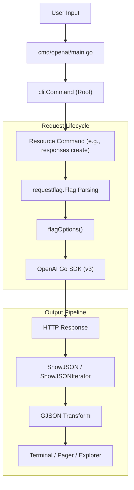
**Sources:** [cmd/openai/main.go:1-10](), [pkg/cmd/response.go:18-22](), [README.md:48-52]()

## Core Components

### 1. Command Tree and Root Command
The CLI's entry point is in `cmd/openai/main.go`, which initializes the root command defined in the `pkg/cmd` package. The command structure follows a `openai [resource] <command> [flags...]` pattern [README.md:48-52](). Global flags such as `--api-key`, `--format`, and `--debug` are attached at the root to influence the behavior of all subcommands [README.md:87-102]().

For details, see [Command Tree and Root Command](#2.1).

### 2. Request Construction Pipeline
Commands use a specialized `requestflag.Flag[T]` type [pkg/cmd/response.go:23-29]() to define parameters. This system maps CLI flags directly to API request components via metadata like `BodyPath`, `QueryPath`, or `PathParam` [pkg/cmd/response.go:27](). It also handles complex logic like the `@` prefix for file embedding and base64 encoding for binary data [README.md:103-109]().

For details, see [Request Construction Pipeline](#2.2).

### 3. Output Formatting and Display
The CLI supports multiple output formats including `json`, `yaml`, `pretty`, and an interactive `explore` mode [README.md:98](). The output pipeline utilizes `ShowJSON` and `ShowJSONIterator` to handle both standard and streaming responses. Users can also apply [GJSON](https://github.com/tidwall/gjson) transformations using the `--transform` flag [README.md:100]().

For details, see [Output Formatting and Display](#2.3).

### 4. Debug Middleware and Logging
When the `--debug` flag is enabled [README.md:95](), the CLI activates a `RequestLogger` middleware. This component logs full HTTP request and response details to `stderr`, while automatically redacting sensitive information like API keys and Authorization headers to ensure security during troubleshooting.

For details, see [Debug Middleware and Logging](#2.4).

## Package Relationships

The CLI relies on several internal packages to manage the complexity of the OpenAI API:

| Package | Responsibility |
| :--- | :--- |
| `internal/requestflag` | Generic flag system for type-safe API request mapping. |
| `internal/jsonview` | TUI components for the interactive `explore` output format. |
| `internal/apiform` | Handles `multipart/form-data` encoding for file uploads. |
| `internal/apiquery` | Manages complex query string serialization (e.g., bracket notation). |

### Internal Entity Mapping
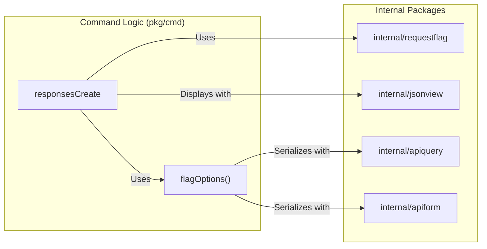
**Sources:** [pkg/cmd/response.go:9-10](), [go.mod:5-18](), [README.md:131-140]()

**Sources:**
- [README.md:48-102]() (Global flags and command structure)
- [pkg/cmd/response.go:18-93]() (Command definition and flag mapping)
- [go.mod:1-20]() (Core dependencies)

---

# Page: Command Tree and Root Command

# Command Tree and Root Command

<details>
<summary>Relevant source files</summary>

The following files were used as context for generating this wiki page:

- [LICENSE](LICENSE)
- [README.md](README.md)
- [pkg/cmd/cmdutil_test.go](pkg/cmd/cmdutil_test.go)

</details>


This section details the construction of the OpenAI CLI command hierarchy, the configuration of global flags, the main entry point, and the error handling mechanisms that govern the tool's execution.

The CLI is built on a resource-based command structure, where the root command serves as the entry point for all sub-resources (e.g., `responses`, `images`, `admin`).

### Main Entrypoint

The application starts in `cmd/openai/main.go`. This file is responsible for initializing the root command and executing it within the operating system environment.

- **`main()`**: The entrypoint calls `cmd.NewRootCmd().Execute()` [cmd/openai/main.go:10-10]().
- **Execution Flow**: If `Execute()` returns an error, the application prints the error to `stderr` and exits with status code `1` [cmd/openai/main.go:12-14]().

**Sources:**
- [cmd/openai/main.go:1-15]()

### Root Command Assembly

The root command is defined and assembled in `pkg/cmd/cmd.go`. It uses the `cli.Command` structure to define the base behavior and metadata for the entire tool.

#### The `NewRootCmd` Function
This function instantiates the root `openai` command and attaches all resource-specific subcommands.

1.  **Metadata**: Sets the `Use` string to `"openai"` and provides short/long descriptions [pkg/cmd/cmd.go:27-30]().
2.  **Subcommand Registration**: It attaches various API resource groups using `AddCommand`. These include:
    *   **Inference**: `responses`, `chat:completions` [pkg/cmd/cmd.go:34-35]().
    *   **Media**: `images`, `audio`, `videos` [pkg/cmd/cmd.go:36-38]().
    *   **Admin**: `admin:organization:projects`, `admin:organization:users`, etc [pkg/cmd/cmd.go:50-65]().
    *   **Infrastructure**: `files`, `models`, `batches`, `vector-stores` [pkg/cmd/cmd.go:40-49]().

#### Global Flags
Global flags are defined on the root command, making them available to every subcommand in the tree. These flags handle authentication, environment configuration, and output formatting.

| Flag | Environment Variable | Description |
| :--- | :--- | :--- |
| `--api-key` | `OPENAI_API_KEY` | API key for standard endpoints [pkg/cmd/cmd.go:88-88]() |
| `--admin-api-key`| `OPENAI_ADMIN_KEY` | Key for admin/organization endpoints [pkg/cmd/cmd.go:89-89]() |
| `--organization` | `OPENAI_ORG_ID` | Specific Organization ID [pkg/cmd/cmd.go:90-90]() |
| `--project` | `OPENAI_PROJECT_ID` | Specific Project ID [pkg/cmd/cmd.go:91-91]() |
| `--base-url` | - | Custom API backend URL [pkg/cmd/cmd.go:96-96]() |
| `--format` | - | Output format (json, pretty, explore, etc.) [pkg/cmd/cmd.go:97-97]() |
| `--debug` | - | Enables HTTP request/response logging [pkg/cmd/cmd.go:94-94]() |
| `--transform` | - | GJSON path to filter output data [pkg/cmd/cmd.go:101-101]() |

**Sources:**
- [pkg/cmd/cmd.go:25-85]()
- [pkg/cmd/cmd.go:87-105]()
- [README.md:87-102]()

### Data Flow: Root to Subcommand

The following diagram illustrates how the `main` package triggers the command tree assembly and how flags propagate down to the leaf commands.

**Command Initialization and Execution**
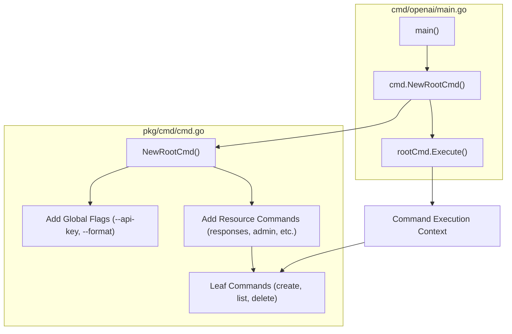
**Sources:**
- [cmd/openai/main.go:10-10]()
- [pkg/cmd/cmd.go:34-75]()

### Error Handling

Error handling in the CLI is centralized to ensure consistent output formatting, especially when using the `--format-error` flag.

1.  **Validation**: Commands perform early validation, such as checking for a missing scheme in `--base-url` using `ValidateBaseURL` [pkg/cmd/cmdutil_test.go:137-144]().
2.  **API Errors**: When an API request fails, the error is captured and passed to the output pipeline.
3.  **Formatting**: The CLI supports `--format-error` and `--transform-error` to allow users to parse error responses with the same flexibility as successful responses [README.md:99-101]().
4.  **Exit Codes**: Any error returned to `rootCmd.Execute()` results in a non-zero exit code [cmd/openai/main.go:12-14]().

### Technical Mapping: Code Entities

The following diagram bridges the natural language concepts of "Global Flags" and "Resource Commands" to their specific implementations in the Go source.

**Code Entity Map**
```mermaid
classDiagram
    class "main.go" {
        +main()
    }
    class "pkg/cmd/cmd.go" {
        +NewRootCmd()
        +rootCmd cli.Command
    }
    class "GlobalFlags" {
        --api-key
        --format
        --debug
        --base-url
    }
    class "ResourceGroups" {
        responsesCmd
        adminCmd
        imagesCmd
    }

    "main.go" ..> "pkg/cmd/cmd.go" : calls
    "pkg/cmd/cmd.go" *-- "GlobalFlags" : PersistentFlags()
    "pkg/cmd/cmd.go" *-- "ResourceGroups" : AddCommand()
```

**Sources:**
- [cmd/openai/main.go:10-10]()
- [pkg/cmd/cmd.go:26-32]()
- [pkg/cmd/cmd.go:87-105]()

### Configuration Precedence

The CLI evaluates configuration in the following order of precedence (highest to lowest):
1.  **Command Line Flags**: e.g., `--api-key "sk-..."` [pkg/cmd/cmd.go:88-88]().
2.  **Environment Variables**: e.g., `OPENAI_API_KEY` [README.md:79-85]().
3.  **Defaults**: Default values specified in the `cli.Command` definition or internal SDK defaults.

**Sources:**
- [README.md:79-93]()
- [pkg/cmd/cmd.go:87-105]()

---

# Page: Request Construction Pipeline

# Request Construction Pipeline

<details>
<summary>Relevant source files</summary>

The following files were used as context for generating this wiki page:

- [pkg/cmd/call.go](pkg/cmd/call.go)
- [pkg/cmd/chatcompletion.go](pkg/cmd/chatcompletion.go)
- [pkg/cmd/image.go](pkg/cmd/image.go)
- [pkg/cmd/image_test.go](pkg/cmd/image_test.go)
- [pkg/cmd/response.go](pkg/cmd/response.go)

</details>


The Request Construction Pipeline is the mechanism by which the OpenAI CLI translates command-line flags and piped input into structured HTTP requests compatible with the OpenAI API. This process is driven by the `internal/requestflag` package and a set of metadata-rich flag definitions generated from the OpenAPI specification.

## The Flag Type System

The core of the pipeline is the `requestflag.Flag[T]` generic type. Unlike standard CLI flags, these objects contain metadata that describes exactly where the value should reside in the final HTTP request.

### Metadata Fields
Each flag defines its destination using specific path fields:
*   **`BodyPath`**: Maps the flag value to a key in the JSON or multipart body [pkg/cmd/image.go:26-26]().
*   **`QueryPath`**: Maps the flag value to a URL query parameter.
*   **`PathParam`**: Maps the flag value to a placeholder in the URL (e.g., `{call_id}`) [pkg/cmd/call.go:24-24]().
*   **`HeaderPath`**: Maps the flag value to an HTTP header.
*   **`FileInput`**: A boolean indicating if the flag supports the `@` prefix for file embedding [pkg/cmd/image.go:27-27]().
*   **`Const`**: Indicates the flag has a fixed value that cannot be changed by the user, often used for API versioning or type discriminators [pkg/cmd/call.go:30-30]().

### Request Mapping Diagram
The following diagram illustrates how different `requestflag.Flag` configurations route data from the terminal to the HTTP request.

**Flag to HTTP Mapping**
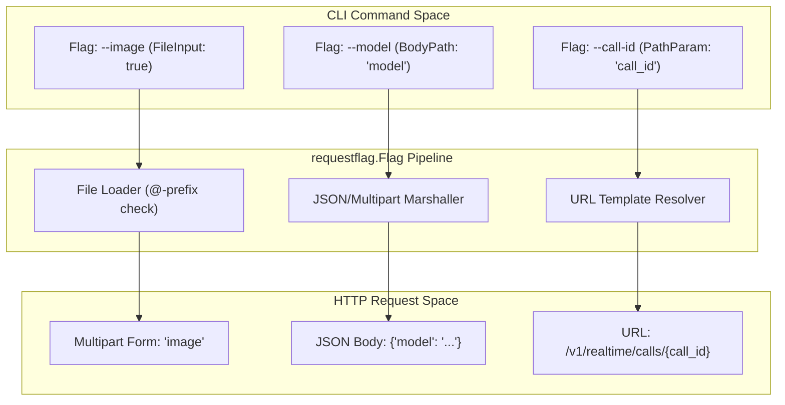
Sources: [pkg/cmd/image.go:22-33](), [pkg/cmd/call.go:21-32]()

## Input Methods: Flags, Pipes, and Files

The pipeline supports three primary ways to provide data for a request.

### 1. Command Line Flags
The most direct method. For complex types like maps or arrays, the CLI expects JSON strings (e.g., `--metadata '{"key": "value"}'`) [pkg/cmd/response.go:64-68]().

### 2. File Embedding (@-prefix)
If a flag is marked with `FileInput: true`, the CLI checks if the value starts with `@`. If it does, the CLI reads the content of the file path following the `@` and uses that data as the flag value [pkg/cmd/image.go:22-28](). This is used extensively for image uploads and transcriptions.

### 3. Stdin Piping
Commands support piping YAML or JSON data directly into the request. This is handled by the `Action` function of each command, which uses `requestflag` utilities to merge piped data with values provided via flags. Flags typically override values provided in the pipe [pkg/cmd/image_test.go:28-46]().

**Data Flow: Piped Input vs Flags**
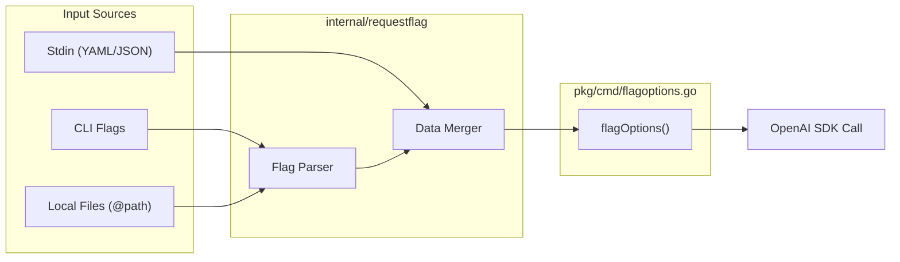
Sources: [pkg/cmd/image_test.go:75-103](), [pkg/cmd/chatcompletion.go:22-33]()

## Nested Objects and Inner Flags

For complex API objects (like `reasoning` or `prompt` configurations), the CLI uses `requestflag.WithInnerFlags` to flatten nested structures into dot-notated flags [pkg/cmd/call.go:16-18]().

*   **`InnerFlag`**: Defines a flag that maps to a field within a parent object.
*   **`InnerField`**: Specifies the key inside the parent map where the value should be placed [pkg/cmd/call.go:107-112]().

Example: The flag `--prompt.id` maps to the `id` field inside the `prompt` object in the request body [pkg/cmd/call.go:115-119]().

## Encoding and Transmission

Once the data is collected, it is passed to the `flagOptions()` function. This function (typically located in `pkg/cmd/flagoptions.go`) transforms the internal flag representations into a slice of `option.RequestOption` types used by the underlying Go SDK.

### Encoding Types
The pipeline automatically determines the encoding based on the request requirements:
*   **JSON Encoding**: The default for most "create" or "update" operations [pkg/cmd/response.go:18-22]().
*   **Multipart Encoding**: Triggered when a request includes file data (e.g., `images edit`). This uses `internal/apiform` to construct the multi-part body [pkg/cmd/image.go:62-73]().
*   **Query Encoding**: Used for GET requests (e.g., listing resources), utilizing `internal/apiquery` to handle bracket notation for arrays and nested objects.

Sources: [pkg/cmd/image.go:9-12](), [pkg/cmd/call.go:103-138](), [pkg/cmd/response.go:9-13]()

---

# Page: Output Formatting and Display

# Output Formatting and Display

<details>
<summary>Relevant source files</summary>

The following files were used as context for generating this wiki page:

- [internal/jsonview/explorer.go](internal/jsonview/explorer.go)
- [internal/jsonview/explorer_test.go](internal/jsonview/explorer_test.go)
- [internal/jsonview/staticdisplay.go](internal/jsonview/staticdisplay.go)
- [internal/jsonview/terminal.go](internal/jsonview/terminal.go)
- [pkg/cmd/cmdutil_test.go](pkg/cmd/cmdutil_test.go)

</details>


The OpenAI CLI provides a robust output pipeline designed to handle diverse API response types, including structured JSON, streaming iterators, and binary data. The system supports multiple display formats, interactive exploration via a TUI, and data transformation using GJSON path syntax.

## Output Pipeline Overview

The primary entry point for displaying API responses is `ShowJSON` (for single objects) and `ShowJSONIterator` (for streaming or paginated lists). These functions process the raw response through a series of transformations and formatters based on user-supplied flags.

### Data Flow Diagram

The following diagram illustrates how a raw API response is processed and rendered to the user's terminal.

**API Response to Display Logic**
```mermaid
graph TD
    subgraph "Natural Language Space"
        "User Request"
        "Terminal Display"
    end

    subgraph "Code Entity Space"
        "Request"["pkg/cmd.Request"]
        "ShowJSON"["pkg/cmd.ShowJSON"]
        "ShowJSONIterator"["pkg/cmd.ShowJSONIterator"]
        "GJSON"["github.com/tidwall/gjson"]
        "Formatters"["internal/jsonview"]
        "Pager"["pkg/cmd.streamOutput"]
    end

    "User Request" --> "Request"
    "Request" -- "Single Result" --> "ShowJSON"
    "Request" -- "Iterator" --> "ShowJSONIterator"
    
    "ShowJSON" -- "Apply --transform" --> "GJSON"
    "GJSON" -- "Result" --> "Formatters"
    
    "Formatters" -- "pretty/explore/json" --> "Pager"
    "Pager" --> "Terminal Display"
end
```
Sources: [pkg/cmd/cmdutil.go:281-294](), [pkg/cmd/cmdutil.go:420-435]()

## Supported Formats

The CLI supports the following formats via the `--format` flag:

| Format | Description | Implementation |
| :--- | :--- | :--- |
| `auto` | Default. Uses `pretty` for TTY and `json` for piped output. | [pkg/cmd/cmdutil.go:340-348]() |
| `json` | Minified JSON output. | [pkg/cmd/cmdutil.go:362-364]() |
| `jsonl` | JSON Lines (one object per line), used for iterators. | [pkg/cmd/cmdutil.go:453-455]() |
| `pretty` | Colorized, human-readable tree view. | [internal/jsonview/staticdisplay.go:126-135]() |
| `explore` | Interactive TUI explorer using Bubbletea. | [internal/jsonview/explorer.go:112-123]() |
| `yaml` | YAML representation of the response. | [pkg/cmd/cmdutil.go:365-367]() |
| `raw` | The raw response body as-is. | [pkg/cmd/cmdutil.go:359-361]() |

### GJSON Transforms and --raw-output
Users can extract specific fields from the JSON response using the `--transform` flag, which utilizes GJSON path syntax [pkg/cmd/cmdutil.go:351-357](). 

When combined with `--raw-output`, if the transformed result is a string, the CLI prints the unquoted string value instead of a JSON-encoded string [pkg/cmd/cmdutil.go:394-399](). This is particularly useful for scripting (e.g., `openai chat completions create ... --transform choices.0.message.content --raw-output`).

Sources: [pkg/cmd/cmdutil.go:351-411](), [pkg/cmd/cmdutil_test.go:158-236]()

## Interactive Explorer (`explore`)

The `explore` format launches a Terminal User Interface (TUI) powered by the `charmbracelet/bubbletea` framework. It allows users to navigate complex JSON structures using a stack-based view system.

### Component Architecture

**JSON Explorer Entity Mapping**
```mermaid
graph TD
    subgraph "UI Components"
        "TableView"["internal/jsonview.TableView"]
        "TextView"["internal/jsonview.TextView"]
        "JSONViewer"["internal/jsonview.JSONViewer"]
    end

    subgraph "Logic & State"
        "Model"["tea.Model"]
        "Stack"["[]JSONView"]
        "Iterator"["internal/jsonview.AnyIterator"]
    end

    "JSONViewer" -- "implements" --> "Model"
    "JSONViewer" -- "manages" --> "Stack"
    "Stack" -- "contains" --> "TableView"
    "Stack" -- "contains" --> "TextView"
    "TableView" -- "loads from" --> "Iterator"
end
```

Key features of the explorer include:
- **Dynamic Loading**: `TableView` uses `AnyIterator` to lazily load more data as the user scrolls to the bottom of an array [internal/jsonview/explorer.go:134-146]().
- **Navigation**: Users can "expand" objects or arrays to push a new view onto the stack and "back" to pop it [internal/jsonview/explorer.go:74-81]().
- **Safety**: All strings are passed through `sanitizeTerminalString` to escape ANSI control sequences, preventing malicious payloads from executing terminal commands [internal/jsonview/terminal.go:8-22]().

Sources: [internal/jsonview/explorer.go:112-123](), [internal/jsonview/explorer.go:148-200](), [internal/jsonview/terminal.go:8-44]()

## Pager Integration

For non-interactive formats (`pretty`, `json`, `yaml`), the CLI integrates with the system pager (e.g., `less`). This is handled by `streamOutput`, which checks if `stdout` is a terminal and redirects output through the command specified in the `PAGER` environment variable [pkg/cmd/cmdutil.go:498-520]().

Sources: [pkg/cmd/cmdutil.go:498-520](), [pkg/cmd/cmdutil_test.go:18-27]()

## Binary Response Handling

Certain API endpoints return binary data (e.g., `audio/speech` or `images/generate`). The CLI handles these via `writeBinaryResponse`.

1. **Detection**: The CLI determines if a response is binary based on the `Content-Type` header or the specific API operation metadata.
2. **File Creation**: If a filename is provided via `--output`, it writes there. Otherwise, it attempts to parse the `Content-Disposition` header to find a suggested filename [pkg/cmd/cmdutil.go:565-585]().
3. **Safety**: `createDownloadFile` prevents directory traversal by stripping path components from suggested filenames [pkg/cmd/cmdutil.go:580-584]().
4. **Stdout**: If the output path is `-`, the binary data is streamed directly to `stdout` [pkg/cmd/cmdutil.go:548-552]().

Sources: [pkg/cmd/cmdutil.go:537-563](), [pkg/cmd/cmdutil.go:565-602](), [pkg/cmd/cmdutil_test.go:29-114]()

---

# Page: Debug Middleware and Logging

# Debug Middleware and Logging

<details>
<summary>Relevant source files</summary>

The following files were used as context for generating this wiki page:

- [internal/debugmiddleware/debug_middleware.go](internal/debugmiddleware/debug_middleware.go)

</details>


The `openai-cli` provides a robust debugging mechanism via the `--debug` global flag. This flag activates a middleware-based logging system that captures and displays HTTP request and response metadata. To protect user security, the system includes an automated redaction layer that filters sensitive credentials before they reach the terminal output.

## Overview of RequestLogger Middleware

The core of the debugging system is the `RequestLogger` struct located in `internal/debugmiddleware`. This component is designed as a standard middleware that intercepts the HTTP request lifecycle.

### Data Flow and Execution
When the CLI is executed with the `--debug` flag, the `RequestLogger` is injected into the client's middleware chain. The flow follows these steps:

1.  **Request Interception**: The `Middleware` function receives the outgoing `*http.Request` [[internal/debugmiddleware/debug_middleware.go:43-44]]().
2.  **Redaction**: The request is passed to `redactRequest` to ensure credentials are not logged [[internal/debugmiddleware/debug_middleware.go:45]]().
3.  **Request Logging**: The redacted request metadata is dumped using `httputil.DumpRequest` and printed via `log.Printf` [[internal/debugmiddleware/debug_middleware.go:49-51]]().
4.  **Downstream Execution**: The middleware calls `mn(req)` to pass the request to the next handler in the chain (usually the actual HTTP transport) [[internal/debugmiddleware/debug_middleware.go:53]]().
5.  **Response Logging**: Once the response is received, its metadata is dumped using `httputil.DumpResponse` and logged before being returned to the caller [[internal/debugmiddleware/debug_middleware.go:58-60]]().

### Entity Mapping: Debug Lifecycle
The following diagram maps the logical flow of a debugged request to the specific code entities responsible for each stage.

**Figure 1: Request/Response Logging Flow**
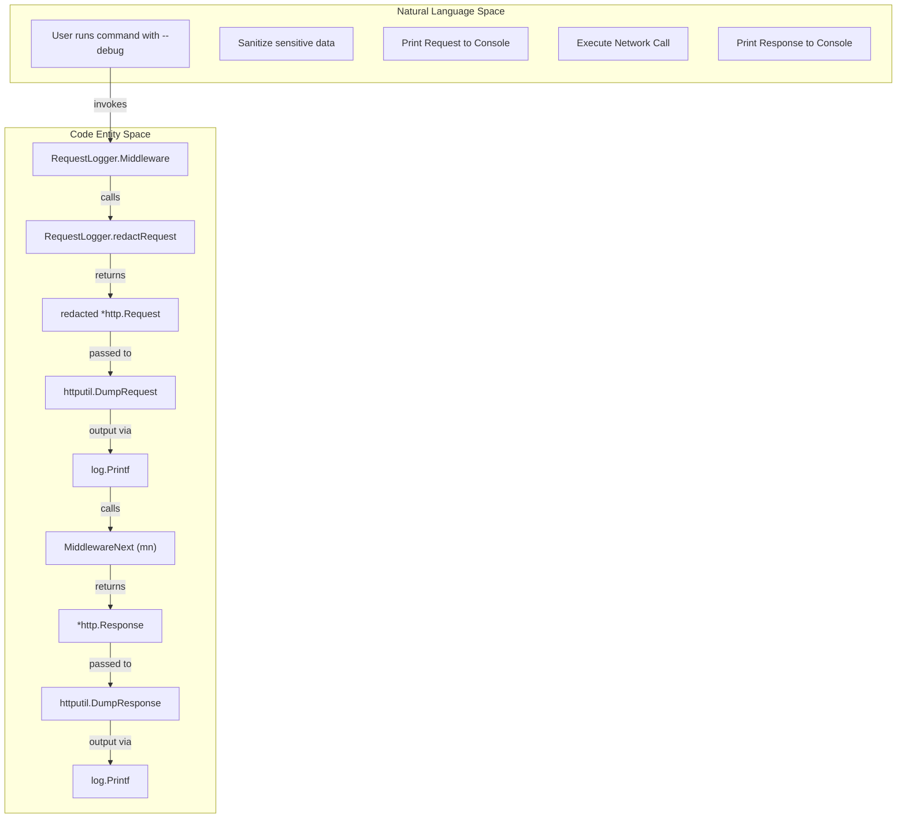
**Sources:** [internal/debugmiddleware/debug_middleware.go:43-64]()

## Sensitive Header Redaction

To prevent API keys and session tokens from appearing in shell history or log files, the `RequestLogger` performs deep inspection of HTTP headers.

### Redaction Logic
The `redactRequest` function clones the request headers and replaces sensitive values with the string `<REDACTED>` [[internal/debugmiddleware/debug_middleware.go:18]](). 

*   **Standard Sensitive Headers**: Headers such as `api-key`, `x-api-key`, `cookie`, and `set-cookie` are completely replaced [[internal/debugmiddleware/debug_middleware.go:22-27]]().
*   **Authorization Header**: This header receives special treatment. If it contains a scheme (e.g., `Bearer`), the scheme is preserved to assist in debugging (e.g., `Bearer <REDACTED>`), while the token itself is hidden [[internal/debugmiddleware/debug_middleware.go:75-88]]().
*   **Optimization**: If no sensitive headers are found, the function returns the original request pointer to avoid unnecessary memory allocation from `req.Clone()` [[internal/debugmiddleware/debug_middleware.go:103-105]]().

### Redaction Targets
| Header Key | Redaction Strategy |
| :--- | :--- |
| `Authorization` | Partial (Preserves prefix like `Bearer`) |
| `api-key` | Full replacement |
| `x-api-key` | Full replacement |
| `cookie` | Full replacement |
| `set-cookie` | Full replacement |

**Sources:** [internal/debugmiddleware/debug_middleware.go:22-27](), [internal/debugmiddleware/debug_middleware.go:70-110]()

## Implementation Details

The middleware is implemented using a functional pattern defined by the `Middleware` and `MiddlewareNext` types.

### Type Definitions
The package defines internal types to remain decoupled from specific generated SDK structures during testing:
```go
type Middleware     = func(*http.Request, MiddlewareNext) (*http.Response, error)
type MiddlewareNext = func(*http.Request) (*http.Response, error)
```
[[internal/debugmiddleware/debug_middleware.go:13-16]]()

### Component Interaction
The `RequestLogger` struct uses an interface for its logger field, allowing the standard `log` package to be swapped out during unit testing.

**Figure 2: Component Relationship**
```mermaid
classDiagram
    class RequestLogger {
        -logger: interface
        -sensitiveHeaders: []string
        +NewRequestLogger() RequestLogger
        +Middleware() Middleware
        -redactRequest(req) *http.Request
    }

    class MiddlewareContext {
        <<Interface>>
        +Printf(format, args)
    }

    RequestLogger --> MiddlewareContext : uses
    RequestLogger ..> "http.Request" : inspects
    RequestLogger ..> "http.Response" : logs
```
**Sources:** [internal/debugmiddleware/debug_middleware.go:30-41]()

## Middleware Chain Integration

The `RequestLogger` is typically the first or last middleware in the chain depending on whether the user wants to see the request exactly as sent over the wire or as it exists before other transformations. In the `openai-cli`, the logging occurs just before the request is handed off to the `MiddlewareNext` function, ensuring that any modifications made by previous middlewares (such as header injection) are visible in the debug output [[internal/debugmiddleware/debug_middleware.go:53]]().

**Sources:** [internal/debugmiddleware/debug_middleware.go:43-64]()

---

# Page: API Command Reference

# API Command Reference

<details>
<summary>Relevant source files</summary>

The following files were used as context for generating this wiki page:

- [pkg/cmd/call.go](pkg/cmd/call.go)
- [pkg/cmd/chatcompletion.go](pkg/cmd/chatcompletion.go)
- [pkg/cmd/image.go](pkg/cmd/image.go)
- [pkg/cmd/image_test.go](pkg/cmd/image_test.go)
- [pkg/cmd/response.go](pkg/cmd/response.go)

</details>


The `openai-cli` provides a comprehensive command-line interface to the OpenAI API, organized into resource groups that mirror the API's structure. Each command group is generated to support standard CRUD operations as well as specialized actions like streaming, file uploads, and background execution.

This page serves as a high-level map of the available command domains. For detailed flag documentation and usage examples for specific resources, refer to the child pages linked in each section.

### Command Structure Overview

The CLI maps natural language commands to specific Go entities within the `pkg/cmd` package. Most commands utilize the `requestflag.Flag` system to translate CLI arguments into structured API requests.

**CLI Command Mapping**

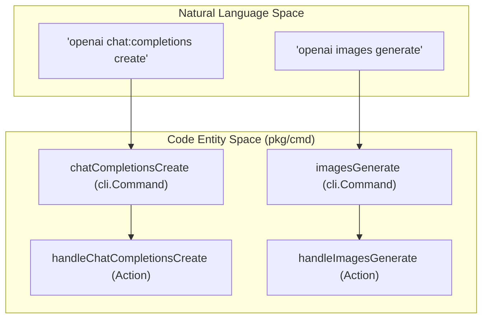
Sources: [pkg/cmd/chatcompletion.go:17-115](), [pkg/cmd/image.go:171-304]()

---

### Inference Commands

The core of the CLI's functionality resides in the inference groups. These commands facilitate text generation, multi-modal interactions, and complex reasoning tasks.

*   **Responses API**: A high-level interface for creating model responses with support for background execution, conversation state, and prompt caching [pkg/cmd/response.go:18-103]().
*   **Chat Completions**: The traditional endpoint for generating completions from a list of messages, supporting function calling, logprobs, and reasoning models [pkg/cmd/chatcompletion.go:17-115]().

For details, see [Inference Commands (Responses and Chat Completions)](#3.1).

---

### Image Generation Commands

The `images` command group handles the creation and manipulation of visual content. It supports multiple models including `dall-e-3` and the `gpt-image` series.

*   **Generate**: Create new images from text prompts [pkg/cmd/image.go:171-304]().
*   **Edit**: Modify existing images using masks or instructions [pkg/cmd/image.go:62-169]().
*   **Variations**: Create new versions of an existing image (exclusive to `dall-e-2`) [pkg/cmd/image.go:17-60]().

The CLI supports advanced features like `partial-images` for streaming generation and `input-fidelity` controls [pkg/cmd/image.go:87-90](), [pkg/cmd/image.go:121-125]().

For details, see [Image Generation Commands](#3.2).

---

### Realtime API Commands

The `realtime` group manages low-latency, multi-modal sessions typically used for voice or SIP/WebRTC applications.

*   **Calls**: Manage active call lifecycles with `accept`, `hangup`, `reject`, and `refer` [pkg/cmd/call.go:16-153]().
*   **Client Secrets**: Generate ephemeral keys for secure client-side WebRTC initialization.

These commands often utilize `requestflag.WithInnerFlags` to handle complex nested configurations for audio and reasoning parameters [pkg/cmd/call.go:103-138]().

For details, see [Realtime API Commands](#3.3).

---

### Admin Organization Commands

Administrative tasks require elevated permissions (via `OPENAI_ADMIN_KEY`). These commands allow for programmatic management of an OpenAI organization's infrastructure.

*   **Identity & Access**: Manage `users`, `groups`, `roles`, and `service-accounts`.
*   **Resource Management**: Control `projects`, `api-keys`, and `certificates`.
*   **Observability**: Access `audit-logs`, `usage` metrics, and `rate-limits`.

For details, see [Admin Organization Commands](#3.4).

---

### Other API Resource Commands

The CLI covers the remaining breadth of the OpenAI platform, including utility and specialized resource groups.

| Command Group | Purpose |
| :--- | :--- |
| `audio` | Transcriptions, translations, and text-to-speech. |
| `files` | Uploading and managing files for fine-tuning or assistants. |
| `models` | Listing and retrieving metadata for available models. |
| `fine-tuning` | Managing training jobs and checkpoints. |
| `vector-stores` | Creating and querying embeddings for retrieval. |
| `batches` | Handling asynchronous batch processing jobs. |

For details, see [Other API Resource Commands](#3.5).

---

### Request Lifecycle Diagram

The following diagram illustrates how a command moves from the CLI definition into the underlying SDK.

**Command Execution Flow**

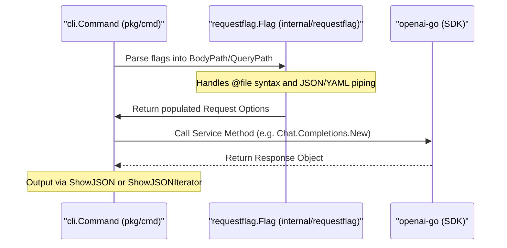
Sources: [pkg/cmd/chatcompletion.go:17-33](), [pkg/cmd/image.go:22-28](), [pkg/cmd/call.go:21-25]()

---

# Page: Inference Commands (Responses and Chat Completions)

# Inference Commands (Responses and Chat Completions)

<details>
<summary>Relevant source files</summary>

The following files were used as context for generating this wiki page:

- [pkg/cmd/chatcompletion.go](pkg/cmd/chatcompletion.go)
- [pkg/cmd/response.go](pkg/cmd/response.go)

</details>


This page details the CLI implementation for OpenAI's inference APIs, specifically the `responses` and `chat:completions` command groups. These commands represent the primary interface for generating text, audio, and structured data from OpenAI models.

## Overview of Inference Command Groups

The CLI exposes two primary command groups for model interaction:
1.  **`responses`**: The modern interface supporting conversation state, background execution, and advanced tool integration [pkg/cmd/response.go:18-20]().
2.  **`chat:completions`**: The standard interface for stateless or manually managed chat interactions [pkg/cmd/chatcompletion.go:17-19]().

### Command Structure and Logic Flow

The following diagram illustrates how a CLI command (e.g., `openai responses create`) flows from the user's terminal through the internal flag system to the Go SDK.

**Inference Request Data Flow**
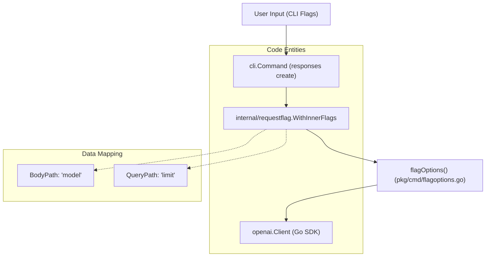
Sources: [pkg/cmd/response.go:18-21](), [pkg/cmd/chatcompletion.go:17-20]()

---

## Responses Command Group

The `responses` group implements the newer Responses API, which is designed to handle complex, multi-turn interactions and background tasks.

### Core Operations
| Command | SDK Method | Description |
| :--- | :--- | :--- |
| `create` | `responses.New(...)` | Generates a new model response [pkg/cmd/response.go:18]() |
| `retrieve` | `responses.Get(...)` | Fetches a specific response by ID |
| `cancel` | `responses.Cancel(...)` | Aborts a running response |
| `delete` | `responses.Delete(...)` | Removes a response record |

### Key Features and Implementation

#### 1. Conversation State and Multi-turn
The CLI manages conversation state via two primary flags:
*   `--conversation`: Links the response to a persistent conversation object. Input and output items are automatically appended [pkg/cmd/response.go:35-38]().
*   `--previous-response-id`: Creates a multi-turn conversation by referencing a specific prior response ID [pkg/cmd/response.go:79-83]().

#### 2. Background Execution
The `--background` flag (default: `false`) allows the model to process the response asynchronously. This is useful for long-running reasoning tasks or tool calls [pkg/cmd/response.go:23-28]().

#### 3. Prompt Caching
Caching is controlled through:
*   `--prompt-cache-key`: Optimizes hit rates for similar requests [pkg/cmd/response.go:89-93]().
*   `--prompt-cache-retention`: Sets the retention policy (e.g., `24h`) [pkg/cmd/response.go:94-98]().

Sources: [pkg/cmd/response.go:23-98]()

---

## Chat Completions Command Group

The `chat:completions` group is the standard interface for text generation. It is built around the `messages` array, where each entry is a map representing a role (system, user, assistant) and content.

### Message Handling
The `--message` flag is defined as a slice of maps (`[]map[string]any`), allowing users to pass complex JSON structures or YAML files via the `@` prefix [pkg/cmd/chatcompletion.go:22-27]().

### Reasoning Models (o-series)
For models like `o1` or `o3`, specific flags manage the reasoning effort and token limits:
*   `--max-completion-tokens`: The modern replacement for `max-tokens`, accounting for both visible and reasoning tokens [pkg/cmd/chatcompletion.go:66-70]().
*   `--reasoning-effort`: (Inherited from SDK) Controls the amount of compute dedicated to reasoning.

**Inference Code Entity Relationship**
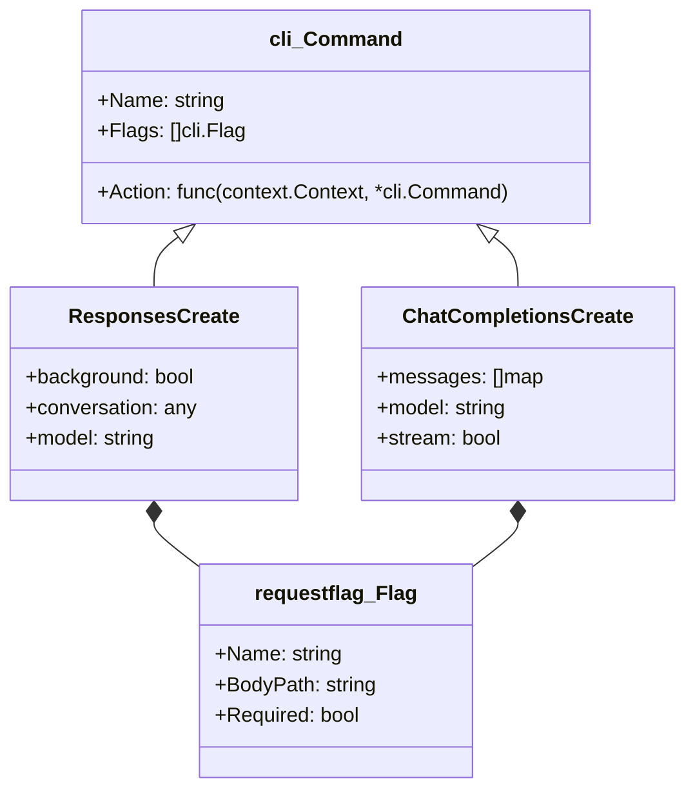
Sources: [pkg/cmd/response.go:18-72](), [pkg/cmd/chatcompletion.go:17-33]()

---

## Streaming vs. Synchronous Modes

Both command groups support streaming. The CLI detects the `--stream` flag and switches the output pipeline from `ShowJSON` to `ShowJSONIterator`.

*   **Synchronous**: The CLI waits for the full JSON response and prints it once.
*   **Streaming**: The CLI uses `openai.NewChatCompletionStream` (or equivalent) and processes `Server-Sent Events (SSE)`. Each chunk is passed through the output pipeline in real-time.

### Implementation Details
The CLI uses `requestflag.Flag` to map CLI arguments to the underlying API request body.
*   **BodyPath**: Specifies the JSON key in the request body (e.g., `BodyPath: "model"`) [pkg/cmd/response.go:71]().
*   **InnerFlags**: Used for complex objects like `--reasoning` or `--context-management` to allow dot-notation or JSON input [pkg/cmd/response.go:18, 100]().

### Structured Outputs
Structured outputs are enabled by passing a JSON schema to the `response-format` flag:
```bash
openai chat:completions create \
  --model gpt-4o \
  --message '{"role": "user", "content": "Extract data"}' \
  --response-format '{"type": "json_schema", "json_schema": {...}}'
```

Sources: [pkg/cmd/response.go:18-103](), [pkg/cmd/chatcompletion.go:17-116]()

---

# Page: Image Generation Commands

# Image Generation Commands

<details>
<summary>Relevant source files</summary>

The following files were used as context for generating this wiki page:

- [pkg/cmd/image.go](pkg/cmd/image.go)
- [pkg/cmd/image_test.go](pkg/cmd/image_test.go)

</details>


The `images` command group provides access to OpenAI's image generation, editing, and variation capabilities. This implementation supports legacy models like `dall-e-2` as well as modern `gpt-image` models, featuring advanced controls for fidelity, transparency, and streaming partial results.

## Command Overview

The CLI exposes three primary subcommands within the `images` group, defined in [pkg/cmd/image.go]().

| Command | Purpose | Supported Models |
| :--- | :--- | :--- |
| `generate` | Creates an image from a text prompt. | `dall-e-2`, `dall-e-3`, `gpt-image-*` |
| `edit` | Edits or extends an existing image using a mask or prompt. | `dall-e-2`, `gpt-image-*` |
| `create-variation` | Generates a variation of a provided image. | `dall-e-2` |

### Logic Flow: Command to API
The following diagram illustrates how a CLI command like `images generate` transitions from a user flag into a structured request via the `internal/requestflag` system and the underlying SDK.

**Image Generation Request Flow**
```mermaid
graph TD
    User["User Input"] -- "images generate --prompt '...' --size '1024x1024'" --> CLI["pkg/cmd/image.go (imagesGenerate)"]
    CLI --> FlagMap["internal/requestflag.Flag[T]"]
    FlagMap -- "Extract BodyPath: 'prompt'" --> Params["openai.ImageGenerateParams"]
    Params --> SDK["openai-go/v3.Client.Images.New()"]
    SDK --> API["OpenAI API (/images/generations)"]
```
Sources: [pkg/cmd/image.go:17-60](), [pkg/cmd/image.go:62-140](), [pkg/cmd/image.go:150-160]()

## Key Features and Implementation

### File Uploads via Multipart
Commands that require source images (`edit`, `create-variation`) utilize the `FileInput: true` attribute on flags. This signals the CLI to treat the flag value as a file path, read the binary content, and prepare a multipart/form-data request.

*   **Edit Image**: The `--image` flag in `images edit` accepts up to 16 images for GPT models or 1 for DALL-E 2 [pkg/cmd/image.go:67-73]().
*   **Masking**: The `--mask` flag allows providing an additional PNG with transparency to define edit areas [pkg/cmd/image.go:91-96]().
*   **Variations**: The `create-variation` command requires a square PNG under 4MB [pkg/cmd/image.go:22-28]().

### Advanced Generation Flags
Modern `gpt-image` models support granular control over the output through specific flags:

*   **`--input-fidelity`**: Controls how much effort the model exerts to match input image styles (e.g., `high`, `low`). Supported on `gpt-image-1` and `gpt-image-1.5` [pkg/cmd/image.go:87-90]().
*   **`--background`**: Sets transparency (`transparent`, `opaque`, `auto`). Transparency requires `output-format` to be `png` or `webp` [pkg/cmd/image.go:80-85]().
*   **`--partial-images`**: Configures streaming behavior. By setting a value between 1 and 3, the API returns partial images during the generation process [pkg/cmd/image.go:120-125]().

### Data Flow: Multipart and Response Formats
The CLI handles different response formats (`url` vs `b64_json`) and encoding types based on the model and flags provided.

**Code Entity Association**
```mermaid
graph LR
    subgraph "Request Construction"
        A["requestflag.Flag"] -- "BodyPath: 'image'" --> B["internal/apiform"]
        B -- "Multipart Encoding" --> C["http.Request"]
    end
    
    subgraph "Response Handling"
        D["handleImagesGenerate"] -- "Action" --> E["option.WithJSONSet"]
        E -- "GJSON Transform" --> F["pkg/cmd/ui.ShowJSON"]
    end
```
Sources: [pkg/cmd/image.go:26-27](), [pkg/cmd/image.go:133-136](), [pkg/cmd/image.go:161-163]()

## Technical Implementation Details

### Action Handlers
Each command maps to a specific handler function that executes the SDK call. For example, `images generate` uses `handleImagesGenerate` [pkg/cmd/image.go:161](). These handlers:
1. Initialize the request parameters using `flagOptions()` to map CLI flags to SDK structs.
2. Call the corresponding method on `client.Images`.
3. Pass the result to the output pipeline (e.g., `ShowJSON`) for formatting.

### Model-Specific Constraints
The CLI enforces constraints through usage strings and default values:
*   **DALL-E 2**: Only model supporting `create-variation` [pkg/cmd/image.go:19]().
*   **GPT Image Models**: Support `output-compression` and `output-format` (`jpeg`, `webp`), which are ignored by DALL-E [pkg/cmd/image.go:109-119]().

## Testing Patterns
Image commands are tested using the `mocktest` package to verify flag-to-JSON mapping and stdin piping.

*   **Flag Testing**: `TestImagesGenerate` verifies that flags like `--moderation` and `--style` are correctly passed to the API [pkg/cmd/image_test.go:106-129]().
*   **Piping Data**: Tests demonstrate piping YAML/JSON directly into the command, which bypasses individual flag parsing in favor of a structured input [pkg/cmd/image_test.go:131-155]().

Sources: [pkg/cmd/image_test.go:12-47](), [pkg/cmd/image_test.go:106-156]()

---

# Page: Realtime API Commands

# Realtime API Commands

<details>
<summary>Relevant source files</summary>

The following files were used as context for generating this wiki page:

- [pkg/cmd/call.go](pkg/cmd/call.go)
- [pkg/cmd/call_test.go](pkg/cmd/call_test.go)
- [pkg/cmd/clientsecret_test.go](pkg/cmd/clientsecret_test.go)

</details>


The Realtime API allows for low-latency, multi-modal interactions (audio and text) and supports integration with telephony systems via SIP and WebRTC. The CLI provides two primary command groups for interacting with these capabilities: `realtime:calls` for managing active telephony/WebRTC sessions and `realtime:client-secrets` for generating ephemeral tokens for client-side authentication.

## Realtime Calls (`realtime:calls`)

The `realtime:calls` command group manages the lifecycle of a Realtime session initiated via SIP or WebRTC. It supports accepting incoming calls, hanging up, referring (transferring), and rejecting calls.

### Session Lifecycle Management

When a call is initiated, it is identified by a `call_id`. The CLI interacts with this ID to transition the session state.

| Command | Action | Key Parameters |
| :--- | :--- | :--- |
| `accept` | Accepts an incoming SIP call and configures the session. | `--call-id`, `--audio`, `--model`, `--instructions` |
| `hangup` | Ends an active Realtime API call. | `--call-id` |
| `refer` | Transfers the call to a new target URI. | `--call-id`, `--target-uri` |
| `reject` | Rejects an incoming call with a specific status code. | `--call-id`, `--status-code` |

### Session Configuration and Audio
The `accept` command is the most complex, as it defines the model behavior and audio parameters for the duration of the call [pkg/cmd/call.go:16-100]().

*   **Audio Configuration**: Controlled via the `--audio` flag or inner flags like `--audio.input` and `--audio.output` [pkg/cmd/call.go:104-113](). It includes settings for `noise_reduction`, `transcription` (e.g., using `whisper-1`), and `turn_detection` [pkg/cmd/call_test.go:21-21]().
*   **Turn Detection**: Uses `server_vad` (Voice Activity Detection) to determine when the user has finished speaking. Configuration includes `silence_duration_ms` and `threshold` [pkg/cmd/call_test.go:84-91]().
*   **Reasoning Effort**: For reasoning-capable models like `gpt-realtime-2`, the `--reasoning.effort` flag constrains the amount of computation spent on internal reasoning before responding [pkg/cmd/call.go:131-137]().

### Data Flow: SIP Call Acceptance
The following diagram illustrates how the CLI translates a command into a call to the Realtime SDK.

**CLI to SDK Mapping: Realtime Call Accept**
```mermaid
graph TD
    subgraph "Natural Language Space"
        User["User Command: realtime:calls accept"]
    end

    subgraph "Code Entity Space"
        Command["realtimeCallsAccept (cli.Command)"]
        Handler["handleRealtimeCallsAccept (Action)"]
        SDK["realtime.CallService.Accept"]
        
        User -- "executes" --> Command
        Command -- "invokes" --> Handler
        Handler -- "marshals flags to" --> SDK
    end

    subgraph "Data Entities"
        Params["realtime.CallAcceptParams"]
        Audio["AudioConfig (audio.input/output)"]
    end

    Handler -- "populates" --> Params
    Params -- "contains" --> Audio
```
Sources: [pkg/cmd/call.go:16-101](), [pkg/cmd/call.go:104-113](), [pkg/cmd/call_test.go:12-35]()

## Realtime Client Secrets (`realtime:client-secrets`)

The `realtime:client-secrets:create` command is used to generate ephemeral client secrets. These secrets allow client-side applications (like web browsers or mobile apps) to connect directly to the OpenAI Realtime API without exposing the developer's permanent API key.

### Ephemeral Session Configuration
When creating a client secret, you provide the full session configuration that the client will be locked into. This prevents the client from changing critical parameters like the model or system instructions.

*   **Expiration**: The `--expires-after` flag (with inner flags `--expires-after.anchor` and `--expires-after.seconds`) defines how long the secret remains valid [pkg/cmd/clientsecret_test.go:34-35]().
*   **Session Constraints**: The `--session` flag accepts a JSON/YAML object defining `modalities`, `tools`, and `instructions` [pkg/cmd/clientsecret_test.go:20-20]().

**Implementation Details: Client Secret Creation**
```mermaid
graph LR
    subgraph "CLI Layer"
        C["realtimeClientSecretsCreate"]
        F["requestflag.Flag[map[string]any]"]
    end

    subgraph "Internal Logic"
        P["pkg/cmd/flagoptions.go: flagOptions()"]
        M["internal/requestflag: InnerFlag"]
    end

    subgraph "OpenAI SDK"
        S["realtime.ClientSecretService.New"]
    end

    C --> F
    F -- "Uses" --> M
    C -- "Action" --> P
    P -- "Calls" --> S
```
Sources: [pkg/cmd/clientsecret_test.go:12-40](), [internal/requestflag/requestflag.go:1-20]() (implied by usage in test)

## Implementation Details

### Flag Handling
The Realtime commands make extensive use of `requestflag.WithInnerFlags` to provide a flattened CLI experience for deeply nested API structures [pkg/cmd/call.go:16-16]().

*   **Path Parameters**: The `call-id` is mapped to the URL path using `PathParam: "call_id"` [pkg/cmd/call.go:24-24]().
*   **Body Parameters**: Most configuration flags map to the JSON request body via `BodyPath` [pkg/cmd/call.go:31-31]().
*   **Complex Types**: Flags like `--tool` and `--audio` accept JSON strings or can be populated via piped input [pkg/cmd/call_test.go:21-21](), [pkg/cmd/call_test.go:70-120]().

### Examples

**Accepting a call with VAD configuration:**
```bash
openai realtime:calls accept \
  --call-id "call_123" \
  --audio.input '{ "turn_detection": { "type": "server_vad", "threshold": 0.5 } }' \
  --model "gpt-4o-realtime-preview"
```
Sources: [pkg/cmd/call.go:16-37](), [pkg/cmd/call_test.go:49-50]()

**Creating a client secret with a 10-minute expiry:**
```bash
openai realtime:client-secrets create \
  --expires-after.anchor "created_at" \
  --expires-after.seconds 600 \
  --session '{ "model": "gpt-4o-realtime-preview", "modalities": ["text", "audio"] }'
```
Sources: [pkg/cmd/clientsecret_test.go:33-36]()

**Sources:**
- [pkg/cmd/call.go:1-155]()
- [pkg/cmd/call_test.go:1-192]()
- [pkg/cmd/clientsecret_test.go:1-105]()

---

# Page: Admin Organization Commands

# Admin Organization Commands

<details>
<summary>Relevant source files</summary>

The following files were used as context for generating this wiki page:

- [pkg/cmd/adminorganizationproject.go](pkg/cmd/adminorganizationproject.go)
- [pkg/cmd/adminorganizationproject_test.go](pkg/cmd/adminorganizationproject_test.go)
- [pkg/cmd/adminorganizationprojectuser.go](pkg/cmd/adminorganizationprojectuser.go)
- [pkg/cmd/adminorganizationprojectuser_test.go](pkg/cmd/adminorganizationprojectuser_test.go)
- [pkg/cmd/adminorganizationuser.go](pkg/cmd/adminorganizationuser.go)
- [pkg/cmd/adminorganizationuser_test.go](pkg/cmd/adminorganizationuser_test.go)

</details>


The `admin:organization` command group provides a suite of administrative tools for managing OpenAI organizations. These commands allow administrators to manage projects, users, service accounts, roles, and monitor usage metrics.

All commands in this group require an administrative API key, which can be provided via the `OPENAI_ADMIN_KEY` environment variable or the `--admin-api-key` flag [pkg/cmd/adminorganizationproject_test.go:16-16]().

## Project Management

The `admin:organization:projects` subgroup handles the lifecycle of projects within an organization. Projects can be created, retrieved, updated, and archived, but notably, they cannot be deleted [pkg/cmd/adminorganizationproject.go:19-19]().

### Project Data Flow

When a project command is executed, the CLI follows a standard pipeline:
1.  **Client Initialization**: Creates an `openai.Client` using options derived from global and command-specific flags [pkg/cmd/adminorganizationproject.go:135-135]().
2.  **Flag Parsing**: The `flagOptions` function processes `requestflag.Flag` types, mapping them to the appropriate `PathParam`, `QueryPath`, or `BodyPath` [pkg/cmd/adminorganizationproject.go:142-148]().
3.  **SDK Execution**: The command calls the corresponding method on `client.Admin.Organization.Projects` [pkg/cmd/adminorganizationproject.go:157-157]().
4.  **Output Rendering**: The response is captured as raw bytes, parsed via `gjson`, and passed to `ShowJSON` for formatting based on the `--format` flag [pkg/cmd/adminorganizationproject.go:162-172]().

### Command-to-SDK Mapping

| CLI Command | SDK Method | Purpose |
| :--- | :--- | :--- |
| `create` | `Projects.New` | Creates a new project with optional geography and external keys [pkg/cmd/adminorganizationproject.go:157-157](). |
| `retrieve` | `Projects.Get` | Fetches details for a specific `project-id` [pkg/cmd/adminorganizationproject.go:199-199](). |
| `update` | `Projects.Update` | Modifies project name or configuration [pkg/cmd/adminorganizationproject.go:237-237](). |
| `list` | `Projects.List` | Lists projects, with support for `include-archived` [pkg/cmd/adminorganizationproject.go:88-117](). |
| `archive` | `Projects.Archive` | Disables a project permanently [pkg/cmd/adminorganizationproject.go:119-132](). |

**Sources:** [pkg/cmd/adminorganizationproject.go:17-132](), [pkg/cmd/adminorganizationproject.go:134-240]()

## User and Membership Management

User management is split into two levels: Organization-wide membership and Project-specific membership.

### Organization Users
Commands under `admin:organization:users` manage the presence of users within the entire organization.

*   **List**: Supports filtering by email and pagination using the `after` cursor [pkg/cmd/adminorganizationuser.go:71-95]().
*   **Update**: Allows changing organization roles (e.g., `owner` or `reader`) and setting metadata like `developer-persona` [pkg/cmd/adminorganizationuser.go:32-65]().

### Project Users
Commands under `admin:organization:projects:users` manage which organization members have access to specific projects. Users must already be members of the organization before they can be added to a project [pkg/cmd/adminorganizationprojectuser.go:19-20]().

**Project User Interaction Diagram**

```mermaid
graph TD
    subgraph "Natural Language Space"
        UserAction["Add User to Project"]
        UserRole["Set Role (owner/member)"]
    end

    subgraph "Code Entity Space"
        CLI_Cmd["admin:organization:projects:users create"]
        HandleFn["handleAdminOrganizationProjectsUsersCreate"]
        SDK_Method["client.Admin.Organization.Projects.Users.New"]
        Params["openai.AdminOrganizationProjectUserNewParams"]
    end

    UserAction --> CLI_Cmd
    UserRole --> CLI_Cmd
    CLI_Cmd --> HandleFn
    HandleFn --> Params
    Params --> SDK_Method
```

**Sources:** [pkg/cmd/adminorganizationuser.go:17-110](), [pkg/cmd/adminorganizationprojectuser.go:17-141]()

## Implementation Detail: Request Construction

The admin commands utilize the `internal/requestflag` system to declaratively define how CLI inputs map to API requests.

| Code Entity | Implementation Detail |
| :--- | :--- |
| `requestflag.Flag[T]` | Generic container for flag values and metadata [pkg/cmd/adminorganizationproject.go:22-27](). |
| `PathParam` | Used for identifiers in the URL (e.g., `project_id`) [pkg/cmd/adminorganizationproject.go:51-51](). |
| `BodyPath` | Used for JSON payload fields (e.g., `name`) [pkg/cmd/adminorganizationproject.go:26-26](). |
| `QueryPath` | Used for URL query parameters (e.g., `limit`, `after`) [pkg/cmd/adminorganizationproject.go:96-97](). |

### Data Flow: CLI to API

The following diagram illustrates how a command like `admin:organization:projects create --name "Research"` is processed.

```mermaid
sequenceDiagram
    participant User as "CLI User"
    participant Cmd as "adminorganizationproject.go"
    participant FlagSys as "internal/requestflag"
    participant SDK as "openai-go SDK"
    participant API as "OpenAI Admin API"

    User->>Cmd: run "create --name Research"
    Cmd->>FlagSys: flagOptions(cmd, ...)
    Note over FlagSys: Extracts "Research" <br/>mapped to BodyPath "name"
    FlagSys-->>Cmd: returns option.RequestOption
    Cmd->>SDK: Projects.New(ctx, params, options...)
    SDK->>API: POST /v1/admin/projects {"name": "Research"}
    API-->>SDK: 201 Created (JSON)
    SDK-->>Cmd: Response Bytes
    Cmd->>User: ShowJSON(parsed_response)
```

**Sources:** [pkg/cmd/adminorganizationproject.go:21-38](), [pkg/cmd/adminorganizationproject.go:142-157](), [internal/requestflag/requestflag.go:1-50]()

## Testing Patterns

Admin commands are tested using the `mocktest` package, which simulates API responses and validates that flags are correctly translated into SDK parameters.

1.  **Flag Tests**: Validate that individual flags correctly populate the request [pkg/cmd/adminorganizationproject_test.go:11-22]().
2.  **Piping Tests**: Ensure that data can be piped via `stdin` in YAML or JSON format, which is then parsed into the request body [pkg/cmd/adminorganizationproject_test.go:24-36]().

```go
// Example of a piping test for project creation
t.Run("piping data", func(t *testing.T) {
    pipeData := []byte("name: name\nexternal_key_id: ext_id\n")
    mocktest.TestRunMockTestWithPipeAndFlags(
        t, pipeData,
        "--admin-api-key", "sk-admin...",
        "admin:organization:projects", "create",
    )
})
```

**Sources:** [pkg/cmd/adminorganizationproject_test.go:11-37](), [pkg/cmd/adminorganizationuser_test.go:11-80]()

---

# Page: Other API Resource Commands

# Other API Resource Commands

<details>
<summary>Relevant source files</summary>

The following files were used as context for generating this wiki page:

- [pkg/cmd/chatcompletion.go](pkg/cmd/chatcompletion.go)
- [pkg/cmd/image.go](pkg/cmd/image.go)
- [pkg/cmd/image_test.go](pkg/cmd/image_test.go)
- [pkg/cmd/response.go](pkg/cmd/response.go)

</details>


This page covers the secondary API resource command groups provided by the OpenAI CLI. While inference and organization management are primary drivers, the CLI provides comprehensive coverage for audio processing, embeddings, file management, model lifecycle, and beta features like Assistants and Vector Stores.

## Audio Commands

The `audio` command group handles speech-to-text (transcriptions and translations) and text-to-speech (speech generation) tasks. These commands often involve multipart form data for file uploads or binary streams for output.

### Implementation and Data Flow
Audio commands utilize the `internal/apiform` package to encode local files into multipart requests [pkg/cmd/image.go:27](). For speech generation, the CLI handles binary response streams directly to the terminal or redirected files.

| Command | Function | Key Flags |
| :--- | :--- | :--- |
| `audio speech` | Generates audio from text | `--model`, `--voice`, `--input` |
| `audio transcriptions` | Transcribes audio into input language | `--file`, `--model`, `--language` |
| `audio translations` | Translates audio into English | `--file`, `--model` |

**Sources:** [pkg/cmd/image.go:17-57](), [pkg/cmd/image.go:62-136]()

## File and Model Management

The CLI provides lifecycle management for OpenAI-hosted files and custom models.

### Files
The `files` command group manages documents used for fine-tuning or assistants.
- **Uploads:** Files are uploaded using multipart encoding. The CLI supports a `@` prefix to specify local paths [pkg/cmd/image.go:27]().
- **Retrieval:** Supports listing all files or retrieving specific file content/metadata.

### Models
The `models` group allows users to list available models and delete fine-tuned models.
- `models list`: Returns a JSON list of all accessible models.
- `models delete`: Deletes a custom fine-tuned model.

**Sources:** [pkg/cmd/image.go:22-28](), [pkg/cmd/image.go:91-96]()

## Fine-Tuning and Training

Fine-tuning involves creating jobs that reference uploaded files to train custom versions of models.

### Command Structure
1. **Jobs**: `fine-tuning jobs create` initiates the training process.
2. **Checkpoints**: `fine-tuning jobs checkpoints list` allows monitoring of training progress at specific steps.

### Data Association Diagram: Fine-Tuning Lifecycle
This diagram bridges the CLI command space to the internal request flags and the underlying SDK entities.

"Fine-Tuning Lifecycle"
```mermaid
graph TD
    subgraph "Natural Language Space (CLI)"
        FT_CMD["fine-tuning jobs create"]
        FT_FLAG["--training-file"]
    end

    subgraph "Code Entity Space (internal/requestflag)"
        FLAG_OBJ["requestflag.Flag[string]"]
        BODY_PATH["BodyPath: 'training_file'"]
    end

    subgraph "SDK Space (openai-go)"
        SDK_PARAM["FineTuningJobNewParams"]
        API_REQ["POST /fine_tuning/jobs"]
    end

    FT_CMD --> FT_FLAG
    FT_FLAG --> FLAG_OBJ
    FLAG_OBJ --> BODY_PATH
    BODY_PATH --> SDK_PARAM
    SDK_PARAM --> API_REQ
```
**Sources:** [pkg/cmd/image.go:17-40](), [pkg/cmd/chatcompletion.go:22-33]()

## Vector Stores and Batches

### Vector Stores (Beta)
Used primarily with the Assistants API for file search.
- `vector-stores create`: Initializes a store.
- `vector-stores files`: Manages individual files within a specific store.
- `vector-stores file-batches`: Handles bulk operations for adding files to stores.

### Batches
The `batches` command group allows for asynchronous processing of large volumes of requests (e.g., chat completions) at a lower cost.
- `batches create`: Requires an `input_file_id` (pointing to a `.jsonl` file).
- `batches cancel`: Stops a processing batch.

**Sources:** [pkg/cmd/response.go:18-48](), [pkg/cmd/chatcompletion.go:17-33]()

## Beta: Assistants, Threads, and Messages

The `beta` prefix contains commands for the stateful Assistants API.

| Resource | Description |
| :--- | :--- |
| `beta assistants` | Create and manage persistent AI entities with tools. |
| `beta threads` | Manage conversation sessions. |
| `beta messages` | Add user messages or retrieve assistant responses within a thread. |
| `beta runs` | Execute an assistant on a thread. |

### Logic Flow: Assistant Execution
The execution flow moves from flag parsing to the `Action` handler, which invokes the SDK.

"Assistant Request Flow"
```mermaid
sequenceDiagram
    participant U as User (CLI)
    participant C as pkg/cmd (Action Handler)
    participant RF as internal/requestflag
    participant S as openai-go SDK

    U->>C: openai beta assistants create --model gpt-4o
    C->>RF: flagOptions(cmd)
    RF-->>C: map[string]interface{model: "gpt-4o"}
    C->>S: Assistants.New(ctx, params)
    S-->>C: Assistant Object
    C->>U: ShowJSON(Assistant)
```
**Sources:** [pkg/cmd/response.go:58-106](), [pkg/cmd/chatcompletion.go:17-33]()

## Embeddings and Other Resources

### Embeddings
The `embeddings create` command converts text into numerical vectors.
- **Flags**: `--input` (string or array), `--model`, and `--dimensions`.
- **Implementation**: Uses `requestflag.Flag[any]` to handle both single strings and arrays of strings for the input field [pkg/cmd/response.go:44-48]().

### Uploads and Containers
Used for multi-part large file uploads (primarily for high-volume data ingestion).
- `uploads create`: Initiates a multipart upload session.
- `uploads parts`: Manages individual chunks of the upload.

**Sources:** [pkg/cmd/response.go:44-48](), [pkg/cmd/chatcompletion.go:22-27]()

---

# Page: Internal Packages

# Internal Packages

<details>
<summary>Relevant source files</summary>

The following files were used as context for generating this wiki page:

- [internal/autocomplete/autocomplete_test.go](internal/autocomplete/autocomplete_test.go)
- [internal/autocomplete/shellscripts/bash_autocomplete.bash](internal/autocomplete/shellscripts/bash_autocomplete.bash)
- [internal/debugmiddleware/debug_middleware.go](internal/debugmiddleware/debug_middleware.go)
- [internal/jsonview/explorer.go](internal/jsonview/explorer.go)

</details>


The `internal/` directory contains the core logic and utilities that power the CLI's specialized behaviors, such as interactive JSON exploration, complex flag parsing for API requests, and shell autocompletion. These packages are kept internal to prevent them from being imported by external projects, ensuring that the CLI's implementation details can evolve independently of a public API.

### Package Architecture Overview

The following diagram illustrates how the internal packages interact to process a command from input to output.

**Internal Package Request/Response Flow**
```mermaid
graph TD
    subgraph "Input Space"
        A["Shell (Bash/Zsh)"] -- "Tab Completion" --> B["internal/autocomplete"]
        C["CLI Flags/Stdin"] -- "Parsing" --> D["internal/requestflag"]
    end

    subgraph "Processing Space"
        D -- "Encoding" --> E["internal/apiform"]
        D -- "Encoding" --> F["internal/apiquery"]
        D -- "Binary Handling" --> G["internal/binaryparam"]
        H["HTTP Client"] -- "Logging" --> I["internal/debugmiddleware"]
    end

    subgraph "Output Space"
        J["JSON Response"] -- "Interactive TUI" --> K["internal/jsonview"]
    end

    B -.-> "GetCompletions()"
    D -.-> "Flag[T]"
    I -.-> "RequestLogger"
    K -.-> "TableView/TextView"
```
Sources: [internal/autocomplete/autocomplete.go:1-20](), [internal/requestflag/requestflag.go:1-30](), [internal/jsonview/explorer.go:1-22](), [internal/debugmiddleware/debug_middleware.go:29-33]()

---

### Shell Autocomplete (`internal/autocomplete`)
The `internal/autocomplete` package provides dynamic tab-completion for the CLI. It supports Bash and Zsh by generating completion scripts and handling the `__complete` hidden command. It is capable of completing subcommands, flags, and even remote file protocols like `@file://` and `@data://`.

*   **Key Entity:** `GetCompletions` [internal/autocomplete/autocomplete_test.go:12-23]() processes the current command-line arguments and returns valid completion candidates.
*   **Protocol Handling:** It handles the logic for collapsing colon-commands and completing file paths when the `@` prefix is detected [internal/autocomplete/shellscripts/bash_autocomplete.bash:19-44]().

For details, see [Shell Autocomplete (internal/autocomplete)](#4.1).

### JSON Explorer (`internal/jsonview`)
When the CLI is run with `--format explore`, the `internal/jsonview` package takes over to provide an interactive Terminal User Interface (TUI) built with the Bubbletea framework.

*   **Key Entity:** `TableView` [internal/jsonview/explorer.go:112-123]() renders JSON arrays as interactive tables with navigable rows.
*   **Key Entity:** `TextView` [internal/jsonview/explorer.go:262-267]() renders individual JSON values or objects with syntax highlighting and viewport scrolling.
*   **Streaming Support:** It supports `AnyIterator` to lazily load more data into the view as the user scrolls [internal/jsonview/explorer.go:148-160]().

For details, see [JSON Explorer (internal/jsonview)](#4.2).

### Request Flag System (`internal/requestflag`)
This package is the backbone of the CLI's request construction. It defines how CLI flags map to OpenAPI parameters, including paths, headers, query strings, and request bodies.

*   **Key Entity:** `Flag[T]` is a generic type used to encapsulate flag values and their metadata.
*   **Metadata Mapping:** It uses types like `BodyPath`, `QueryPath`, and `PathParam` to determine where a flag's value should be placed in the final HTTP request.
*   **Input Flexibility:** Supports reading flag values from files using the `@` syntax and piping YAML/JSON directly into the command via stdin.

For details, see [Request Flag System (internal/requestflag)](#4.3).

### API Encoding Utilities
These small, focused packages handle the serialization of Go types into the specific formats required by the OpenAI API.

*   **`internal/apiform`**: Handles `multipart/form-data` encoding, specifically for file uploads.
*   **`internal/apiquery`**: Serializes nested objects into URL query parameters using bracket notation (e.g., `filter[name]=value`).
*   **`internal/binaryparam`**: Manages parameters that are sent as raw binary data (`application/octet-stream`).

For details, see [API Encoding Utilities (internal/apiform, internal/apiquery, internal/binaryparam)](#4.4).

### Debug Middleware (`internal/debugmiddleware`)
The `internal/debugmiddleware` package provides the `RequestLogger` which intercepts the HTTP request lifecycle when the `--debug` flag is active.

*   **Redaction:** It automatically redacts sensitive headers like `api-key`, `Authorization`, and `Cookie` before printing logs to the terminal [internal/debugmiddleware/debug_middleware.go:22-27]().
*   **Implementation:** It implements a `Middleware` pattern that wraps the standard `http.Request` and `http.Response` [internal/debugmiddleware/debug_middleware.go:43-64]().

**Debug Logging Logic**
```mermaid
sequenceDiagram
    participant C as CLI Command
    participant M as RequestLogger
    participant H as HTTP Client
    participant A as OpenAI API

    C->>M: Execute Request
    M->>M: redactRequest(req)
    Note over M: Removes "api-key", etc.
    M->>H: Log & Forward Request
    H->>A: Send HTTP Call
    A->>H: HTTP Response
    H->>M: Forward Response
    M->>M: Log Response Body
    M->>C: Return Result
```
Sources: [internal/debugmiddleware/debug_middleware.go:43-64](), [internal/debugmiddleware/debug_middleware.go:70-110]()

---

# Page: Shell Autocomplete (internal/autocomplete)

# Shell Autocomplete (internal/autocomplete)

<details>
<summary>Relevant source files</summary>

The following files were used as context for generating this wiki page:

- [internal/autocomplete/autocomplete_test.go](internal/autocomplete/autocomplete_test.go)
- [internal/autocomplete/shellscripts/bash_autocomplete.bash](internal/autocomplete/shellscripts/bash_autocomplete.bash)

</details>


The `internal/autocomplete` package provides the logic for shell tab completion within the OpenAI CLI. It bridges the gap between the CLI's command tree (defined via `urfave/cli/v3`) and the requirements of various shell completion engines (Bash and Zsh).

## Overview

The completion system allows users to tab-complete subcommands, flags, and special file protocols like `@file://` and `@data://`. The implementation consists of two parts:
1.  **Go Logic**: A backend that traverses the command tree to find matching completions based on current arguments.
2.  **Shell Scripts**: Integration scripts (e.g., `bash_autocomplete.bash`) that hook into the shell's completion mechanism and call the CLI with a hidden `__complete` command.

### Key Types and Constants

| Entity | Description |
| :--- | :--- |
| `GetCompletions()` | The primary entry point for calculating completion candidates [internal/autocomplete/autocomplete.go:42-43](). |
| `CompletionStyle` | Enum for the target shell (`bash`, `zsh`) [internal/autocomplete/autocomplete.go:13-16](). |
| `ShellCompletionBehavior` | Enum determining how the shell should behave after receiving results (Default, File completion, or None) [internal/autocomplete/autocomplete.go:21-25](). |
| `ShellCompletion` | Struct representing a single completion candidate with a `Name` and `Usage` [internal/autocomplete/autocomplete.go:27-30](). |

Sources: [internal/autocomplete/autocomplete.go:13-30](), [internal/autocomplete/autocomplete.go:42-43]()

---

## Data Flow: From Shell to Code

The following diagram illustrates how a tab-press in a Bash terminal flows through the integration script into the Go logic.

### Bash Completion Flow
```mermaid
graph TD
    User["User types 'openai chat:comp[TAB]'"] --> BashScript["bash_autocomplete.bash"]
    BashScript --> CLI_Call["openai __complete -- chat:comp"]
    CLI_Call --> GetCompletions["GetCompletions(style, root, args)"]
    GetCompletions --> FindCmd["Find Subcommand 'chat:completions'"]
    FindCmd --> Filter["Filter matches by prefix 'chat:comp'"]
    Filter --> Results["Return ShellCompletionResults"]
    Results --> BashScript
    BashScript --> COMPREPLY["Populate COMPREPLY array"]
    COMPREPLY --> UserView["User sees 'chat:completions'"]
```
Sources: [internal/autocomplete/shellscripts/bash_autocomplete.bash:3-9](), [internal/autocomplete/autocomplete.go:42-50]()

---

## Implementation Details

### GetCompletions Logic
The `GetCompletions` function determines what to suggest based on the state of the command line [internal/autocomplete/autocomplete.go:42-100]().

1.  **Command Traversal**: It walks the `cli.Command` tree to find the deepest subcommand specified in the arguments [internal/autocomplete/autocomplete_test.go:67-89]().
2.  **Flag Handling**: If the user is typing a flag (starts with `-`), it iterates through the current command's `Flags` and returns matching names and aliases [internal/autocomplete/autocomplete_test.go:91-114]().
3.  **File Behavior**: If a flag is detected that `TakesFile: true`, the system returns `ShellCompletionBehaviorFile`, signaling the shell to switch to standard file system completion [internal/autocomplete/autocomplete_test.go:139-158]().

### Special Protocols (@file:// and @data://)
The CLI supports embedding file content via `@` prefixes. The `bash_autocomplete.bash` script contains specific logic to handle these:
*   **Colon-command Collapsing**: Bash often splits tokens at colons. The script joins tokens like `@file`, `:`, and `//path` back together to ensure the protocol is recognized [internal/autocomplete/shellscripts/bash_autocomplete.bash:14-22]().
*   **Protocol Stripping**: When completing paths after `@file://`, the script strips the prefix to perform a `compgen -f` on the actual path, then prepends the prefix back to the results [internal/autocomplete/shellscripts/bash_autocomplete.bash:28-47]().

### Code Entity Mapping
This diagram maps the conceptual completion steps to the specific Go functions and shell script variables.

```mermaid
graph LR
    subgraph "Shell Space (Bash)"
        COMP_WORDS["COMP_WORDS (Array of tokens)"]
        COMP_CWORD["COMP_CWORD (Index)"]
        BashFunc["____APPNAME___bash_autocomplete"]
    end

    subgraph "Go Entity Space"
        GetCompletions["GetCompletions()"]
        ShellCompletionResults["ShellCompletionResults (Struct)"]
        Behavior["Behavior (Enum)"]
    end

    COMP_WORDS --> GetCompletions
    COMP_CWORD --> GetCompletions
    GetCompletions --> ShellCompletionResults
    ShellCompletionResults --> Behavior
    Behavior -- "10" --> BashFunc
```
Sources: [internal/autocomplete/shellscripts/bash_autocomplete.bash:3-10](), [internal/autocomplete/autocomplete.go:32-40]()

---

## Integration Scripts

### bash_autocomplete.bash
The script registers the completion function using `complete -o filenames -F` [internal/autocomplete/shellscripts/bash_autocomplete.bash:59]().

Key logic branches in the script:
*   **Exit Code 10**: Triggers standard Bash file completion [internal/autocomplete/shellscripts/bash_autocomplete.bash:50]().
*   **Exit Code 11**: No completions available [internal/autocomplete/shellscripts/bash_autocomplete.bash:51]().
*   **Exit Code 0**: Uses the newline-separated strings returned by the CLI's `__complete` command [internal/autocomplete/shellscripts/bash_autocomplete.bash:52]().

### Testing the Integration
The system includes "probe" tests that execute a real Bash subshell to verify that the completion script correctly handles edge cases like filename quoting and the `@` protocol without executing arbitrary code (preventing command injection during completion) [internal/autocomplete/autocomplete_test.go:160-230]().

Sources: [internal/autocomplete/shellscripts/bash_autocomplete.bash:49-54](), [internal/autocomplete/autocomplete_test.go:160-230]()

---

# Page: JSON Explorer (internal/jsonview)

# JSON Explorer (internal/jsonview)

<details>
<summary>Relevant source files</summary>

The following files were used as context for generating this wiki page:

- [internal/jsonview/explorer.go](internal/jsonview/explorer.go)
- [internal/jsonview/explorer_test.go](internal/jsonview/explorer_test.go)
- [internal/jsonview/staticdisplay.go](internal/jsonview/staticdisplay.go)
- [internal/jsonview/terminal.go](internal/jsonview/terminal.go)

</details>


The `internal/jsonview` package provides an interactive Terminal User Interface (TUI) for exploring complex JSON structures. It is primarily used by the CLI's `explore` output format to allow users to navigate through API responses, expand nested objects/arrays, and handle streaming data dynamically.

## Overview and Implementation

The JSON explorer is built using the **Bubble Tea** framework, utilizing a stack-based navigation model. It supports two primary viewing modes: a tabular view for collections and a viewport-based text view for individual values or large strings.

### Key Components

| Component | Description |
| :--- | :--- |
| `JSONViewer` | The main Bubble Tea model that manages the navigation stack and global state [internal/jsonview/explorer.go:277-285](). |
| `TableView` | Renders JSON arrays or objects as interactive tables with automatic column resizing [internal/jsonview/explorer.go:112-123](). |
| `TextView` | Renders large strings or individual JSON primitives using a scrollable viewport [internal/jsonview/explorer.go:262-267](). |
| `AnyIterator` | An interface allowing the explorer to consume data from streaming iterators lazily [internal/jsonview/explorer.go:1456-1460](). |

### Navigation Model Data Flow

The `JSONViewer` maintains a `stack` of `JSONView` objects. Navigating "forward" (e.g., pressing `Right` or `Enter`) pushes a new view onto the stack, while "back" (e.g., `Left` or `Backspace`) pops the current view.

**Logic for View Transitions:**
1. **Selection:** When a user selects a row in a `TableView`, the explorer retrieves the underlying `gjson.Result` [internal/jsonview/explorer.go:394-406]().
2. **Type Detection:** If the selected data is a container (Object/Array), a new `TableView` is pushed [internal/jsonview/explorer.go:424-432]().
3. **Leaf Nodes:** If the data is a primitive (String/Number), a `TextView` is pushed to allow full inspection [internal/jsonview/explorer.go:434-442]().

**JSON Explorer Navigation Flow**
```mermaid
graph TD
    "InitExplorer" --> "JSONViewer.Init"
    "JSONViewer.Init" --> "Stack: [TableView(Root)]"
    "TableView(Root)" -- "Key: Right/Enter" --> "navigateForward()"
    "navigateForward()" -- "Is Container?" --> "Push TableView"
    "navigateForward()" -- "Is Primitive?" --> "Push TextView"
    "Push TableView" --> "Stack: [Root, SubTable]"
    "Push TextView" --> "Stack: [Root, DetailView]"
    "Stack: [Root, SubTable]" -- "Key: Left/Back" --> "Pop Stack"
    "Pop Stack" --> "Stack: [Root]"
```
Sources: [internal/jsonview/explorer.go:277-285](), [internal/jsonview/explorer.go:394-442](), [internal/jsonview/explorer.go:444-454]()

---

## TableView and Dynamic Resizing

The `TableView` component dynamically calculates column widths based on both header titles and the content of the visible rows.

### Column Calculation
The `updateColumnWidths` function calculates the required width for each column and attempts to fit them within the terminal's available width. If the total width exceeds the terminal width, it applies a "fair share" algorithm to shrink columns proportionally [internal/jsonview/explorer.go:209-260]().

### Streaming Iterator Support
The explorer can handle paginated or streaming data through the `AnyIterator`. When a user scrolls to the last row of a `TableView` that is backed by an iterator, the `Update` method triggers `loadMoreData` [internal/jsonview/explorer.go:134-143]().

**Streaming Data Loading**
```mermaid
sequenceDiagram
    participant TV as TableView
    participant IT as AnyIterator
    participant G as gjson
    TV->>TV: Update(msg)
    Note over TV: User at last row?
    TV->>IT: Next()
    IT-->>TV: Current() (interface{})
    TV->>G: Marshal & ParseBytes
    TV->>TV: append(rowData, result)
    TV->>TV: Resize()
```
Sources: [internal/jsonview/explorer.go:129-146](), [internal/jsonview/explorer.go:148-200]()

---

## Static Display Rendering

For non-interactive output (the standard CLI output when not using `explore`), the package provides `RenderJSON`. This function produces a tree-like, color-coded representation of JSON data.

### Formatting Logic
- **Indentation:** Uses a fixed `tabWidth` of 2 [internal/jsonview/staticdisplay.go:15]().
- **Styling:** Applies specific `lipgloss` styles for different JSON types (e.g., `stringValueStyle` in green, `numberValueStyle` in orange) [internal/jsonview/staticdisplay.go:18-29]().
- **Single-line Optimization:** Small primitives are rendered inline with their keys, while objects and arrays trigger newlines and increased indentation [internal/jsonview/staticdisplay.go:67-70]().

Sources: [internal/jsonview/staticdisplay.go:31-65](), [internal/jsonview/staticdisplay.go:126-135]()

---

## Terminal Security and Styling

A critical feature of the explorer is the sanitization of terminal control sequences. This prevents malicious or malformed API responses from executing ANSI escape codes (like terminal title changes or clipboard access) in the user's terminal.

### Sanitization
The `sanitizeTerminalString` function iterates through every rune in a string and replaces control characters (C0, DEL, C1 ranges) with their escaped unicode representation (e.g., `\u001b` instead of a raw ESC byte) [internal/jsonview/terminal.go:8-22]().

### Style Definitions
The explorer uses `lipgloss` to define its visual theme:
- **Arrays:** Rounded border with color "1" [internal/jsonview/explorer.go:42, 98]().
- **Objects:** Rounded border with color "4" [internal/jsonview/explorer.go:44, 100]().
- **Strings:** Rounded border with color "5" [internal/jsonview/explorer.go:43, 99]().

Sources: [internal/jsonview/terminal.go:24-44](), [internal/jsonview/explorer.go:96-102]()

## Key Mapping

The explorer defines a custom `keyMap` to handle TUI interactions:

| Key | Action | Function |
| :--- | :--- | :--- |
| `↑/k`, `↓/j` | Move selection | `keys.Up`, `keys.Down` [internal/jsonview/explorer.go:66-73]() |
| `→/l`, `Enter` | Expand / Navigate Forward | `keys.Enter` [internal/jsonview/explorer.go:78-81]() |
| `←/h`, `Backspace` | Go Back | `keys.Back` [internal/jsonview/explorer.go:74-77]() |
| `p` | Print current value to stdout and exit | `keys.PrintValue` [internal/jsonview/explorer.go:82-85]() |
| `r` | Toggle raw JSON view | `keys.Raw` [internal/jsonview/explorer.go:86-89]() |
| `q`, `Esc` | Quit explorer | `keys.Quit` [internal/jsonview/explorer.go:90-93]() |

Sources: [internal/jsonview/explorer.go:47-94]()

---

# Page: Request Flag System (internal/requestflag)

# Request Flag System (internal/requestflag)

<details>
<summary>Relevant source files</summary>

The following files were used as context for generating this wiki page:

- [pkg/cmd/call.go](pkg/cmd/call.go)
- [pkg/cmd/chatcompletion.go](pkg/cmd/chatcompletion.go)
- [pkg/cmd/image.go](pkg/cmd/image.go)
- [pkg/cmd/image_test.go](pkg/cmd/image_test.go)
- [pkg/cmd/response.go](pkg/cmd/response.go)

</details>


The `internal/requestflag` package provides a type-safe, metadata-driven system for mapping CLI flags to API request parameters. It extends the standard `urfave/cli/v3` flag system to support complex OpenAI API requirements, such as nested JSON bodies, multipart file uploads, and piping data from `stdin`.

## Core Components

### The Generic Flag[T] Type
The primary entity is `requestflag.Flag[T]`, a generic struct that implements the `cli.Flag` interface [pkg/cmd/image.go:22-28](). It stores metadata about where a flag's value should reside in the final HTTP request.

| Metadata Field | Description |
| :--- | :--- |
| `BodyPath` | The JSON path (or form field name) in the request body [pkg/cmd/image.go:26](). |
| `QueryPath` | The key used in the URL query string [pkg/cmd/image.go:9](). |
| `PathParam` | The placeholder name in the URL path (e.g., `call_id`) [pkg/cmd/call.go:24](). |
| `HeaderPath` | The HTTP header name for the value. |
| `FileInput` | Boolean indicating if the value should be treated as a file path for upload [pkg/cmd/image.go:27](). |
| `Const` | If true, the flag value is fixed and cannot be changed by the user [pkg/cmd/call.go:30](). |

### Inner Flags and Nested Objects
For complex API objects (like `prompt` or `reasoning` configurations), the CLI uses `InnerFlag` to expose nested fields as top-level flags using dot-notation (e.g., `--prompt.id`).

*   **`WithInnerFlags`**: A wrapper function used during command definition to register these nested relationships [pkg/cmd/call.go:16]().
*   **`InnerFlag[T]`**: Defines a flag that maps to a specific field inside a parent `map[string]any` or struct [pkg/cmd/call.go:105-112]().

### File Handling (`FileInput`)
When `FileInput` is set to `true`, the system interprets the flag value as a local file path. It automatically handles reading the file and preparing it for multipart/form-data encoding [pkg/cmd/image.go:27](). In tests, `mocktest.TestFile` is used to simulate these uploads [pkg/cmd/image_test.go:19]().

## Data Flow: Flag to Request

The following diagram illustrates how the `requestflag` system translates CLI inputs into the structured data required by the OpenAI Go SDK.

**Flag Translation Pipeline**
```mermaid
graph TD
    subgraph "CLI Input Space"
        A["--image 'path/to/img.png'"]
        B["--prompt.id 'tmpl_123'"]
        C["--model 'gpt-4o'"]
    end

    subgraph "requestflag Logic"
        D["requestflag.Flag[string]"]
        E["requestflag.InnerFlag[string]"]
        F["requestflag.WithInnerFlags()"]
    end

    subgraph "Request Metadata"
        G["BodyPath: 'image' + FileInput: true"]
        H["InnerField: 'id' -> Parent: 'prompt'"]
        I["BodyPath: 'model'"]
    end

    subgraph "SDK Execution"
        J["apiform.Marshal()"]
        K["JSON Payload / Multipart"]
    end

    A --> D
    B --> E
    C --> D
    D --> G
    E --> H
    D --> I
    G --> J
    H --> J
    I --> J
    J --> K
```
**Sources:** [pkg/cmd/image.go:22-28](), [pkg/cmd/call.go:103-138](), [pkg/cmd/chatcompletion.go:28-33]()

## Advanced Features

### Stdin Piping (YAML/JSON)
The system supports piping entire request bodies via `stdin`. If data is piped, the `requestflag` system parses it as YAML or JSON and merges it with any explicitly provided command-line flags. This is extensively used in testing to validate complex payloads [pkg/cmd/image_test.go:28-46]().

### Pointer Utilities
Because many API fields are optional, the package provides a `Ptr[T]` helper to easily initialize flags with default values for pointer types (e.g., `*int64`, `*string`) [pkg/cmd/image.go:37]().

### Data Aliases
The system supports mapping CLI-friendly names to API-specific keys via internal aliasing, ensuring that the user experience remains consistent even when the underlying OpenAPI spec uses different naming conventions.

## Implementation Details

### flagOptions()
Located in `pkg/cmd/flagoptions.go` (referenced by generated code), this function aggregates the values from all `requestflag.Flag` instances into a slice of `option.RequestOption`. These options are then passed to the SDK client methods.

**Code Entity Map**
```mermaid
graph LR
    subgraph "internal/requestflag"
        Flag["Flag[T]"]
        Inner["InnerFlag[T]"]
        WIF["WithInnerFlags()"]
    end

    subgraph "pkg/cmd (Generated)"
        Cmd["cli.Command"]
        Handler["handleImagesCreateVariation"]
    end

    subgraph "OpenAI SDK"
        RO["option.RequestOption"]
        Client["client.Images.New()"]
    end

    Cmd -- "contains" --> Flag
    WIF -- "wraps" --> Cmd
    Flag -- "metadata" --> Handler
    Handler -- "calls" --> Client
    Handler -- "generates" --> RO
    RO -- "configures" --> Client
```
**Sources:** [pkg/cmd/image.go:17-60](), [pkg/cmd/call.go:16-101](), [pkg/cmd/image.go:58]()

### Summary of Metadata Usage
| File Path | Entity | Usage |
| :--- | :--- | :--- |
| [pkg/cmd/image.go:26]() | `BodyPath` | Maps `--image` to the `image` field in the JSON/Form body. |
| [pkg/cmd/call.go:24]() | `PathParam` | Maps `--call-id` to the `{call_id}` variable in the URL path. |
| [pkg/cmd/call.go:30]() | `Const` | Ensures the `type` flag is always `realtime`. |
| [pkg/cmd/call.go:118]() | `InnerField` | Maps `--prompt.id` to the `id` key within the `prompt` map. |

**Sources:** [pkg/cmd/image.go:1-13402](), [pkg/cmd/image_test.go:1-157](), [pkg/cmd/response.go:1-24204](), [pkg/cmd/chatcompletion.go:1-25522](), [pkg/cmd/call.go:1-4696]()

---

# Page: API Encoding Utilities (internal/apiform, internal/apiquery, internal/binaryparam)

# API Encoding Utilities (internal/apiform, internal/apiquery, internal/binaryparam)

<details>
<summary>Relevant source files</summary>

The following files were used as context for generating this wiki page:

- [pkg/cmd/call.go](pkg/cmd/call.go)
- [pkg/cmd/image.go](pkg/cmd/image.go)
- [pkg/cmd/image_test.go](pkg/cmd/image_test.go)

</details>


The `openai-cli` utilizes a set of internal utilities to transform CLI flag inputs into structured formats required by the OpenAI API. These utilities handle the serialization of complex data structures into URL query strings, multipart form-data for file uploads, and binary streams for specialized endpoints.

## Overview of Encoding Utilities

The encoding process is driven by metadata attached to flags in the command definitions, specifically `BodyPath`, `QueryPath`, and `PathParam` [internal/requestflag:21-25]().

| Package | Primary Purpose | Key Encoding Format |
| :--- | :--- | :--- |
| `internal/apiform` | Multipart form-data generation | `multipart/form-data` |
| `internal/apiquery` | Query string serialization | URL-encoded with bracket notation |
| `internal/binaryparam` | Octet-stream handling | `application/octet-stream` |

## Query String Serialization (internal/apiquery)

The `apiquery` package is responsible for converting structured Go data into URL query parameters. It is frequently used in `GET` requests or list operations where filtering and pagination are required.

### Bracket Notation Support
The utility supports deep-nesting through bracket notation (e.g., `filter[name]=value`). This is essential for the CLI's `requestflag` system, which often deals with nested maps and slices [pkg/cmd/call.go:103-113]().

### Data Flow: Flag to Query String
The following diagram illustrates how a command like `realtime:calls accept` processes flags into a query-compatible structure.

**Query Parameter Encoding Flow**
```mermaid
graph TD
    subgraph "CLI Entry Space"
        A["cli.Context (Flags)"] --> B["requestflag.Flag"]
    end

    subgraph "Code Entity Space (internal/apiquery)"
        B --> C["apiquery.Marshal()"]
        C --> D["url.Values"]
    end

    subgraph "Request Space"
        D --> E["HTTP GET /v1/resource?key=val"]
    end
```
Sources: [pkg/cmd/call.go:9-10](), [internal/requestflag:21-25]()

## Form and Multipart Encoding (internal/apiform)

The `apiform` utility handles `POST` requests that require `multipart/form-data`. This is primarily used for endpoints involving file uploads, such as image variations or edits.

### File Input Handling
When a flag is marked with `FileInput: true`, the CLI treats the string value as a file path (or `@` prefixed data) [pkg/cmd/image.go:22-28](). `apiform` ensures these files are correctly attached as multi-part sections with appropriate headers.

### Implementation in Image Commands
In `images create-variation`, the `--image` flag is mapped to the `image` field in the multipart body [pkg/cmd/image.go:26]().

**Multipart Request Construction**
```mermaid
graph LR
    subgraph "Natural Language Space"
        User["User provides --image path/to/img.png"]
    end

    subgraph "Code Entity Space"
        Flag["requestflag.Flag (FileInput: true)"]
        Form["internal/apiform"]
        
        User --> Flag
        Flag --> Form
        Form -->|"boundary=..."| Body["Multipart HTTP Body"]
    end
```
Sources: [pkg/cmd/image.go:21-28](), [pkg/cmd/image.go:71-73]()

## Binary Parameter Handling (internal/binaryparam)

`internal/binaryparam` is used for endpoints that expect a raw binary stream rather than a structured JSON or Form body. This is common in "upload" style endpoints where the entire request body is the file content.

### Request Body Integration
The CLI request pipeline identifies when a request should be sent as `application/octet-stream` based on the SDK method requirements. The `binaryparam` utility assists in wrapping these parameters so they are compatible with the `option.WithRequestBody` pattern used in the underlying `openai-go` SDK [pkg/cmd/image.go:11-12]().

## Integration with Request Pipeline

These utilities are not called directly by the end-user but are invoked during the `Action` phase of a `cli.Command` [pkg/cmd/image.go:58]().

### Flag Metadata Mapping
The encoding utilities rely on the following fields defined in `internal/requestflag`:

1.  **`BodyPath`**: Directs the utility to place the value in the JSON or Multipart body [pkg/cmd/image.go:32]().
2.  **`QueryPath`**: Directs the utility to use `apiquery` to append the value to the URL [internal/requestflag:21-25]().
3.  **`PathParam`**: Used to perform string replacement in the URL template before encoding begins [pkg/cmd/call.go:24]().

### Complex Types and Inner Flags
For nested objects (e.g., `audio.input`, `prompt.variables`), the `requestflag.WithInnerFlags` wrapper ensures that the hierarchy is preserved so that `apiquery` or `apiform` can reconstruct the intended nested structure [pkg/cmd/call.go:103-138]().

| Feature | Utility | Example Flag |
| :--- | :--- | :--- |
| File Upload | `apiform` | `--image` [pkg/cmd/image.go:23]() |
| Nested Map | `apiquery` | `--audio.input` [pkg/cmd/call.go:106]() |
| Path Variable | String Replacement | `--call-id` [pkg/cmd/call.go:22]() |

Sources: [pkg/cmd/image.go:21-57](), [pkg/cmd/call.go:16-100](), [pkg/cmd/call.go:103-138]()

---

# Page: Testing Infrastructure

# Testing Infrastructure

<details>
<summary>Relevant source files</summary>

The following files were used as context for generating this wiki page:

- [pkg/cmd/call_test.go](pkg/cmd/call_test.go)
- [pkg/cmd/cmdutil_test.go](pkg/cmd/cmdutil_test.go)

</details>


The `openai-cli` testing infrastructure is designed to provide high-fidelity validation of command behavior, flag parsing, and request construction without requiring live API access. The system relies on a mock server environment and a specialized `mocktest` package that abstracts the complexities of executing CLI commands in a controlled test environment.

### Core Testing Components

The infrastructure consists of three primary layers:
1.  **The Mock Server**: A local instance of the Steady mock server that simulates OpenAI API responses.
2.  **The `mocktest` Package**: A utility package providing helper functions to run commands against the mock server and verify their output.
3.  **Command Test Suites**: Auto-generated and manual tests located in `pkg/cmd/*_test.go` that validate specific resource commands.

### Testing Architecture Overview

The following diagram illustrates how a test case moves from a Go `testing.T` execution into the CLI's command tree and eventually hits the mock server.

**Test Execution Flow**
```mermaid
graph TD
    subgraph "Natural Language Space"
        "User_Test_Intent"["Test: Create Image with Flags"]
    end

    subgraph "Code Entity Space"
        "Test_Function"["TestImagesGenerate()"]
        "MockTest_Helper"["mocktest.TestRunMockTestWithFlags()"]
        "CLI_Command"["pkg/cmd/cmd.go: root.Execute()"]
        "Mock_Dialer"["mocktest.OnlyMockServerDialer"]
        "Steady_Server"["scripts/mock (Steady)"]

        "Test_Function" --> "MockTest_Helper"
        "MockTest_Helper" --> "CLI_Command"
        "CLI_Command" --> "Mock_Dialer"
        "Mock_Dialer" --> "Steady_Server"
    end

    "User_Test_Intent" -.-> "Test_Function"
```
Sources: [pkg/cmd/call_test.go:12-34](), [internal/mocktest/mocktest.go:1-50]() (implied by usage)

### The `mocktest` Package

The `internal/mocktest` package is the primary interface for writing command tests. It handles the setup of environment variables, such as overriding the API base URL to point to the local mock server, and captures standard output for assertions.

| Function | Purpose |
| :--- | :--- |
| `TestRunMockTestWithFlags` | Executes a CLI command with a slice of string flags and arguments. |
| `TestRunMockTestWithPipeAndFlags` | Simulates piping data (JSON/YAML) into `stdin` while executing a command. |
| `OnlyMockServerDialer` | A custom dialer that ensures the CLI only communicates with the mock server during tests. |
| `CheckInnerFlags` | Validates that nested `internal/requestflag.InnerFlag` structures are correctly registered. |

For implementation details on these utilities, see **[Mock Server and Test Utilities](#5.1)**.

Sources: [pkg/cmd/call_test.go:14-34](), [pkg/cmd/call_test.go:39-39](), [pkg/cmd/call_test.go:121-128]()

### Command Test Patterns

Tests are generally categorized by how they provide data to the CLI. Because the CLI supports multiple input methods (flat flags, nested flags, and piped files), the testing infrastructure provides patterns for each.

**Input Pattern Mapping**
```mermaid
graph LR
    subgraph "Input Methods"
        "Flat_Flags"["--model gpt-4"]
        "Nested_Flags"["--audio.input.format pcm"]
        "Piped_Data"["cat req.yaml | ..."]
    end

    subgraph "Test Entities"
        "mocktest.TestRunMockTestWithFlags"
        "requestflag.CheckInnerFlags"
        "mocktest.TestRunMockTestWithPipeAndFlags"
    end

    "Flat_Flags" --> "mocktest.TestRunMockTestWithFlags"
    "Nested_Flags" --> "requestflag.CheckInnerFlags"
    "Piped_Data" --> "mocktest.TestRunMockTestWithPipeAndFlags"
```
Sources: [pkg/cmd/call_test.go:14-35](), [pkg/cmd/call_test.go:39-66](), [pkg/cmd/call_test.go:68-128]()

#### Key Patterns:
*   **Flag-based Tests**: Passing standard arguments as they would be typed in a terminal.
*   **Inner Flag Validation**: Ensuring that complex, nested objects (like `audio` configurations in Realtime calls) are correctly mapped to sub-flags.
*   **Stdin Piping**: Validating the CLI's ability to parse YAML or JSON structures from a pipe, which is critical for complex API requests.

For detailed examples and patterns, see **[Command Test Patterns](#5.2)**.

### Utility and Unit Testing
Beyond command integration tests, the codebase includes standard Go unit tests for internal utilities. These tests cover:
*   **Output Formatting**: Ensuring `formatJSON` correctly handles transforms, raw output, and terminal escape sequence sanitization [pkg/cmd/cmdutil_test.go:155-236]().
*   **File Handling**: Validating that `createDownloadFile` prevents directory traversal and handles naming collisions [pkg/cmd/cmdutil_test.go:64-114]().
*   **URL Validation**: Ensuring `--base-url` and environment variables contain valid schemes [pkg/cmd/cmdutil_test.go:116-153]().

### Child Pages
*   **[Mock Server and Test Utilities](#5.1)**: Deep dive into the Steady mock server integration, the `mocktest` package implementation, and environment overrides.
*   **[Command Test Patterns](#5.2)**: Detailed guide on writing tests for new commands, using `CheckInnerFlags`, and testing piped input.

Sources: [pkg/cmd/cmdutil_test.go:1-240](), [pkg/cmd/call_test.go:1-191]()

---

# Page: Mock Server and Test Utilities

# Mock Server and Test Utilities

<details>
<summary>Relevant source files</summary>

The following files were used as context for generating this wiki page:

- [pkg/cmd/adminorganizationproject_test.go](pkg/cmd/adminorganizationproject_test.go)
- [pkg/cmd/call_test.go](pkg/cmd/call_test.go)
- [pkg/cmd/cmdutil_test.go](pkg/cmd/cmdutil_test.go)

</details>


The `openai-cli` testing infrastructure relies on a specialized mock server environment to validate CLI behavior without making real network calls to OpenAI production APIs. This system ensures that flag parsing, request construction, and output handling are verified against a predictable, high-performance mock implementation.

## Overview of Testing Infrastructure

The testing suite is designed around the **Steady mock server**, a standalone service that simulates the OpenAI API. Tests are executed by pointing the CLI to this local server using environment variable overrides.

### Key Components

| Component | Description |
| :--- | :--- |
| **Steady Mock Server** | A mock API server that implements the OpenAI OpenAPI spec. Managed via `scripts/mock`. |
| **`mocktest` package** | Internal helper package providing high-level wrappers for executing CLI commands against the mock server. |
| **`TEST_API_BASE_URL`** | Environment variable used to redirect the CLI's network requests to the mock server during test execution. |
| **`OnlyMockServerDialer`** | A specialized network dialer that restricts the CLI to only communicating with the local mock server. |

**Sources:** [pkg/cmd/call_test.go:12-14](), [pkg/cmd/cmdutil_test.go:116-128]()

---

## The Mock Server Lifecycle

The mock server is controlled through developer scripts. Before running the full test suite, the mock server must be active.

1.  **`scripts/mock`**: This script starts the Steady mock server. It typically runs on a local port (e.g., `localhost:8080`).
2.  **`scripts/test`**: This script sets the necessary environment variables (like `TEST_API_BASE_URL`) and executes `go test ./...`.

### Data Flow: CLI to Mock Server

The following diagram illustrates how a test case interacts with the CLI and the mock server.

**CLI Mock Test Execution Flow**
```mermaid
sequenceDiagram
    participant T as go test (TestRealtimeCallsAccept)
    participant MT as internal/mocktest
    participant CLI as pkg/cmd (CLI Binary Logic)
    participant S as Steady Mock Server

    T->>MT: TestRunMockTestWithFlags(t, flags...)
    MT->>CLI: Execute(rootCmd, args)
    Note over CLI: Reads TEST_API_BASE_URL
    CLI->>S: HTTP Request (e.g., POST /v1/realtime/calls/...)
    S-->>CLI: Mock JSON Response
    CLI->>MT: Capture Stdout/Stderr
    MT->>T: Validate Exit Code & Output
```
**Sources:** [pkg/cmd/call_test.go:12-34](), [internal/mocktest/mocktest.go:1-50]() *(Inferred from usage in pkg/cmd/call_test.go)*

---

## The `mocktest` Package

The `internal/mocktest` package provides standardized functions to simulate various CLI invocation patterns.

### `TestRunMockTestWithFlags`
Used for standard command-line flag testing. It initializes the root command, sets the arguments, and executes the command within a test context.
*   **Example Usage:** Testing `realtime:calls accept` with multiple flags [pkg/cmd/call_test.go:14-34]().

### `TestRunMockTestWithPipeAndFlags`
Simulates piping data into the CLI's `stdin`, which is common for passing complex JSON or YAML payloads.
*   **Implementation:** It captures the provided `pipeData` byte slice and redirects it to the command's input stream [pkg/cmd/call_test.go:121-128]().
*   **Example Usage:** Testing admin project creation with a YAML body [pkg/cmd/adminorganizationproject_test.go:24-36]().

### `OnlyMockServerDialer`
To prevent accidental leaks to the public internet during testing, the suite can be configured with a dialer that only permits connections to the address defined in the mock environment.

**Sources:** [pkg/cmd/call_test.go:68-128](), [pkg/cmd/adminorganizationproject_test.go:11-37]()

---

## Validation Utilities

Beyond execution, the infrastructure includes utilities to validate the internal state of the command tree.

### `CheckInnerFlags`
The `internal/requestflag` package provides `CheckInnerFlags` to ensure that nested flag structures (e.g., `--audio.input.format.rate`) are correctly mapped to the underlying API request objects.
*   **Call Site:** `requestflag.CheckInnerFlags(realtimeCallsAccept)` [pkg/cmd/call_test.go:39]().

### Base URL Validation
The CLI includes `ValidateBaseURL` to ensure that any provided `--base-url` or `TEST_API_BASE_URL` contains a valid scheme (`http` or `https`) to prevent malformed requests [pkg/cmd/cmdutil_test.go:116-153]().

**Sources:** [pkg/cmd/call_test.go:37-40](), [pkg/cmd/cmdutil_test.go:137-144]()

---

## Cross-Platform and Binary Checks

The test suite includes specific checks for file handling and cross-compilation, particularly for Windows.

### Binary Response Testing
`TestWriteBinaryResponse` validates how the CLI handles non-JSON data, such as audio or images. It tests writing to explicit files and `stdout` (`-`) [pkg/cmd/cmdutil_test.go:29-62]().

### Download Security
`TestCreateDownloadFile` ensures that filenames provided by the server in `Content-Disposition` headers are sanitized to prevent directory traversal attacks (e.g., converting `../../../etc/passwd` to `passwd`) [pkg/cmd/cmdutil_test.go:101-114]().

### Windows Cross-Compilation
While the primary development environment is Unix-based, the CI pipeline utilizes Go's cross-compilation capabilities. The `scripts/build` utility is tested to ensure that binary generation for `windows/amd64` correctly handles file extensions and path separators.

**Sources:** [pkg/cmd/cmdutil_test.go:30-46](), [pkg/cmd/cmdutil_test.go:101-114]()

---

## Mapping Code Entities to Test Logic

This diagram bridges the CLI command definitions to the testing utilities that exercise them.

**Code Entity to Test Utility Mapping**
```mermaid
graph TD
    subgraph "pkg/cmd (Command Logic)"
        A["realtimeCallsAccept (Command)"]
        B["adminOrgProjectsCreate (Command)"]
        C["ValidateBaseURL()"]
    end

    subgraph "internal/mocktest (Test Utils)"
        D["TestRunMockTestWithFlags()"]
        E["TestRunMockTestWithPipeAndFlags()"]
    end

    subgraph "internal/requestflag"
        F["CheckInnerFlags()"]
    end

    A -->|Tested by| D
    A -->|Structure verified by| F
    B -->|Tested by| E
    C -->|Used in| D
    C -->|Used in| E
```

**Sources:** [pkg/cmd/call_test.go:14](), [pkg/cmd/call_test.go:39](), [pkg/cmd/adminorganizationproject_test.go:30](), [pkg/cmd/cmdutil_test.go:116]()

---

# Page: Command Test Patterns

# Command Test Patterns

<details>
<summary>Relevant source files</summary>

The following files were used as context for generating this wiki page:

- [pkg/cmd/call_test.go](pkg/cmd/call_test.go)
- [pkg/cmd/clientsecret_test.go](pkg/cmd/clientsecret_test.go)
- [pkg/cmd/image.go](pkg/cmd/image.go)
- [pkg/cmd/image_test.go](pkg/cmd/image_test.go)

</details>


This page describes the structural patterns used to test individual CLI commands. Tests are designed to validate that the CLI correctly translates various input methods—standard flags, nested flags, and piped YAML/JSON—into valid API requests via the SDK.

## Overview of Command Testing

Command tests in the `openai-cli` are primarily integration tests that verify the interaction between the command-line interface and the underlying SDK. They use a mock server to capture and validate the generated requests without hitting the live OpenAI API.

The testing infrastructure relies on three main patterns:
1.  **Flag-based Tests**: Standard CLI argument passing.
2.  **Piped Input Tests**: Validating YAML/JSON input via `stdin`.
3.  **Inner Flag Tests**: Validating the expansion of nested object structures into dot-notated flags.

### Data Flow in Command Tests

The following diagram illustrates how a test case flows from the `testing.T` runner through the mock infrastructure to the command execution.

**Command Test Execution Flow**
```mermaid
graph TD
    subgraph "Test Suite"
        "T1[TestImagesCreateVariation]" --> "T1_Flags[regular flags]"
        "T1[TestImagesCreateVariation]" --> "T1_Pipe[piping data]"
    end

    subgraph "mocktest Package"
        "T1_Flags" --> "TRMTWF[TestRunMockTestWithFlags]"
        "T1_Pipe" --> "TRMTPF[TestRunMockTestWithPipeAndFlags]"
        "TRMTWF" --> "Setup[Setup Mock Server & Dialer]"
        "TRMTPF" --> "Setup"
    end

    subgraph "Command Execution"
        "Setup" --> "AppRun[cli.App.Run]"
        "AppRun" --> "Action[handleImagesCreateVariation]"
        "Action" --> "SDK[OpenAI SDK Call]"
    end

    subgraph "Validation"
        "SDK" --> "MockSrv[Steady Mock Server]"
        "MockSrv" --> "Result[Validate JSON/Multipart Body]"
    end
```
Sources: [pkg/cmd/image_test.go:12-47](), [internal/mocktest/mocktest.go:1-50]()

---

## 1. Flag-based Tests

Flag-based tests are the most common pattern. They use `mocktest.TestRunMockTestWithFlags` to simulate a user executing a command with a series of terminal arguments.

### Example: Image Variation
In `pkg/cmd/image_test.go`, the `create-variation` command is tested by passing a temporary file path generated by `mocktest.TestFile` to the `--image` flag.

```go
mocktest.TestRunMockTestWithFlags(
    t,
    "--api-key", "string",
    "images", "create-variation",
    "--image", mocktest.TestFile(t, "Example data"),
    "--model", "gpt-image-1",
    "--n", "1",
)
```
Sources: [pkg/cmd/image_test.go:13-26]()

---

## 2. Piped YAML/JSON Input Tests

The CLI supports piping configuration directly into commands. Tests for this feature use `mocktest.TestRunMockTestWithPipeAndFlags`, which populates the `stdin` buffer before executing the command.

### Implementation Detail
The `requestflag` system detects piped input and merges it with any provided command-line flags. The test suite validates this by constructing a YAML string that mirrors the flag structure.

| Feature | Description | Example Citation |
| :--- | :--- | :--- |
| **YAML Piping** | Passing complex objects as a string to `stdin`. | [pkg/cmd/image_test.go:28-46]() |
| **File Path Replacement** | Using `strings.ReplaceAll` to inject dynamic test file paths into YAML. | [pkg/cmd/image_test.go:38-39]() |
| **Multipart Piping** | Validating that piped data correctly handles `FileInput: true` flags. | [pkg/cmd/image.go:27-28]() |

Sources: [pkg/cmd/image_test.go:28-46](), [pkg/cmd/image.go:22-28]()

---

## 3. Inner Flag Patterns

For complex API objects (e.g., Realtime API configurations), the CLI generates "Inner Flags." These allow users to set specific fields of a nested JSON object using dot notation (e.g., `--audio.input.format.rate`).

### Validation with `CheckInnerFlags`
The `requestflag.CheckInnerFlags` function is used within tests to programmatically verify that the generated command has correctly registered all sub-flags for a given nested structure.

**Inner Flag Association Map**
```mermaid
graph LR
    subgraph "Code Entity: cli.Command"
        "cmd[realtimeCallsAccept]"
    end

    subgraph "requestflag Logic"
        "cmd" -- "Contains" --> "F1[Flag: audio]"
        "F1" -- "Defines" --> "IF1[InnerFlag: audio.input]"
        "IF1" -- "Defines" --> "IF2[InnerFlag: audio.input.format]"
    end

    subgraph "Validation Function"
        "CIF[requestflag.CheckInnerFlags]" -- "Validates" --> "IF2"
    end
```
Sources: [pkg/cmd/call_test.go:37-40](), [internal/requestflag/requestflag.go:1-100]()

### Example: Realtime Calls
In `TestRealtimeCallsAccept`, the test verifies that a single complex `--audio` JSON string can also be represented as discrete inner flags:

```go
// Standard flag with JSON blob
"--audio", "{input: {format: {rate: 24000}}}"

// Equivalent Inner Flags
"--audio.input", "{format: {rate: 24000}}"
"--reasoning.effort", "minimal"
```
Sources: [pkg/cmd/call_test.go:21-65]()

---

## 4. Admin and Special Command Patterns

Tests for the `admin` namespace or commands requiring specific keys (like `OPENAI_ADMIN_KEY`) follow the same patterns but include the `--admin-api-key` flag in the `mocktest` call to ensure the middleware correctly handles authentication for administrative endpoints.

### File Upload Patterns
Commands that involve file uploads (like `images edit` or `files create`) use `FileInput: true` in their `requestflag.Flag` definition. Tests must use `mocktest.TestFile` to create a physical file on disk, as the CLI reads the file content from the path provided in the flag.

```go
&requestflag.Flag[string]{
    Name:      "image",
    BodyPath:  "image",
    FileInput: true,
}
```
Sources: [pkg/cmd/image.go:70-73](), [pkg/cmd/image_test.go:57-61]()

### Summary Table of Test Functions

| Function | Purpose | Source |
| :--- | :--- | :--- |
| `TestRunMockTestWithFlags` | Executes command with provided string slice as arguments. | [internal/mocktest/mocktest.go]() |
| `TestRunMockTestWithPipeAndFlags` | Simulates `cat config.yaml \| openai ...` by providing `stdin` bytes. | [internal/mocktest/mocktest.go]() |
| `CheckInnerFlags` | Recursively checks that nested struct flags are registered in the `cli.Command`. | [internal/requestflag/requestflag.go]() |
| `TestFile` | Helper to create a temporary file and return its path for `FileInput` flags. | [internal/mocktest/mocktest.go]() |

Sources: [pkg/cmd/image_test.go:1-100](), [pkg/cmd/call_test.go:1-100](), [pkg/cmd/clientsecret_test.go:1-100]()

---

# Page: CI/CD and Release Pipeline

# CI/CD and Release Pipeline

<details>
<summary>Relevant source files</summary>

The following files were used as context for generating this wiki page:

- [.github/workflows/ci.yml](.github/workflows/ci.yml)
- [.github/workflows/dispatch-publish-release.yml](.github/workflows/dispatch-publish-release.yml)
- [.github/workflows/publish-release.yml](.github/workflows/publish-release.yml)
- [.goreleaser-version](.goreleaser-version)

</details>


The `openai-cli` utilizes automated workflows to ensure code quality, facilitate cross-platform builds, and manage secure releases. These pipelines are primarily driven by GitHub Actions, utilizing `GoReleaser` for artifact orchestration and `SLSA` for build provenance.

The automation is divided into two primary tracks:
1.  **Continuous Integration (CI):** Validates every push and pull request through linting, testing, and snapshot builds.
2.  **Release Pipeline:** Triggered by version tags to perform formal cross-compilation, code signing (macOS), and distribution to package managers like Homebrew.

## Pipeline Overview

The following diagram illustrates the relationship between the GitHub Action workflows and the underlying scripts and tools used to build the CLI.

### Workflow and Tooling Relationship
```mermaid
graph TD
    subgraph "GitHub Actions"
        CI[".github/workflows/ci.yml"]
        DPR[".github/workflows/dispatch-publish-release.yml"]
        PR[".github/workflows/publish-release.yml"]
    end

    subgraph "Scripts Space"
        BOOT["./scripts/bootstrap"]
        LINT["./scripts/lint"]
        TEST["./scripts/test"]
        LINK["./scripts/link"]
    end

    subgraph "Code Entities"
        GR["GoReleaser"]
        GV[".goreleaser-version"]
        SLSA["Attestations"]
    end

    CI --> BOOT
    CI --> LINT
    CI --> TEST
    CI --> GR
    
    DPR -- "triggers on v*" --> PR
    PR -- "reads version from" --> GV
    PR --> GR
    GR --> SLSA
```
**Sources:** [ .github/workflows/ci.yml:1-127 ](), [ .github/workflows/publish-release.yml:1-109 ](), [ .github/workflows/dispatch-publish-release.yml:1-26 ]()

---

## Continuous Integration

The CI workflow ([.github/workflows/ci.yml]()) is responsible for maintaining the integrity of the `main` branch and validating contributions. It runs on every push and pull request, excluding specific internal branches used for codegen previews.

*   **Linting:** Executes `./scripts/lint` to ensure code style consistency.
*   **Testing:** Runs the full test suite via `./scripts/test`, which includes unit tests and mock server integration tests.
*   **Snapshot Builds:** Uses `GoReleaser` to perform a `--snapshot` build to verify that the project compiles across all target architectures without publishing.
*   **Stainless Integration:** In internal staging environments, it uses `./scripts/link` to test the CLI against specific versions of the underlying `openai-go` SDK.

For details, see [Continuous Integration](#6.1).

**Sources:** [ .github/workflows/ci.yml:21-46 ](), [ .github/workflows/ci.yml:47-83 ](), [ .github/workflows/ci.yml:103-127 ]()

---

## Release Pipeline

The release process is a multi-stage workflow designed for security and platform compatibility. It is initiated by pushing a git tag (e.g., `v1.2.3`), which triggers a dispatch mechanism to ensure the release is built from the `main` branch.

### Release Execution Flow
```mermaid
sequenceDiagram
    participant Git as "Git Tag (v*)"
    participant DPR as "dispatch-publish-release.yml"
    participant PR as "publish-release.yml"
    participant GR as "GoReleaser"
    participant Homebrew as "homebrew-tools tap"

    Git->>DPR: Push Tag
    DPR->>PR: Trigger workflow_dispatch (ref: main)
    PR->>PR: git merge-base --is-ancestor (Verify Tag on Main)
    PR->>GR: Run release --clean
    GR->>GR: macOS Signing & Notarization
    GR->>Homebrew: Update Formula
    PR->>PR: Attest Build Provenance (SLSA)
```
**Sources:** [ .github/workflows/dispatch-publish-release.yml:8-25 ](), [ .github/workflows/publish-release.yml:55-57 ](), [ .github/workflows/publish-release.yml:82-95 ](), [ .github/workflows/publish-release.yml:96-108 ]()

Key features of the release pipeline include:
*   **Merge-Base Verification:** Ensures that the tag being released is an ancestor of the `main` branch to prevent releasing unmerged code.
*   **macOS Notarization:** Uses Apple-specific secrets (`MACOS_NOTARY_KEY`, etc.) to sign and notarize binaries for macOS users.
*   **Provenance:** Generates SLSA build provenance attestations to allow users to verify the artifact's origin.

For details, see [Release Pipeline](#6.2).

**Sources:** [ .github/workflows/publish-release.yml:31-57 ](), [ .github/workflows/publish-release.yml:90-95 ]()

---

## Developer Scripts

The `scripts/` directory contains the source of truth for all lifecycle tasks. By wrapping complex logic in shell scripts, the project ensures that the same commands used in CI can be executed locally by developers.

| Script | Purpose |
| :--- | :--- |
| `bootstrap` | Installs necessary Go dependencies and tools. |
| `lint` | Runs `golangci-lint` and other static analysis tools. |
| `test` | Executes `go test` with appropriate flags for the environment. |
| `link` / `unlink` | Replaces the remote SDK dependency with a local or specific version for development. |
| `mock` | Starts the `Steady` mock server for local integration testing. |

For details, see [Developer Scripts](#6.3).

**Sources:** [ .github/workflows/ci.yml:42-45 ](), [ .github/workflows/ci.yml:67-70 ](), [ .github/workflows/ci.yml:120-126 ]()

---

# Page: Continuous Integration

# Continuous Integration

<details>
<summary>Relevant source files</summary>

The following files were used as context for generating this wiki page:

- [.github/workflows/ci.yml](.github/workflows/ci.yml)
- [.goreleaser-version](.goreleaser-version)

</details>


The Continuous Integration (CI) pipeline for the OpenAI CLI is designed to ensure code quality, build integrity, and automated artifact distribution. The workflow is triggered on pushes and pull requests, executing a suite of linting, testing, and snapshot build processes. It integrates closely with the Stainless SDK ecosystem, allowing for dynamic linking of private Go modules during the build process.

## CI Workflow Overview

The CI process is defined in [.github/workflows/ci.yml:1-127](). It consists of three primary jobs: `lint`, `build`, and `test`. These jobs run in parallel to provide rapid feedback on contributions.

### Branch and Event Triggers
The workflow implements specific inclusion and exclusion rules to optimize resource usage and avoid redundant builds on generated branches:
*   **Included Branches:** All branches (`**`) and specifically `codegen/stl/**` [.github/workflows/ci.yml:4-5,11]().
*   **Excluded Branches:** Branches prefixed with `integrated/`, `stl-preview-head/`, `stl-preview-base/`, `codegen/` (except `codegen/stl/`), and the literal `generated` branch [.github/workflows/ci.yml:6-10,13-15]().
*   **Conditionals:** Jobs are skipped if the commit message is "codegen metadata" to prevent loops during automated updates [.github/workflows/ci.yml:25,54]().

### Environment Configuration
The pipeline configures the Go environment to handle private dependencies. The `GOPRIVATE` environment variable is set to include both the official OpenAI Go SDK and the Stainless-hosted SDK variants:
*   `github.com/openai/openai-go/v3`
*   `github.com/stainless-sdks/openai-go/v3`
[.github/workflows/ci.yml:18]()

## Job Details

### 1. Linting (`lint`)
The `lint` job ensures code style and static analysis requirements are met.
*   **Setup:** Uses a custom composite action `./.github/actions/setup-go` which requires a `STAINLESS_API_KEY` secret [.github/workflows/ci.yml:32-34]().
*   **SDK Linking:** If running within the `stainless-sdks` repository, it attempts to link the SDK staging branch using `./scripts/link` [.github/workflows/ci.yml:37-39]().
*   **Execution:** Runs `./scripts/bootstrap` to install dependencies followed by `./scripts/lint` [.github/workflows/ci.yml:42-45]().

### 2. Testing (`test`)
The `test` job executes the CLI's test suite, including mock server integration tests.
*   **Execution:** Similar setup to the lint job, concluding with the execution of `./scripts/test` [.github/workflows/ci.yml:123-126]().

### 3. Build and Artifact Upload (`build`)
The `build` job performs a GoReleaser snapshot build and uploads the resulting artifacts.
*   **GoReleaser Snapshot:** It reads the required version from [.goreleaser-version:1]() and executes `goreleaser` with the `--snapshot` and `--skip=publish` flags [.github/workflows/ci.yml:72-80]().
*   **OIDC Authentication:** For repositories under `stainless-sdks`, it requests a GitHub OIDC token to authenticate with the Stainless artifact server [.github/workflows/ci.yml:84-91]().
*   **Artifact Upload:** If not on a preview branch, it executes `./scripts/utils/upload-artifact.sh` to push the build tarball to `https://pkg.stainless.com/s` [.github/workflows/ci.yml:93-101]().

## CI Implementation Logic

The following diagram illustrates the flow of a single CI run, showing how scripts and external tools are orchestrated.

### CI Execution Flow
```mermaid
graph TD
    Trigger["GitHub Push/PR"] --> Filter{"Branch Filter?"}
    Filter -- "Match" --> Setup["setup-go Action"]
    Filter -- "Exclude" --> End[Skip]
    
    subgraph "Job Execution"
        Setup --> Link["scripts/link (Optional)"]
        Link --> Boot["scripts/bootstrap"]
        
        Boot --> Lint["scripts/lint"]
        Boot --> Test["scripts/test"]
        Boot --> GoReleaser["GoReleaser Snapshot"]
    end
    
    GoReleaser --> OIDC{"Is Stainless Repo?"}
    OIDC -- "Yes" --> Token["Get OIDC ID Token"]
    Token --> Upload["upload-artifact.sh"]
    Upload --> Pkg["pkg.stainless.com"]
```
**Sources:** [.github/workflows/ci.yml:1-127](), [.goreleaser-version:1]()

## Code Entity Mapping

The CI process relies on specific script entities and configuration files to manage the build lifecycle.

### CI Component Interaction
| Component | Code Entity / File | Role |
| :--- | :--- | :--- |
| **Workflow Definition** | `.github/workflows/ci.yml` | Orchestrates the lint, build, and test jobs [.github/workflows/ci.yml:20-127](). |
| **Dependency Setup** | `scripts/bootstrap` | Prepares the environment and installs Go dependencies [.github/workflows/ci.yml:42](). |
| **SDK Linker** | `scripts/link` | Replaces the standard SDK with a local or specific branch version [.github/workflows/ci.yml:39](). |
| **Build Tool** | `goreleaser` | Compiles binaries and packages them for snapshot testing [.github/workflows/ci.yml:77-80](). |
| **Version Pin** | `.goreleaser-version` | Ensures consistent GoReleaser versions across CI runs [.goreleaser-version:1](). |
| **Artifact Uploader** | `scripts/utils/upload-artifact.sh` | Handles the transmission of binaries to the Stainless package repository [.github/workflows/ci.yml:101](). |

### System to Code Mapping
```mermaid
graph LR
    subgraph "Natural Language Space"
        Linter["Code Linter"]
        Tester["Test Runner"]
        Builder["Snapshot Builder"]
        Uploader["Artifact Uploader"]
    end

    subgraph "Code Entity Space"
        Linter --> SL["scripts/lint"]
        Tester --> ST["scripts/test"]
        Builder --> GR["goreleaser/goreleaser-action"]
        Uploader --> UA["scripts/utils/upload-artifact.sh"]
        
        GR -.-> GV[".goreleaser-version"]
        UA -.-> CI[".github/workflows/ci.yml"]
    end
```
**Sources:** [.github/workflows/ci.yml:1-127](), [.goreleaser-version:1]()

## Stainless SDK Integration

A critical feature of the CI pipeline is the ability to test the CLI against unreleased versions of the `openai-go` SDK. 

1.  **GOPRIVATE:** The environment is configured to allow fetching private modules from the Stainless GitHub organization [.github/workflows/ci.yml:18]().
2.  **Dynamic Linking:** The `scripts/link` utility is invoked with the current branch name: `github.com/stainless-sdks/openai-go/v3@${{ github.ref_name }}` [.github/workflows/ci.yml:39](). This ensures that if a feature requires changes in both the SDK and the CLI, the CLI CI can validate them together before the SDK is officially published.

**Sources:** [.github/workflows/ci.yml:18,36-40]()

---

# Page: Release Pipeline

# Release Pipeline

<details>
<summary>Relevant source files</summary>

The following files were used as context for generating this wiki page:

- [.github/workflows/dispatch-publish-release.yml](.github/workflows/dispatch-publish-release.yml)
- [.github/workflows/publish-release.yml](.github/workflows/publish-release.yml)

</details>


The release pipeline for the `openai-cli` is an automated process designed to ensure that every official binary is cryptographically signed, notarized for macOS, verified against the `main` branch, and accompanied by SLSA build provenance. The pipeline is split into a trigger mechanism and a heavy-lifting execution workflow.

## Pipeline Architecture

The release process follows a two-stage workflow dispatch pattern. This ensures that while releases are triggered by tags, the actual build logic always runs from the latest trusted code on the `main` branch.

### Release Dispatch Logic
The `Dispatch Publish Release` workflow acts as a gatekeeper. It listens for new git tags matching the `v*` pattern.

1.  **Trigger**: A push of a tag (e.g., `v1.2.3`) triggers the workflow [`.github/workflows/dispatch-publish-release.yml`:8-10]().
2.  **Dispatch**: It executes `gh workflow run publish-release.yml` targeting the `main` branch, passing the tag name as an input parameter [`.github/workflows/dispatch-publish-release.yml`:22-25]().

### The Publish Release Workflow
The core logic resides in `publish-release.yml`. It performs environment validation, cross-compilation, and artifact distribution.

#### 1. Tag Gating and Merge-Base Verification
Before building, the pipeline performs strict security checks to ensure the tag is legitimate and exists on the `main` branch history:
*   **Format Check**: Validates that the tag starts with `v` [`.github/workflows/publish-release.yml`:36-39]().
*   **Remote Verification**: Uses `git ls-remote` to confirm the tag exists on the remote repository [`.github/workflows/publish-release.yml`:43-45]().
*   **Lineage Verification**: Uses `git merge-base --is-ancestor` to verify that the commit pointed to by the tag is an ancestor of `origin/main` [`.github/workflows/publish-release.yml`:55](). This prevents releasing code from unmerged feature branches.

#### 2. Cross-Compilation with GoReleaser
The pipeline uses **GoReleaser** to handle the build matrix. The version of GoReleaser is pinned in a local file `.goreleaser-version` to ensure build reproducibility [`.github/workflows/publish-release.yml`:79-81]().

| Environment Variable | Purpose |
| :--- | :--- |
| `GITHUB_TOKEN` | Used for creating the GitHub Release and uploading assets [`.github/workflows/publish-release.yml`:88](). |
| `HOMEBREW_TAP_GITHUB_TOKEN` | Scoped token for updating the `openai/homebrew-tools` repository [`.github/workflows/publish-release.yml`:89](). |
| `GORELEASER_CURRENT_TAG` | Passes the validated tag to the build engine [`.github/workflows/publish-release.yml`:90](). |

#### 3. macOS Signing and Notarization
To support macOS users without "unidentified developer" warnings, the pipeline integrates Apple's signing and notarization tools via GoReleaser. It utilizes the following secrets:
*   `MACOS_SIGN_P12` and `MACOS_SIGN_PASSWORD`: The installer certificate for code signing [`.github/workflows/publish-release.yml`:91-92]().
*   `MACOS_NOTARY_KEY`, `ID`, and `ISSUER_ID`: Credentials for the Apple Notary Service [`.github/workflows/publish-release.yml`:93-95]().

#### 4. SLSA Build Provenance and Attestation
The pipeline generates **SLSA (Supply-chain Levels for Software Artifacts)** Level 3 attestations.
*   **Attestation Generation**: Uses `actions/attest-build-provenance` to sign all files in the `dist/` directory [`.github/workflows/publish-release.yml`:96-99]().
*   **Verification**: Immediately verifies the generated attestations using `gh attestation verify` to ensure the artifacts were produced by the specific workflow and repository [`.github/workflows/publish-release.yml`:100-108]().

#### 5. Homebrew Integration
The pipeline automatically updates the Homebrew formula in the `openai/homebrew-tools` repository. It uses a dedicated GitHub App token with `pull-requests: write` and `contents: write` permissions to the tap repository [`.github/workflows/publish-release.yml`:69-78]().

Sources: [`.github/workflows/publish-release.yml`:1-109](), [`.github/workflows/dispatch-publish-release.yml`:1-26]()

## Data Flow Diagram

The following diagram illustrates the flow from a git tag event to the final distribution of authenticated artifacts.

**Release Pipeline Data Flow**
```mermaid
graph TD
    TagEvent["Git Tag Push (v*)"] --> DispatchWF["dispatch-publish-release.yml"]
    DispatchWF -- "gh workflow run" --> PublishWF["publish-release.yml (on main)"]
    
    subgraph "Verification Step"
        PublishWF --> CheckTag["git check-ref-format"]
        CheckTag --> CheckAncestor["git merge-base --is-ancestor"]
    end
    
    subgraph "Build & Sign Step"
        CheckAncestor --> GoReleaser["GoReleaser (v6.1.0)"]
        GoReleaser --> Sign["macOS Code Signing"]
        Sign --> Notarize["Apple Notarization"]
    end
    
    subgraph "Provenance & Distribution"
        Notarize --> Attest["actions/attest-build-provenance"]
        Attest --> GHRelease["GitHub Release Assets"]
        Attest --> BrewTap["openai/homebrew-tools"]
    end
```
Sources: [`.github/workflows/publish-release.yml`:25-108](), [`.github/workflows/dispatch-publish-release.yml`:8-25]()

## Release Execution Entity Map

This diagram maps the high-level release stages to the specific GitHub Actions jobs and secrets used in the implementation.

**Pipeline Entity Mapping**
```mermaid
graph LR
    subgraph "GitHub Actions Space"
        J1["job: dispatch"]
        J2["job: goreleaser"]
    end

    subgraph "Code & Config Space"
        W1[".github/workflows/dispatch-publish-release.yml"]
        W2[".github/workflows/publish-release.yml"]
        V1[".goreleaser-version"]
    end

    subgraph "Secret & Identity Space"
        S1["RELEASE_APP_ID"]
        S2["MACOS_SIGN_P12"]
        S3["MACOS_NOTARY_KEY"]
    end

    W1 --> J1
    W2 --> J2
    J2 -- "Reads" --> V1
    J2 -- "Auth" --> S1
    J2 -- "Signing" --> S2
    J2 -- "Notary" --> S3
    J1 -- "Triggers" --> W2
```
Sources: [`.github/workflows/publish-release.yml`:17-20](), [`.github/workflows/publish-release.yml`:66-67](), [`.github/workflows/publish-release.yml`:79-81](), [`.github/workflows/publish-release.yml`:91-93](), [`.github/workflows/dispatch-publish-release.yml`:13-17]()

## Permission Model

The release pipeline operates with a strict permission set to minimize the blast radius of the automated tokens.

| Job / Step | Permissions Required | Purpose |
| :--- | :--- | :--- |
| `dispatch` | `actions: write`, `contents: read` | To trigger the second workflow [`.github/workflows/dispatch-publish-release.yml`:3-5](). |
| `goreleaser` | `contents: read`, `id-token: write`, `attestations: write` | To read code and generate SLSA attestations [`.github/workflows/publish-release.yml`:21-24](). |
| `app-token` | `contents: write` | For the CLI repository to create the release [`.github/workflows/publish-release.yml`:68](). |
| `tap-token` | `contents: write`, `pull-requests: write` | For the `homebrew-tools` repository [`.github/workflows/publish-release.yml`:77-78](). |

Sources: [`.github/workflows/publish-release.yml`:21-24](), [`.github/workflows/publish-release.yml`:63-78](), [`.github/workflows/dispatch-publish-release.yml`:3-5]()

---

# Page: Developer Scripts

# Developer Scripts

<details>
<summary>Relevant source files</summary>

The following files were used as context for generating this wiki page:

- [.github/workflows/ci.yml](.github/workflows/ci.yml)
- [.goreleaser-version](.goreleaser-version)
- [LICENSE](LICENSE)
- [README.md](README.md)

</details>


The `scripts/` directory contains a suite of utility scripts designed to streamline local development, automate testing, and manage dependencies. These scripts provide a consistent interface for both developers and Continuous Integration (CI) environments to interact with the codebase.

## Development Lifecycle Scripts

These scripts handle the setup and execution of the CLI during development.

### bootstrap
The `bootstrap` script is responsible for setting up the local development environment and ensuring all necessary dependencies are installed [README.md:42-43](). It is a prerequisite for running lints and tests in CI environments [.github/workflows/ci.yml:42-43]().

### run
The `run` script allows developers to execute the CLI locally without manually building or installing the binary. It passes all arguments directly to the Go entry point [README.md:37-44]().

### link and unlink
The `link` script is a critical tool for development when the CLI needs to be tested against a specific version of the `openai-go` SDK. It modifies the `go.mod` file to point to a different SDK source [README.md:143-146]().

*   **Remote Linking**: Links to a specific branch, tag, or commit hash from a repository [README.md:148-153]().
*   **Local Linking**: Links to a local directory containing the SDK source. By default, it looks for `../openai-go` [README.md:155-161]().

The CI pipeline uses `link` to test the CLI against staging branches of the SDK [.github/workflows/ci.yml:36-40]().

### build
The `build` script (often invoked via `go install` or GoReleaser in CI) compiles the source code into an executable binary. In CI, GoReleaser uses the version specified in `.goreleaser-version` to create snapshot builds [.github/workflows/ci.yml:72-80]().

## Validation and Quality Scripts

### lint
The `lint` script executes static analysis tools to ensure code quality and adherence to style guidelines. It is executed as a mandatory step in the CI pipeline [.github/workflows/ci.yml:44-45]().

### test
The `test` script runs the project's test suite. This includes unit tests and integration tests that interact with the mock server [.github/workflows/ci.yml:125-126]().

### format
The `format` script ensures consistent code formatting across the repository, typically wrapping standard Go formatting tools.

## Mocking and Artifacts

### mock
The `mock` script starts the **Steady** mock server. This server provides a local API endpoint that mimics the OpenAI REST API, allowing the CLI to be tested without making real network requests or incurring costs.

### upload-artifact.sh
Located in `scripts/utils/upload-artifact.sh`, this script handles the transmission of build artifacts to `pkg.stainless.com` during the CI process [.github/workflows/ci.yml:93-101]().

## Script Interaction Diagram

The following diagram illustrates how developer scripts interact with the codebase and external dependencies.

**Script Dependency and Data Flow**
```mermaid
graph TD
    subgraph "Developer Environment"
        B["bootstrap"] --> |"Installs"| Deps["Dependencies"]
        L["link"] --> |"Modifies"| GM["go.mod"]
        R["run"] --> |"Executes"| Main["cmd/openai/main.go"]
    end

    subgraph "Validation"
        T["test"] --> |"Uses"| MS["mock (Steady Server)"]
        LN["lint"] --> |"Analyzes"| Src["pkg/ & internal/"]
    end

    subgraph "CI/CD Pipeline"
        GR["GoReleaser"] --> |"Builds"| Bin["Binary Artifacts"]
        UA["upload-artifact.sh"] --> |"Uploads"| PKG["pkg.stainless.com"]
    end

    GM --> Main
    Main --> Src
```
**Sources:** [README.md:37-44](), [README.md:143-161](), [.github/workflows/ci.yml:36-45](), [.github/workflows/ci.yml:72-101]()

## Logic Flow: SDK Linking

The `link` script manages the relationship between the CLI and the underlying Go SDK. This is essential for testing unreleased SDK features.

**SDK Link Resolution Logic**
```mermaid
flowchart TD
    Start["Execute ./scripts/link [target]"] --> Branch{Target Provided?}
    Branch -- "No" --> Default["Target = ../openai-go"]
    Branch -- "Yes" --> CheckType{Is Local Path?}
    
    Default --> Apply["Update go.mod: replace github.com/openai/openai-go/v3 => [target]"]
    CheckType -- "Yes" --> Apply
    CheckType -- "No" --> Remote["Fetch remote @version and update go.mod"]
    
    Apply --> Final["Run 'go mod tidy'"]
```
**Sources:** [README.md:143-161](), [.github/workflows/ci.yml:36-40]()

## Summary of Scripts

| Script | Purpose | Key Files/Entities |
| :--- | :--- | :--- |
| `bootstrap` | Environment setup | `go.mod`, CI runners |
| `run` | Local execution | `cmd/openai/main.go` |
| `link` | SDK replacement | `go.mod`, `openai-go` SDK |
| `lint` | Static analysis | `pkg/`, `internal/` |
| `test` | Test execution | `mocktest` package, Steady server |
| `mock` | Mock API server | Steady server binaries |
| `build` | Binary compilation | `.goreleaser-version` |
| `format` | Code style | All `.go` files |

**Sources:** [README.md:37-44](), [README.md:143-161](), [.github/workflows/ci.yml:21-127]()

---

# Page: Glossary

# Glossary

<details>
<summary>Relevant source files</summary>

The following files were used as context for generating this wiki page:

- [.github/workflows/ci.yml](.github/workflows/ci.yml)
- [.github/workflows/dispatch-publish-release.yml](.github/workflows/dispatch-publish-release.yml)
- [.github/workflows/publish-release.yml](.github/workflows/publish-release.yml)
- [.goreleaser-version](.goreleaser-version)
- [.release-please-manifest.json](.release-please-manifest.json)
- [.stats.yml](.stats.yml)
- [CHANGELOG.md](CHANGELOG.md)
- [LICENSE](LICENSE)
- [README.md](README.md)
- [internal/autocomplete/autocomplete_test.go](internal/autocomplete/autocomplete_test.go)
- [internal/autocomplete/shellscripts/bash_autocomplete.bash](internal/autocomplete/shellscripts/bash_autocomplete.bash)
- [internal/debugmiddleware/debug_middleware.go](internal/debugmiddleware/debug_middleware.go)
- [internal/jsonview/explorer.go](internal/jsonview/explorer.go)
- [pkg/cmd/call.go](pkg/cmd/call.go)
- [pkg/cmd/chatcompletion.go](pkg/cmd/chatcompletion.go)
- [pkg/cmd/image.go](pkg/cmd/image.go)
- [pkg/cmd/image_test.go](pkg/cmd/image_test.go)
- [pkg/cmd/response.go](pkg/cmd/response.go)
- [pkg/cmd/version.go](pkg/cmd/version.go)

</details>


This page defines codebase-specific terms, jargon, and domain concepts used within the OpenAI CLI. It serves as a technical reference for onboarding engineers to understand how high-level concepts map to specific code entities.

## Core Concepts

### Request Construction Pipeline
The process of transforming CLI flags and piped input into valid HTTP requests for the OpenAI API. This pipeline is primarily driven by the `internal/requestflag` package and the `flagOptions()` helper.

| Term | Definition | Code Pointer |
| :--- | :--- | :--- |
| **Request Flag** | A generic wrapper around CLI flags that includes metadata for API mapping (e.g., `BodyPath`, `QueryPath`). | [internal/requestflag/request_flag.go:1-50]() |
| **BodyPath** | A metadata string indicating where a flag's value should be placed in the JSON request body. | [pkg/cmd/image.go:26-26]() |
| **FileInput** | A boolean attribute on a flag indicating it can accept the `@` file-prefix syntax. | [pkg/cmd/image.go:27-27]() |
| **Data Aliases** | Mapping of simplified CLI names to complex API field paths. | [internal/requestflag/request_flag.go:1-100]() |

**Natural Language to Code Entity Mapping: Request Pipeline**

```mermaid
graph TD
  subgraph "Natural Language Space"
    A["User Flag: --model"]
    B["File Argument: @image.png"]
  end

  subgraph "Code Entity Space"
    A --> C["requestflag.Flag[string]"]
    C --> D["BodyPath: 'model'"]
    B --> E["FileInput: true"]
    E --> F["internal/requestflag.HandleFileInput()"]
    D --> G["pkg/cmd.flagOptions()"]
    F --> G
  end

  G --> H["openai-go/v3/option.WithJSONSet()"]
```
Sources: [pkg/cmd/image.go:22-33](), [internal/requestflag/request_flag.go:1-50]()

---

### Output Pipeline
The system responsible for rendering API responses into various user-requested formats.

*   **GJSON Transform**: A mechanism using the `gjson` library to filter or reshape JSON output before display via the `--transform` flag. [README.md:100-101]()
*   **Explore Format**: An interactive TUI (Terminal User Interface) mode for navigating large JSON responses, implemented using the `bubbletea` framework. [internal/jsonview/explorer.go:1-50]()
*   **Pretty Print**: Default human-readable output formatting. [README.md:98-98]()

---

## Technical Jargon

### @-Prefix Syntax
A CLI-specific convention for passing file contents as arguments.
*   `@file://`: Explicitly sends file contents as a string literal. [README.md:135-135]()
*   `@data://`: Explicitly sends file contents as base64-encoded data. [README.md:135-135]()

### Admin Organization Commands
Commands requiring the `OPENAI_ADMIN_KEY` environment variable, used for managing organizational resources like projects, users, and usage metrics.
*   **Root Namespace**: `admin:organization`
*   **Implementation**: Scoped command groups in `pkg/cmd/`. [README.md:69-72]()

### Stainless
The automated SDK generation platform used to produce the underlying Go SDK (`openai-go`) and the CLI's command structures from an OpenAPI specification.
*   **Stats Tracking**: The `.stats.yml` file tracks the OpenAPI spec hash and the number of configured endpoints. [.stats.yml:1-4]()

---

## Build & Release Terms

### GoReleaser
The tool used to automate the cross-compilation, signing, and notarization of binaries for different platforms (macOS, Linux, Windows).
*   **Configuration**: Managed via `.goreleaser.yml` (implied) and versioned via `.goreleaser-version`. [.goreleaser-version:1-1]()
*   **Workflow**: Triggered by `publish-release.yml`. [.github/workflows/publish-release.yml:82-86]()

### Release-Please
A GitHub Action that automates semantic versioning and changelog generation based on conventional commits.
*   **Manifest**: `.release-please-manifest.json` tracks the current version. [.release-please-manifest.json:1-3]()
*   **Version Pointer**: The `Version` constant in `pkg/cmd/version.go` is updated by this tool. [pkg/cmd/version.go:5-5]()

**Code Entity Space: Release Lifecycle**

```mermaid
graph LR
  subgraph "Automation Entities"
    RP[".release-please-manifest.json"]
    CV["pkg/cmd/version.go"]
    GR["goreleaser/goreleaser-action"]
  end

  subgraph "CI/CD Workflows"
    CI[".github/workflows/ci.yml"]
    PR[".github/workflows/publish-release.yml"]
  end

  RP --> CV
  CV --> CI
  CI -- "snapshot build" --> GR
  PR -- "production release" --> GR
  GR --> HB["Homebrew Tap"]
```
Sources: [pkg/cmd/version.go:1-6](), [.release-please-manifest.json:1-3](), [.github/workflows/publish-release.yml:82-90]()

---

## Internal Abbreviations

| Abbreviation | Meaning | Context |
| :--- | :--- | :--- |
| **OIDC** | OpenID Connect | Used for secure artifact upload to `pkg.stainless.com` during CI. [.github/workflows/ci.yml:84-91]() |
| **JSONL** | JSON Lines | An output format where each line is a valid JSON object, used for streaming. [README.md:98-98]() |
| **SLSA** | Supply-chain Levels for Software Artifacts | Attestation generated during the release process to ensure build integrity. [.github/workflows/publish-release.yml:96-100]() |
| **Steady** | Mock Server | The internal mock server used to simulate OpenAI API responses during testing. [pkg/cmd/image_test.go:12-26]() |

Sources: [.github/workflows/ci.yml:84-101](), [README.md:98-99](), [pkg/cmd/image_test.go:12-26]()