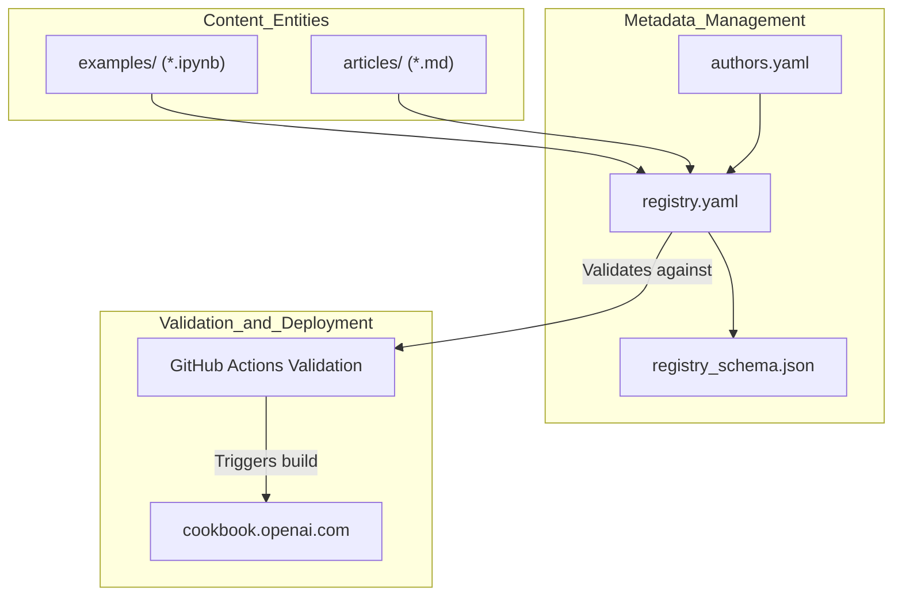
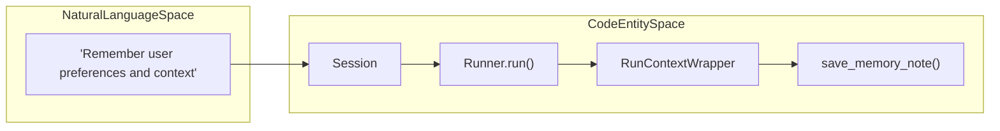
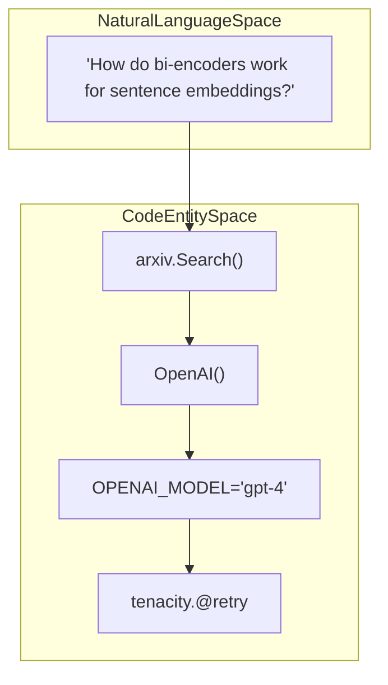

<!-- source: DeepWiki mcp.deepwiki.com · repo openai/openai-cookbook · page 1 Overview · fetched 2026-10-26 -->

# Overview

Relevant source files

The following files were used as context for generating this wiki page:

- [.github/authors_schema.json](.github/authors_schema.json)
- [.github/pull_request_template.md](.github/pull_request_template.md)
- [.github/registry_schema.json](.github/registry_schema.json)
- [CONTRIBUTING.md](CONTRIBUTING.md)
- [README.md](README.md)
- [articles/how_to_work_with_large_language_models.md](articles/how_to_work_with_large_language_models.md)
- [articles/related_resources.md](articles/related_resources.md)
- [articles/techniques_to_improve_reliability.md](articles/techniques_to_improve_reliability.md)
- [articles/text_comparison_examples.md](articles/text_comparison_examples.md)
- [articles/what_makes_documentation_good.md](articles/what_makes_documentation_good.md)
- [authors.yaml](authors.yaml)
- [examples/Search_reranking_with_cross-encoders.ipynb](examples/Search_reranking_with_cross-encoders.ipynb)
- [examples/agents_sdk/building_reliable_agents_memory_compaction.ipynb](examples/agents_sdk/building_reliable_agents_memory_compaction.ipynb)
- [examples/agents_sdk/context_personalization.ipynb](examples/agents_sdk/context_personalization.ipynb)
- [examples/agents_sdk/session_memory.ipynb](examples/agents_sdk/session_memory.ipynb)
- [examples/completions_usage_api.ipynb](examples/completions_usage_api.ipynb)
- [examples/evaluation/moving-from-openai-evals-to-promptfoo.md](examples/evaluation/moving-from-openai-evals-to-promptfoo.md)
- [examples/gpt-5/prompt_personalities.ipynb](examples/gpt-5/prompt_personalities.ipynb)
- [examples/gpt4-1_prompting_guide.ipynb](examples/gpt4-1_prompting_guide.ipynb)
- [examples/skills_in_api.ipynb](examples/skills_in_api.ipynb)
- [examples/voice_solutions/arduino_ai_speech_assets/elato-alien.png](examples/voice_solutions/arduino_ai_speech_assets/elato-alien.png)
- [examples/voice_solutions/arduino_ai_speech_assets/pcb-design.png](examples/voice_solutions/arduino_ai_speech_assets/pcb-design.png)
- [images/memory_comparison.jpg](images/memory_comparison.jpg)
- [images/openai-cookbook-white.png](images/openai-cookbook-white.png)
- [images/openai-cookbook.png](images/openai-cookbook.png)
- [images/promptfoo-custom-example-view.png](images/promptfoo-custom-example-view.png)
- [images/summarizingSession.jpg](images/summarizingSession.jpg)
- [images/trimingSession.jpg](images/trimingSession.jpg)
- [registry.yaml](registry.yaml)

The OpenAI Cookbook is a community-driven collection of executable code examples, articles, and guides demonstrating common patterns and use cases for the OpenAI API platform [README.md:12-15](). The repository serves as a reference implementation library, showing developers how to build applications using chat completions, embeddings, function calling, fine-tuning, multimodal inputs, and agentic workflows [README.md:12-15]().

All content is published to [cookbook.openai.com](https://cookbook.openai.com) through a registry-based content management system defined in `registry.yaml` [registry.yaml:3-5](). The repository provides both conceptual articles in markdown and runnable examples in Jupyter notebooks covering the full OpenAI API surface [README.md:12-15]().

Sources: [README.md:12-15](), [registry.yaml:3-5]()

## Repository Architecture

The repository uses a declarative content manifest to control what appears on the cookbook website. All discoverable content must be registered in `registry.yaml` with metadata including title, path, tags, authors, and publication date [registry.yaml:7-17]().

### Manifest and Publication Flow
Title: "RepositoryDataFlow"

Sources: [registry.yaml:1-5](), [authors.yaml:1-5](), [.github/registry_schema.json:1-48]()

### Key Files and Directories

| Path | Purpose | Key References |
|------|---------|------------|
| `registry.yaml` | Manifest of all published content with metadata | [registry.yaml:1-5]() |
| `authors.yaml` | Author profile customizations (name, website, avatar) | [authors.yaml:1-194]() |
| `examples/` | Executable Jupyter notebooks demonstrating API usage | [registry.yaml:8]() |
| `articles/` | Educational markdown guides | [registry.yaml:22]() |
| `.github/registry_schema.json` | JSON Schema for validating registry entries | [registry.yaml:1]() |
| `.github/pull_request_template.md` | Quality rubric checklist for contributions | [.github/pull_request_template.md:11-24]() |

Sources: [registry.yaml:1-153](), [authors.yaml:1-194](), [.github/pull_request_template.md:1-24]()

## Content Organization and Metadata

Content entries in `registry.yaml` follow a strict JSON schema defined in [.github/registry_schema.json:1-48]() to ensure proper rendering on the web portal [registry.yaml:1-5]().

Required fields per entry include `title`, `path`, `slug`, `tags`, and `authors` [.github/registry_schema.json:45](). Tags serve as the primary content categorization mechanism.

Sources: [registry.yaml:1-5](), [.github/registry_schema.json:1-48]()

## API and Model Coverage

The cookbook covers primary OpenAI API endpoints and model families through targeted examples and guides.

### Chat, Reasoning, and Skills
- **GPT-4.1 Prompting:** Focuses on instruction following, multi-message turns, and agentic workflows using `System Prompt Reminders` for persistence and tool-calling [examples/gpt4-1_prompting_guide.ipynb:7-47]().
- **Skills API:** Demonstrates packaging workflows into a folder structure anchored by a required `SKILL.md` manifest, uploaded and run with hosted shell environments (`environment.type="container_auto"`) [examples/skills_in_api.ipynb:12-45]().

### Agentic Frameworks
The cookbook extensively documents the **OpenAI Agents SDK** for building adaptive collaborators using `RunContextWrapper` for state management [examples/agents_sdk/context_personalization.ipynb:18-25]() and `Session` memory objects with `Runner.run()` [examples/agents_sdk/session_memory.ipynb:40-50]().

Title: "AgentMemoryEntityMapping"

Sources: [examples/agents_sdk/context_personalization.ipynb:18-106](), [examples/agents_sdk/session_memory.ipynb:40-50]()

## Major Workflow Patterns

### Retrieval Augmented Generation and Cross-Encoders
The cookbook outlines bi-encoder retrieval combined with cross-encoder re-ranking using GPT models and libraries like `arxiv` and `tenacity` [examples/Search_reranking_with_cross-encoders.ipynb:10-30]().

Title: "SearchRerankingEntityMapping"

Sources: [examples/Search_reranking_with_cross-encoders.ipynb:28-65]()

### Agentic Context Engineering
Modern agentic patterns utilize **Context Trimming** (dropping older turns) and **Context Summarization** (compressing history) via the `Session` object to maintain coherence across long-running sessions [examples/agents_sdk/session_memory.ipynb:40-69]().

Sources: [examples/agents_sdk/session_memory.ipynb:40-108]()

## Contribution and Quality Standards

The repository maintains strict standards for community contributions. Contributors must perform a self-review against a standardized rubric covering relevance, uniqueness, spelling, grammar, clarity, correctness, and completeness [.github/pull_request_template.md:11-24](). New entries must be added to `registry.yaml` and validated against schema constraints [CONTRIBUTING.md:15-18]().

Sources: [.github/pull_request_template.md:11-24](), [CONTRIBUTING.md:15-35]()

---

