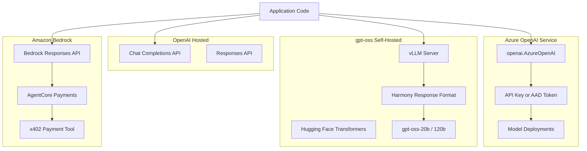
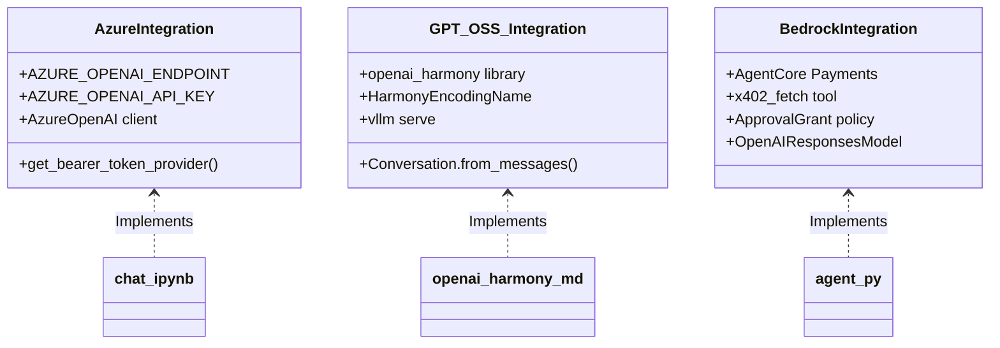

<!-- source: DeepWiki mcp.deepwiki.com · repo openai/openai-cookbook · page 10 Platform Integration · fetched 2026-10-26 -->

# Platform Integration

Relevant source files

The following files were used as context for generating this wiki page:

- [articles/gpt-oss/fine-tune-transfomers.ipynb](articles/gpt-oss/fine-tune-transfomers.ipynb)
- [articles/gpt-oss/handle-raw-cot.md](articles/gpt-oss/handle-raw-cot.md)
- [articles/gpt-oss/run-colab.ipynb](articles/gpt-oss/run-colab.ipynb)
- [articles/gpt-oss/run-locally-lmstudio.md](articles/gpt-oss/run-locally-lmstudio.md)
- [articles/gpt-oss/run-locally-ollama.md](articles/gpt-oss/run-locally-ollama.md)
- [articles/gpt-oss/run-transformers.md](articles/gpt-oss/run-transformers.md)
- [articles/gpt-oss/run-vllm.md](articles/gpt-oss/run-vllm.md)
- [articles/openai-harmony.md](articles/openai-harmony.md)
- [examples/azure/archive/DALL-E.ipynb](examples/azure/archive/DALL-E.ipynb)
- [examples/azure/archive/chat.ipynb](examples/azure/archive/chat.ipynb)
- [examples/azure/archive/chat_with_your_own_data.ipynb](examples/azure/archive/chat_with_your_own_data.ipynb)
- [examples/azure/archive/completions.ipynb](examples/azure/archive/completions.ipynb)
- [examples/azure/archive/embeddings.ipynb](examples/azure/archive/embeddings.ipynb)
- [examples/azure/archive/functions.ipynb](examples/azure/archive/functions.ipynb)
- [examples/azure/archive/whisper.ipynb](examples/azure/archive/whisper.ipynb)
- [examples/azure/chat.ipynb](examples/azure/chat.ipynb)
- [examples/azure/chat_with_your_own_data.ipynb](examples/azure/chat_with_your_own_data.ipynb)
- [examples/azure/embeddings.ipynb](examples/azure/embeddings.ipynb)
- [examples/azure/functions.ipynb](examples/azure/functions.ipynb)
- [examples/azure/whisper.ipynb](examples/azure/whisper.ipynb)
- [examples/vector_databases/azuresearch/Getting_started_with_azure_ai_search_and_openai.ipynb](examples/vector_databases/azuresearch/Getting_started_with_azure_ai_search_and_openai.ipynb)

## Purpose and Scope

This document covers platform-specific integration patterns for deploying and accessing OpenAI models outside of the standard OpenAI API. As a parent page, it provides a high-level overview of enterprise, open-weight, and cloud-native deployment options. For detailed technical guides, refer to the child pages:
- Azure OpenAI Service: For details, see [Azure OpenAI Service](#10.1) [examples/azure/chat.ipynb:1-12]()
- gpt-oss Models and Harmony Format: For details, see [gpt-oss Models and Harmony Format](#10.2) [articles/openai-harmony.md:1-5]()
- Amazon Bedrock and AWS Integration: For details, see [Amazon Bedrock and AWS Integration](#10.3)

For general API usage with OpenAI's hosted service, see [Chat Completions and Prompting](#4).

Sources: [examples/azure/chat.ipynb:1-12](), [articles/openai-harmony.md:1-5]()

## Integration Architecture Overview

The cookbook documents multiple deployment paths for OpenAI models, each with distinct tradeoffs regarding control, infrastructure cost, latency, and feature support.

Sources: [examples/azure/chat.ipynb:82-87](), [articles/gpt-oss/run-vllm.md:1-5]()

## Platform Integration Patterns

### Azure OpenAI Service Integration

Azure OpenAI Service provides enterprise-grade access to OpenAI models within Microsoft Azure infrastructure. The integration relies on the `openai.AzureOpenAI` client class configured with dedicated endpoints and deployments [examples/azure/embeddings.ipynb:82-87]().

* **Authentication**: Supports static API keys [examples/azure/chat.ipynb:78-87]() and Azure Active Directory (AAD) via `get_bearer_token_provider` [examples/azure/chat.ipynb:114-124]().
* **Deployments**: Requires managing named deployments in Azure OpenAI Studio, where the `model` parameter maps directly to the deployment ID [examples/azure/chat.ipynb:154-164]().
* **Data Integration**: Connects models to enterprise data sources using Azure AI Search via Azure OpenAI on your data [examples/azure/chat_with_your_own_data.ipynb:10-12]().

For details, see [Azure OpenAI Service](#10.1).

Sources: [examples/azure/chat.ipynb:45-164](), [examples/azure/embeddings.ipynb:45-138](), [examples/azure/chat_with_your_own_data.ipynb:10-12]()

### gpt-oss Models and Harmony Format

The open-weight `gpt-oss-20b` and `gpt-oss-120b` models enable self-hosted inference under open licensing terms [articles/gpt-oss/run-colab.ipynb:20-20]().

* **Inference Engines**: Can be served via **vLLM** for production workloads [articles/gpt-oss/run-vllm.md:1-5](), **Hugging Face Transformers** for experimentation [articles/gpt-oss/run-transformers.md:3-5](), or locally using **Ollama** [articles/gpt-oss/run-locally-ollama.md:1-5]() and **LM Studio** [articles/gpt-oss/run-locally-lmstudio.md:1-5]().
* **Harmony Format**: Enforces structured conversations, role hierarchies (`system`, `developer`, `user`, `assistant`, `tool`), and channel separation (`final`, `analysis`, `commentary`) for Chain of Thought processing [articles/openai-harmony.md:9-29]().
* **Fine-Tuning**: Supports parameter-efficient fine-tuning (LoRA) and multilingual reasoning enhancements via the TRL library [articles/gpt-oss/fine-tune-transfomers.ipynb:14-20]().

For details, see [gpt-oss Models and Harmony Format](#10.2).

Sources: [articles/gpt-oss/run-vllm.md:1-80](), [articles/openai-harmony.md:1-105](), [articles/gpt-oss/fine-tune-transfomers.ipynb:1-25](), [articles/gpt-oss/run-locally-ollama.md:1-5](), [articles/gpt-oss/run-locally-lmstudio.md:1-5]()

### Amazon Bedrock Integration

Amazon Bedrock integration bridges OpenAI model interfaces with AWS-managed services and secure agentic workflows.

* **Responses API Surface**: Exposes structured output capabilities and tool execution compatible with AWS paradigms.
* **AgentCore Payments**: Manages bounded spending sessions where autonomous agents can request paid resources while enforcing strict authorization policies.
* **Protocol Tooling**: Utilizes specialized tools like `x402_fetch` to handle HTTP 402 payment required challenges in automated workflows.

For details, see [Amazon Bedrock and AWS Integration](#10.3).

Sources: [articles/gpt-oss/run-vllm.md:48-48]()

## Integration Decision Guide

### Bridging Natural Language to Code Entities

The diagram below links platform-specific concepts in natural language space to their exact classes, environment variables, and module identifiers in the codebase.

Sources: [examples/azure/chat.ipynb:79-124](), [articles/openai-harmony.md:38-51]()

### Choosing a Platform

| Consideration | Azure OpenAI | gpt-oss (Self-Hosted) | Amazon Bedrock |
| :--- | :--- | :--- | :--- |
| **Primary Use Case** | Enterprise RAG & Management | Data Privacy & Control | Agentic Commerce & AWS Native |
| **Auth Model** | API Key / AAD Token | Engine-specific (vLLM/Ollama) | AWS IAM / AgentCore Sessions |
| **Model Hosting** | Managed by Microsoft | User-managed (H100/Local) | Managed by AWS |
| **Key Feature** | Azure AI Search Integration | Harmony CoT & MXFP4 | Bounded Payment Sessions |

Sources: [examples/azure/chat_with_your_own_data.ipynb:10-12](), [articles/gpt-oss/run-vllm.md:1-5]()

---

