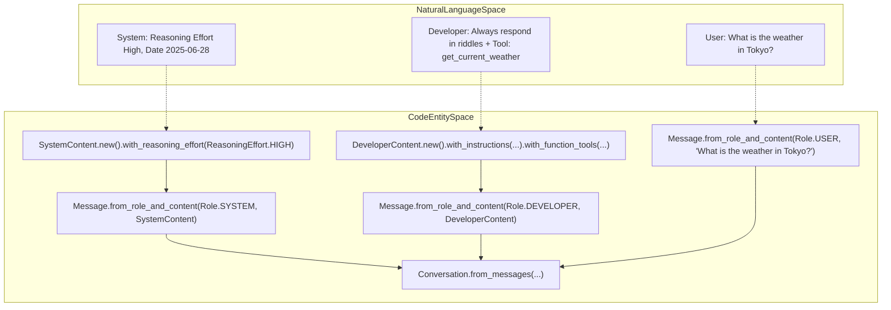
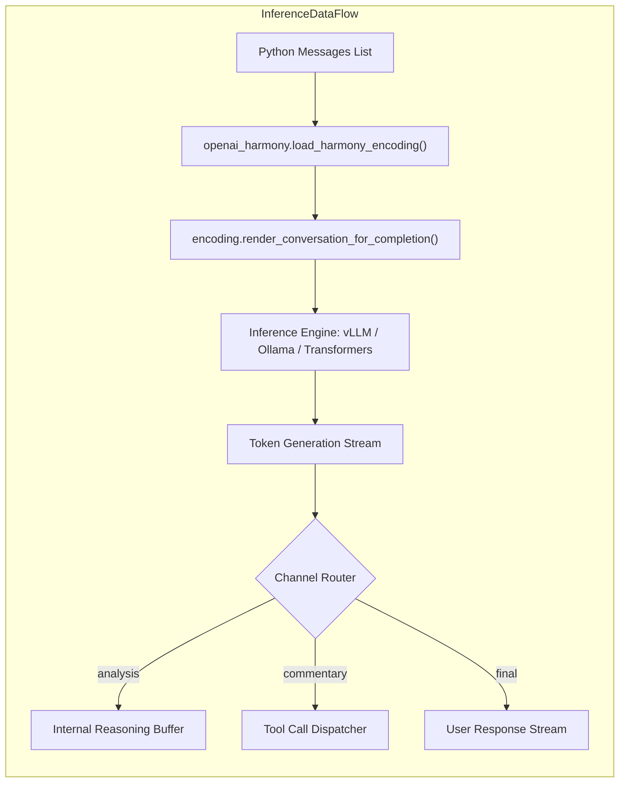

<!-- source: DeepWiki mcp.deepwiki.com · repo openai/openai-cookbook · page 10.2 gpt-oss Models and Harmony Format · fetched 2026-10-26 -->

# gpt-oss Models and Harmony Format

<details>
<summary>Relevant source files</summary>

The following files were used as context for generating this wiki page:

- [articles/gpt-oss-safeguard-guide.md](articles/gpt-oss-safeguard-guide.md)
- [articles/gpt-oss/fine-tune-transfomers.ipynb](articles/gpt-oss/fine-tune-transfomers.ipynb)
- [articles/gpt-oss/handle-raw-cot.md](articles/gpt-oss/handle-raw-cot.md)
- [articles/gpt-oss/run-colab.ipynb](articles/gpt-oss/run-colab.ipynb)
- [articles/gpt-oss/run-locally-lmstudio.md](articles/gpt-oss/run-locally-lmstudio.md)
- [articles/gpt-oss/run-locally-ollama.md](articles/gpt-oss/run-locally-ollama.md)
- [articles/gpt-oss/run-transformers.md](articles/gpt-oss/run-transformers.md)
- [articles/gpt-oss/run-vllm.md](articles/gpt-oss/run-vllm.md)
- [articles/openai-harmony.md](articles/openai-harmony.md)

</details>


## Purpose and Scope

This page documents the **gpt-oss model family** (`openai/gpt-oss-20b` and `openai/gpt-oss-120b`) and the **Harmony response format** required for their correct operation [articles/openai-harmony.md:1-3](). It details model specifications, the Harmony format (roles, channels, renderer library), deployment options across execution runtimes (vLLM, Ollama, LM Studio, Transformers, and Google Colab), raw Chain-of-Thought (CoT) management, Supervised Fine-Tuning (SFT), and safety classification via `gpt-oss-safeguard`.

---

## Model Family Overview

The gpt-oss models are open-weight reasoning models released under the Apache 2.0 license [articles/gpt-oss/run-colab.ipynb:18-20](). They are architected to leverage native 4-bit floating point quantization (`MXFP4`) out of the box [articles/gpt-oss/run-vllm.md:19-19]().

| Model | Parameters | Active Parameters | Memory Requirement | Hardware Target |
| :--- | :--- | :--- | :--- | :--- |
| `openai/gpt-oss-20b` | 21B [articles/gpt-oss/run-colab.ipynb:22-22]() | 3.6B [articles/gpt-oss/run-colab.ipynb:22-22]() | ~16GB VRAM [articles/gpt-oss/run-vllm.md:11-13]() | Consumer GPUs, Apple Silicon, Colab [articles/gpt-oss/run-locally-ollama.md:13-14](), [articles/gpt-oss/run-colab.ipynb:24-24]() |
| `openai/gpt-oss-120b` | 120B [articles/gpt-oss/run-vllm.md:14-15]() | Full MoE | ≥60GB VRAM [articles/gpt-oss/run-vllm.md:16-16]() | Server-class GPUs (H100) [articles/gpt-oss/run-vllm.md:5-17]() |

**Key Hardware Constraints:** `MXFP4` quantization kernels require NVIDIA Hopper architectures (H100, GB200) or consumer RTX 50xx series cards when using Triton/PyTorch implementations [articles/gpt-oss/run-transformers.md:22-22]().

Sources: [articles/openai-harmony.md:1-3](), [articles/gpt-oss/run-vllm.md:7-20](), [articles/gpt-oss/run-colab.ipynb:18-26](), [articles/gpt-oss/run-transformers.md:13-25]()

---

## Harmony Response Format Specification

The Harmony format is the structured prompt and conversation interface used by gpt-oss models to access reasoning, execute function calls, and manage multi-turn dialogues [articles/openai-harmony.md:1-3](), [articles/gpt-oss-safeguard-guide.md:22-22]().

### Roles and Hierarchy
Every message processed by the model is bound to a specific role [articles/openai-harmony.md:7-9](). Instruction conflicts are resolved using the precedence hierarchy: `system` > `developer` > `user` > `assistant` > `tool` [articles/openai-harmony.md:19-19]().

| Role | Purpose | Code Entity / Class (`openai_harmony`) |
| :--- | :--- | :--- |
| `system` | Specifies reasoning effort, knowledge cutoff, and built-in tools [articles/openai-harmony.md:13-13]() | `SystemContent` [articles/openai-harmony.md:45-45]() |
| `developer` | Contains instructions (system prompts) and tool definitions [articles/openai-harmony.md:14-14]() | `DeveloperContent` [articles/openai-harmony.md:41-41]() |
| `user` | User inputs [articles/openai-harmony.md:15-15]() | `Role.USER` [articles/openai-harmony.md:44-44]() |
| `assistant` | Model outputs (messages or tool calls) with explicit channels [articles/openai-harmony.md:16-16]() | `Role.ASSISTANT` [articles/openai-harmony.md:44-44]() |
| `tool` | Results of external tool executions [articles/openai-harmony.md:17-17]() | `Author` / `Role.TOOL` [articles/openai-harmony.md:39-44]() |

### Channels
Assistant outputs are segregated into three channels to separate public communication from internal execution state [articles/openai-harmony.md:23-23]():
* `final`: End-user facing responses [articles/openai-harmony.md:27-27]().
* `analysis`: Internal Chain-of-Thought (CoT). **Not safety-trained**; should not be exposed directly to end users [articles/openai-harmony.md:28-28]().
* `commentary`: Function tool invocations (`functions.*`) and preambles [articles/openai-harmony.md:29-29]().

### Natural Language to Code Entity Mapping


Sources: [articles/openai-harmony.md:7-102](), [articles/openai-harmony.md:38-49](), [articles/openai-harmony.md:87-105]()

---

## Deployment Options and Inference Runtimes

Because gpt-oss models require strict adherence to the Harmony protocol, native runtimes or middleware layers must handle token rendering and parsing [articles/openai-harmony.md:3-3]().

### Deployment Runtimes
* **vLLM**: Optimized high-throughput server using `vllm serve openai/gpt-oss-120b` supporting OpenAI-compatible Chat Completions and Responses endpoints [articles/gpt-oss/run-vllm.md:3-45]().
* **Ollama**: Local consumer deployment via `ollama pull gpt-oss:20b`, exposing a local `/v1` Chat Completions endpoint [articles/gpt-oss/run-locally-ollama.md:25-70]().
* **LM Studio**: Desktop GUI and local dev API (`http://localhost:1234/v1`) supporting local agentic execution (`model.act()`) [articles/gpt-oss/run-locally-lmstudio.md:3-100]().
* **Hugging Face Transformers**: Low-level generation via `AutoModelForCausalLM.from_pretrained()` and `tokenizer.apply_chat_template()` [articles/gpt-oss/run-transformers.md:89-121]().
* **Google Colab**: Free-tier execution using `gpt-oss-20b` with `torch` and Triton MXFP4 kernels [articles/gpt-oss/run-colab.ipynb:18-121]().

### Inference Data Flow and Tokenization


Sources: [articles/gpt-oss/run-vllm.md:21-78](), [articles/gpt-oss/run-transformers.md:87-157](), [articles/openai-harmony.md:38-51]()

---

## Raw Chain-of-Thought (CoT) Handling

The `analysis` channel exposes the model's raw reasoning steps [articles/openai-harmony.md:28-28](). While required for optimal tool-calling performance and interpretability research, raw CoT should be intercepted before reaching end-users [articles/gpt-oss/handle-raw-cot.md:3-4]().

### API Specifications for CoT
* **Responses API Spec**: Augmented with `ReasoningItem`, `ReasoningTextContent`, and streaming deltas `response.reasoning_text.delta` / `response.reasoning_text.done` [articles/gpt-oss/handle-raw-cot.md:28-68]().
* **Chat Completions API Spec**: Follows OpenRouter conventions where raw reasoning text is returned via the `reasoning` message property, suppressible via `reasoning: { exclude: true }` [articles/gpt-oss/handle-raw-cot.md:15-22]().

```typescript
type ReasoningItem = {
  id: string;
  type: "reasoning";
  summary: SummaryContent[];
  content: ReasoningTextContent[];
};

type ReasoningTextContent = {
  type: "reasoning_text";
  text: string;
};
```
Sources: [articles/gpt-oss/handle-raw-cot.md:1-123]()

---

## Fine-Tuning gpt-oss Models

Developers can perform Supervised Fine-Tuning (SFT) on gpt-oss models (such as adapting `openai/gpt-oss-20b` for multilingual reasoning using Hugging Face's `trl` and `peft` libraries) [articles/gpt-oss/fine-tune-transfomers.ipynb:1-24]().

### Training Pipeline Steps
1. **Environment Setup**: Install PyTorch, `trl`, `peft`, and `transformers>=4.55.0` [articles/gpt-oss/fine-tune-transfomers.ipynb:59-84]().
2. **Dataset Loading**: Ingest structured reasoning datasets like `HuggingFaceH4/Multilingual-Thinking` [articles/gpt-oss/fine-tune-transfomers.ipynb:119-122]().
3. **LoRA Configuration**: Configure parameter-efficient fine-tuning on `openai/gpt-oss-20b` [articles/gpt-oss/fine-tune-transfomers.ipynb:14-20]().

Sources: [articles/gpt-oss/fine-tune-transfomers.ipynb:1-46](), [articles/gpt-oss/run-transformers.md:9-9]()

---

## Safeguards and Trust & Safety Guide

`gpt-oss-safeguard` is an open-weight reasoning model specialized for safety classification tasks based on customizable policies [articles/gpt-oss-safeguard-guide.md:7-9]().

### Bring-Your-Own-Policy Moderation
Unlike prebaked safety classifiers with fixed taxonomies [articles/gpt-oss-safeguard-guide.md:13-16](), `gpt-oss-safeguard` accepts explicitly written developer policies in system prompts to interpret organizational thresholds, explain borderline determinations, and audit decisions [articles/gpt-oss-safeguard-guide.md:9-18](). It can be deployed locally using vLLM, Ollama, LM Studio, or Transformers [articles/gpt-oss-safeguard-guide.md:24-34]().

Sources: [articles/gpt-oss-safeguard-guide.md:1-121]()

---

