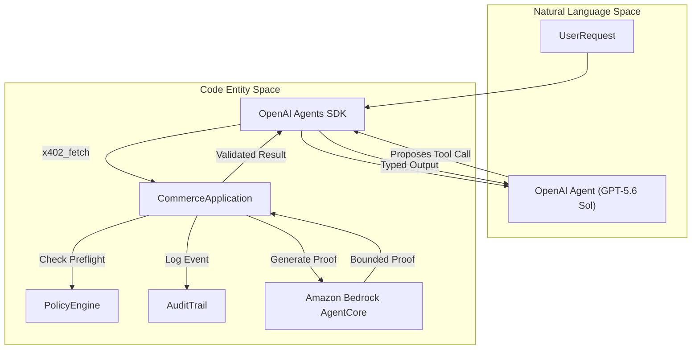
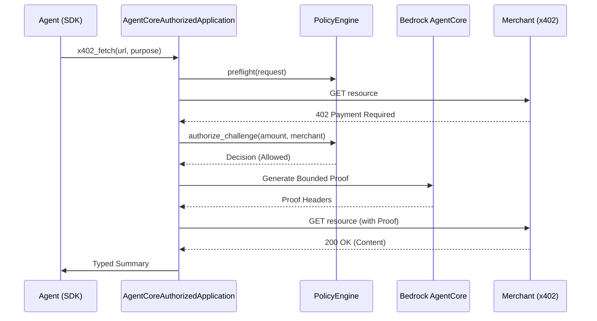
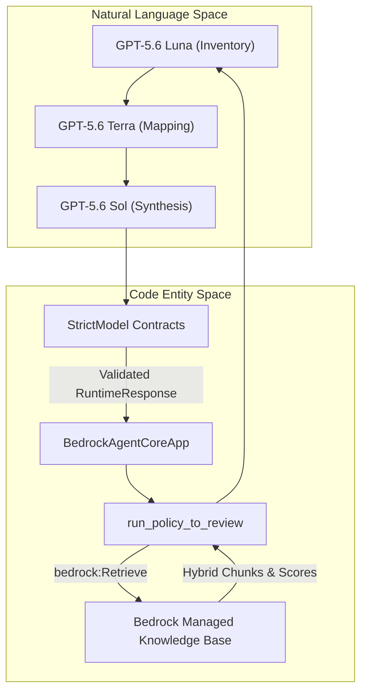

<!-- source: DeepWiki mcp.deepwiki.com · repo openai/openai-cookbook · page 10.3 Amazon Bedrock and AWS Integration · fetched 2026-10-26 -->

# Amazon Bedrock and AWS Integration

Relevant source files

The following files were used as context for generating this wiki page:

- [examples/partners/AWS/controlled_agentic_commerce_with_agentcore_payments/.env.example](examples/partners/AWS/controlled_agentic_commerce_with_agentcore_payments/.env.example)
- [examples/partners/AWS/controlled_agentic_commerce_with_agentcore_payments/.gitignore](examples/partners/AWS/controlled_agentic_commerce_with_agentcore_payments/.gitignore)
- [examples/partners/AWS/controlled_agentic_commerce_with_agentcore_payments/README.md](examples/partners/AWS/controlled_agentic_commerce_with_agentcore_payments/README.md)
- [examples/partners/AWS/controlled_agentic_commerce_with_agentcore_payments/controlled_agentic_commerce.ipynb](examples/partners/AWS/controlled_agentic_commerce_with_agentcore_payments/controlled_agentic_commerce.ipynb)
- [examples/partners/AWS/controlled_agentic_commerce_with_agentcore_payments/pyproject.toml](examples/partners/AWS/controlled_agentic_commerce_with_agentcore_payments/pyproject.toml)
- [examples/partners/AWS/controlled_agentic_commerce_with_agentcore_payments/src/agentic_commerce/__init__.py](examples/partners/AWS/controlled_agentic_commerce_with_agentcore_payments/src/agentic_commerce/__init__.py)
- [examples/partners/AWS/controlled_agentic_commerce_with_agentcore_payments/src/agentic_commerce/agent.py](examples/partners/AWS/controlled_agentic_commerce_with_agentcore_payments/src/agentic_commerce/agent.py)
- [examples/partners/AWS/controlled_agentic_commerce_with_agentcore_payments/src/agentic_commerce/agentcore_agent.py](examples/partners/AWS/controlled_agentic_commerce_with_agentcore_payments/src/agentic_commerce/agentcore_agent.py)
- [examples/partners/AWS/controlled_agentic_commerce_with_agentcore_payments/src/agentic_commerce/agentcore_application.py](examples/partners/AWS/controlled_agentic_commerce_with_agentcore_payments/src/agentic_commerce/agentcore_application.py)
- [examples/partners/AWS/controlled_agentic_commerce_with_agentcore_payments/src/agentic_commerce/agentcore_e2e.py](examples/partners/AWS/controlled_agentic_commerce_with_agentcore_payments/src/agentic_commerce/agentcore_e2e.py)
- [examples/partners/AWS/controlled_agentic_commerce_with_agentcore_payments/tests/test_publication_contract.py](examples/partners/AWS/controlled_agentic_commerce_with_agentcore_payments/tests/test_publication_contract.py)
- [examples/partners/AWS/data/policy_to_review/.gitattributes](examples/partners/AWS/data/policy_to_review/.gitattributes)
- [examples/partners/AWS/data/policy_to_review/PA-OXY-2088-room-air-oximetry-abg.pdf](examples/partners/AWS/data/policy_to_review/PA-OXY-2088-room-air-oximetry-abg.pdf)
- [examples/partners/AWS/policy_to_review_prior_authorization_agents_sdk_agentcore.ipynb](examples/partners/AWS/policy_to_review_prior_authorization_agents_sdk_agentcore.ipynb)
- [examples/partners/AWS/prior_authorization_agentcore/README.md](examples/partners/AWS/prior_authorization_agentcore/README.md)
- [examples/partners/AWS/prior_authorization_agentcore/__init__.py](examples/partners/AWS/prior_authorization_agentcore/__init__.py)
- [examples/partners/AWS/prior_authorization_agentcore/knowledge_base.py](examples/partners/AWS/prior_authorization_agentcore/knowledge_base.py)
- [examples/partners/AWS/prior_authorization_agentcore/runtime_project.py](examples/partners/AWS/prior_authorization_agentcore/runtime_project.py)
- [examples/partners/AWS/prior_authorization_agentcore/runtime_source/main.py](examples/partners/AWS/prior_authorization_agentcore/runtime_source/main.py)
- [examples/partners/AWS/prior_authorization_agentcore/runtime_source/models.py](examples/partners/AWS/prior_authorization_agentcore/runtime_source/models.py)
- [examples/partners/AWS/prior_authorization_agentcore/runtime_source/policy_registry.py.tmpl](examples/partners/AWS/prior_authorization_agentcore/runtime_source/policy_registry.py.tmpl)

The Amazon Bedrock integration allows developers to use OpenAI models hosted on AWS infrastructure. This integration supports the **OpenAI-compatible Responses API surface**, structured outputs, application-bound tools, and advanced agentic workflows via the **OpenAI Agents SDK** and **Amazon Bedrock AgentCore Runtime**. Key features include managed payment sessions for agentic commerce, background processing, context compaction, and enterprise prior-authorization workflows.

Sources: `[examples/partners/AWS/controlled_agentic_commerce_with_agentcore_payments/README.md:1-20]()`, `[examples/partners/AWS/policy_to_review_prior_authorization_agents_sdk_agentcore.ipynb:7-14]()`

## Overview and Architecture

The integration follows a four-boundary responsibility model to ensure security and authority are maintained when agents interact with external services, payment infrastructure, or enterprise backends.

* **AI Agent**: Identifies when a tool is needed and proposes parameters [examples/partners/AWS/controlled_agentic_commerce_with_agentcore_payments/controlled_agentic_commerce.ipynb:40-40]().
* **Application**: Owns the policy engine, merchant allowlists, budget limits, and audit history [examples/partners/AWS/controlled_agentic_commerce_with_agentcore_payments/controlled_agentic_commerce.ipynb:41-41]().
* **Amazon Bedrock AgentCore**: Provides bounded payment sessions and generates payment proofs (e.g., for x402 exchanges) or hosts serverless runtime loops [examples/partners/AWS/controlled_agentic_commerce_with_agentcore_payments/controlled_agentic_commerce.ipynb:42-42]() [examples/partners/AWS/policy_to_review_prior_authorization_agents_sdk_agentcore.ipynb:10-12]().
* **Paid API / Merchant / Knowledge Base**: Validates proofs, returns content, or executes hybrid retrieval [examples/partners/AWS/controlled_agentic_commerce_with_agentcore_payments/controlled_agentic_commerce.ipynb:43-43]() [examples/partners/AWS/policy_to_review_prior_authorization_agents_sdk_agentcore.ipynb:23-28]().

### Authority Boundaries Diagram

The following diagram illustrates the separation of concerns between natural language reasoning spaces and code execution entities for agentic commerce.

"Agentic Commerce Authority Boundaries"

Sources: `[examples/partners/AWS/controlled_agentic_commerce_with_agentcore_payments/controlled_agentic_commerce.ipynb:38-51]`, `[examples/partners/AWS/controlled_agentic_commerce_with_agentcore_payments/src/agentic_commerce/agentcore_agent.py:86-141]()`

Sources: `[examples/partners/AWS/controlled_agentic_commerce_with_agentcore_payments/controlled_agentic_commerce.ipynb:38-51]()`, `[examples/partners/AWS/controlled_agentic_commerce_with_agentcore_payments/src/agentic_commerce/agentcore_agent.py:86-141]()`

## OpenAI-Compatible Responses API and Structured Outputs

The integration utilizes the `openai[bedrock]` provider to interact with models like `openai.gpt-5.6-sol`. The `AsyncOpenAI` client is configured with the `bedrock` provider, pointing to specific AWS regions and utilizing model discovery endpoints. 

Structured outputs are enforced via strict Pydantic base models (`StrictModel`) ensuring extra fields are forbidden (`extra="forbid"`), providing strict guarantees for downstream parsing and execution.

Sources: `[examples/partners/AWS/prior_authorization_agentcore/runtime_source/models.py:8-68]`, `[examples/partners/AWS/prior_authorization_agentcore/runtime_source/main.py:44-54]()`

Sources: `[examples/partners/AWS/prior_authorization_agentcore/runtime_source/models.py:8-68]`, `[examples/partners/AWS/prior_authorization_agentcore/runtime_source/main.py:44-54]()`

## AgentCore Payments Workflow

A primary use case for Bedrock integration is **Agentic Commerce**, where agents can pay for resources using the `x402` payment exchange protocol [examples/partners/AWS/controlled_agentic_commerce_with_agentcore_payments/README.md:49-54]().

### The x402 Sequence
1. **Challenge**: A merchant returns `HTTP 402 Payment Required` with machine-readable terms [examples/partners/AWS/controlled_agentic_commerce_with_agentcore_payments/README.md:51-52]().
2. **Validation**: The `AgentCoreAuthorizedApplication` validates the challenge against a `PolicyEngine` [examples/partners/AWS/controlled_agentic_commerce_with_agentcore_payments/src/agentic_commerce/agentcore_application.py:102-111]().
3. **Proof**: If approved, the application uses `AgentCorePayments` to generate a bounded payment proof [examples/partners/AWS/controlled_agentic_commerce_with_agentcore_payments/src/agentic_commerce/agentcore_application.py:126-130]().
4. **Retry**: The application retries the request with the proof and a stable `idempotency_key` [examples/partners/AWS/controlled_agentic_commerce_with_agentcore_payments/src/agentic_commerce/agentcore_application.py:133-136]().

### Payment Implementation Logic

"AgentCore Payment Flow"

Sources: `[examples/partners/AWS/controlled_agentic_commerce_with_agentcore_payments/README.md:71-71]`, `[examples/partners/AWS/controlled_agentic_commerce_with_agentcore_payments/src/agentic_commerce/agentcore_application.py:63-183]()`

Sources: `[examples/partners/AWS/controlled_agentic_commerce_with_agentcore_payments/README.md:71-71]()`, `[examples/partners/AWS/controlled_agentic_commerce_with_agentcore_payments/src/agentic_commerce/agentcore_application.py:63-183]()`

## Prior-Authorization Agents on Bedrock AgentCore

Enterprise workflows such as prior-authorization reviews combine Amazon Bedrock Managed Knowledge Bases with sequential multi-agent execution inside **Amazon Bedrock AgentCore Runtime**.

### Runtime Execution Pattern
The runtime application is bootstrapped using `BedrockAgentCoreApp` and exposes async entrypoints that execute deterministic agent handoffs [examples/partners/AWS/prior_authorization_agentcore/runtime_source/main.py:5-48]().

"Prior Authorization AgentCore Runtime Flow"

Sources: `[examples/partners/AWS/policy_to_review_prior_authorization_agents_sdk_agentcore.ipynb:23-41]`, `[examples/partners/AWS/prior_authorization_agentcore/runtime_source/main.py:44-53]`, `[examples/partners/AWS/prior_authorization_agentcore/runtime_project.py:38-59]()`

Sources: `[examples/partners/AWS/policy_to_review_prior_authorization_agents_sdk_agentcore.ipynb:23-41]()`, `[examples/partners/AWS/prior_authorization_agentcore/runtime_source/main.py:44-53]()`, `[examples/partners/AWS/prior_authorization_agentcore/runtime_project.py:38-59]()`

## Key Classes and Functions

| Entity | File Path | Role |
| :--- | :--- | :--- |
| `BedrockAgentCoreApp` | `bedrock_agentcore.runtime` | Provides the serverless application decorator (`@app.entrypoint`) for AgentCore Runtime. |
| `AgentCoreAuthorizedApplication` | `examples/partners/AWS/controlled_agentic_commerce_with_agentcore_payments/src/agentic_commerce/agentcore_application.py` | Manages policy, budget reservation, and audit trails for economic tools. |
| `PolicyEngine` | `examples/partners/AWS/controlled_agentic_commerce_with_agentcore_payments/src/agentic_commerce/policy.py` | Evaluates if a merchant, amount, and purpose meet application rules. |
| `RuntimeResponse` | `examples/partners/AWS/prior_authorization_agentcore/runtime_source/models.py` | Typed strict Pydantic model for prior-authorization assessments. |
| `PaymentSessionManager` | `examples/partners/AWS/controlled_agentic_commerce_with_agentcore_payments/src/agentic_commerce/agentcore_session.py` | Handles the lifecycle of bounded Bedrock AgentCore payment sessions. |

Sources: `[examples/partners/AWS/prior_authorization_agentcore/runtime_source/main.py:5-13]`, `[examples/partners/AWS/controlled_agentic_commerce_with_agentcore_payments/src/agentic_commerce/agentcore_application.py:47-61]`, `[examples/partners/AWS/prior_authorization_agentcore/runtime_source/models.py:188-199]()`

Sources: `[examples/partners/AWS/controlled_agentic_commerce_with_agentcore_payments/src/agentic_commerce/agentcore_application.py:47-61]()`, `[examples/partners/AWS/prior_authorization_agentcore/runtime_source/models.py:188-199]()`, `[examples/partners/AWS/prior_authorization_agentcore/runtime_source/main.py:5-13]()`

## Operational Controls and Security

### Bounded Sessions and Expiries
Payment authority and token usage are strictly limited by short-lived sessions. Expiries and maximum session budgets prevent runaway background execution [examples/partners/AWS/controlled_agentic_commerce_with_agentcore_payments/src/agentic_commerce/agentcore_e2e.py:48-50]().

### Audit and Verification
Applications maintain comprehensive audit trails recording events like `RESOURCE_REQUESTED`, `PAYMENT_REQUIRED`, and `CONTENT_RETURNED` [examples/partners/AWS/controlled_agentic_commerce_with_agentcore_payments/src/agentic_commerce/agentcore_application.py:74-170](). Final agent outputs are validated via strict schemas to prevent model hallucination of receipts or settlement claims [examples/partners/AWS/controlled_agentic_commerce_with_agentcore_payments/src/agentic_commerce/agentcore_agent.py:162-204]().

### Proxy Restrictions and Fail-Closed Behavior
To maintain cryptographic and network binding for x402 tools and Bedrock endpoints, live adapters fail closed if environment proxies (`HTTP_PROXY`, `HTTPS_PROXY`, `ALL_PROXY`) are detected [examples/partners/AWS/controlled_agentic_commerce_with_agentcore_payments/README.md:67-69]() [examples/partners/AWS/controlled_agentic_commerce_with_agentcore_payments/tests/test_publication_contract.py:66-87]().

Sources: `[examples/partners/AWS/controlled_agentic_commerce_with_agentcore_payments/README.md:67-69]`, `[examples/partners/AWS/controlled_agentic_commerce_with_agentcore_payments/tests/test_publication_contract.py:66-87]()`

Sources: `[examples/partners/AWS/controlled_agentic_commerce_with_agentcore_payments/README.md:67-69]()`, `[examples/partners/AWS/controlled_agentic_commerce_with_agentcore_payments/tests/test_publication_contract.py:66-87]()`

---

