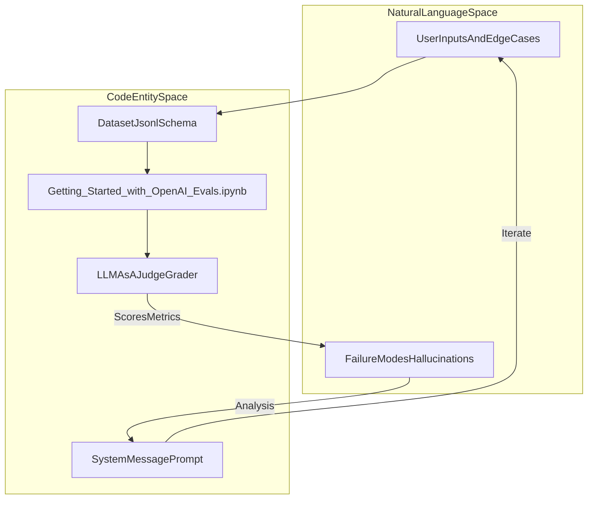
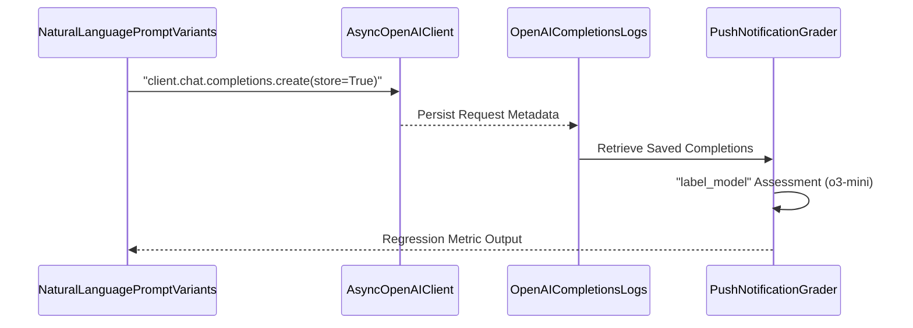

<!-- source: DeepWiki mcp.deepwiki.com · repo openai/openai-cookbook · page 11 Evaluation and Testing · fetched 2026-10-26 -->

# Evaluation and Testing

Relevant source files

The following files were used as context for generating this wiki page:

- [examples/evaluation/Getting_Started_with_OpenAI_Evals.ipynb](examples/evaluation/Getting_Started_with_OpenAI_Evals.ipynb)
- [examples/evaluation/use-cases/bulk-experimentation.ipynb](examples/evaluation/use-cases/bulk-experimentation.ipynb)
- [examples/evaluation/use-cases/completion-monitoring.ipynb](examples/evaluation/use-cases/completion-monitoring.ipynb)
- [examples/evaluation/use-cases/regression.ipynb](examples/evaluation/use-cases/regression.ipynb)

Evaluation and testing are critical for moving Large Language Model (LLM) applications from prototype to production. This page provides an overview of the frameworks and methodologies used to ensure model reliability, quality, and performance across codebases.

The core philosophy in this codebase is the **Evaluation Flywheel**, a continuous cycle of qualitative analysis and quantitative measurement designed to build resilient prompts [examples/evaluation/Getting_Started_with_OpenAI_Evals.ipynb:36-44]().

## The Evaluation Flywheel

The evaluation process follows a structured engineering discipline consisting of recurring phases:

1.  **Analyze**: Qualitative review of failures to identify failure modes such as coherence, conciseness, or readability issues [examples/evaluation/How_to_eval_abstractive_summarization.ipynb:21-23]().
2.  **Measure**: Quantifying failures by creating test datasets and automated "graders" (such as `label_model` or deterministic string checkers) to score performance at scale [examples/evaluation/Getting_Started_with_OpenAI_Evals.ipynb:126-132](), [examples/evaluation/use-cases/bulk-experimentation.ipynb:175-189]().
3.  **Improve**: Targeted refinements to prompts, model selection, or system components based on measured data.

### Evaluation Workflow Diagram

This diagram maps the conceptual flywheel bridging natural language requirements to the code and data entities used in the OpenAI evaluation frameworks.

Sources: [examples/evaluation/Getting_Started_with_OpenAI_Evals.ipynb:36-49](), [examples/evaluation/How_to_eval_abstractive_summarization.ipynb:21-23]()

## Evaluation Methodologies

The cookbook documents several testing patterns depending on the application type, ranging from deterministic assertions to complex model-graded evaluation workflows [examples/evaluation/Getting_Started_with_OpenAI_Evals.ipynb:48-83]().

| Methodology | Description | Key Tools/Files |
| :--- | :--- | :--- |
| **Deterministic Evals** | Logic-based checks (e.g., string matching, JSON parsing) for objective tasks. | `Basic Eval Templates` [examples/evaluation/Getting_Started_with_OpenAI_Evals.ipynb:80-81]() |
| **Model Grading** | Using a powerful model (e.g., `o3-mini` or `GPT-4`) to grade the outputs of another model [examples/evaluation/Getting_Started_with_OpenAI_Evals.ipynb:82-83](), [examples/evaluation/use-cases/bulk-experimentation.ipynb:165-178](). | `label_model` graders |
| **Completion Monitoring** | Logging production completions with `store=True` and evaluating prompt version regressions [examples/evaluation/use-cases/completion-monitoring.ipynb:11-16]() | `AsyncOpenAI` client logs |
| **Bulk Experimentation** | Testing multiple model and prompt variants against custom `pydantic` schemas [examples/evaluation/use-cases/bulk-experimentation.ipynb:11-15]() | `PushNotifications` schema |

### Monitoring and Regression Execution Flow

This diagram illustrates how natural language evaluations transition into production logging and automated execution using API code entities.

Sources: [examples/evaluation/use-cases/completion-monitoring.ipynb:140-152](), [examples/evaluation/use-cases/bulk-experimentation.ipynb:165-189]()

## Sub-Topics and Child Pages

### Evals API and LLM-as-a-Judge
The OpenAI Evals API provides a framework for validating and testing LLM outputs. It includes evaluation definitions, regression tests, bulk experimentation, completion monitoring, stored completions as data sources, and LLM-as-a-judge graders.
For details, see [Evals API and LLM-as-a-Judge](#11.1).

### Realtime and Voice Evaluation
Voice and audio-based applications require specialized evaluation harnesses to handle streaming inputs, multi-turn duplex interactions, and low-latency requirements. This includes grading transcript accuracy, grader stacks, and plotting utilities.
For details, see [Realtime and Voice Evaluation](#11.2).

### Eval-Driven System Design
Partner-contributed eval-driven system design patterns focus on structured data extraction, receipt inspection with structured outputs, rigorous dataset construction, and systematically iterating on system architecture based on eval results.
For details, see [Eval-Driven System Design](#11.3).

Sources:
- [examples/evaluation/Getting_Started_with_OpenAI_Evals.ipynb:12-83]()
- [examples/evaluation/How_to_eval_abstractive_summarization.ipynb:17-23]()
- [examples/evaluation/use-cases/completion-monitoring.ipynb:1-16]()
- [examples/evaluation/use-cases/bulk-experimentation.ipynb:1-115]()

---

