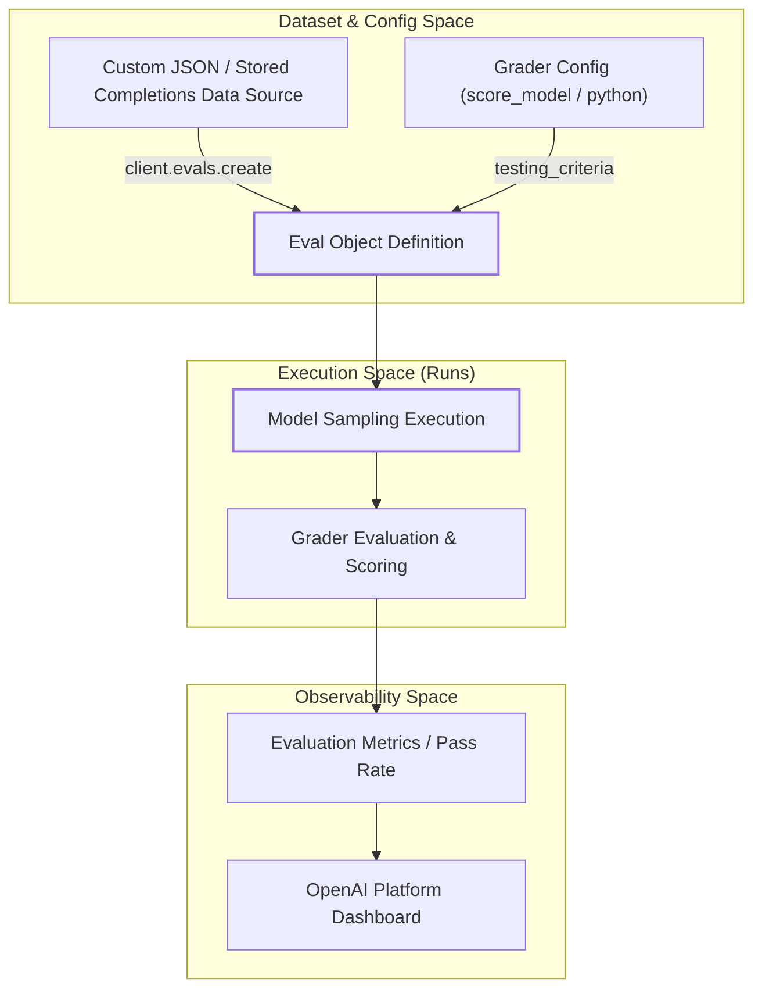
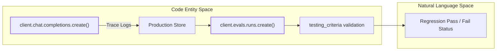

<!-- source: DeepWiki mcp.deepwiki.com · repo openai/openai-cookbook · page 11.1 Evals API and LLM-as-a-Judge · fetched 2026-10-26 -->

# Evals API and LLM-as-a-Judge

<details>
<summary>Relevant source files</summary>

The following files were used as context for generating this wiki page:

- [examples/evaluation/Building_resilient_prompts_using_an_evaluation_flywheel.md](examples/evaluation/Building_resilient_prompts_using_an_evaluation_flywheel.md)
- [examples/evaluation/Evaluate_RAG_with_LlamaIndex.ipynb](examples/evaluation/Evaluate_RAG_with_LlamaIndex.ipynb)
- [examples/evaluation/Getting_Started_with_OpenAI_Evals.ipynb](examples/evaluation/Getting_Started_with_OpenAI_Evals.ipynb)
- [examples/evaluation/use-cases/EvalsAPI_Audio_Inputs.ipynb](examples/evaluation/use-cases/EvalsAPI_Audio_Inputs.ipynb)
- [examples/evaluation/use-cases/EvalsAPI_Image_Inputs.ipynb](examples/evaluation/use-cases/EvalsAPI_Image_Inputs.ipynb)
- [examples/evaluation/use-cases/bulk-experimentation.ipynb](examples/evaluation/use-cases/bulk-experimentation.ipynb)
- [examples/evaluation/use-cases/completion-monitoring.ipynb](examples/evaluation/use-cases/completion-monitoring.ipynb)
- [examples/evaluation/use-cases/regression.ipynb](examples/evaluation/use-cases/regression.ipynb)
- [examples/evaluation/use-cases/structured-outputs-evaluation.ipynb](examples/evaluation/use-cases/structured-outputs-evaluation.ipynb)
- [examples/evaluation/use-cases/tools-evaluation.ipynb](examples/evaluation/use-cases/tools-evaluation.ipynb)
- [examples/evaluation/use-cases/web-search-evaluation.ipynb](examples/evaluation/use-cases/web-search-evaluation.ipynb)
- [images/axial-coding.png](images/axial-coding.png)
- [images/creating-availability-grader.png](images/creating-availability-grader.png)
- [images/creating-feedback-column.png](images/creating-feedback-column.png)
- [images/creating-formatting-grader.png](images/creating-formatting-grader.png)
- [images/dataset.png](images/dataset.png)
- [images/eval_qa_code.png](images/eval_qa_code.png)
- [images/eval_qa_data_1.png](images/eval_qa_data_1.png)
- [images/eval_qa_data_2.png](images/eval_qa_data_2.png)
- [images/eval_tools_fail.png](images/eval_tools_fail.png)
- [images/evals_sentiment.png](images/evals_sentiment.png)
- [images/evals_tool_dashboard.png](images/evals_tool_dashboard.png)
- [images/evals_websearch_dashboard.png](images/evals_websearch_dashboard.png)
- [images/evaluation-flywheel.png](images/evaluation-flywheel.png)
- [images/ground-truth-columns.png](images/ground-truth-columns.png)
- [images/llamaindex_rag_overview.png](images/llamaindex_rag_overview.png)
- [images/open-coding.png](images/open-coding.png)

</details>


## Purpose and Scope

This document provides a technical specification for the OpenAI Evals API and LLM-as-a-Judge evaluation patterns covered in the OpenAI Cookbook [examples/evaluation/Getting_Started_with_OpenAI_Evals.ipynb:24-25](). It details how to set up custom data sources, perform bulk experimentation, execute regression testing, monitor completions, configure LLM-as-a-judge graders, and execute specialized evaluations across multimodal inputs, tools, web search, structured outputs, abstractive summarization, and RAG pipelines with LlamaIndex [examples/evaluation/Getting_Started_with_OpenAI_Evals.ipynb:38-44](), [examples/evaluation/Evaluate_RAG_with_LlamaIndex.ipynb:18-23]().

---

## 1. Overview of the Evaluation Framework

The OpenAI Evals API provides a hosted framework for validating and testing LLM applications [examples/evaluation/Getting_Started_with_OpenAI_Evals.ipynb:24-25](). It separates evaluation definition from execution, allowing developers to systematically measure quality and catch regressions [examples/evaluation/Getting_Started_with_OpenAI_Evals.ipynb:38-44](), [examples/evaluation/use-cases/EvalsAPI_Image_Inputs.ipynb:133-134]().

### Core Components
*   **Data Source**: Structured input datasets containing items (text, base64/URL media, query/answer pairs) [examples/evaluation/use-cases/EvalsAPI_Image_Inputs.ipynb:70-71](), [examples/evaluation/use-cases/EvalsAPI_Audio_Inputs.ipynb:78-81]().
*   **Sampling**: Automated generation of model responses for each dataset item using specified model parameters [examples/evaluation/use-cases/EvalsAPI_Image_Inputs.ipynb:162-162]().
*   **Graders**: Testing criteria such as `score_model` (LLM-as-a-judge) or programmatic Python validation scripts [examples/evaluation/use-cases/EvalsAPI_Image_Inputs.ipynb:177-179](), [examples/evaluation/use-cases/tools-evaluation.ipynb:152-164]().

### Evaluation Run Lifecycle


Sources: [examples/evaluation/use-cases/EvalsAPI_Image_Inputs.ipynb:133-134](), [examples/evaluation/use-cases/tools-evaluation.ipynb:145-165]()

---

## 2. Eval Definitions, Bulk Experimentation, and Stored Completions

Creating evaluations programmatically via the SDK involves specifying `data_source_config` schemas and `testing_criteria` [examples/evaluation/use-cases/tools-evaluation.ipynb:145-164](). 

### Stored Completions as Data Sources
Rather than static JSON files, production pipelines can leverage stored chat completions as dynamic data sources. This allows historical production interactions to be ingested directly into evaluation runs for bulk experimentation.

### Bulk Experimentation Workflow
Bulk experiments run multiple parameter configurations or prompt iterations across large evaluation datasets simultaneously.

```python
# Programmatic eval creation with custom data source schema
logs_eval = client.evals.create(
    name="Code QA Eval",
    data_source_config={
        "type": "custom",
        "item_schema": {"type": "object", "properties": {"input": {"type": "string"}}},
        "include_sample_schema": True,
    },
    testing_criteria=[
        {
            "type": "score_model",
            "name": "General Evaluator",
            "model": "o3",
            "input": [
                {"role": "system", "content": structured_output_grader},
                {"role": "user", "content": structured_output_grader_user_prompt},
            ],
            "range": [1, 7],
            "pass_threshold": 5.0,
        }
    ],
)
```
Sources: [examples/evaluation/use-cases/tools-evaluation.ipynb:145-165]()

---

## 3. Regression Testing and Completion Monitoring

Continuous integration and delivery pipelines require automated regression testing before deploying model or prompt updates.

### Regression Testing Pattern
Regression tests compare baseline scores against candidate outputs across standardized datasets. If pass rates drop below a configured `pass_threshold` (e.g., `5.0` out of `7.0`), the CI/CD workflow fails.

### Completion Monitoring
Completion monitoring tracks production model drift and output quality over time by routing live traces into evaluation buckets.


Sources: [examples/evaluation/use-cases/tools-evaluation.ipynb:145-165]()

---

## 4. LLM-as-a-Judge Graders and the Evaluation Flywheel

When exact string matching is insufficient for open-ended generation, **LLM-as-a-Judge** utilizes a robust model (such as `o3` or `GPT-4o`) to evaluate response quality based on detailed rubrics [examples/evaluation/Getting_Started_with_OpenAI_Evals.ipynb:62-74](), [examples/evaluation/use-cases/tools-evaluation.ipynb:152-164]().

### Grader Types
*   `score_model`: Instructs a judge model to assign a score within a defined numeric range (e.g., `[1, 7]`) [examples/evaluation/use-cases/tools-evaluation.ipynb:152-164]().
*   `python`: Executes custom programmatic logic to inspect structured JSON outputs or tool calls [examples/evaluation/use-cases/mcp_eval_notebook.ipynb:175-180]().

### The Evaluation Flywheel
The evaluation flywheel is a continuous three-phase methodology for hardening application prompts [examples/evaluation/Building_resilient_prompts_using_an_evaluation_flywheel.md:11-12]().
1.  **Analyze**: Review failing traces using qualitative coding techniques (*Open Coding* and *Axial Coding*) to categorize error modes [examples/evaluation/Building_resilient_prompts_using_an_evaluation_flywheel.md:26-28](), [examples/evaluation/Building_resilient_prompts_using_an_evaluation_flywheel.md:61-98]().
2.  **Measure**: Quantify failures by establishing test datasets and automated `score_model` or `python` graders [examples/evaluation/Building_resilient_prompts_using_an_evaluation_flywheel.md:29-31]().
3.  **Improve**: Refine prompts, adjust parameters, or add few-shot examples, measuring impact instantly [examples/evaluation/Building_resilient_prompts_using_an_evaluation_flywheel.md:32-35]().

Sources: [examples/evaluation/Getting_Started_with_OpenAI_Evals.ipynb:62-82](), [examples/evaluation/Building_resilient_prompts_using_an_evaluation_flywheel.md:11-35](), [examples/evaluation/use-cases/tools-evaluation.ipynb:152-164]()

---

## 5. Abstractive Summarization and RAG Evaluation with LlamaIndex

Complex architectures like Retrieval-Augmented Generation (RAG) and abstractive summarization require specialized evaluation workflows to measure faithfulness, answer relevance, and context recall [examples/evaluation/Evaluate_RAG_with_LlamaIndex.ipynb:68-69]().

### RAG Evaluation Workflow
Using `llama_index.evaluation`, evaluation pipelines generate question-context test pairs from reference documents, execute retrieval, and grade retrieval accuracy via `RetrieverEvaluator` [examples/evaluation/Evaluate_RAG_with_LlamaIndex.ipynb:107-111]().

```python
# LlamaIndex evaluation setup
from llama_index.evaluation import generate_question_context_pairs, RetrieverEvaluator
from llama_index import VectorStoreIndex, SimpleDirectoryReader
```
Sources: [examples/evaluation/Evaluate_RAG_with_LlamaIndex.ipynb:107-111]()

---

## 6. Multimodal, Tools, Web Search, and Structured Output Evals

The Evals API supports comprehensive validation across diverse interaction modalities and tool integrations.

### Specialized Eval Capabilities
*   **Image Inputs**: Evaluates vision models against user prompts and reference answers by passing web URLs or base64 data streams via `media_url` item schemas [examples/evaluation/use-cases/EvalsAPI_Image_Inputs.ipynb:70-89]().
*   **Audio Inputs**: Evaluates audio conversations directly without intermediate transcription, using audio-capable models to score sampled audio outputs against reference files [examples/evaluation/use-cases/EvalsAPI_Audio_Inputs.ipynb:9-11]().
*   **Tool & MCP Evals**: Audits tool call invocations by inspecting `sample.output_tools` via Python or model graders [examples/evaluation/use-cases/mcp_eval_notebook.ipynb:175-183]().
*   **Web Search Evals**: Measures retrieval performance by passing user queries and evaluating search outputs against ground truth answers [examples/evaluation/use-cases/web-search-evaluation.ipynb:14-18]().
*   **Structured Outputs Evals**: Validates that models extract exact JSON schemas (e.g., symbol extraction from code files) scored by completeness and quality modifiers [examples/evaluation/use-cases/tools-evaluation.ipynb:10-12](), [examples/evaluation/use-cases/tools-evaluation.ipynb:108-115]().

Sources: [examples/evaluation/use-cases/EvalsAPI_Image_Inputs.ipynb:70-89](), [examples/evaluation/use-cases/EvalsAPI_Audio_Inputs.ipynb:9-11](), [examples/evaluation/use-cases/tools-evaluation.ipynb:10-12](), [examples/evaluation/use-cases/web-search-evaluation.ipynb:14-18]()

---

## 7. Migration to Promptfoo

As OpenAI transitions away from the hosted Evals API product, developers are advised to migrate evaluation suites to **Promptfoo** [examples/evaluation/moving-from-openai-evals-to-promptfoo.md:1-1]().
*   **Export Workflow**: Existing evaluations can be exported directly from the OpenAI Platform dashboard into portable Promptfoo YAML configuration files [examples/evaluation/moving-from-openai-evals-to-promptfoo.md:32-34]().
*   **CLI Execution**: Local and CI/CD validation is performed using the Promptfoo CLI (`promptfoo eval`) [examples/evaluation/moving-from-openai-evals-to-promptfoo.md:9-9]().

Sources: [examples/evaluation/moving-from-openai-evals-to-promptfoo.md:1-34]()

---

