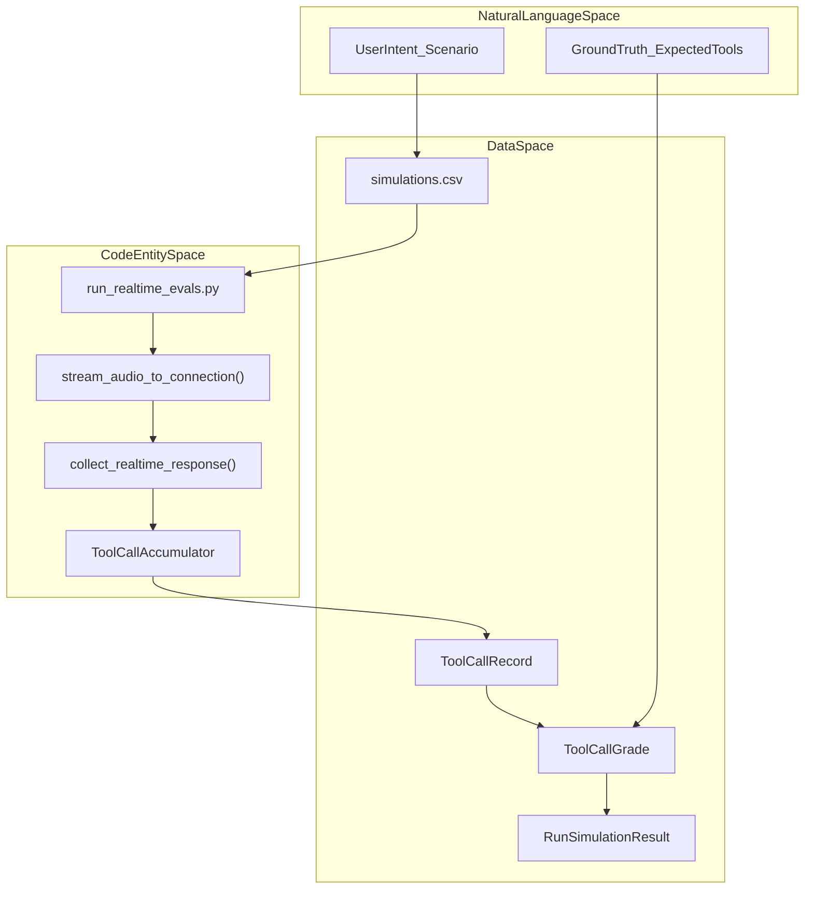
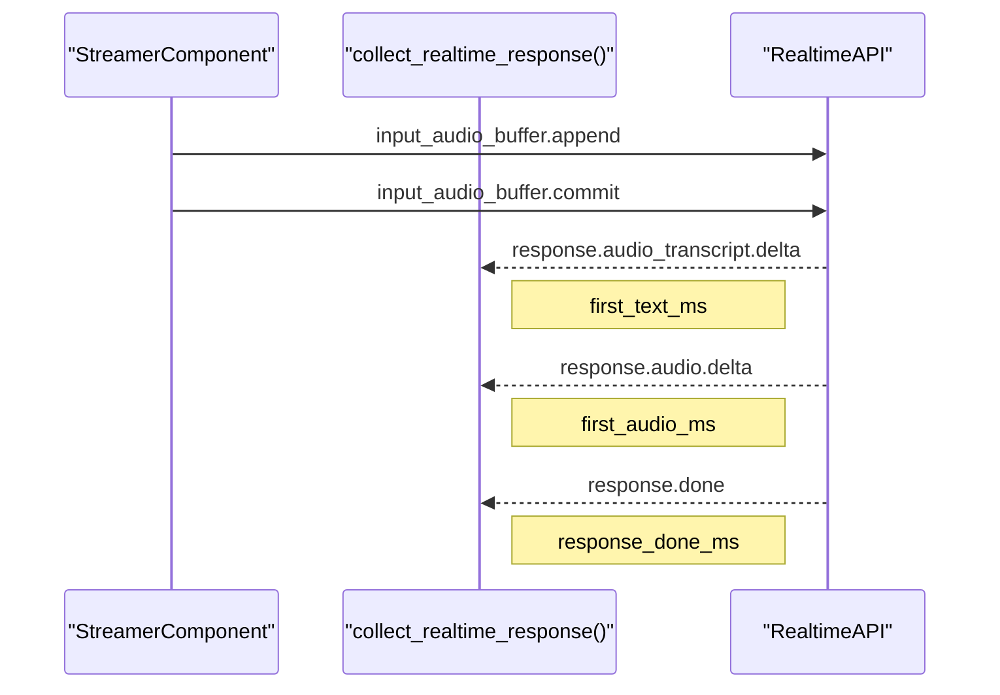

<!-- source: DeepWiki mcp.deepwiki.com · repo openai/openai-cookbook · page 11.2 Realtime and Voice Evaluation · fetched 2026-10-26 -->

# Realtime and Voice Evaluation

Relevant source files

The following files were used as context for generating this wiki page:

- [.codex/skills/docs-editor/SKILL.md](.codex/skills/docs-editor/SKILL.md)
- [.codex/skills/docs-editor/resources/style-guide.md](.codex/skills/docs-editor/resources/style-guide.md)
- [AGENTS.md](AGENTS.md)
- [articles/codex_exec_plans.md](articles/codex_exec_plans.md)
- [examples/Realtime_eval_guide.ipynb](examples/Realtime_eval_guide.ipynb)
- [examples/codex/build_code_review_with_codex_sdk.md](examples/codex/build_code_review_with_codex_sdk.md)
- [examples/evals/realtime_evals/shared/plotting_utils.py](examples/evals/realtime_evals/shared/plotting_utils.py)
- [examples/evals/realtime_evals/shared/result_types.py](examples/evals/realtime_evals/shared/result_types.py)
- [examples/evals/realtime_evals/skills/bootstrap-realtime-eval/SKILL.md](examples/evals/realtime_evals/skills/bootstrap-realtime-eval/SKILL.md)
- [examples/evals/realtime_evals/skills/bootstrap-realtime-eval/agents/openai.yaml](examples/evals/realtime_evals/skills/bootstrap-realtime-eval/agents/openai.yaml)
- [examples/evals/realtime_evals/skills/bootstrap-realtime-eval/references/harness-selection.md](examples/evals/realtime_evals/skills/bootstrap-realtime-eval/references/harness-selection.md)
- [examples/evals/realtime_evals/skills/bootstrap-realtime-eval/scripts/bootstrap_realtime_eval.py](examples/evals/realtime_evals/skills/bootstrap-realtime-eval/scripts/bootstrap_realtime_eval.py)
- [images/codex_code_review.png](images/codex_code_review.png)
- [images/realtime_eval_page_01_image_01.png](images/realtime_eval_page_01_image_01.png)
- [images/realtime_eval_page_02_image_01.png](images/realtime_eval_page_02_image_01.png)
- [images/realtime_eval_page_03_image_01.png](images/realtime_eval_page_03_image_01.png)
- [images/realtime_eval_page_04_image_01.png](images/realtime_eval_page_04_image_01.png)
- [images/realtime_eval_page_04_image_02.png](images/realtime_eval_page_04_image_02.png)
- [images/realtime_eval_page_05_image_01.png](images/realtime_eval_page_05_image_01.png)
- [images/realtime_eval_page_05_image_02.png](images/realtime_eval_page_05_image_02.png)
- [images/realtime_eval_page_07_image_01.png](images/realtime_eval_page_07_image_01.png)
- [images/realtime_eval_page_07_image_02.png](images/realtime_eval_page_07_image_02.png)
- [images/realtime_eval_page_08_image_01.png](images/realtime_eval_page_08_image_01.png)

## Overview and Purpose

Evals turn voice-based Realtime API applications from exploratory demos into reliable production systems [examples/Realtime_eval_guide.ipynb:32-34](). Evaluating voice applications is uniquely challenging because it requires assessing a continuous streaming interaction across two independent axes: **Content Quality** (correctness, tool choice, instructions) and **Audio Quality** (prosody, pronunciation, stability, and artifact resilience) [examples/Realtime_eval_guide.ipynb:53-65](). 

This section documents the Crawl/Walk/Run evaluation harness, multi-layered grader stacks, automated scaffolding via the `bootstrap-realtime-eval` skill, result types, plotting utilities, and production evaluation flywheel.

Sources: [examples/Realtime_eval_guide.ipynb:30-36](), [examples/evals/realtime_evals/skills/bootstrap-realtime-eval/SKILL.md:3-3]()

## Crawl / Walk / Run Evaluation Harness

To manage the complexity of streaming voice pipelines, the evaluation harness follows a three-stage maturity model:
1. **Crawl**: Single-turn text-to-TTS execution where text rows are synthesized into audio, sent to the Realtime API, and graded on tool selection and text responses [examples/Realtime_eval_guide.ipynb:45-45](), [examples/evals/realtime_evals/skills/bootstrap-realtime-eval/SKILL.md:46-46]().
2. **Walk**: Saved audio replay that introduces acoustic realism by feeding recorded speech, telephony artifacts, or noisy environments into the pipeline [examples/Realtime_eval_guide.ipynb:46-46]().
3. **Run**: Model-simulated multi-turn dialogues where a simulator model acts as the user while the assistant system under test responds, enabling multi-step state and tool orchestration [examples/Realtime_eval_guide.ipynb:47-47](), [examples/evals/realtime_evals/run_harness/run_realtime_evals.py:3-6]().

### Harness Implementation and Data Flow

**Harness Implementation Map**

Sources: [examples/Realtime_eval_guide.ipynb:45-47](), [examples/evals/realtime_evals/run_harness/run_realtime_evals.py:3-6](), [examples/evals/realtime_evals/shared/result_types.py:58-63]()

## Grader Stacks

The evaluation framework utilizes a multi-layered grader stack to isolate failures across deterministic code, semantic LLM evaluation, and acoustic auditing [examples/Realtime_eval_guide.ipynb:34-34]().

| Grader Type | Implementation | Target Metrics |
| :--- | :--- | :--- |
| **Deterministic** | `compute_tool_call_grade` | `tool_call_correctness`, `tool_call_arg_correctness` [examples/evals/realtime_evals/shared/result_types.py:131-136]() |
| **LLM-as-a-Judge** | `judge-model` (e.g., GPT-5.1) | Helpfulness, tone, instruction following, and multi-turn coherence [examples/evals/realtime_evals/run_harness/run_realtime_evals.py:62-62]() |
| **Audio Audit** | Human spot-check (1-5% of sessions) | Naturalness, stability, and barge-in behavior [examples/Realtime_eval_guide.ipynb:132-132]() |

Sources: [examples/Realtime_eval_guide.ipynb:124-132](), [examples/evals/realtime_evals/shared/result_types.py:131-152]()

## Bootstrap Realtime Eval Skill and Scaffolding

New evaluations are initialized using the `bootstrap_realtime_eval.py` CLI script and its associated skill workflow [examples/evals/realtime_evals/skills/bootstrap-realtime-eval/SKILL.md:3-3](), [examples/evals/realtime_evals/skills/bootstrap-realtime-eval/scripts/bootstrap_realtime_eval.py:1-1]().

### Key Functions and Parameters
- `parse_args()`: Configures command-line arguments including `--name`, `--harness`, `--system-prompt-file`, `--tools-file`, and `--data-path` [examples/evals/realtime_evals/skills/bootstrap-realtime-eval/scripts/bootstrap_realtime_eval.py:26-122]().
- `slugify()`: Normalizes eval names into valid snake_case identifiers for directory creation [examples/evals/realtime_evals/skills/bootstrap-realtime-eval/scripts/bootstrap_realtime_eval.py:125-128]().
- `normalize_crawl_dataset()`: Validates and formats CSV schemas to guarantee mandatory columns like `example_id`, `user_text`, `gt_tool_call`, and `gt_tool_call_arg` [examples/evals/realtime_evals/skills/bootstrap-realtime-eval/scripts/bootstrap_realtime_eval.py:198-219]().

Sources: [examples/evals/realtime_evals/skills/bootstrap-realtime-eval/SKILL.md:16-34](), [examples/evals/realtime_evals/skills/bootstrap-realtime-eval/scripts/bootstrap_realtime_eval.py:26-122]()

## Result Types and Data Structures

Structured dataclasses in `result_types.py` define the schema for crawl, walk, and run evaluation outputs, ensuring robust parsing and aggregation across test runs [examples/evals/realtime_evals/shared/result_types.py:1-8]().

### Key Dataclasses
- `ToolCallRecord`: Represents predicted tool invocations with name, arguments, raw argument strings, and call identifiers [examples/evals/realtime_evals/shared/result_types.py:58-75]().
- `ToolCallGrade`: Computes binary correctness metrics for tool names and arguments [examples/evals/realtime_evals/shared/result_types.py:131-152]().
- `CrawlEvalResult`: Encapsulates single-turn results including user text, expected tool calls, assistant text, latencies, token usage, and error states [examples/evals/realtime_evals/shared/result_types.py:183-194]().

Sources: [examples/evals/realtime_evals/shared/result_types.py:58-194]()

## Production Flywheel and Latency Metrics

The production flywheel captures real-world production failures, logs end-to-end event streams, and transforms them into regression test cases within the walk and crawl suites [examples/Realtime_eval_guide.ipynb:34-34](). 

Latency tracking monitors granular milestones during streaming sessions to isolate client-server networking delays from model reasoning time [examples/Realtime_eval_guide.ipynb:103-104]().

### Latency Measurement Flow

**Latency Tracking Flow**

Sources: [examples/Realtime_eval_guide.ipynb:103-104](), [examples/evals/realtime_evals/shared/result_types.py:161-165]()

---

