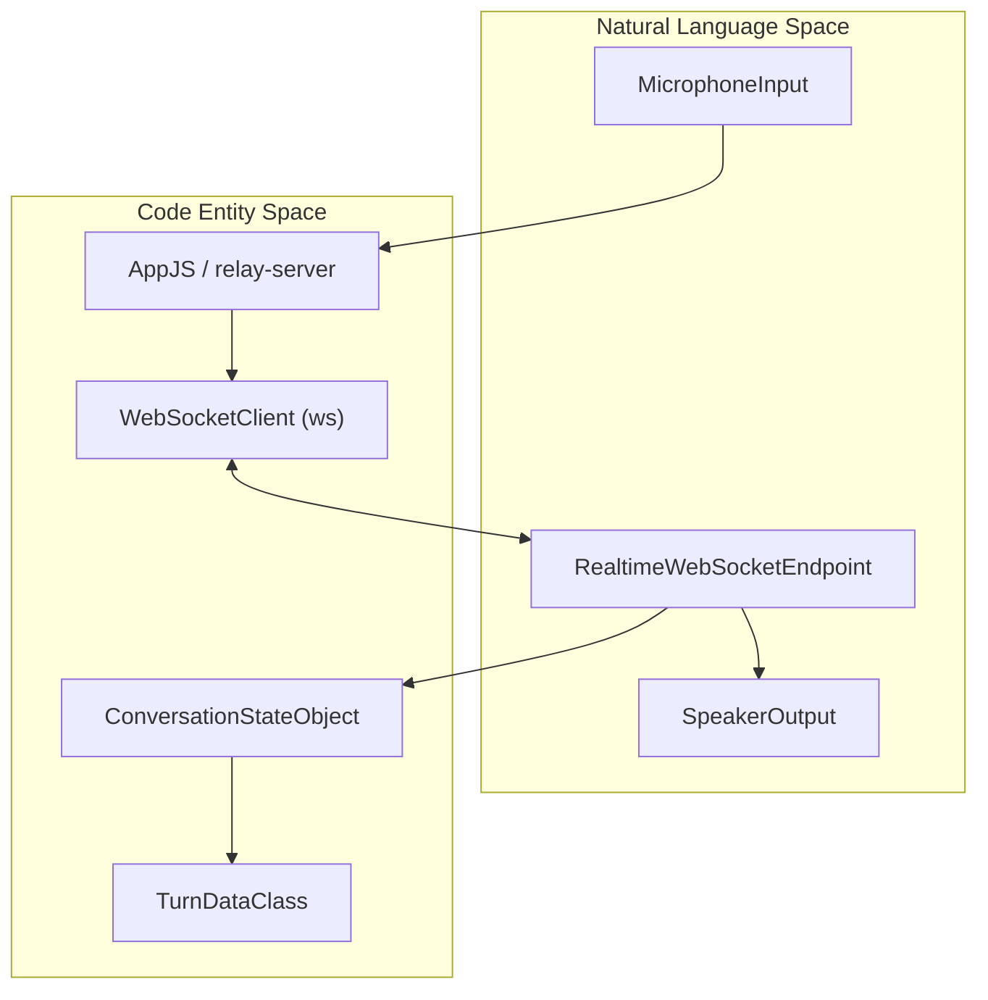
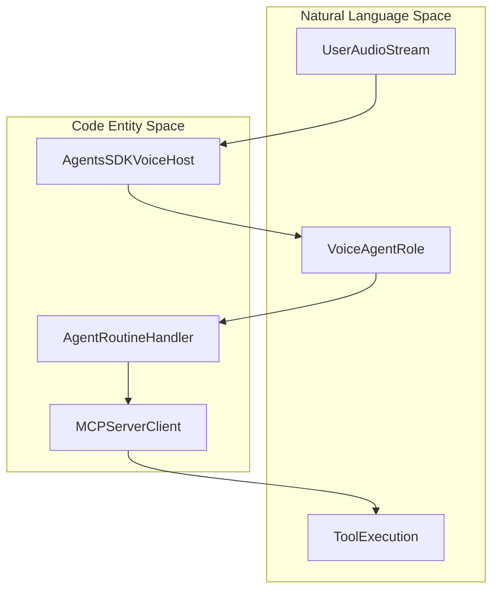

<!-- source: DeepWiki mcp.deepwiki.com · repo openai/openai-cookbook · page 12 Voice and Real-time Applications · fetched 2026-10-26 -->

# Voice and Real-time Applications

Relevant source files

The following files were used as context for generating this wiki page:

- [examples/Realtime_out_of_band_transcription.ipynb](examples/Realtime_out_of_band_transcription.ipynb)
- [examples/Realtime_prompting_guide.ipynb](examples/Realtime_prompting_guide.ipynb)
- [examples/data/audio/multi-emotion.mp3](examples/data/audio/multi-emotion.mp3)
- [examples/data/audio/obj_06.mp3](examples/data/audio/obj_06.mp3)
- [examples/data/audio/obj_07.mp3](examples/data/audio/obj_07.mp3)
- [examples/data/audio/obj_2_06.mp3](examples/data/audio/obj_2_06.mp3)
- [examples/data/audio/obj_2_07.mp3](examples/data/audio/obj_2_07.mp3)
- [examples/data/audio/pace_06.mp3](examples/data/audio/pace_06.mp3)
- [examples/data/audio/pace_07.mp3](examples/data/audio/pace_07.mp3)
- [examples/data/audio/pronounciation_06.mp3](examples/data/audio/pronounciation_06.mp3)
- [examples/data/audio/pronounciation_07.mp3](examples/data/audio/pronounciation_07.mp3)
- [examples/data/audio/sql_after.mp3](examples/data/audio/sql_after.mp3)
- [images/oob_transcription.png](images/oob_transcription.png)

This page provides a high-level overview of the OpenAI Cookbook's examples and patterns for building low-latency, multimodal voice applications. It covers the core capabilities of the Realtime API, speech processing workflows, and integration with the Agents SDK for voice-driven agentic behaviors.

## Overview of Voice Solutions

OpenAI provides several paths for integrating voice and audio into applications, ranging from simple file-based transcription to high-performance, bidirectional speech-to-speech sessions using `gpt-realtime` models.

### Comparison of Audio Processing Methods

| Method | Latency | Best For | Model |
| :--- | :--- | :--- | :--- |
| **Batch Transcription** | Seconds | Recordings, long-form content | `whisper-1` |
| **Realtime WebSocket** | Subseconds | Interactive assistants, live captions | `gpt-4o-realtime-preview` |
| **Out-of-Band Transcription**| Subseconds | High-accuracy session-aware text | `gpt-4o-realtime-preview` |

Sources: [examples/Realtime_prompting_guide.ipynb:16-23](), [examples/Realtime_out_of_band_transcription.ipynb:7-12]()

## Realtime API Architecture

The Realtime API enables low-latency multimodal interaction by maintaining a stateful WebSocket connection. It handles Voice Activity Detection (VAD), transcription, and Text-to-Speech (TTS) on the server side.

### Realtime Session Component Map

**Realtime API Interaction Model**

Sources: [examples/Realtime_prompting_guide.ipynb:16-23](), [examples/Realtime_out_of_band_transcription.ipynb:7-12]()

## Core Patterns

### Realtime Prompting
Building for voice requires a shift in prompting strategy. The `gpt-realtime` model benefits from clear, labeled sections in the system prompt. Key techniques include:
- **Structure**: Using headers like `# Role & Objective`, `# Personality & Tone`, and `# Conversation Flow`.
- **Emphasis**: Capitalizing key rules to make them stand out.
- **Clarity**: Preferring bullet points over long paragraphs.

For details, see [Realtime API Patterns](#12.1).
Sources: [examples/Realtime_prompting_guide.ipynb:42-53](), [examples/Realtime_prompting_guide.ipynb:77-87]()

### Out-of-Band Transcription
Standard transcription relies on a separate ASR model. To improve accuracy and context awareness, developers can use the Realtime model itself to transcribe audio "out-of-band." This is a second `response.create` request on the same WebSocket, tagged with `conversation: "none"` so it doesn't write back to the active conversation state.

For details, see [Realtime API Patterns](#12.1).
Sources: [examples/Realtime_out_of_band_transcription.ipynb:19-30](), [examples/Realtime_out_of_band_transcription.ipynb:32-37]()

### Context Management & Summarization
Audio tokens consume the context window significantly faster than text. The cookbook demonstrates a `ConversationState` pattern that tracks `history` and performs an automatic "context trim" by summarizing older turns into a single assistant message when the token window is exceeded.

For details, see [Realtime API Patterns](#12.1).
Sources: [examples/Realtime_prompting_guide.ipynb:16-23](), [examples/Realtime_out_of_band_transcription.ipynb:7-12]()

## Voice Agents with Agents SDK

The `Agents SDK` allows for building voice agents that integrate with complex workflows, such as MCP-powered tools or real-time translation. This simplifies the orchestration of multi-agent handoffs in a voice-first environment.

### Voice Agent Logic Flow

**Voice Agent Workflow Mapping**

For details, see [Voice Agents with Agents SDK](#12.2).
Sources: [examples/Realtime_prompting_guide.ipynb:16-23](), [examples/Realtime_out_of_band_transcription.ipynb:7-12]()

## Child Pages

- [Realtime API Patterns](#12.1): Detailed documentation on the Realtime API, including prompting guides, out-of-band transcription, and strategies for data-intensive real-time apps.
- [Voice Agents with Agents SDK](#12.2): Implementation details for building voice agents with the Agents SDK, covering MCP integration, audio optimization, and real-time translation.

---

