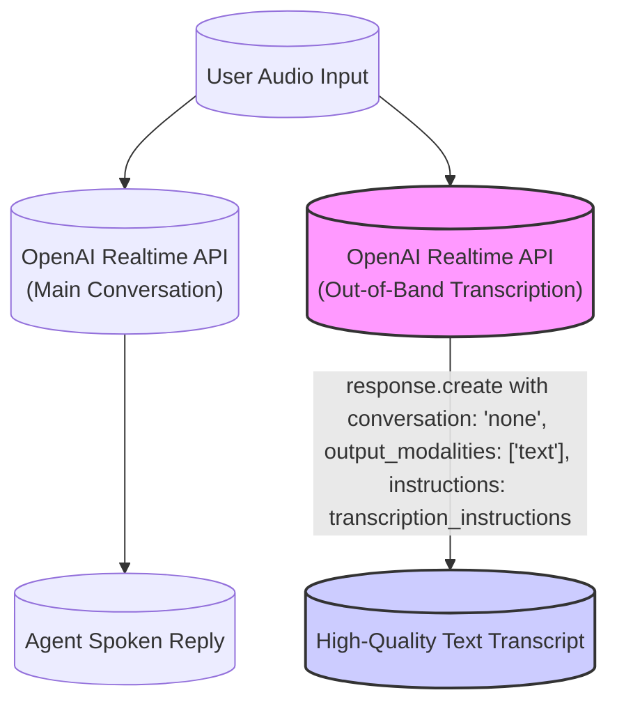
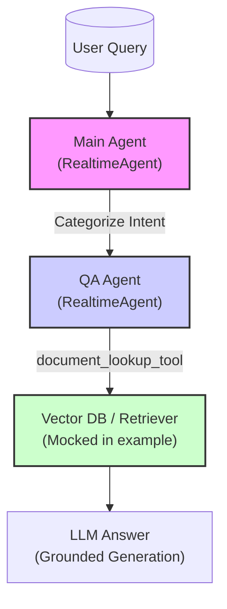
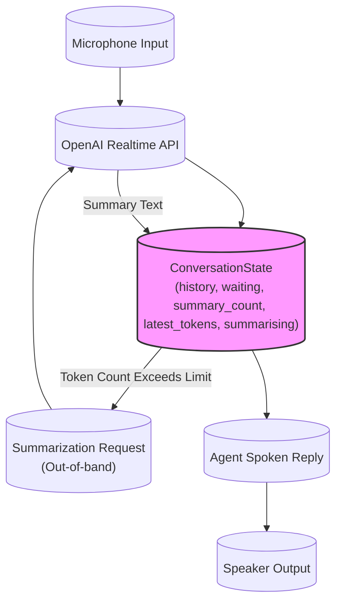
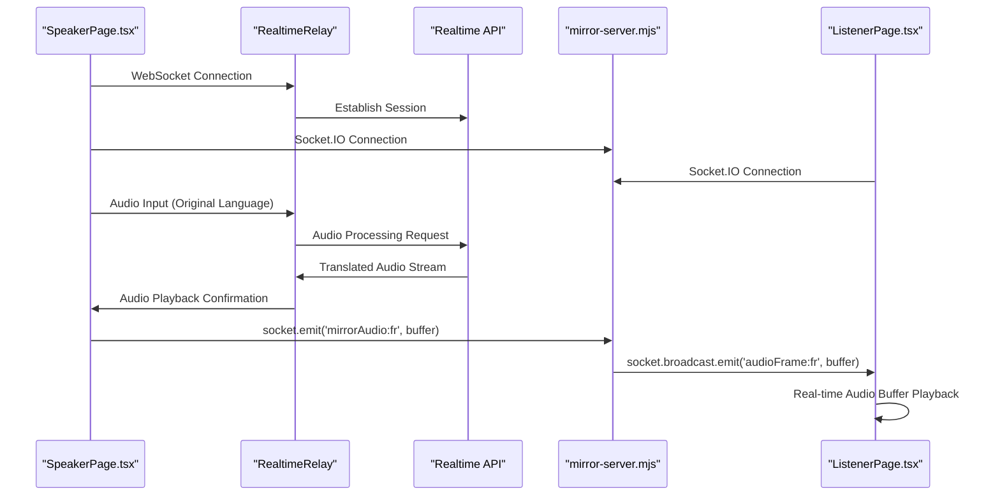

<!-- source: DeepWiki mcp.deepwiki.com · repo openai/openai-cookbook · page 12.1 Realtime API Patterns · fetched 2026-10-26 -->

# Realtime API Patterns

<details>
<summary>Relevant source files</summary>

The following files were used as context for generating this wiki page:

- [examples/Context_summarization_with_realtime_api.ipynb](examples/Context_summarization_with_realtime_api.ipynb)
- [examples/Prompt_migration_guide.ipynb](examples/Prompt_migration_guide.ipynb)
- [examples/Realtime_out_of_band_transcription.ipynb](examples/Realtime_out_of_band_transcription.ipynb)
- [examples/Realtime_prompting_guide.ipynb](examples/Realtime_prompting_guide.ipynb)
- [examples/building_w_rt_mini/building_w_rt_mini.ipynb](examples/building_w_rt_mini/building_w_rt_mini.ipynb)
- [examples/data/audio/multi-emotion.mp3](examples/data/audio/multi-emotion.mp3)
- [examples/data/audio/obj_06.mp3](examples/data/audio/obj_06.mp3)
- [examples/data/audio/obj_07.mp3](examples/data/audio/obj_07.mp3)
- [examples/data/audio/obj_2_06.mp3](examples/data/audio/obj_2_06.mp3)
- [examples/data/audio/obj_2_07.mp3](examples/data/audio/obj_2_07.mp3)
- [examples/data/audio/pace_06.mp3](examples/data/audio/pace_06.mp3)
- [examples/data/audio/pace_07.mp3](examples/data/audio/pace_07.mp3)
- [examples/data/audio/pronounciation_06.mp3](examples/data/audio/pronounciation_06.mp3)
- [examples/data/audio/pronounciation_07.mp3](examples/data/audio/pronounciation_07.mp3)
- [examples/data/audio/sql_after.mp3](examples/data/audio/sql_after.mp3)
- [examples/voice_solutions/one_way_translation_using_realtime_api/.env.example](examples/voice_solutions/one_way_translation_using_realtime_api/.env.example)
- [examples/voice_solutions/one_way_translation_using_realtime_api/.gitignore](examples/voice_solutions/one_way_translation_using_realtime_api/.gitignore)
- [examples/voice_solutions/one_way_translation_using_realtime_api/README.md](examples/voice_solutions/one_way_translation_using_realtime_api/README.md)
- [examples/voice_solutions/one_way_translation_using_realtime_api/mirror-server/mirror-server.mjs](examples/voice_solutions/one_way_translation_using_realtime_api/mirror-server/mirror-server.mjs)
- [examples/voice_solutions/one_way_translation_using_realtime_api/package-lock.json](examples/voice_solutions/one_way_translation_using_realtime_api/package-lock.json)
- [examples/voice_solutions/one_way_translation_using_realtime_api/package.json](examples/voice_solutions/one_way_translation_using_realtime_api/package.json)
- [examples/voice_solutions/one_way_translation_using_realtime_api/public/index.html](examples/voice_solutions/one_way_translation_using_realtime_api/public/index.html)
- [examples/voice_solutions/one_way_translation_using_realtime_api/relay-server/index.js](examples/voice_solutions/one_way_translation_using_realtime_api/relay-server/index.js)
- [examples/voice_solutions/one_way_translation_using_realtime_api/src/App.scss](examples/voice_solutions/one_way_translation_using_realtime_api/src/App.scss)
- [images/agents_sdk_transcription.png](images/agents_sdk_transcription.png)
- [images/byo_realtime_diagram.png](images/byo_realtime_diagram.png)
- [images/byo_realtime_starting.png](images/byo_realtime_starting.png)
- [images/oob_transcription.png](images/oob_transcription.png)
- [images/prompt_migrator_fig.png](images/prompt_migrator_fig.png)
- [images/realtime_api_transcription.png](images/realtime_api_transcription.png)
- [images/speech-to-text-not-streaming.png](images/speech-to-text-not-streaming.png)
- [images/speech-to-text-streaming.png](images/speech-to-text-streaming.png)
- [images/text-vs-audio-tokens.png](images/text-vs-audio-tokens.png)

</details>


This document covers the technical patterns, architectures, and implementation strategies for building low-latency, bidirectional voice applications using OpenAI's Realtime API. It details prompting guides, out-of-band transcription, context summarization, building with `gpt-realtime-mini`, multi-language translation relay architectures, and data-intensive conversation strategies.

Sources: [examples/Realtime_prompting_guide.ipynb:16-23](), [examples/Context_summarization_with_realtime_api.ipynb:8-10]()

---

## 1. Realtime API Overview

The Realtime API provides WebSocket-based connectivity for real-time audio and text streaming with GPT speech-to-speech models (`gpt-realtime` and `gpt-realtime-mini`). Key architectural capabilities include:
- **Low-Latency Audio Streaming**: Bi-directional audio data streaming over persistent WebSocket connections.
- **Voice Activity Detection (VAD)**: Server-side or client-side VAD for automatic speech start/stop detection and turn handling.
- **Stateful Sessions**: Persistent conversation state container managing turn history and global configuration (`Session` and `Conversation`).
- **Tool Integration**: Native support for function calling and tool execution within streaming audio turns.

Sources: [examples/Realtime_prompting_guide.ipynb:16-23](), [examples/Context_summarization_with_realtime_api.ipynb:121-130]()

---

## 2. Realtime Prompting Guide

Prompting speech-to-speech models requires distinct patterns compared to text-only interfaces due to voice cadence, instruction adherence over audio turns, and conversational dynamics.

### Prompt Skeleton Structure
Structured system prompts improve model adherence across streaming turns. A recommended prompt skeleton comprises:
- `# Role & Objective`: Defines persona and success criteria.
- `# Personality & Tone`: Sets conversational style and acoustic temperament.
- `# Context`: Retrieved background or session context.
- `# Reference Pronunciations`: Phonetic guides for domain-specific jargon.
- `# Tools`: Tool names, usage rules, and preambles.
- `# Instructions / Rules`: Explicit do's and don'ts.
- `# Conversation Flow`: States, goals, and transitions.
- `# Safety & Escalation`: Fallback and handoff logic.

### Optimization Rules
- **Prefer bullets over paragraphs**: Concise bullet points outperform long prose blocks.
- **Precise wording**: Ambiguity degrades performance; swap vague terms (e.g., changing `"inaudible"` to `"unintelligible"` for noisy input handling).
- **Capitalization for emphasis**: Use uppercase text for critical constraints.
- **Deterministic control**: Convert logical rules into plain text instructions rather than conditional code syntax (e.g., write `"IF MORE THAN THREE FAILURES THEN ESCALATE"`).

Sources: [examples/Realtime_prompting_guide.ipynb:42-87]()

---

## 3. Out-of-Band Transcription

Relying on separate Automatic Speech Recognition (ASR) models like `whisper-1` or `gpt-4o-transcribe` can cause discrepancies between how user audio is transcribed versus how the Realtime model interprets it. **Out-of-band transcription** uses the Realtime model itself to generate text transcripts on the same WebSocket connection without polluting the active conversation state.

### Implementation Pattern
Triggered via a secondary `response.create` client event with `"conversation": "none"` and `"output_modalities": ["text"]`:

```python
{
    "type": "response.create",
    "response": {
        "conversation": "none",
        "output_modalities": ["text"],
        "instructions": transcription_instructions
    }
}
```[examples/Realtime_out_of_band_transcription.ipynb:21-29]()

### Trade-offs and Cost Analysis
- **Consistency**: Minimizes semantic mismatch since the same model processes audio and text output.
- **Steerability**: Enables custom transcription instructions (e.g., handling medical or legal terminology).
- **Cost Impact**: Passing session context increases token consumption. Transcribing with the Realtime model costs approximately $48.00 per 1M audio input / 1M text output tokens compared to ~$16.00 for dedicated ASR models.

Title: Out-of-Band Transcription Data Flow


Sources: [examples/Realtime_out_of_band_transcription.ipynb:7-36](), [examples/Realtime_out_of_band_transcription.ipynb:56-86]()

---

## 4. Building with Realtime Mini

The `gpt-realtime-mini` model reduces costs by ~70% while improving tool-calling reliability and lowering latency. Building robust voice applications with Realtime Mini often employs a **handoff architecture** via the Agents SDK.

### Handoff Architecture Pattern
- **Main Agent**: Acts as an entry-point intent classifier. It analyzes user queries and routes them to specialist agents.
- **QA / Specialist Agents**: Handle specialized workflows (e.g., document lookup, authentication, flight status checks).

Title: Realtime Mini Handoff Architecture


Sources: [examples/building_w_rt_mini/building_w_rt_mini.ipynb:10-32](), [examples/building_w_rt_mini/building_w_rt_mini.ipynb:61-97]()

---

## 5. Context Summarization with Realtime API

Audio input tokens scale ~10x faster than plain text because acoustic details (timing, amplitude, cadence) must be represented. As sessions grow, token windows approach the 32k limit, risking instruction drift.

### Conversation State and Truncation
Managing long sessions requires encapsulating mutable state and automatically compressing older conversation turns:

- `Turn`: Represents an individual user or assistant utterance item (`role`, `item_id`, `text`) [examples/Context_summarization_with_realtime_api.ipynb:139-144]().
- `ConversationState`: Tracks `history` list, pending transcript `waiting` futures, `summary_count`, `latest_tokens`, and a `summarising` guard flag [examples/Context_summarization_with_realtime_api.ipynb:146-154]().
- **Automatic Truncation**: Utilizing the `truncation` session parameter optimizes context compaction by summarizing older turns into a single assistant summary while preserving recent verbatim turns [examples/Context_summarization_with_realtime_api.ipynb:39]().

Title: Context Summarization Flow


Sources: [examples/Context_summarization_with_realtime_api.ipynb:14-39](), [examples/Context_summarization_with_realtime_api.ipynb:95-104](), [examples/Context_summarization_with_realtime_api.ipynb:138-154]()

---

## 6. One-Way Translation App Architecture

The one-way translation reference application (`examples/voice_solutions/one_way_translation_using_realtime_api`) demonstrates real-time speech translation and multi-client broadcasting.

### Component Architecture

| Component | Code Entity / File Path | Role |
|-----------|-------------------------|------|
| Relay Server | `relay-server/index.js:1-18` | Imports `RealtimeRelay` from `./lib/relay.js`, validates `OPENAI_API_KEY`, and binds to `process.env.PORT` (default 8081) |
| Mirror Server | `mirror-server/mirror-server.mjs:2-42` | Express & Socket.IO server (`cors: { origin: '*' }`) broadcasting audio frames across languages (`audioFrame:fr`, `audioFrame:es`, etc.) |
| Frontend App | `package.json:6-43` | React TypeScript UI using `@openai/realtime-api-beta` and `socket.io-client` |

Sources: [examples/voice_solutions/one_way_translation_using_realtime_api/relay-server/index.js:1-18](), [examples/voice_solutions/one_way_translation_using_realtime_api/mirror-server/mirror-server.mjs:2-42](), [examples/voice_solutions/one_way_translation_using_realtime_api/package.json:6-43]()

Title: Translation Relay and Mirror Server Workflow


Sources: [examples/voice_solutions/one_way_translation_using_realtime_api/mirror-server/mirror-server.mjs:15-42]()

---

## 7. Data-Intensive Real-time Strategies

Production voice applications processing heavy data streams require systematic context and memory management:
- **State Persistence**: Utilize `RunContextWrapper` to persist user profiles, preferences, and session notes across conversational turns [examples/agents_sdk/context_personalization.ipynb:18-22]().
- **Memory Consolidation**: Periodically merge session-scoped memory into long-term global memory stores upon session completion [examples/agents_sdk/context_personalization.ipynb:24]().
- **Precedence Rules**: Enforce clear state override hierarchies: `latest user input` > `session overrides` > `global defaults` [examples/agents_sdk/context_personalization.ipynb:62]().
- **Short-Term Continuity**: Leverage SDK `Session` objects to maintain conversation history without manual token ledger management [examples/agents_sdk/session_memory.ipynb:49-50]().

Sources: [examples/agents_sdk/context_personalization.ipynb:18-62](), [examples/agents_sdk/session_memory.ipynb:49-50]()

---

